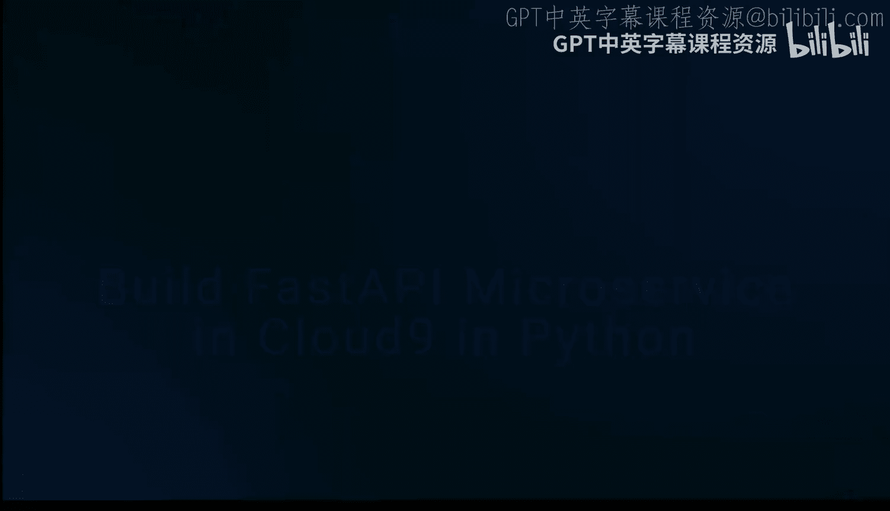
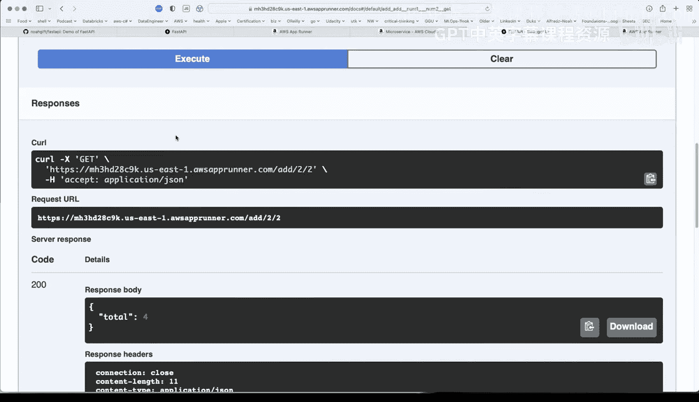
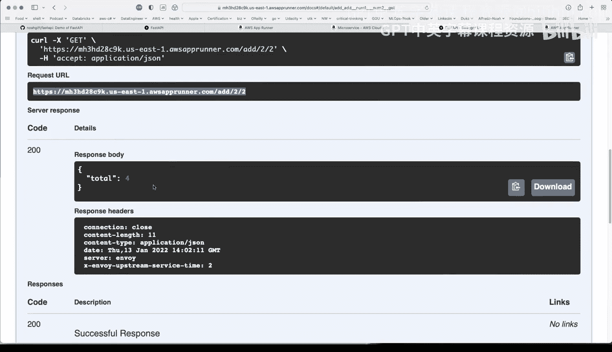
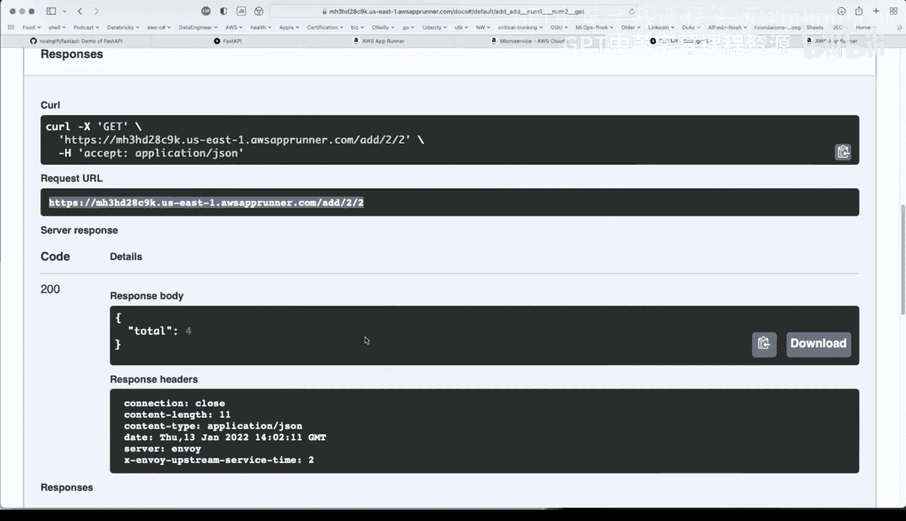
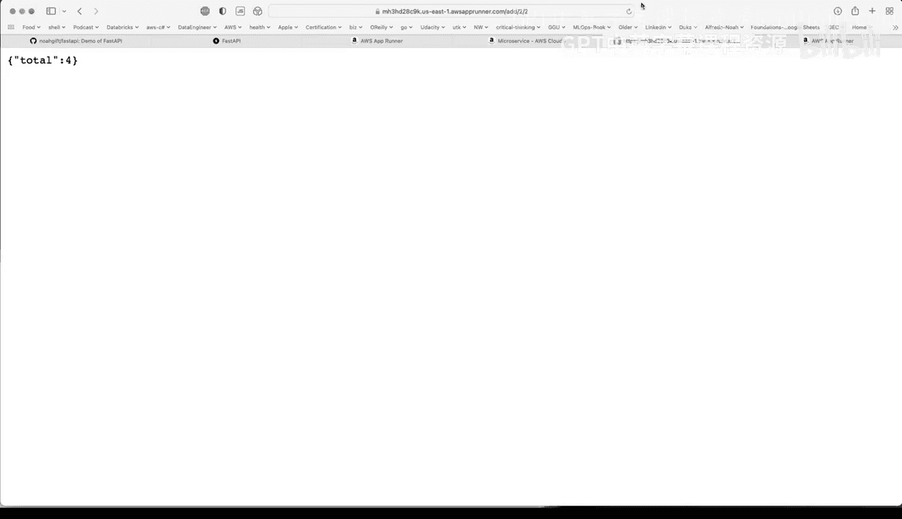
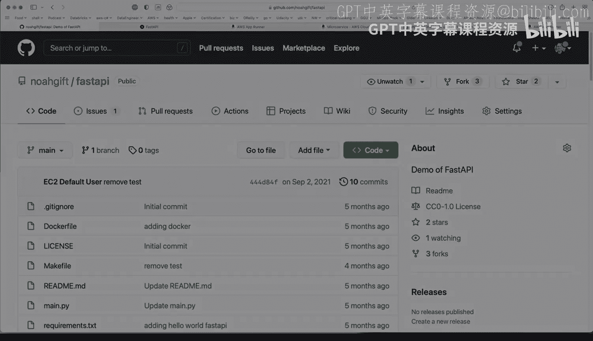

# 应用Python数据工程：3.4.2：在Cloud9中用Python构建FastAPI微服务 🚀



在本节课中，我们将学习如何使用FastAPI框架构建一个简单的微服务，并将其部署到AWS App Runner平台。整个过程将涵盖从本地开发环境设置到云端部署的完整流程。

---

## 环境与项目准备

上一节我们介绍了微服务的基本概念，本节中我们来看看如何具体搭建一个FastAPI服务。我使用AWS Cloud9作为开发环境，因为它非常适合在AWS云平台上部署微服务。我们最终将使用AWS App Runner进行部署，这是一个新兴且优秀的微服务托管框架。

我的项目仓库是`NOAAgi-fastAPI`，它使用了FastAPI框架。FastAPI是一个非常流行的框架，具有许多优点，包括类型提示支持和集成的Swagger文档，使用起来非常简单。

以下是我的项目环境设置：
*   我有一个Python虚拟环境。
*   我喜欢为项目搭建一个脚手架结构。例如，我使用一个Makefile来管理安装、测试、代码格式化和代码检查任务。
*   我还使用了GitHub Actions来实现持续集成，自动测试代码。我强烈建议你也这样做。

你可以在`NOAAgi-fastAPI`仓库中查看这些配置的细节。

---

## 编写并运行FastAPI服务

接下来，我将运行这个微服务。让我们先看一下核心代码。

首先，从fastapi导入FastAPI：
```python
from fastapi import FastAPI
```

我定义了一个简单的“hello world”路由：
```python
@app.get("/")
def hello():
    return {"message": "Hello Duke"}
```
这条消息来自我在杜克大学讲授的云计算课程。

然后，我定义了一个加法端点：
```python
@app.get("/add")
def add_numbers(a: int, b: int):
    total = a + b
    return {"total": total}
```
它接收两个整数参数，并返回它们的和。

最后，服务被配置为运行在外部接口的8080端口上。

运行服务非常简单。进入微服务目录后，只需执行：
```python
python main.py
```

服务启动后，我可以在新的终端中使用`curl`命令测试它。这是一个在基于终端的环境中非常有用的技巧。

测试根路径：
```bash
curl http://localhost:8080/
```
返回`{"message":"Hello Duke"}`，工作正常。

测试加法端点：
```bash
curl "http://localhost:8080/add?a=2&b=2"
```
返回`{"total":4}`，功能正确。

---

## 部署到AWS App Runner

现在服务已在本地运行，我们来看看如何将其部署到AWS App Runner环境。幸运的是，这个过程非常直接。

以下是部署步骤：
1.  在AWS控制台创建App Runner服务。
2.  选择“源代码仓库”作为部署源。
3.  连接并选择我们的`NOAAgi-fastAPI`仓库。
4.  配置部署设置。我选择“手动”部署以简化流程，运行时选择“Python 3”。
5.  构建命令设置为`pip install -r requirements.txt`，启动命令设置为`python main.py`。这与我们在Cloud9环境中的操作一致。
6.  为服务命名，例如“microservice-2”，然后点击“创建并部署”。

部署过程大约需要五分钟。完成后，App Runner会提供一个完全加密的默认域名来访问服务。

---

## 测试与验证部署的服务

部署完成后，我们可以通过提供的URL访问服务。FastAPI的一个很棒的特性是内置了Swagger文档。

访问`{你的服务URL}/docs`，可以看到自动生成的API交互文档。例如，我可以点击“add”端点，选择“Try it out”，输入参数`a=2`和`b=2`，然后执行。界面会显示对应的curl命令、请求URL和响应详情，这对于构建数据工程或机器学习API非常有用。

同样，我也可以直接在浏览器中测试完整路径，例如访问`{你的服务URL}/add?a=2&b=2`来验证加法功能。

---







## 总结





本节课中我们一起学习了使用FastAPI构建Python微服务的完整流程。我们从设置Cloud9开发环境开始，编写了一个包含“hello world”和加法功能的简单API。接着，我们探索了如何将这个本地服务部署到AWS App Runner平台，并利用FastAPI自带的Swagger UI对部署后的服务进行了测试和验证。整个过程展示了从开发到部署的现代化微服务实践。