# 杜克大学《应用Python数据工程（3课全）｜Applied Python Data Engineering》中英字幕 p89 34_04_03_将FastAPI-PyTorch容器化应用部署到AWS-App-Runner.zh_en -BV1nz421i7KP_p89-

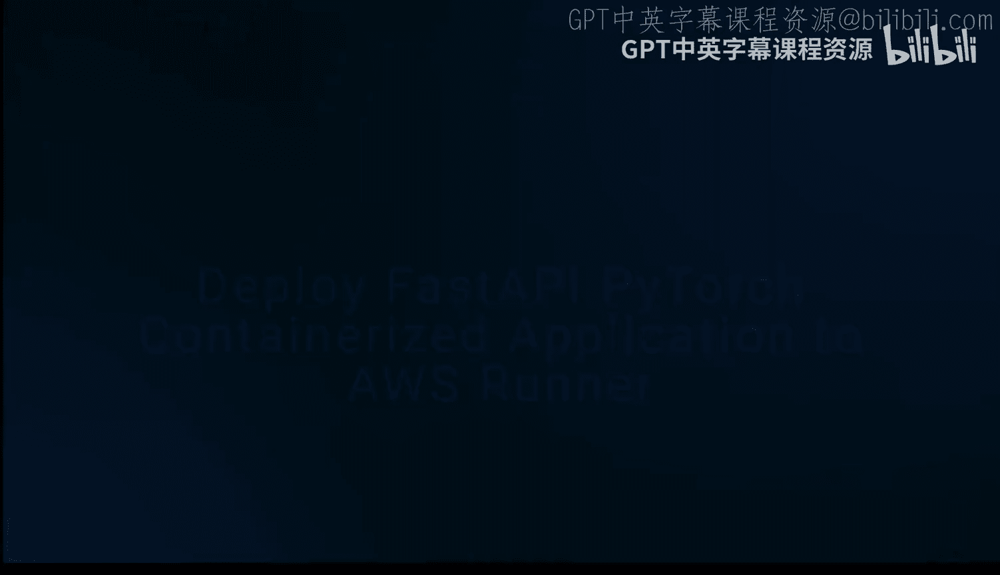

All right， here we're in a new repo that is a pytorch fast API repo that also can deploy to AWS app runner a platform as a service offering。

 If we take a look at some of the goodies here， we've got a application here that's running Pytorch。

 and we also can get this thing cooking inside of a Github codespaces。

 So I've already got one running right here。 I'm going to go ahead and locked into this。

 and let's take a look at this requirements file here。 I've got some utilities installed。

 I also have fast API Uvcorn pillow Pytorch Vi。 All of these things are are ready to go here。

 So once I've got this set up here。

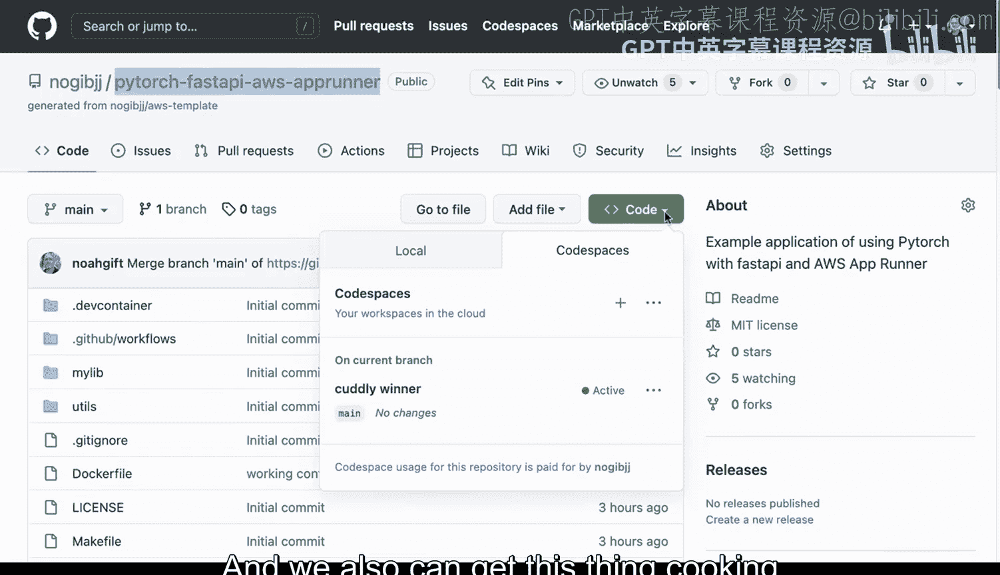

The only other thing I'm going to need to do is to make sure that I've also got Pytorrch installed as well。

 and of course I do。 so now that I've got that installed， I also could take a look at a Docker file。

 So if I want to run it via Docker I can do that as well， you can see how it's a very simple process。

And from here I'm ready to just run this this piece of code， let's go ahead and walk through it。

 We have the imports here。I have the boilerplate code around setting up the model that is a pretrain model。

 and I'm also setting up fast API app。 Then I'm going to transform an image here。

 And then I'm going to get a prediction here。 So these are the helper functions that do the majority of the work。

 I've also got a hello world function here to help me debug things。

 and I have a file size and upload file helper method that is available inside of fast API so I can test things out。

 And then finally have the thing that does all the work right， the prediction。

 And inside of here you can see I reading in a file and I pass it to the prediction those helper functions。

 and then I determine if it's let's say a cat。 And then from here I run this app。

 So let's go ahead and run this pretty straightforward。

 we can just say Python app And we've got this thing running。

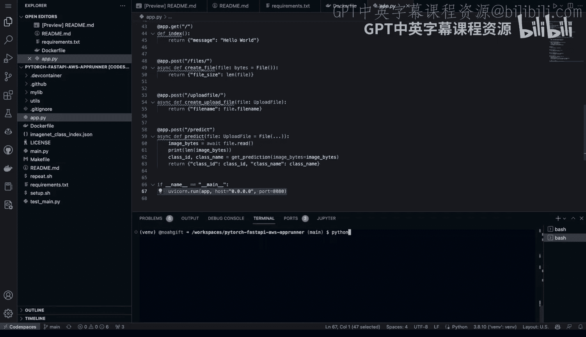

And it's going to pop up right here。

And then from here， all I need to do is go to slash docs。

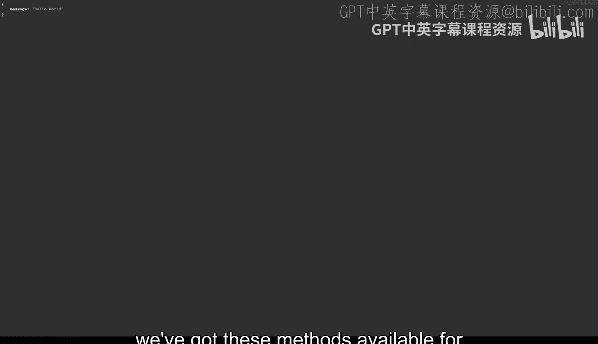

And we've got these methods available for us to play around with in Swwagger。 Now。

 the first thing Id play around with is I'm going to go to the predict。

 and I'm going to go ahead and try it out。 And from here I can choose a file and I'm going to choose a cat In fact。

 we can just take a look at it real quick here， you can see that this is an Egyptian cat let's go ahead and open that up and let's go ahead and execute it there we go。

 it was able to successfully do this classification。

 So really this is a great service to build MLop style applications， fast APIpi pytorch。

 we're ready to go And from here I'm going now move on to AWs。 So how do we move on to AWs。 Well。

 I'm going to start off with launching an apprunner service in order to do that the first thing that I'm need to do is I'm going need to go to the elastic container registry to build a container that will work with apprunner。

 So let's go ahead and do that。 we going call this Pitorch here。

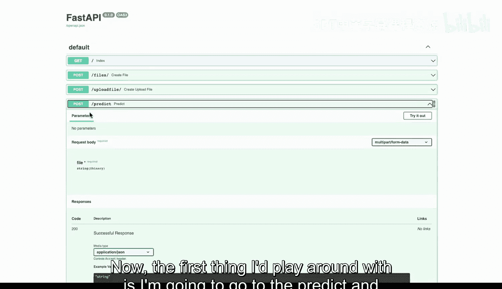

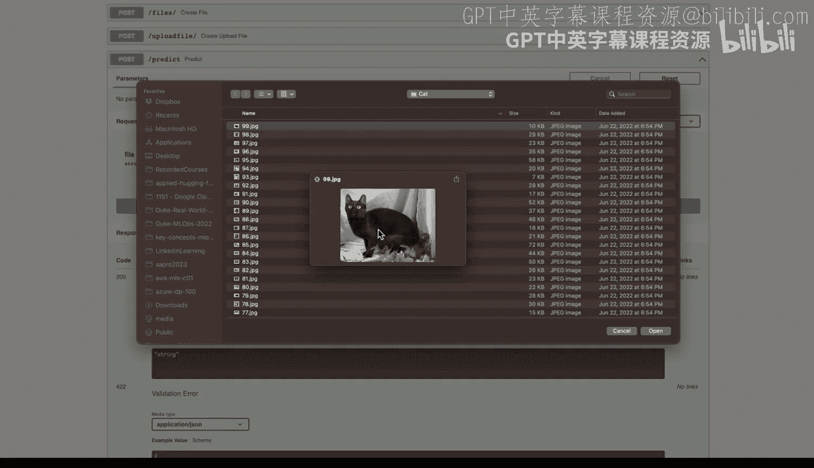

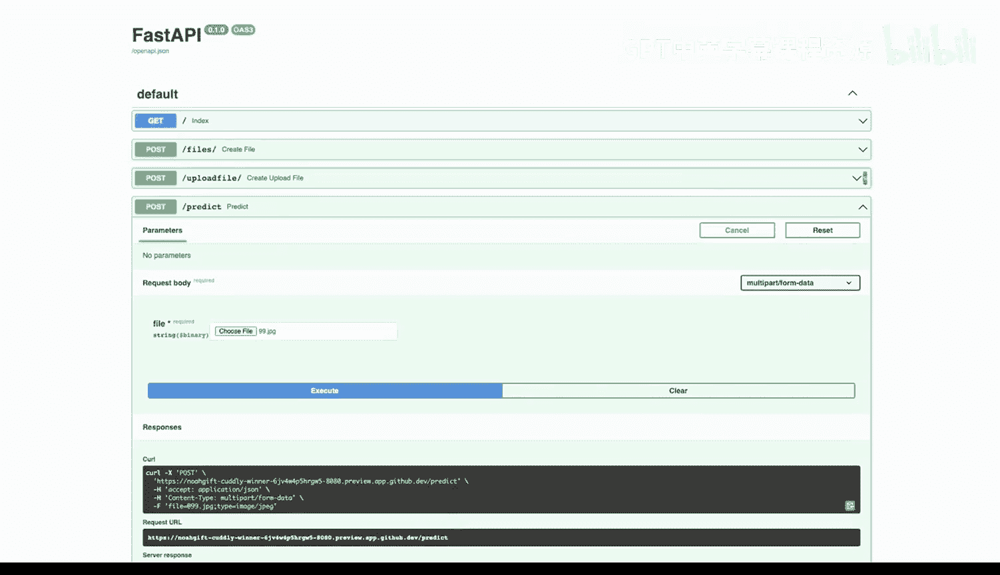

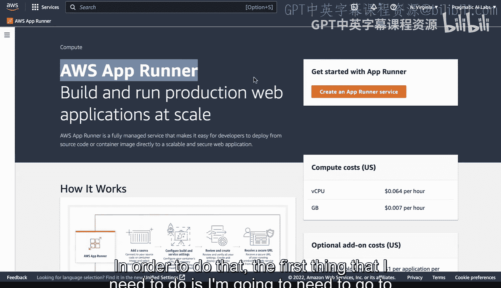

Let's go ahead and create this repo。 Now that I've got that repo created。

 Im going to go over to cloud 9， my AWs build environment， a little bit like Gi Github code spaces。

 but it allows us to check things out。

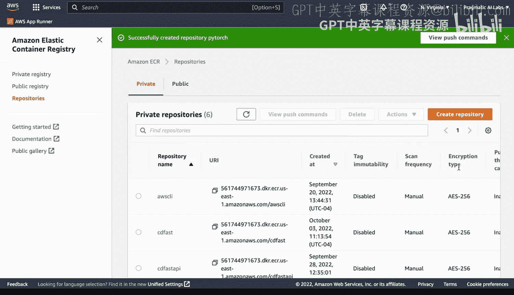

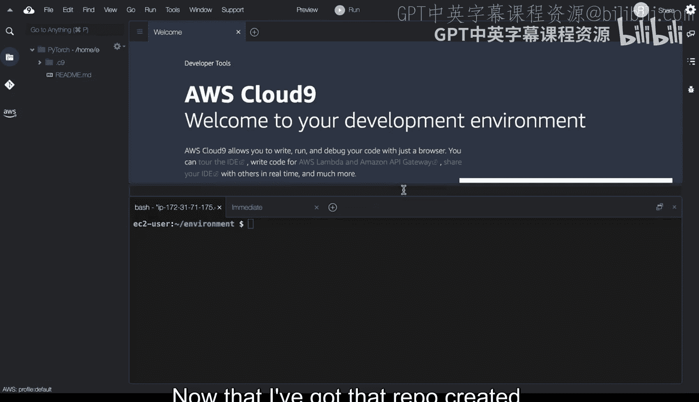

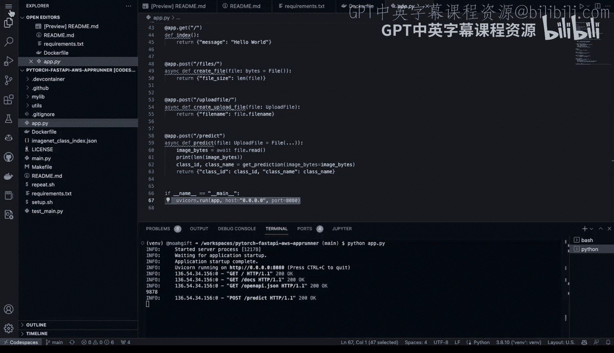

Into this cloud based environment for AWS。

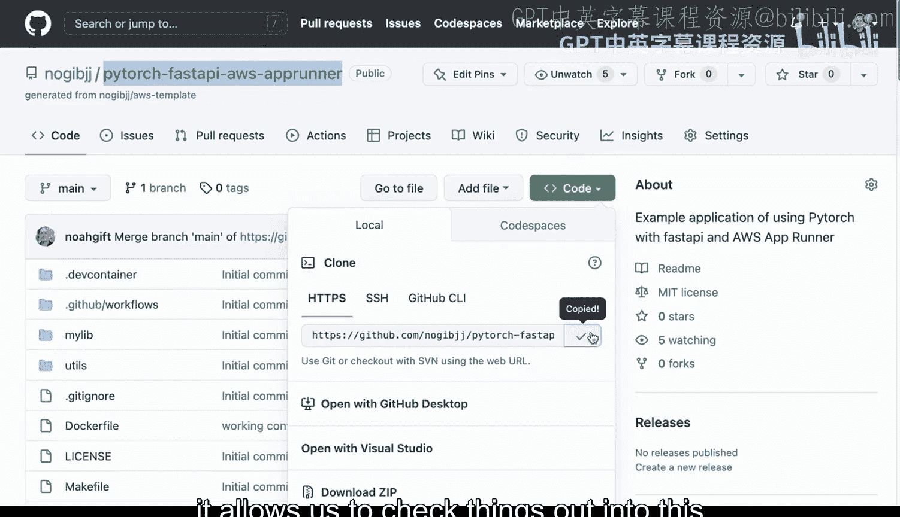

And now I just do get clone。Like that。 And we'll go ahead and create a Python virtual environment。

 Python 3， dash M， V， E， and V。And we will source that。There we go。

So one of the first things that we probably want to do as well when we're inside of here is to resize our cloud 9 environment。

 my friend here， Cyrus has a nice little script。 I'm going to go ahead and run this。

 and it's going to make it larger so that we can build things locally。 So let's go ahead and do that。

 it's going to resize it to a bigger size。 When you're building containers on cloud 9。

 Always a good idea。 All right， now let's go ahead and build this。😊。

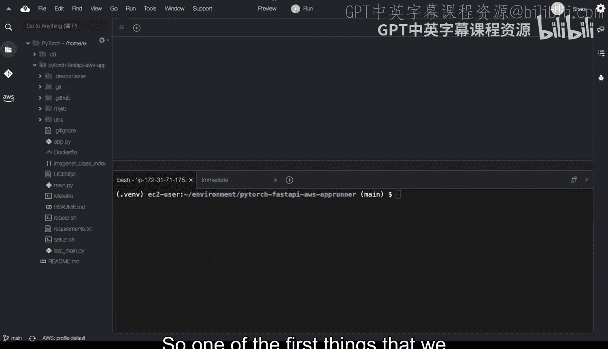

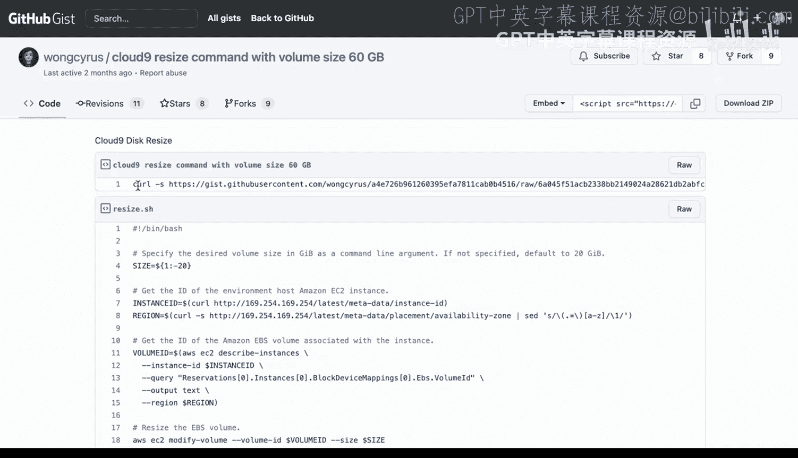

All right， so we got this thing running locally and probably a good idea when you build in a new environment。

 just double check that everything is going to be running the way that we think it will be running。

 It's going to be pushing to this repo here。 So what I'm going to do is I'm going to look at my readme real quick。

And I'm going to follow my， my guide， which says that to run it， I would just pass in that image I D。

 So let's go ahead and do that。 Let's go here。Let's pass in this image ID。

And let's make sure that this thing actually works。Okay， so this thing appears to be working。

 And now if I go to this port here， if we say preview。We can preview a running application。

There we go， we see that the hellello world is working and in fact， if I go to docs。

We see the swagger documentation。 Let's go ahead and run a prediction。 Let's try it out。

Let's choose that same file and does it work。Let's go to。Exeeccuted， and it appears to work。

There we go。 We've got this thing working here locally。 great。

 So now that I got that working locally， we should go ahead and follow the rest of the commands here to。

 to push it。 So go here。

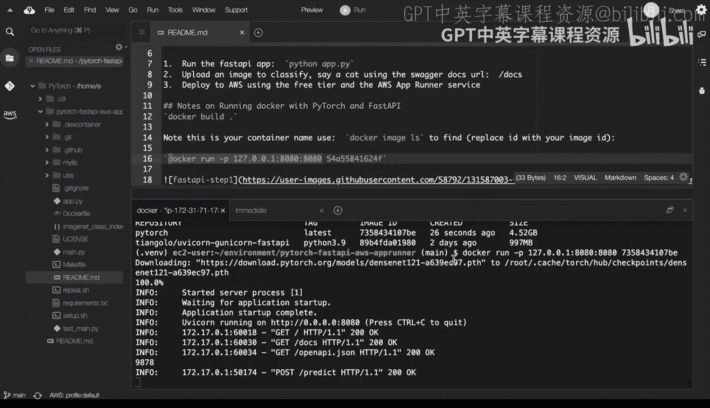

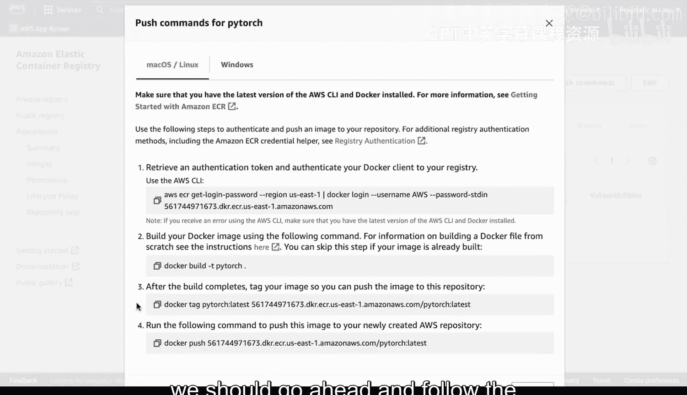

And we will。A tagt。And then we'll go to the last command to push it。And again。

 because we have a fast machine， this should go very， very quick。

And the reason for doing this is so that when we do a deployment with apprunner。

 it's going to run much， much faster because we've already tested things out locally and then we've pushed this to our own ECR。

A location which allows us to take take all this handy work that we have already done and then use it to deploy a working microservice。

All right， now we've got this thing deployed。 Let's go on and move on to apprunner。

 So I'm going to go ahead and say create a service。

 And now I can select this option container registry。 Let's go ahead and find our image here。

 So we're going go to Pytorrch latest。

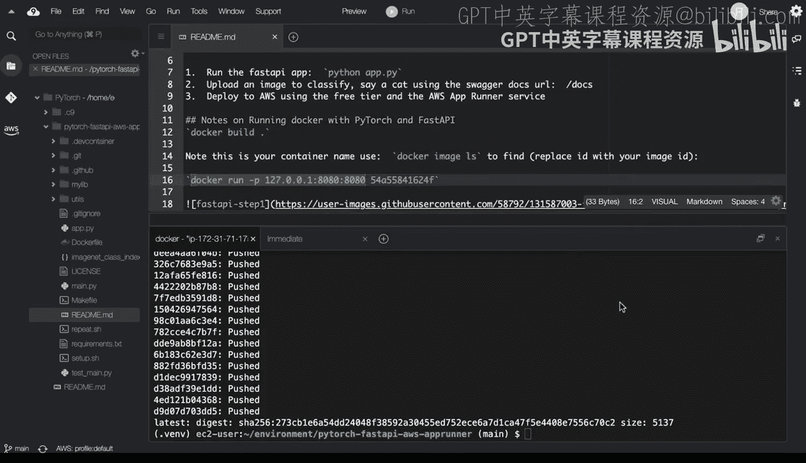

And from here， we could just see automatic， right， and we can use an existing service。

I've got set up， and we'll go ahead and call this pietorrch container。

And let's make it a nice beefy environment here， and here we go。All right。

 so we're back here and we're able to pull from that container。 We can look at the logs as well。

 And look， we can see all the steps that were taken， including pulling from ER， doing a health check。

 And now that this thing is routed。 if I select this domain， which is a encrypted domain。

 which is great。 It's a fully secure microservice， we actually can get right into this。

 and start using our microservice and doing machine learning predictions。

 So let's go ahead and do a prediction here。 I'm going to go ahead and try this out。

 chooseose this file。😊。

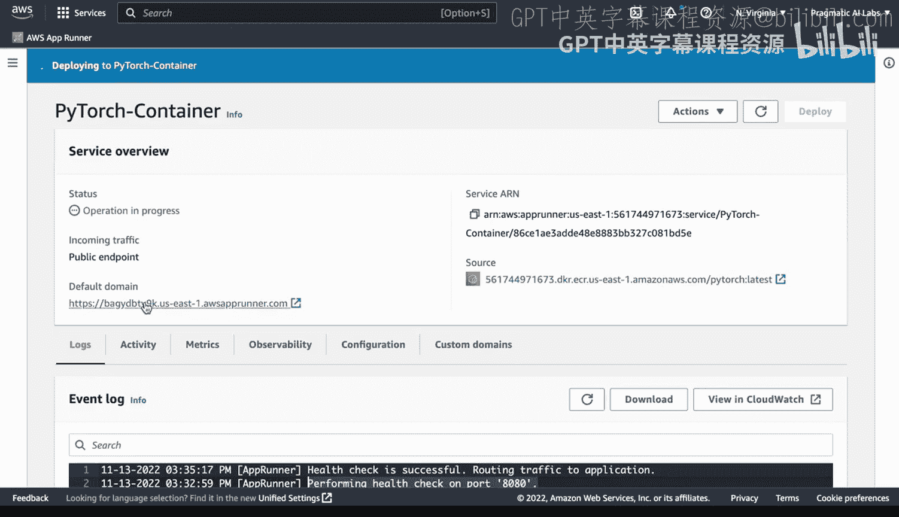

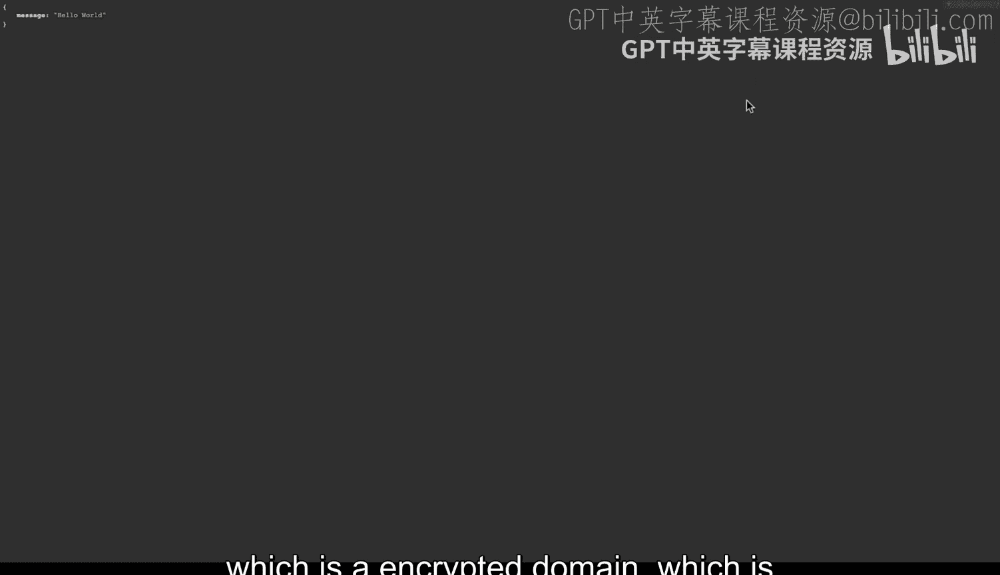

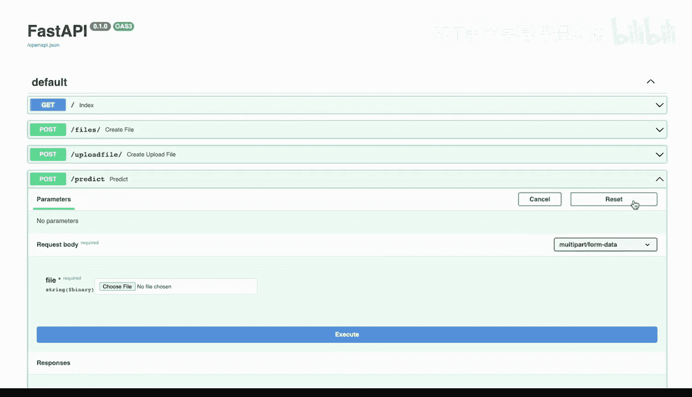

Select a quick look， double check。 Yeah， that's the cat I want to do a prediction on。

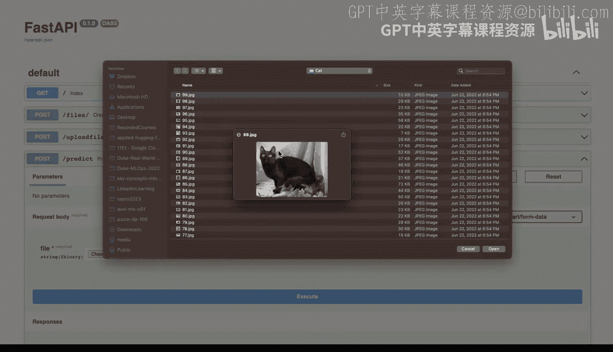

Let's go ahead and open it up and go to execute。 And in fact， look at this。

 we have a full working machine learning microservice running byytorch is deployed into the cloud here and other people can actually access this service。

 So this is a fairly production grade service that was done just in a few steps by using cloud based development environmentments。

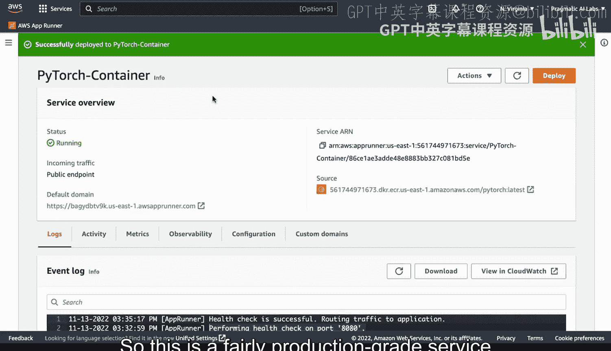