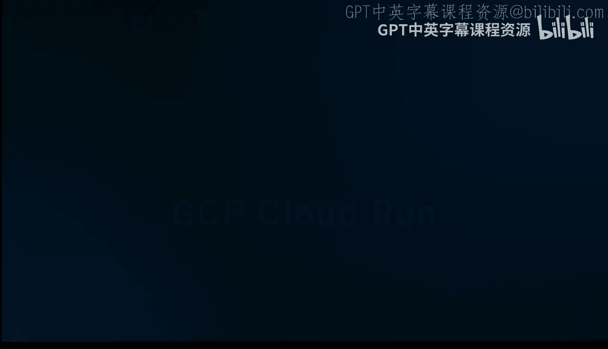
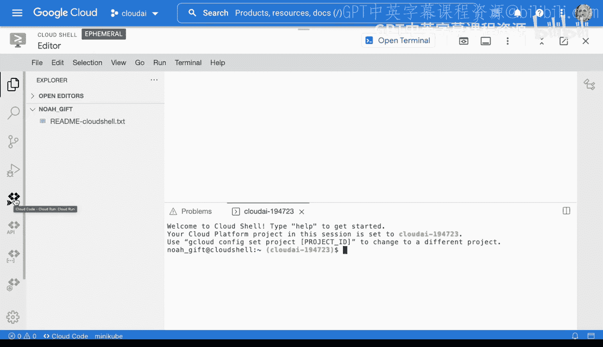
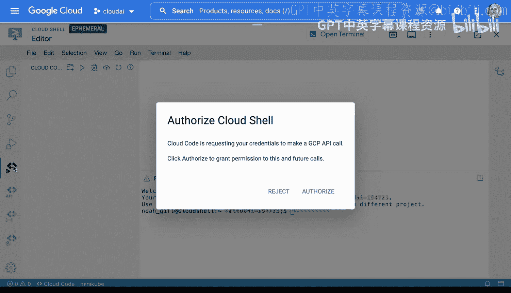
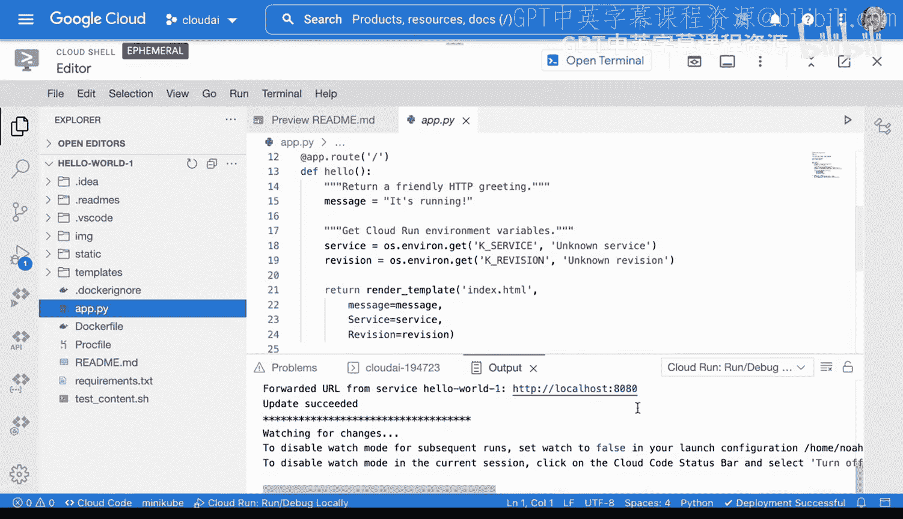
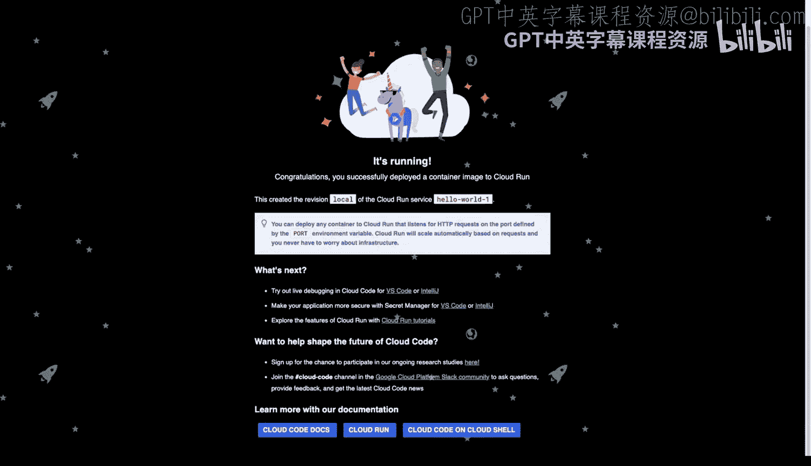
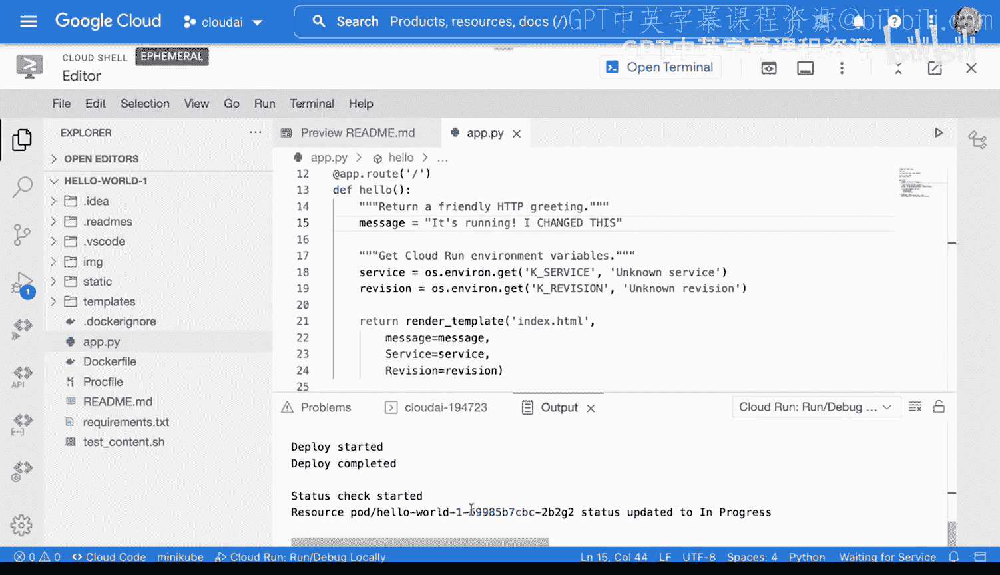
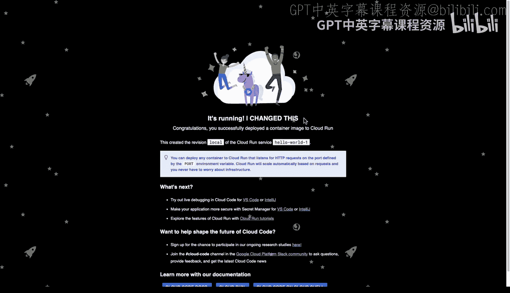
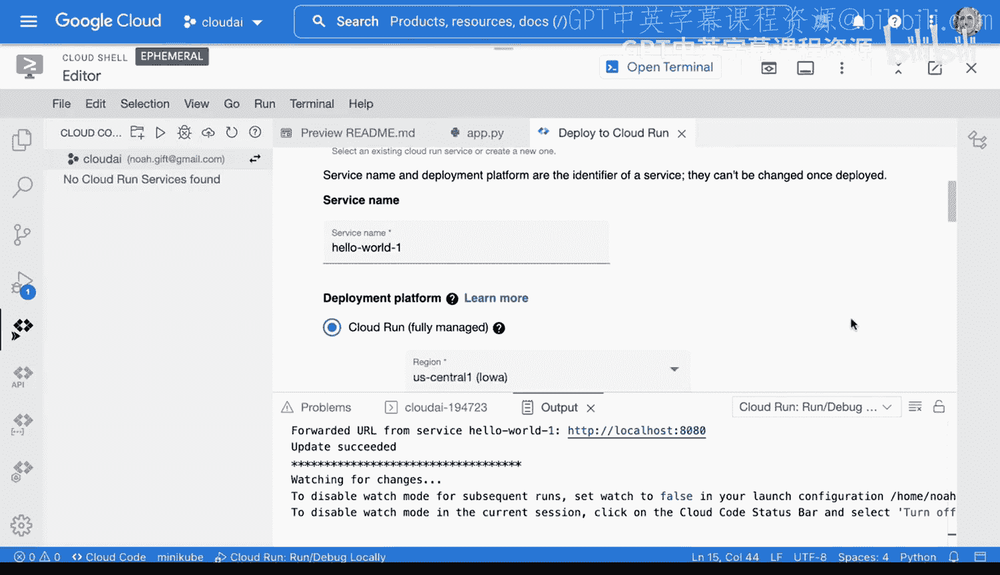

# 杜克大学《应用Python数据工程（3课全）｜Applied Python Data Engineering》中英字幕 p91 36_04_02_GCP-Cloud-Run.zh_en -BV1nz421i7KP_p91-

Here inside the Google Cloud console， we have the cloud Run service。

 One of the ways that you can run containers on a fully managed platform。

 is to use a service like cloud Run。 In fact， you can just click this button and get started。

 Another option that's kind of fun is to do it from scratch。

 And if we go ahead and we select activate cloud shellll。

 One of the nice things about this is that if I wanted to。

 I could open up an editor and get a full Ide that's customized for building container applications that then gets pushed into a production environments。

 And you can see here from the Google Cloud editor。 There's lots of neat features here。

 including the ability to launch terminal。 and play around with things。

 But one of the more interesting aspects of these cloud based development environments is this menu here where you can select different services and build them out in a prototyped way。

 So let's go ahead and select cloud run。😊。

Right here。 And if I go ahead and I authorize it， it's going to set up an environment that allows me to prototype out a cloud run application。

 So if we go through here， it says， oh， welcome to Cloudhell。And how do we do this， Well。

 we can create a new cloud run app。 Let's go ahead and do that and we can choose a template。

 Let's go ahead and choose Python Cloud run， and we'll go ahead and say create new application。

There we go。 And so it's going to download an environment for us， get this thing all set up。

 And then once I'm inside of this environment， the really nice thing about it is that I have documentation。

 I have a preliminary setup here And in fact， I even have a Docker file all built up。

 And this is a great way to get ideas about how to build something right。

 because the experts at Google are showing you exactly what to build and they're even using a really cool outpine container。

 which is a minimal size container。 And then I can also look at the boilerp code here。

 And you can see it's a really simple service here。

 but it's going to be pushed later into a managed container orchestration service where I don't have to do any of the work。

 So how do we get this thing cooking here。 So first。

 we want to run the app locally with cloud emulator。 and then we deploy to cloud run。

 So I think this is one of the better ways to get started with it。 So how do we do this。😊。

So you click on the cloud status bar and select run on cloud Iulator。

 What this does is it runs miniiCbe locally。 So let's go ahead and do that。

 And so if we go to the status bar here and we select our cloud run application。

 we can just say run app on local cloud run emulator。

 so let's go ahead and take a look at how that would work。Great， so it says build environment local。

 Let's go ahead and do that。 It's gonna ask some settings here。 We can actually go ahead and do this。

 And what's really cool about this local service here is that as I actually prototype the code。

 I can I can actually have it restart automatically。

 So this is a really slick way to do develop to basically to develop container as applications and the fact that I can actually edit on the fly and it'll rebuild a container for me。

 And then as I mentioned before， whenever I want to deploy this。

 it'll just push it directly into production。 So this will take just a second for this to load。

 All right， so now that we've got this thing set up here。

 what's really cool is it's watching for changes。 And so on one hand， I can also preview it。

 So if I just hover over this， we can go ahead and check this out and really cool， right。

 I have an application running。 Now if I want to debug it locally， one of the cool things I can do。

 is we can say， look， it's running。 and I can say。😊。

You know， I changed this。And then if I save it， automatically look。

 it restarts it if I go again back to the service URL here and we take a look at it。

There we go。 I changed it。 So a really nice environment to prototype out a cloud based service。

 So let's go ahead and now go back to our control panel here and let's， let's actually。😊。

呃。Kill this。 And then what we can do is we can actually deploy it to production。

 So in order to do that， what I can do is I can actually go ahead and select deploy to cloud run。

And this will actually push this directly into production soone。Really， once you've got a container。

 you've got your microservice set up using a service like Cloud Run is very straightforward。

 and you can see the steps here to actually go through and deploy the rest of the code。

