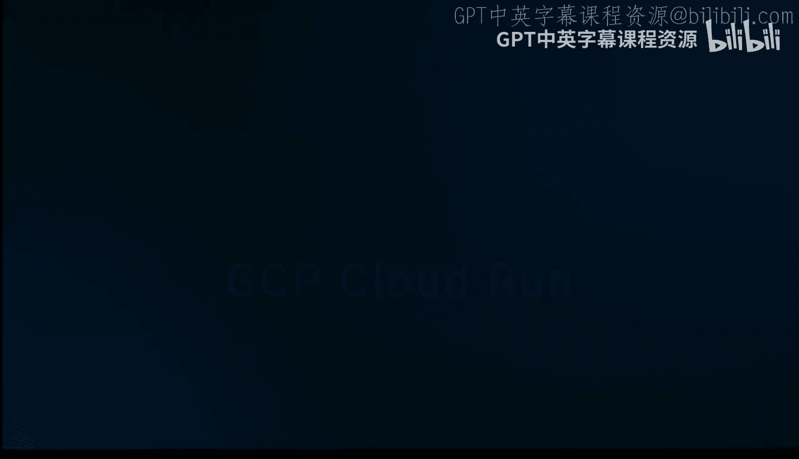
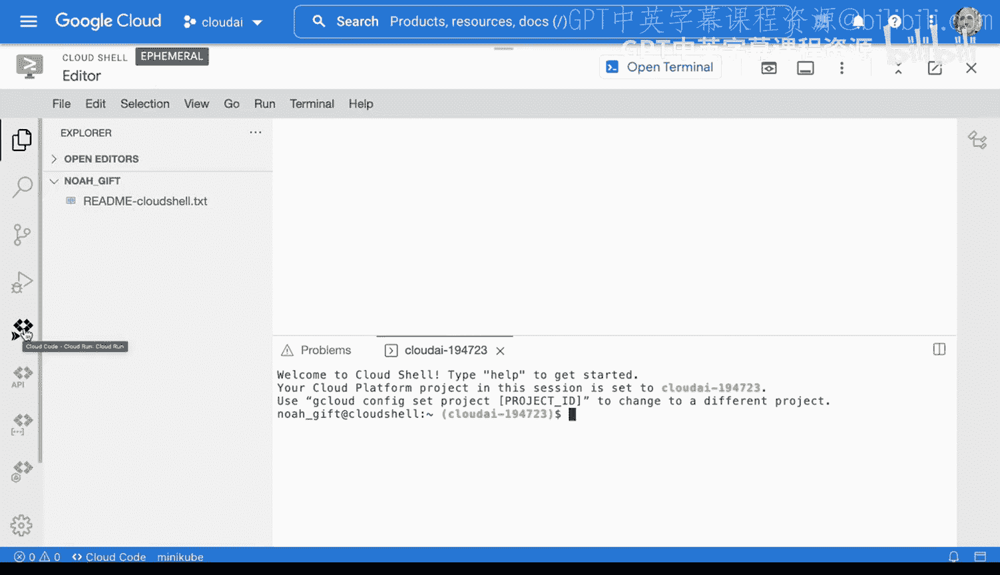
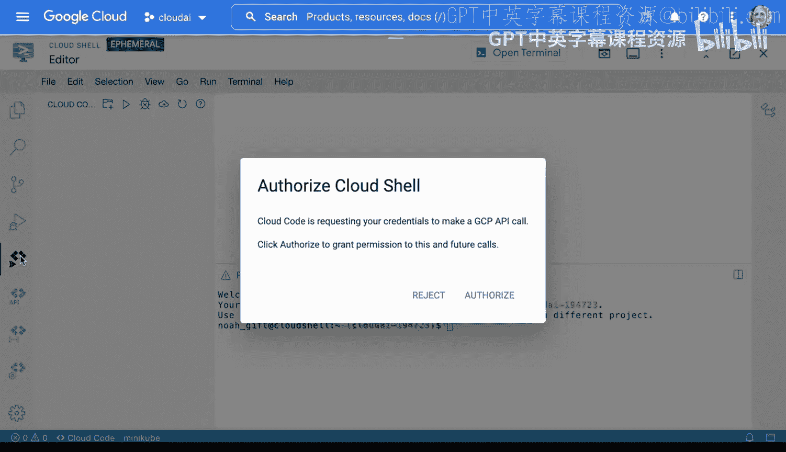
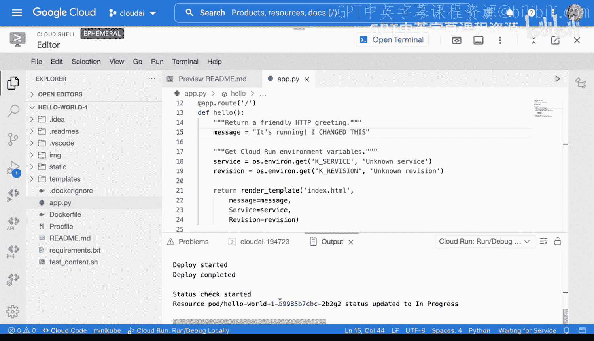
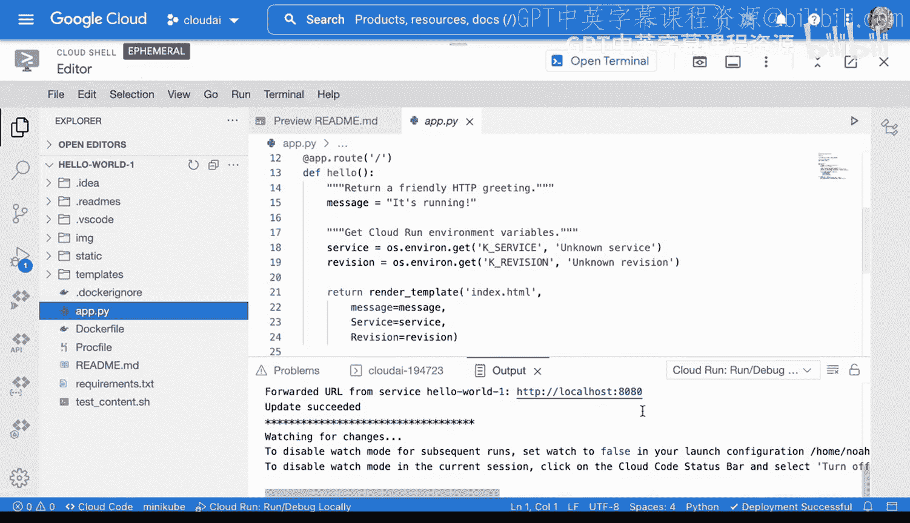
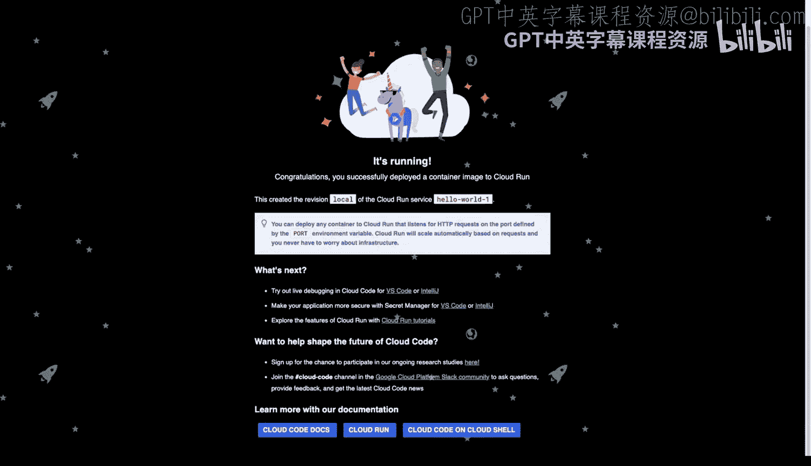
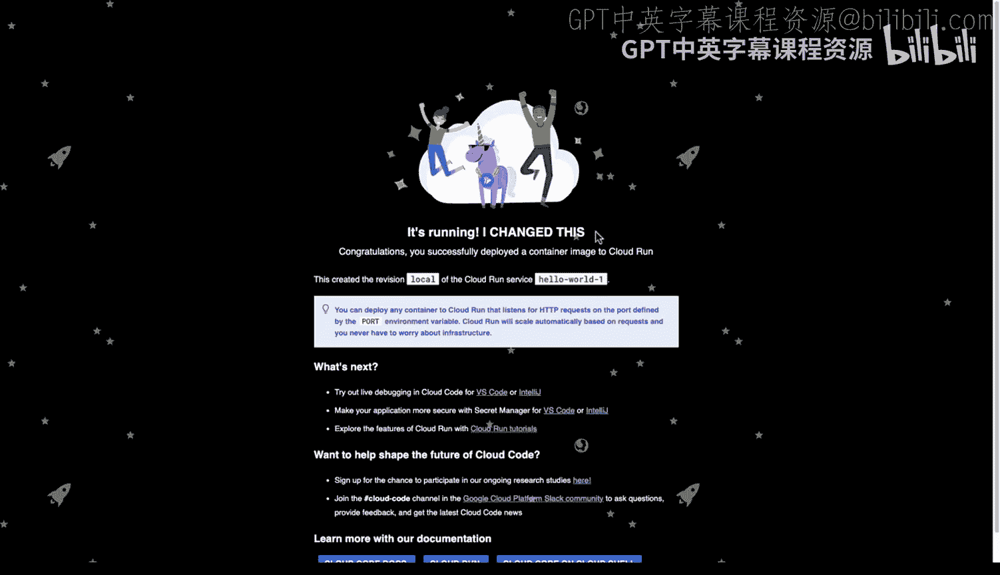
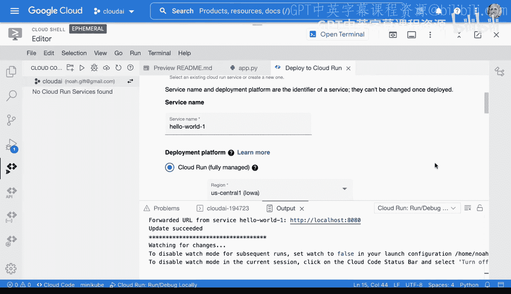

# 应用Python数据工程：3：GCP Cloud Run 服务部署教程 🚀

在本节课中，我们将学习如何在 Google Cloud Platform 上使用 Cloud Run 服务来部署一个容器化的 Python 应用。我们将从零开始，通过 Cloud Shell 编辑器创建一个应用，在本地模拟器中运行和调试，最后将其部署到生产环境。

---

在 Google Cloud 控制台中，提供了 Cloud Run 服务。在完全托管的平台上运行容器的方法之一，就是使用像 Cloud Run 这样的服务。事实上，你可以直接点击按钮开始使用。另一个有趣的选择是从头开始创建。

如果我们选择激活 Cloud Shell，它的一个优点是，我可以打开一个编辑器，获得一个专为构建容器应用而定制的完整 IDE，这些应用随后可以被推送到生产环境。从 Google Cloud 编辑器中可以看到，这里有很多简洁的功能，包括启动终端和进行各种操作的能力。

但这些基于云的开发环境更有趣的一个方面是这个菜单，你可以在这里选择不同的服务并以原型化的方式构建它们。接下来，让我们选择 Cloud Run。

就在这里。如果我继续并授权它，它将设置一个允许我原型化 Cloud Run 应用的环境。我们继续操作，它会显示“欢迎来到 Cloud Shell”。我们该怎么做呢？我们可以创建一个新的 Cloud Run 应用。让我们继续这样做，并且我们可以选择一个模板。

我们继续选择 Python Cloud Run 模板，然后点击创建新应用。好了，它将会为我们下载环境，完成所有设置。一旦我进入这个环境，真正的好处是我有文档，这里有初步的设置。事实上，我甚至已经有了一个构建好的 Dockerfile。

这是获取如何构建某物想法的好方法，因为 Google 的专家向你展示了具体要构建什么，他们甚至使用了一个非常酷的 `outpine` 容器，这是一个最小尺寸的容器。我还可以查看这里的样板代码。你可以看到这是一个非常简单的服务，但它稍后将被推送到一个托管的容器编排服务中，而我无需做任何工作。

那么，我们如何让这个东西运行起来呢？首先，我们想使用云模拟器在本地运行应用，然后将其部署到 Cloud Run。我认为这是开始使用它的更好方法之一。那么我们该怎么做呢？

你点击云状态栏并选择“在云模拟器上运行”。这样做是在本地运行 `minikube`。让我们继续这样做。如果我们转到状态栏这里并选择我们的 Cloud Run 应用，我们可以直接说“在本地 Cloud Run 模拟器上运行应用”。让我们继续看看这将如何工作。

很好，它显示构建环境为本地。我们继续操作。它会询问一些设置。我们可以直接继续。这个本地服务真正酷的地方在于，当我实际原型化代码时，我可以让它自动重启。这是一种非常流畅的开发方式，基本上就是开发容器化应用，而且我可以实时编辑，它会为我重建容器。

正如我之前提到的，每当我想要部署它时，它就会直接推送到生产环境。这需要一点时间来加载。好了，现在我们已经设置好了，真正酷的是它在监视变化。一方面，我还可以预览它。所以如果我悬停在这个上面，我们可以继续查看，非常酷，对吧？我有一个应用在运行。

现在如果我想在本地调试它，我能做的一件很酷的事情是，我们可以看到它在运行。然后我可以说，看，我更改了这个。如果我保存它，自动地，看，它重启了。如果我再次回到这里的服务 URL 并查看它。

好了，我更改了它。这真是一个用于原型化基于云的服务的绝佳环境。现在让我们回到控制面板，实际上，让我们终止这个进程。然后我们能做的是，我们可以将其部署到生产环境。

为了做到这一点，我可以做的是继续选择“部署到 Cloud Run”。这实际上会直接将此推送到生产环境。真的，一旦你有了一个容器，使用像 Cloud Run 这样的服务设置好你的微服务就非常直接了。你可以在这里看到实际部署其余代码的步骤。

---

本节课中，我们一起学习了在 GCP 上使用 Cloud Run 服务部署 Python 应用的全过程。我们从在 Cloud Shell 编辑器中创建项目开始，使用模板生成了包含 Dockerfile 的代码。接着，我们利用本地 Cloud Run 模拟器运行和调试应用，体验了代码热重载的便捷性。最后，我们了解了如何一键将调试好的容器化应用部署到 Cloud Run 生产环境。整个过程展示了如何在一个完全托管、无需管理基础设施的平台中，高效地开发、测试和部署微服务。