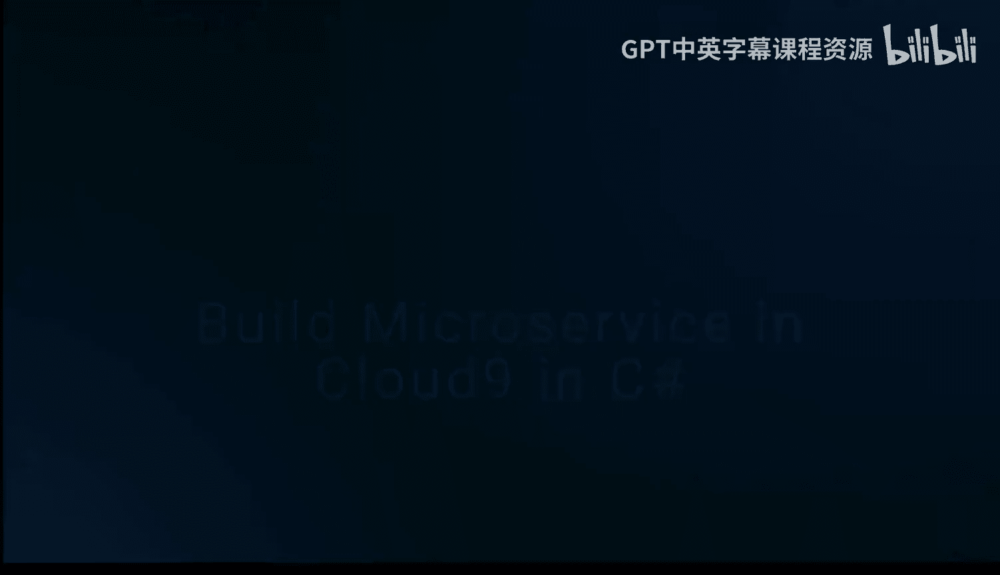
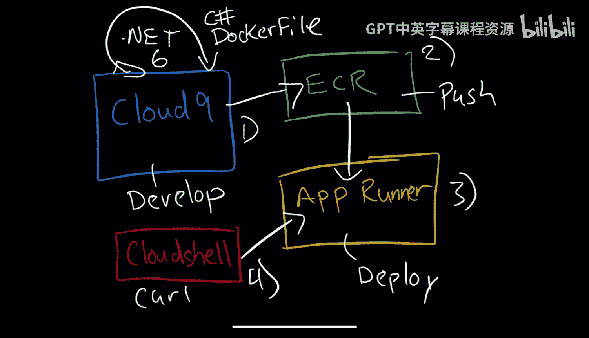
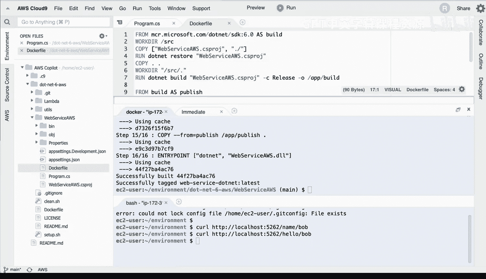
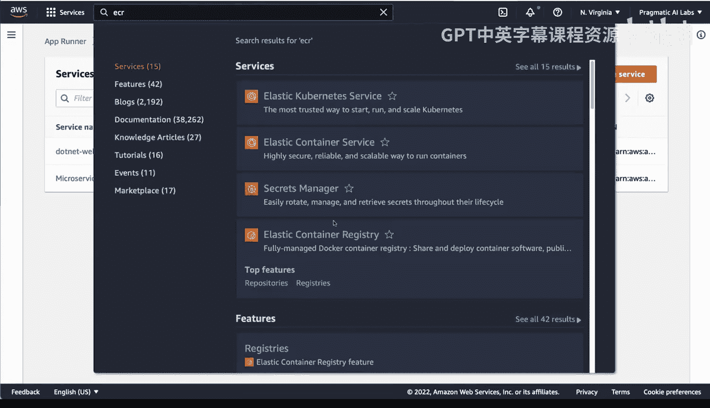
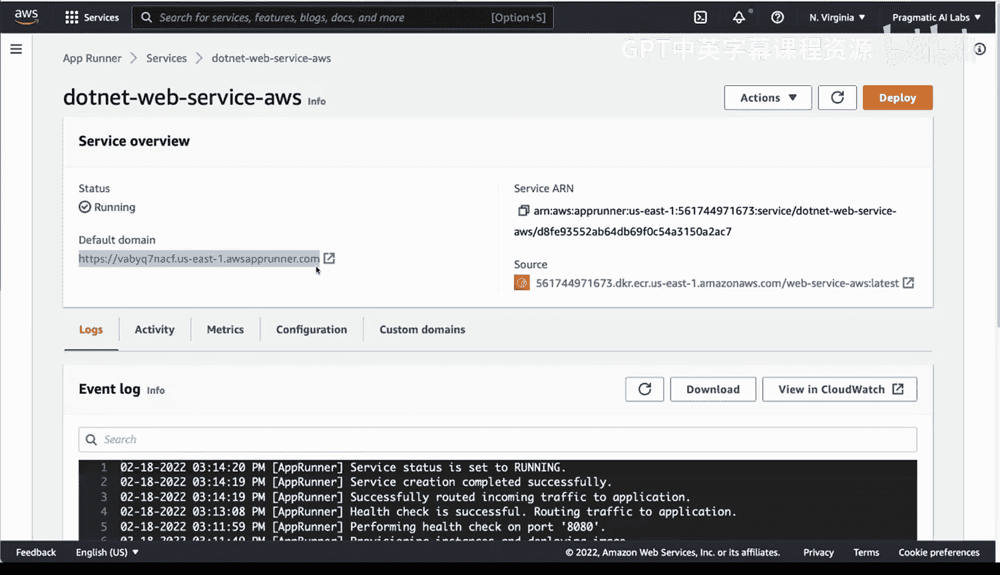
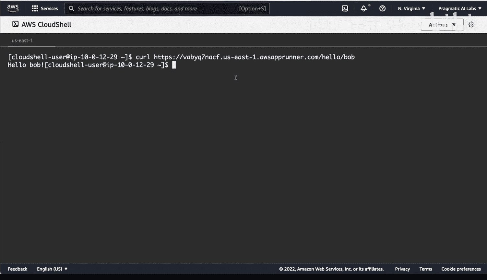

# 杜克大学《应用Python数据工程（3课全）｜Applied Python Data Engineering》中英字幕 p92 37_04_04_在Cloud9中用C语言构建微服务.zh_en -BV1nz421i7KP_p92-

Let's take a look at a containerized workflow for AWS。 If you look at these four services here。

 AWS cloud 9 Amazon Elastic container registry， AWs apprunner and cloud shellll。

 you have a pure cloudbased development environment I don't have to touch anything。

 I could have the weakest development environment ever maybe a web browser on a Chromebook or something like that with cloud 9 though because I have this power。

 I can develop things out in a localized environment that's very similar to where I would deploy to and I have a highspeed network connection between the EcrR environment。

 So once I've containerized my dotnet application， I push it into Ecr and really I'm ready to go。

 then once it's an Ecr I have the ability to connect it to a production deployed process And the reason I can do this is that app runner allows me to automatically deploy new images that get pushed into E I can listen for that Once I've got this thing deployed。

 It's fully encrypted via。HTPS， I can go to Cloudhell， spin up a shell。

 invoke a via curl and test it out so really this is the next generation of development for donet and C sharpp and it's a good thing to have in your toolkit alongside Viual Studio。

Okay let's take a look at this repo Noagift donet 6 AWs。

 And really this is all you're going to need to get this running in cloud 9。 once you launch cloud9。

 you'll need to install some donet 6 packages and then you're pretty much good to go and we're gonna go through and deploy this in this environment。

 So first up I'll say that I have a cloud9 environment set up here and you can set this up yourself。

 I would recommend setting a powerful machine up， but a few things to point out here that are great to know is that once I've installednet。

 I can runnet and create a program in this case I've got program here very simple program that accepts a URL hello and I substitute out some string and I can run this。

 So if I want to actually run this as a containerized application it's pretty straightforward because I've already got this thing set up。

 I also can run it as a regular donet application。 Let's go ahead and run a regular one first。

 let's go ahead and。Dotnet run。And you'll see that I'm able to actually take this application and then I can just grab one of these URLs that pops up here and just curl it。

And say， for example， name Bob。And we should be able to we need to go hello。

 we need to say hello Bob， there we go。 we see that this thing is actually working。

 Now if I want to run the containerized version， also fairly straightforward all I need to do is go over to this Docker file real quick and let's just take a look at it this Docker file has a dotnet 6 SDK built in and what I do is I look at this CSprodge file and I set it up to build and then I build out a release that has a port 8080 set and I've also got this web service DLL that gets exposed in my containerized application so what's great about this environment is it's very straightforward to build In fact I could just build it locally here by just doing a Docker command so let's go ahead and bring this up as long as you're in this directory。

And you've got a Docker file inside of your project， I can just run this。

 I can say Docker build dot T tag this as the latest。

 it goes through and it builds this application and what's nice about this is that because I have a very powerful machine。

 it's very quick to run and then if I want to run this I can just do the Docker run command。

 go through here Docker run。

Perfect， we got the same thing and notice that I can just change the port to the port that Docker is serving out traffic on。

 which is 8080。 There we go。 We see hellello Bob is still working Great， Now really at this point。

 the next thing that I can do is push this over to our ER environment。

 let's go ahead and take a look at that really quick here。 So if I go over to E here。

 and I type this in， we can see that this stands for the elastic container regisrate。

And all you need to do is create a new repo， put something in here test or whatever。

 it's very simple to create a new repository。 And then once you want to push it。 in this case。

 I've already got one set up， you would just select view push commands here and it tells you every single thing you need to do to push your container。

 In fact， I'll just copy this last one because I've already authenticated and I'll make it very simple So if I go through here and I run this push command。

 you can see very， very fast because we're on the same network and this thing's good to go。

 So once it's in there， I could share it with coworks in AWs or use either ES or apprunner we're gonna go ahead and use apprunner and I'll show you how simple it is to set up So all we need to do to set up a new dotnet service in apprunner。

 I say create service and here's where the magic of containers come in I would just point it to EcrR browse find where I push that last container here oh here we go web service AWS I say continue and then at that point I can say。

And this means that every time maybe the code build system pushes a new container。

 it'll go through here and push a new version of it。

I can again say you know deploy dotnet here or whatever I want to call this。Go through here。

 set this up。 This looks great。 And and I all have to do is say create and deploy。

 So it's trivial to deploy an app runner service。 And it's got all of the software development software development best practices。

 logs， activity metrics configuration。 If I go back here。 look。

 we can see that that web service is what I deployed earlier。 and take a look at it。 There we go。

 it even runs。 So what I can do now is I can actually go to this URL。

 And I'm going to leverage yet another cloud service， which is I'm going to go to Cloudhell。😊。

And if I go to Cloudhell here， I can just run that curl command and we'll again say hello Bob。

 there we go。 we see that this service is working。 So really by leveraging all of these cloud native services。

 Cloud 9 ECR app runner and Cloudhell， I have a complete end end environment without any interruption and I have extremely fast performance。

 So for dotnet developers give this a try， I think you won't regret it。

