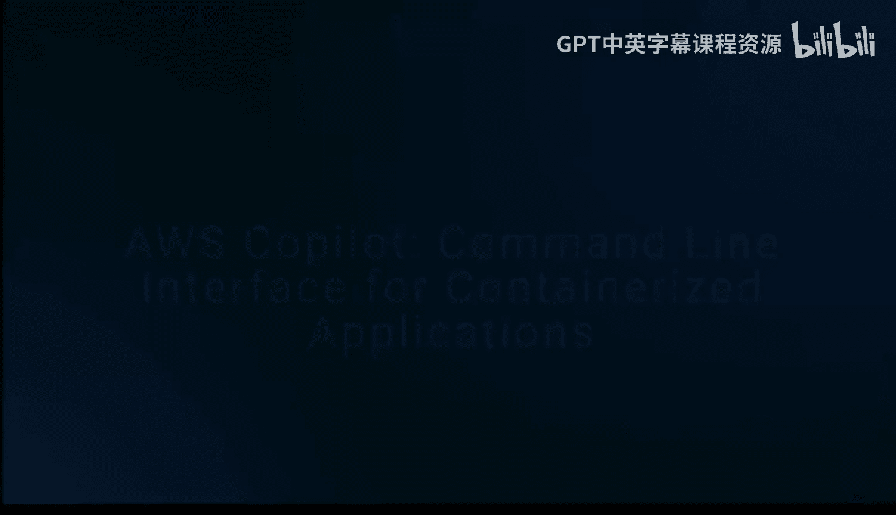
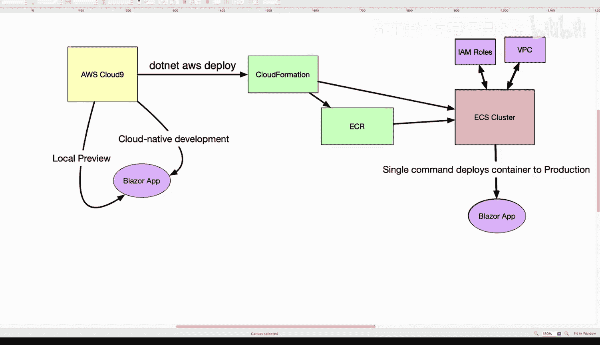
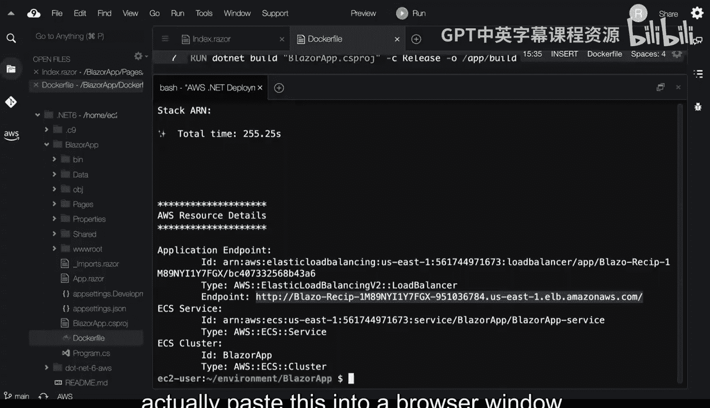
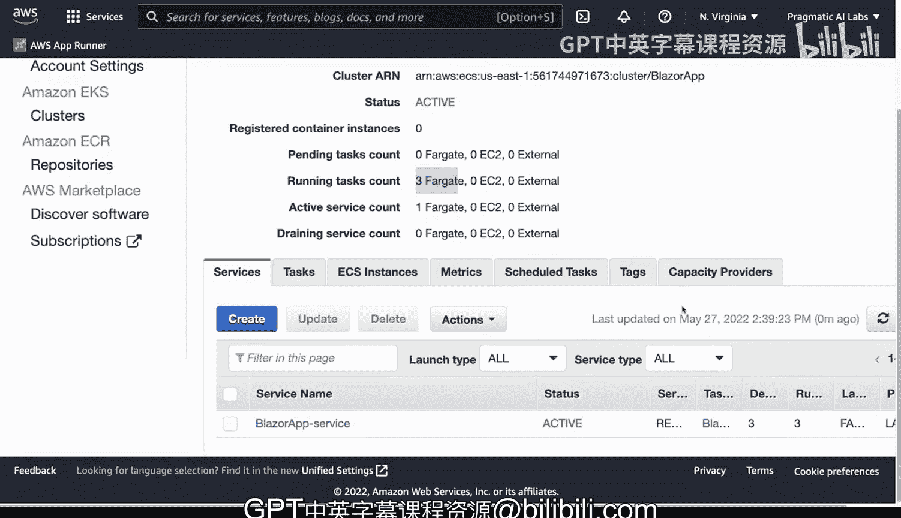

# 杜克大学《应用Python数据工程（3课全）｜Applied Python Data Engineering》中英字幕 p93 38_04_05_AWS-Copilot容器化应用命令行界面.zh_en -BV1nz421i7KP_p93-

Allright， let's take a look at what we're actually going to deploy and how we're gonna do it。 First。

 I'm going spin up an AWS cloud9 environment。 I like cloud9 for developing with AWS because I can pick any size instance I want。

 I can pick a 32 core machine if I want with lots of Ram and then I'm also going to install the dotnet6 framework and get a blazer application running tested out with preview when I'm ready to go I'm going put a Docker file together and then run dotnet AWS deploy What this will do is hook up a cloud formation process as well as an EcrR image that will get pushed into ECS a I am rule a VpC all will be set up and my blazer application will be running as a task inside of ECS all with just this one command。

 let's go ahead and do it。

All right， so I'm inside of AWS Cloud 9 here。 I picked a large machine that I'm going to use to do my development task to spin up a cloud 9 environment。

 You can go to AWS and just select cloud 9 and configure your own environment with a defaults。

 I would probably pick as the only option in the default I would change is a bigger machine。

 In this case， this is I think at least a eight core machine with lots of RamM。

Now the first thing that you want to do for dotnet6 is to make sure that you have the latest packages。

 you can see I'm going to go ahead and do that pseudo RPpM I'm going to add the Microsoft Sto S packages Next step I would want to make sure that I'm installing donet 6 Here we go pseudoym install and this will make sure that donet6 is installed and then I'll want to install as well the ASP net Co runtime。

And then the final thing I'll install is the dotnet runtime for six。There we go。 Once I've got this。

 all I need to do to run the AwS deployment tools is to run this command。

 which is dotnet tool updateg aws deploy do tools once I do this it'll go through here and check to make sure that I've got the latest version because this tool is installed very frequently you can see I've already been able to install it with the latest tool it's a good idea to just run this fairly frequently So the next thing that I'm going to do is I'm going to create a blazer application in this case it'll be dotnet space new space bazer server o bazer app and I'm going to say F net 6 so I'm going to make a donet6 Blaazer app okay you can see it's very fast and then I'm going to seed into this bazer app directory Now once I've done this all I need to do in order to run it。

Is to run a dotnet command that gives it。The ability to run on port 8080 and the reason for this is that this will allow the preview functionality to work。

 so in this case I say dotnet run dashS URLls equals and then I put in the local host 8080 path。

And this will go ahead and run my blazer application， you'll see it'll run in foreground mode。

Now in order to test it out pretty straightforward。

 I would just go to this preview icon click it and then select preview running application and there we go we see that this thing is actually running I can even make it a little bit bigger and I can actually go to this menu bar here look at the counter go ahead and click it and you can see I'm I'm actually running this application which is nice now all I need to do to deploy this is to make whatever changes I want to make and then go ahead and deploy so I think what I'll probably do here is just tweak this application just a little bit by going inside of the blazer app going down to wherever the index lives here。

Wwhichch should be inside of pages and index razor Okay now I'll go ahead and paste up some new code here In this case。

 I'll just say the root page I wanted to say index still， I want to say hello AWS。

net AWS deploy We to your new app I could test it if I want just to be extra safe。

 let's go ahead and go and preview it。And we can see here that it should be running there we go。

We can see hello AWS。 net AWS deploy， perfect。 All right， so now that I've got this thing running。

 it's time to do a deploy。 Fortunatelyly， it's pretty straightforward。

And I'm going to first make a Docker file， so go ahead and say touch Docker file。

And inside of this Docker file I'm going to configure how I wanted to deploy as a container。

 so I'll go here and paste this in， let's go ahead and take a look real quick so I just use a Microsoft。

 S6 as a base image here I then go through and I build the project out and I expose port 80 importport 443 and then finally I published this application by exposing the dot dlL so as to be blazer app do dL perfect now that that's running pretty straightforward I could even test out the local build process as well which is not a horrible idea so if I want to test out what this Docker container would look like it would be pretty easy to do all I would need to do。

Is run a Docker build command okay now in order to run it， I would just run Docker runP 8080。

 which would be the port that is going to preview locally and then 80。

 which is what's internal here to this Docker file if I go ahead and I run this。

You can see that it's able to listen on port 80 internally to this Docker container and then if I select preview。

 it'll expose port 8080， which allows us to preview this application。

 so it looks like it's ready to go here， which is great Now the only thing I need to do is to go down and run this AWS deployment command here。

 which is pretty straightforward to do。I'll just need to write dot net AWS deploy and because I have a Docker container。

 it is pretty smart。 What it'll do is it'll give me a default here that will say what it is I want to do I can make this window a lot bigger and says look it says ASP donet core application to Amazon ECS using Fargate this application will be deployed to Amazon Elastic container service if your project doesn't contain a Docker file。

 it will be automatically generated so this exactly what I want so I'm going go ahead and just pick one which is already the default and then it's going to ask me what to name it I'm going to go ahead and leave the default here which is the blazer app。

And then finally it'll show me the cluster settings for ECS， so the name of the cluster。

 the service name， how many tasks it wants， so it'll be load balancedd to have three different tasks running。

 it'll set up the role it'll set up the VPC and even environmental variables that I would pass and even would go to ECR and hook into that repository so I'm going to go ahead and say enter now what's going to do is's going to build this container and it's going to push this container to ECR and then set up the cloudbased deploy using cloudformation and AWS CDK and the CDK is a library that works with multiple languages that generates cloudformation code so this is going handle all of these very complex steps for me automatically and here we can see that the process is happening here and it's going go ahead and deploy our application。

All right， so we're ready to go here， you can see that the deployment took 255 seconds and if I go over to this endpoint right here。

 I can actually copy it and actually paste this into a browser window and you see I've got the AWS。

net deployed working。

Now the other thing to point out is if I go over to ECS here and I go to the clusters。

 I can also see all of the handiwork that's been set up here。

 look we've got blazer running in fact I have three running tasks I have an active service that's actually been able to be executed so in a nutshell our donet AWS deploy tool is really a miracle worker and it creates a very high quality production deploy。

