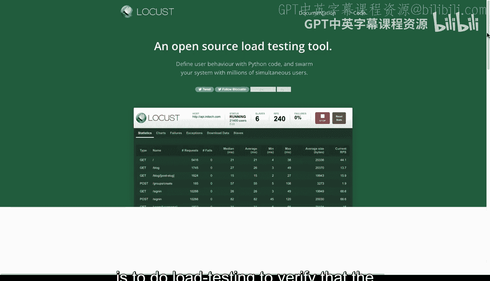
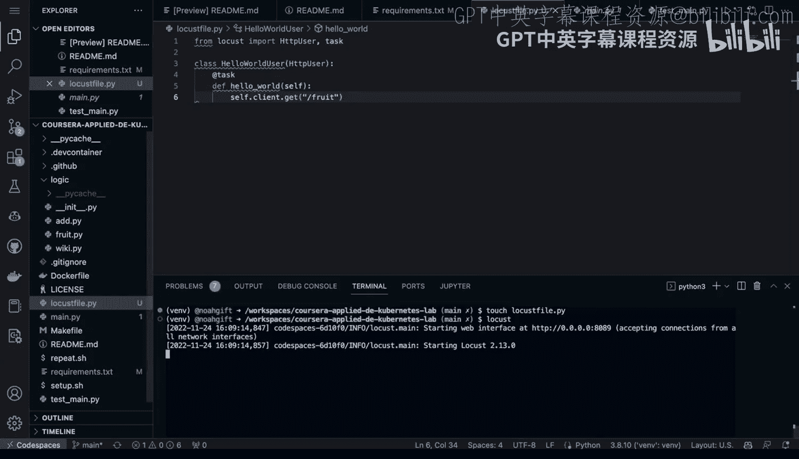
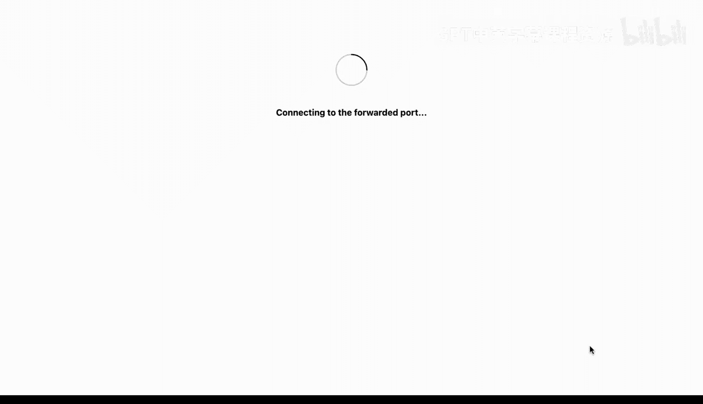
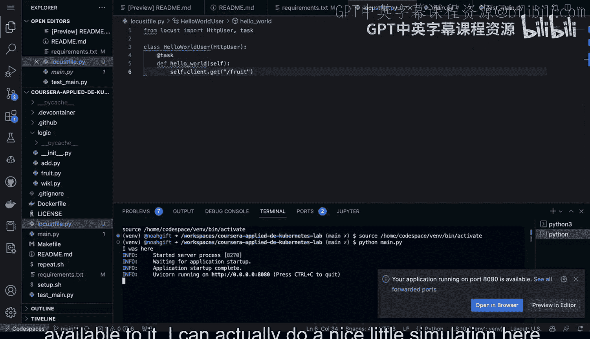
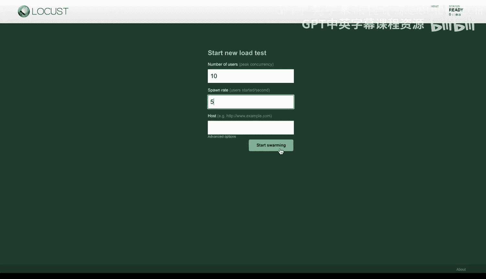
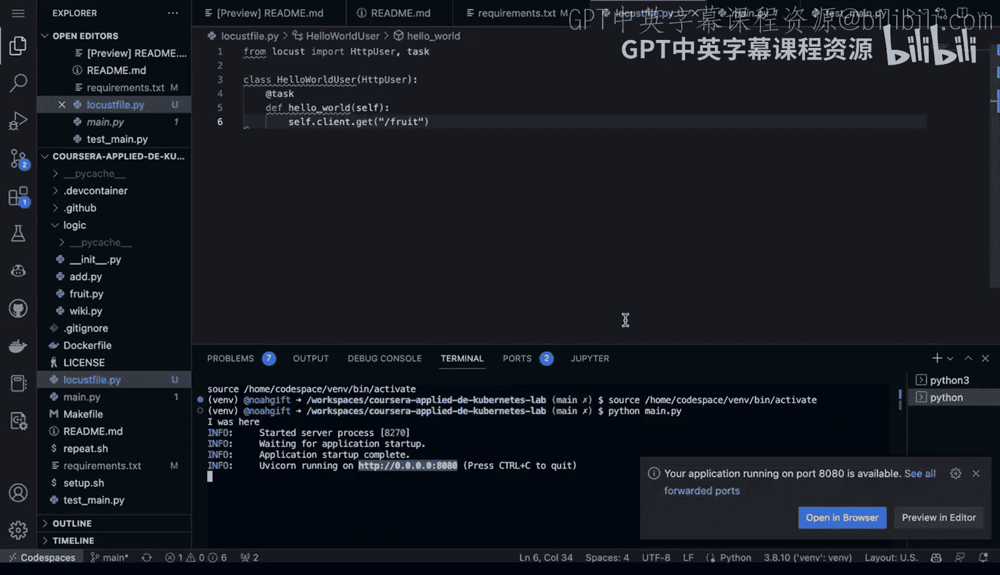
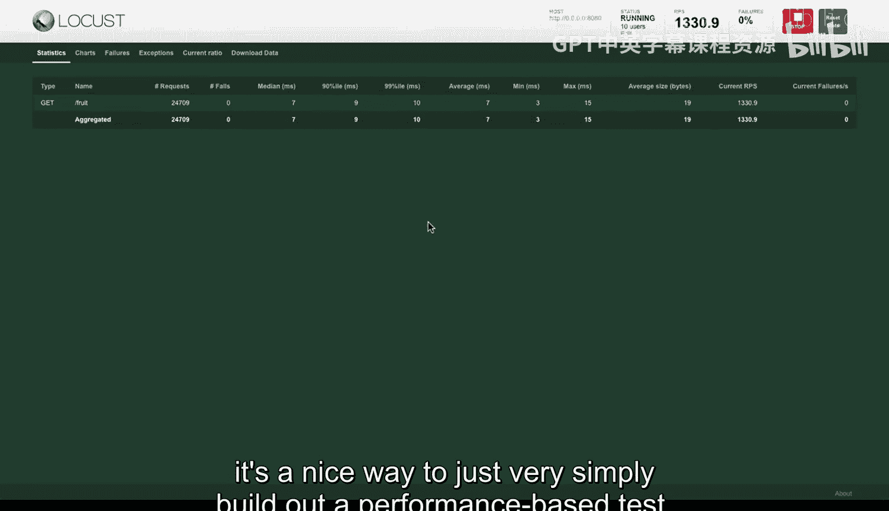
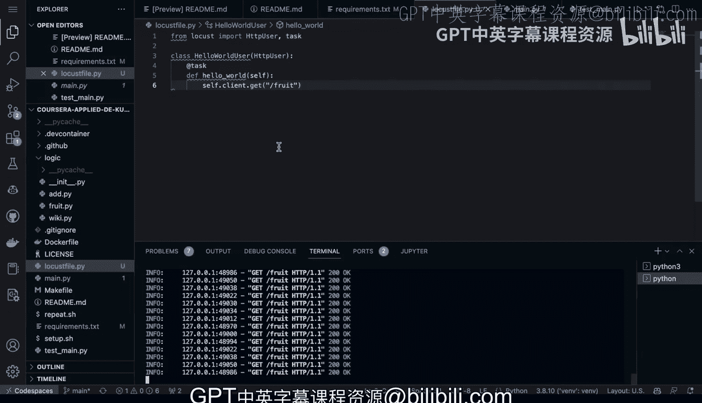

# 杜克大学《应用Python数据工程（3课全）｜Applied Python Data Engineering》中英字幕 p94 39_04_01_使用Locust进行负载测试.zh_en -BV1nz421i7KP_p94-

Locus is an open source load testing tool that can actually do millions of simultaneous users。

 great little app here that we can play around with to test our code。

 And this is an important part of doing production systems is to do load testing to verify that the behavior can be replicated in production。

 So let's go over to a Github codebased environment here。

 this simple microservice that can run Kubernetes， but I'm for now just run it locally。

 And if I go through here and I just say Python main I could run the app right so we know that that'll work and it'll launch the application。

 But what I want to do first is I want to create a locus file and if we go ahead and we look at the application here and I do a touch。

 Im say L O T P we can actually put in our load test very simply inside of here。

 So I'm going to grab some boiler code and change it a little bit here。 and so if we。😊。

through here we can say from Locus and port HETP user and we have a task here and in fact all I care about is I want to just call the random fruit function of this application so if we go to the main file here real quick we can see that it's got a route called fruitru it just randomly gives me a piece of fruit so。

Let's go ahead and do that。 Let's just type in fruit here。And that should be good to go。

 And then now all I need to do to run locust is I just type in locust。 There we go。

And what's nice is this launches a web interface。 I can browse it right here。 and here we go。

 we can start a load test。 Now what I'm going to do is I'm going to open up in a new terminal。

I'm going to also go ahead and say Python Ma to get my microservice running。

And since this is a pretty powerful machine that has lots of。Resources available to it。

 I can actually do a nice little simulation here。 and so if we go back to Locus here。

 I can say number of users， let's go ahead and simulate 10 and we can do how about。

Let's say5 a second。 And then for the swarming here。

 we can also put in the IP address of what we're actually running。 So in this case， it would be 0，0。

080。 so let's go ahead and throw that in。

And we can go ahead and start swimmingming。 And now you can see here it's going through and it's calling that endpoint and we can see exactly what's happening。

 We can look at the charts and we can see the request per second。 We can see the response time。

 We can also look at failures， there's no failures let no exceptions， look at the ratio。

 So it's a nice way to just very simply build out a performancebased test。

 And if we go back to our application， look at this。

 this thing is just getting hammered right here with so trivial to build out a low test。

 There's no reason not to do it。 You could also put this into your continuous integration。

 continuous process where you could always run a low test before you deploy to production and has to read some metric。

 So Locus is a great tool for doing automated load testing。

