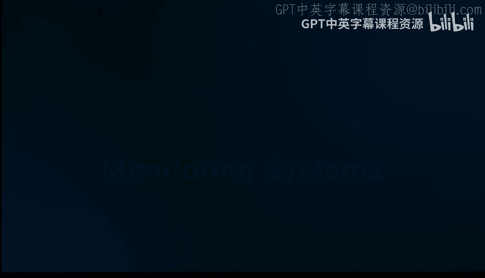
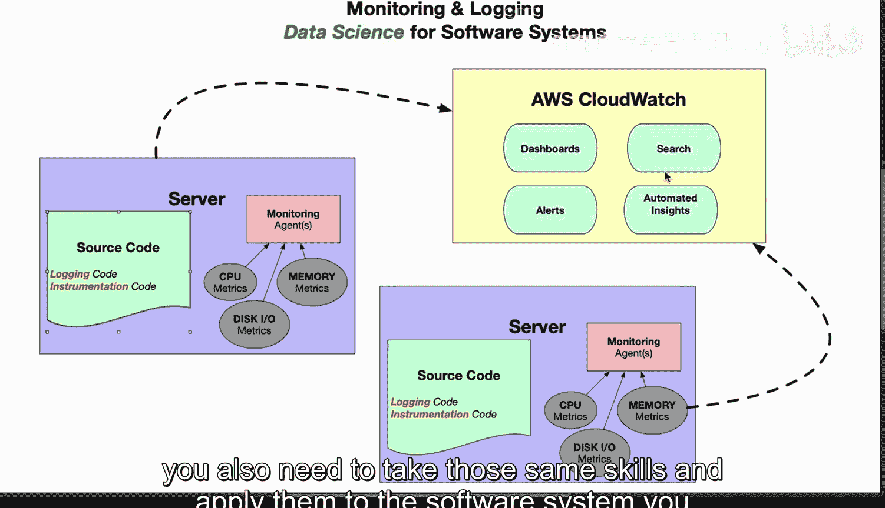

# 杜克大学《应用Python数据工程（3课全）｜Applied Python Data Engineering》中英字幕 p95 40_04_02_监控系统.zh_en -BV1nz421i7KP_p95-

Here we have monitoring and logging。 One of the ways to think about monitoring and logging is its data science for software systems。

 So even though you're doing machine learning operations， putting things into production。

You also need to look at the data science of the infrastructure you're using so in the case of a server。

 the source code itself that could be a source of information。

 the logging that you add inside the instrumentation， you add to your code for example。

 how long does it take to do a particular prediction and then in terms of the monitoring agents there are some core things like CPU diso memory that you would want to put into your agent Now how do you view this well you could do this via AWS CloudWch you could pull up a dashboard look at alerts search through a particular system and then get also automated insights that come from the AWS CloudWch system so that's really the best way to think about monitoring logging as data science for software systems you do need to have monitoring logging so that you know what's happening in your system and you get visibility data is a great discipline to have like being a data scientist you also need to take those same skills and apply them to the software system you built。

To deploy your machine learning model。