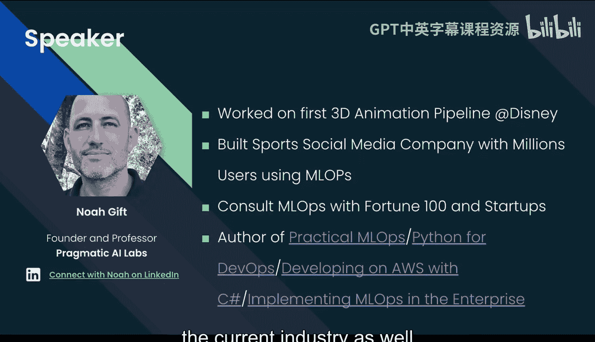
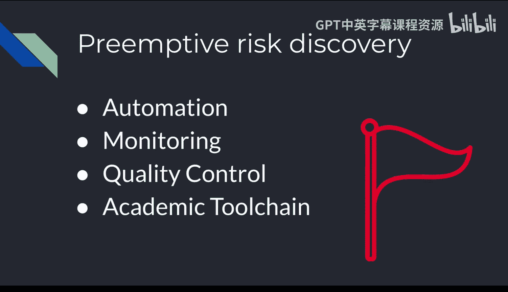
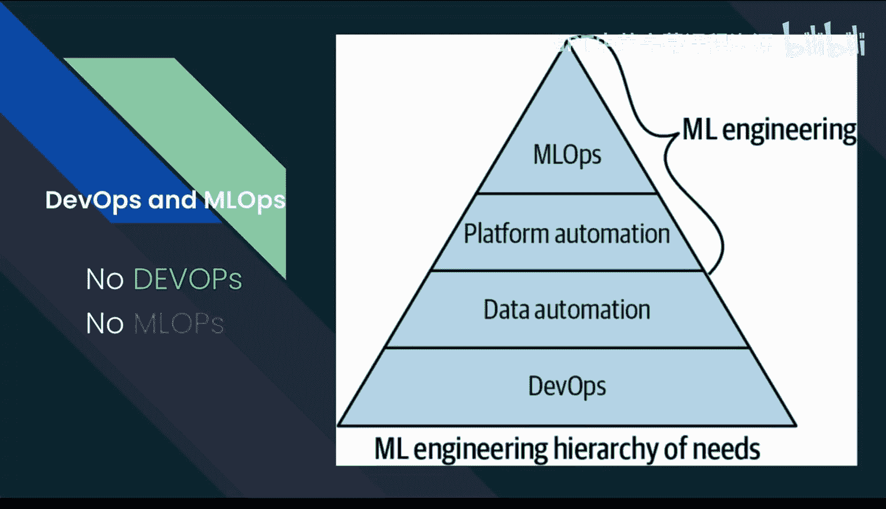
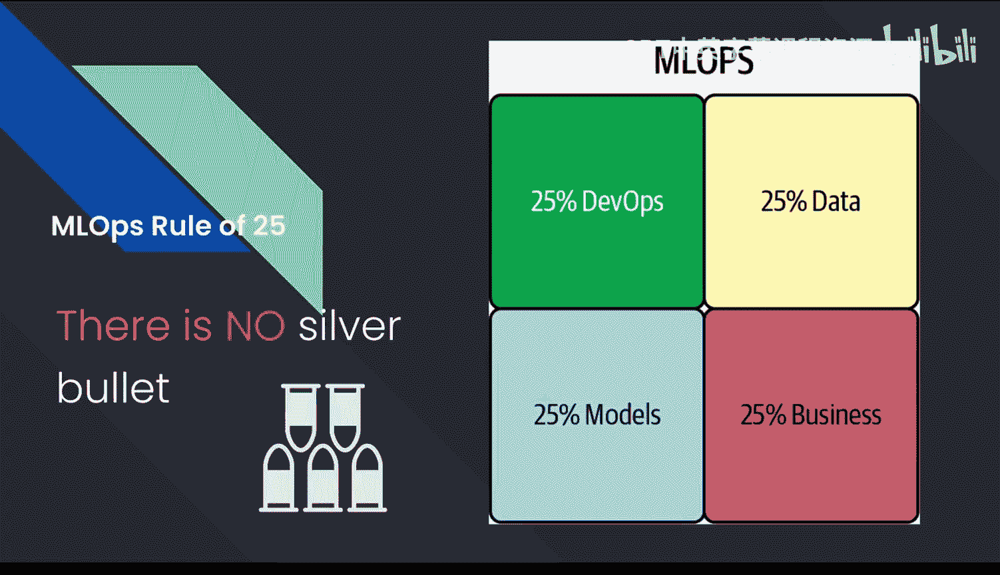
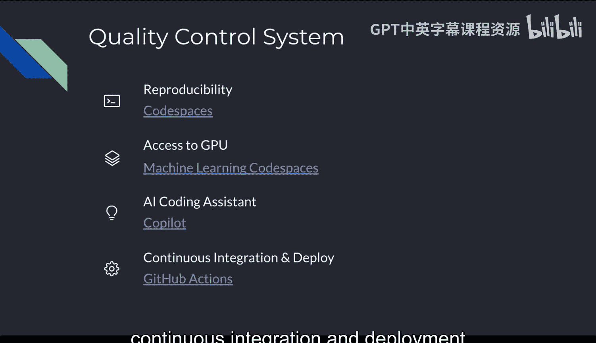
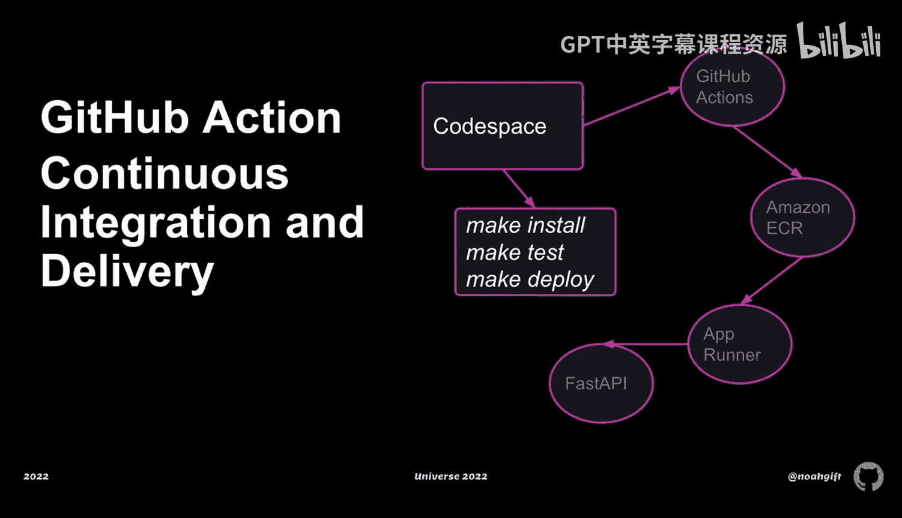
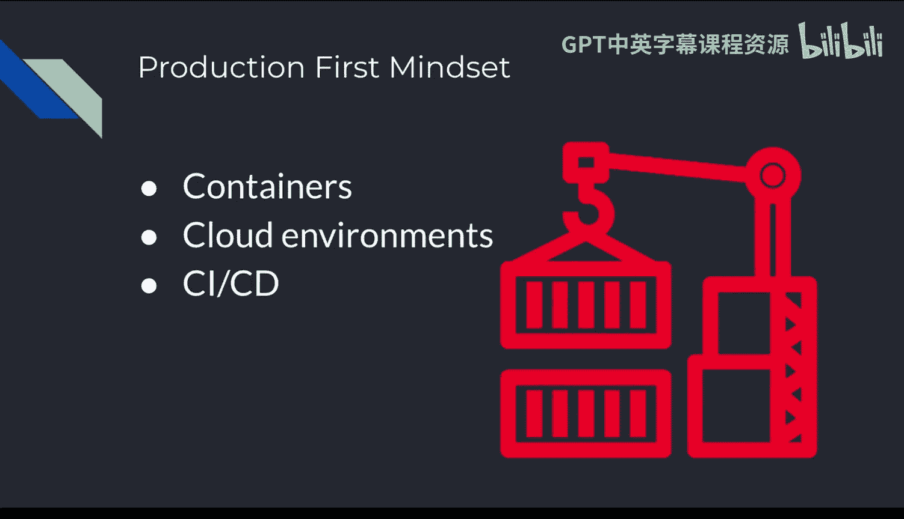

# 杜克大学《应用Python数据工程（3课全）｜Applied Python Data Engineering》中英字幕 p96 41_04_03_MLOps的SRE思维模式.zh_en -BV1nz421i7KP_p96-

Here we have the SR mindset for MLOs or the site reliability engineer mindset for MLOs really in my background。

 I've dealt with a lot of system reliability problems including building machine learning systems that use social media reach to to grow the platform and also I currently consult with companies on machine learning operations and teach ML ops And so really this background has led me to think about some of the ideas around what's happening in the current industry as well as the things that I've done in my career and one of the things that comes up immediately is the concept of preemptive risk discovery。

 So how would you do this in a data engineering or MLO system， Well first up is automation。

 if you don't have automation， there's a risk to your organization。 So can you automatically deploy。

 can you automatically test finally in monitoring right if you're not able to。

or what's happening， you don't have the ability to really use data or use data science to see what's happening in your system and then quality control。

 so are you automatically testing or you automatically linking your code if you don't do this。

 you're really rolling the dice and then another thing that's really relevant to today's era is this concept of an academic tool chain where you're building maybe like God like tools that are really useful in academics but then cause a problem when you go into production。

So really the way to look at this is DevOs and MLOs are tightly correlated if you don't have DevOs。

 you can't do machine learning operations， so if you don't do automation infrastructures code。

 then you can't get to the top of the pyramid here， which is you can automate data automation。

 you can have platform automation， you can have MLOs and this is really the hierarchy of needs for machine learning engineering。

One way to put this is that there's an MLOs rule of 25， right there's no silver bullet。

 you can't have a particular philosophy that solves all your problems。

 you have to put hard work into all of these categories， you have to have hard work into DevOs。

 you have to have hard work into data， you have to have hard work into models and you also have to have hard work into business。

Now， if we get into monitoring， one of the critical things to think about with monitoring is that it's data science for software systems。

 so if you're not monitoring your system， you're not doing data science and this is kind of ironic if your company is practicing data science。

 but then you're not actually doing data science on your software system because you're not doing monitoring。

One of the ways to think about this is a quality control system。

 So are you being able to develop in a reproducible environment that's identical to production things like Github code spaces solve that do you have access to GPU So can you actually train things in a fast manner by doing the same thing you're going to do into production are you using the best tools available。

 So are you using things like copil it， for example。

 that helps you write code in the most efficient manner。

 it's important to use the latest technologies to reduce errors。

 and then finally are you using cloudbased systems like continuous integration and deployment to further enhance your ability to write code。

So one of the things to talk about here is that with a reproducibility of a cloud based system。

 you have several advantages， you can build with a container。

 you can build a configuration from the start， and you can also use the compute and storage so you don't have to actually have a weird environment that isn't a production environment。

As I mentioned before， Copit is a great way to have an enhanced feedback loop right so you have a better prompt。

 you L， you test， you execute your format， so you're increasing your ability to diminish bugs in your code。

 so you're enhancing your ability to write high performance code。

And then if you take a look at these cloud based systems like Gitthub actions for continuous integration and delivery。

 it allows you to put the exact same steps that you do in your development environment into production。

 so it could be used Github actions to push a container to Amazon E。

 which then triggers a build to apprunner and that deployment then serves out a fast API endpoint。

So in a nutshell， one of the things that you want to avoid is the academic data science toolcha。

 some of the things that happen in a academic sense that make a lot of sense there。

 but don't make as much sense in production or notebooks being the only way that you develop software systems because notebooks or brittle and they're not really able to be leveraged in terms of software engineering best practices。

 another one is God tools So you have tools that have tons of different software installs all inside of one environment or package everything up in a way that would work really well in one box but have a problem in production and then voodoo tools so a good example of this is you have a voodoo box under your desk that everybody's connecting to maybe in your lab as a biologist you don't want to do that in the real world。

 you don't want voooo boxes you want to eliminate these kinds of tools So the production first mindset means that you do the exact same thing in development as you do in production。

 use things like containers you use cloudbased。Environment。

 and you also use continuous integration and continuous delivery。

