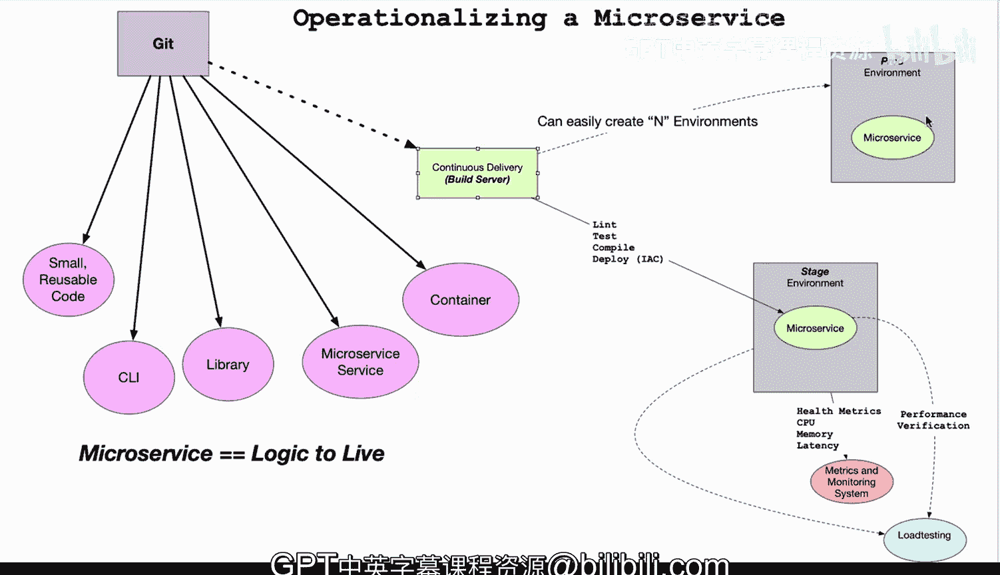

# 杜克大学《应用Python数据工程（3课全）｜Applied Python Data Engineering》中英字幕 p97 42_04_05_微服务运维化.zh_en -BV1nz421i7KP_p97-

Here we have a diagram of operationalizing a microservice。 noticeice that in Git。

 some of the advantages of a microservice come alive。

 I really like to think about a microservice in terms of the concept of logic that you go live with。

 Some of the characteristics are that it is small and it's reusable code。

 So you can maybe turn this into a command line tool。 You can turn it into a library。 You can。

 of course， make a microservice out of it。 You can also convert it into a docker container。

 All of these are characteristics of a microservice。

 It's really like a function that you've operationalized and turn it into something new。 Now。

 if you go to the continuous delivery system or the build server。

 It'll go through the steps of Linting， testing， compiling。

 maybe pushing this into a container repository and then finally deploying through infrastructure as code。

 What this does by using infrastructure as code， coupled with， let's say， a container。😊。

You can create any number of environments， you can create a staging environment。

 you can create a production environment， you can create a load test environment。

 you can create a development environment， and you can do automated things depending on which environment it gets deployed to So in the case of the staging environment and this is something I've done in my career you have a microservice that has health metrics like CPU memory latency。

 these are all monitored in some kind of monitoring system like Prometheus or potentially Cloudwa from AWS and then you do a performance verification and what this is really doing is verifying that what you think will happen will actually happen。

Once this is actually approved， you can easily just merge this into a new branch and push it。

Directly into production。 So really a microservice。

 the simplest possible explanation is it's logic that you push live。

