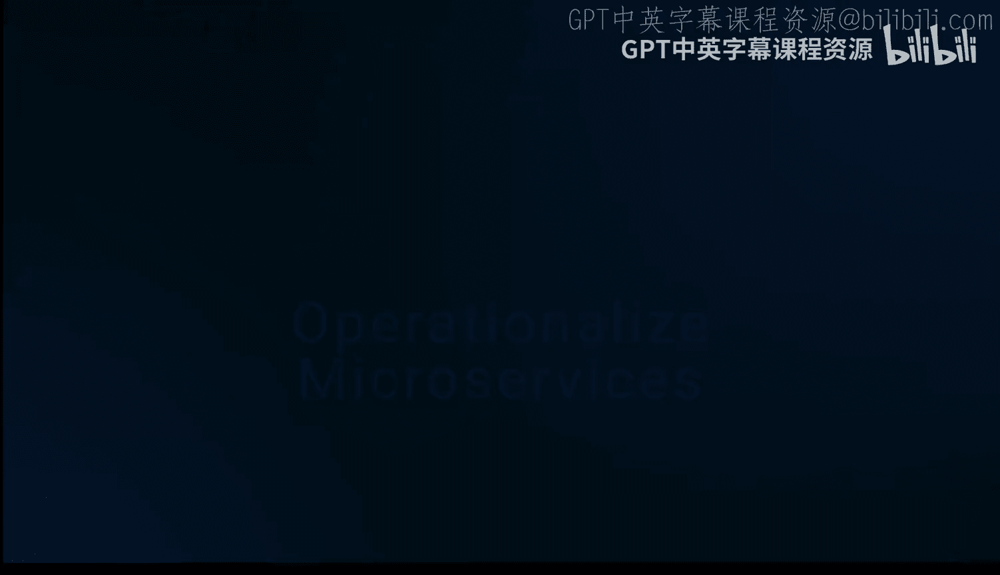
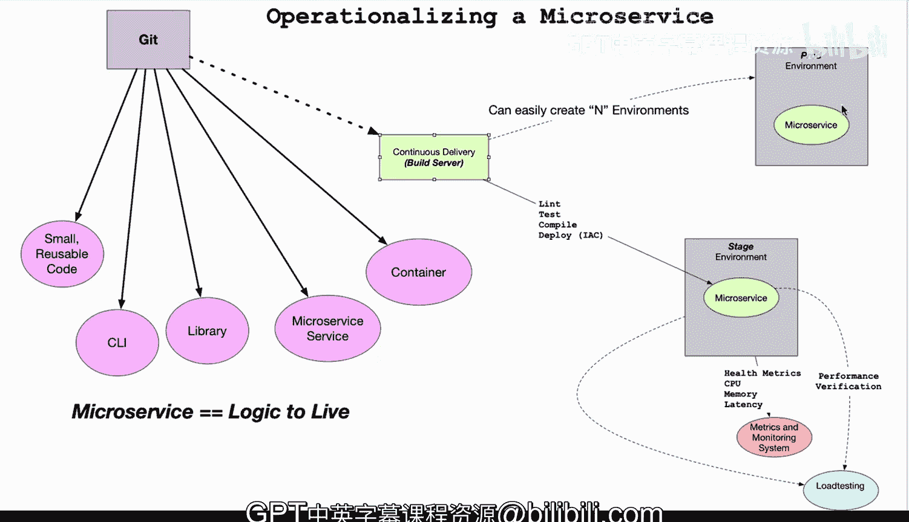

# 微服务运维化：第42章：微服务运维化实践

在本节课中，我们将学习如何将一个微服务投入实际运行，即“运维化”。我们将探讨微服务的核心特征、从代码到部署的完整流程，以及如何利用基础设施即代码和容器技术来管理多个环境。

上一节我们介绍了微服务的基本概念，本节中我们来看看如何将其投入实际运行。

## 微服务的核心特征

微服务的优势在代码管理工具（如Git）中得以体现。我们可以将微服务视为一段可投入实际运行的逻辑代码。

以下是微服务的一些关键特征：
*   **体量小**：微服务是轻量级的。
*   **可复用代码**：其代码可以被多种方式复用。

基于这些特征，一段微服务代码可以转化为多种形态：
*   可以将其制作成一个**命令行工具**。
*   可以将其封装成一个**代码库**。
*   当然，可以将其构建成一个**微服务**。
*   也可以将其打包成一个**Docker容器**。

本质上，微服务就像是一个被“运维化”并赋予了新形态的函数。

## 持续交付流程

接下来，我们看看代码如何通过持续交付系统或构建服务器进入生产环境。

该流程通常包含以下步骤：
1.  **代码检查**：进行代码规范检查。
2.  **测试**：运行各类测试。
3.  **编译**：编译代码。
4.  **推送至容器仓库**：将构建好的容器镜像推送到仓库。
5.  **基础设施即代码部署**：最后通过基础设施即代码的方式完成部署。

## 多环境管理与自动化

通过结合使用**基础设施即代码**和**容器技术**，我们可以轻松创建和管理任意数量的环境。

例如，您可以创建以下环境：
*   开发环境
*   预发布环境
*   生产环境
*   负载测试环境

系统可以根据代码被部署到的不同环境，执行相应的自动化操作。

## 预发布环境的监控与验证

以预发布环境为例，我们可以实施一套监控与验证流程。以下是具体步骤：

1.  **部署微服务**：将微服务部署到预发布环境。
2.  **监控健康指标**：微服务会暴露健康指标，如CPU使用率、内存占用、请求延迟等。
3.  **集成监控系统**：这些指标被收集到监控系统中，例如**Prometheus**或AWS的**CloudWatch**。
4.  **性能验证**：此步骤旨在验证服务的实际表现是否符合预期。

一旦微服务在预发布环境中通过所有验证，您就可以轻松地将其合并到新的分支，并直接部署到生产环境。

本节课中我们一起学习了微服务运维化的完整流程。总而言之，微服务最简洁的解释就是：**一段您投入实际运行的逻辑代码**。通过标准化的构建、部署和验证流程，我们可以确保微服务能够可靠、高效地服务于不同环境。