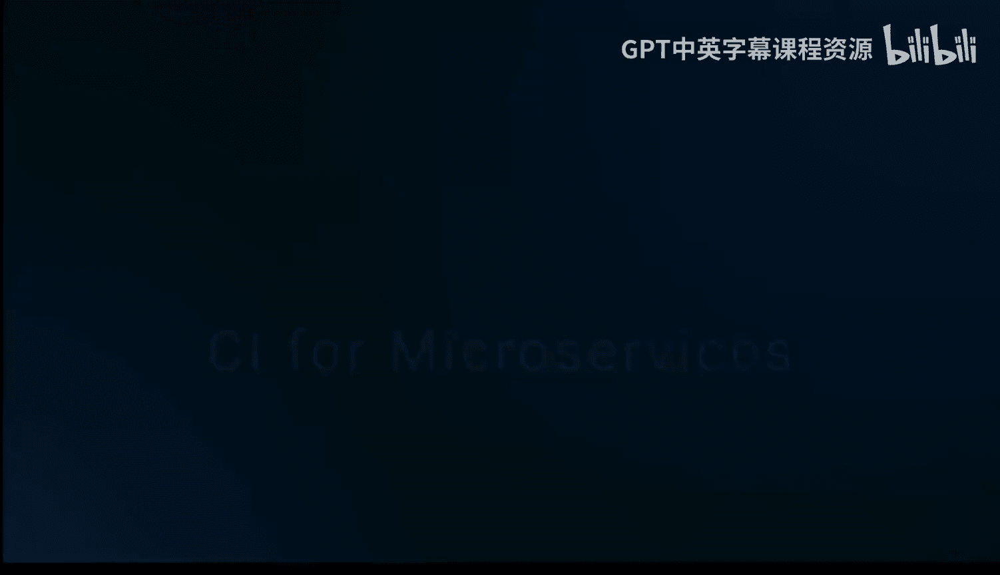
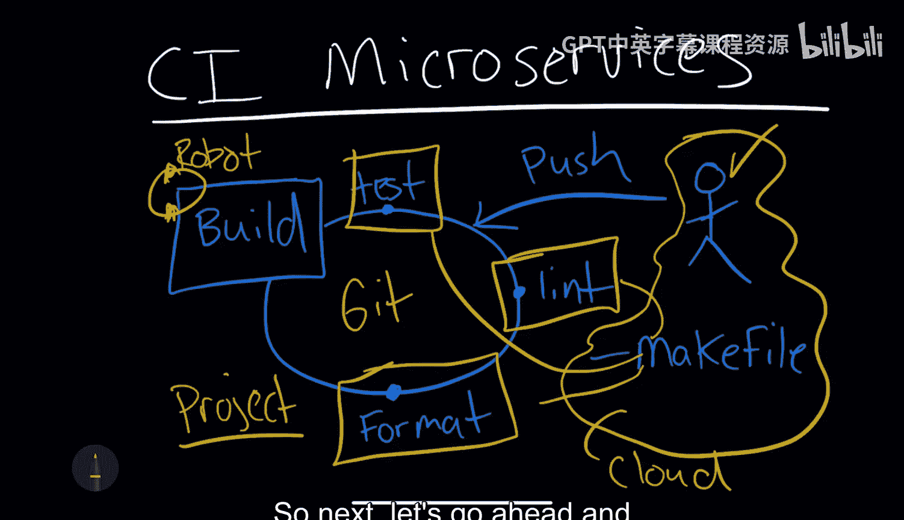
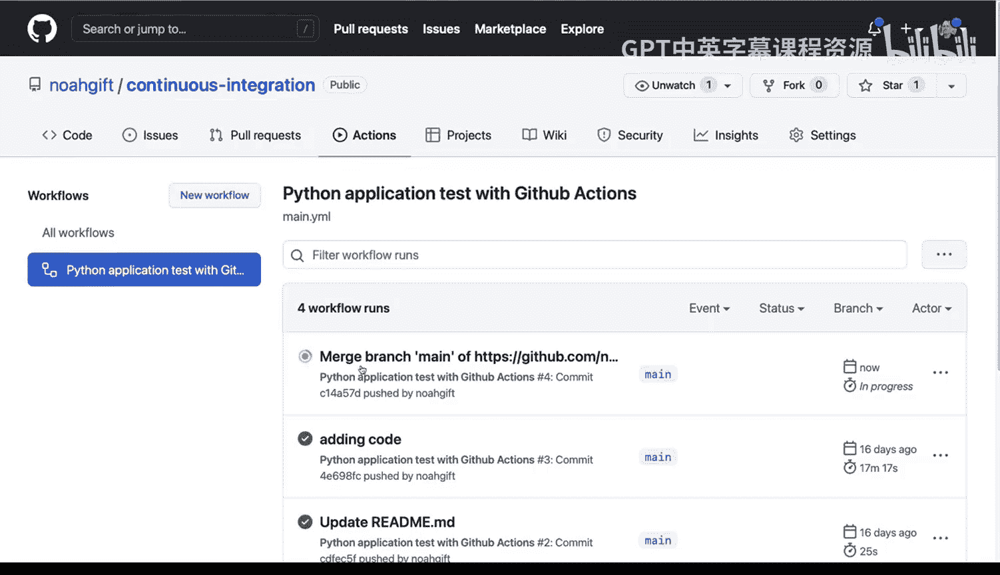
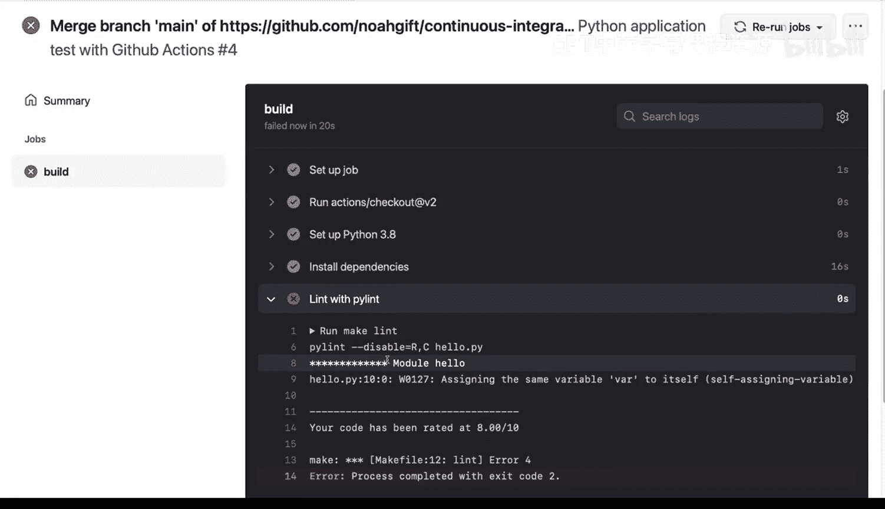
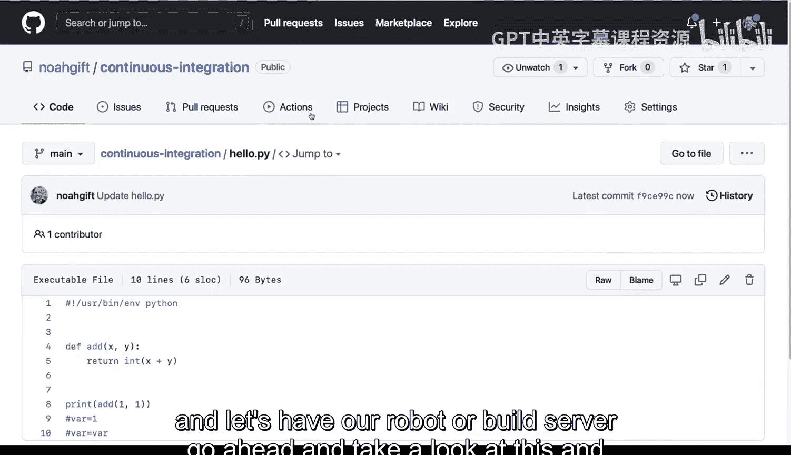
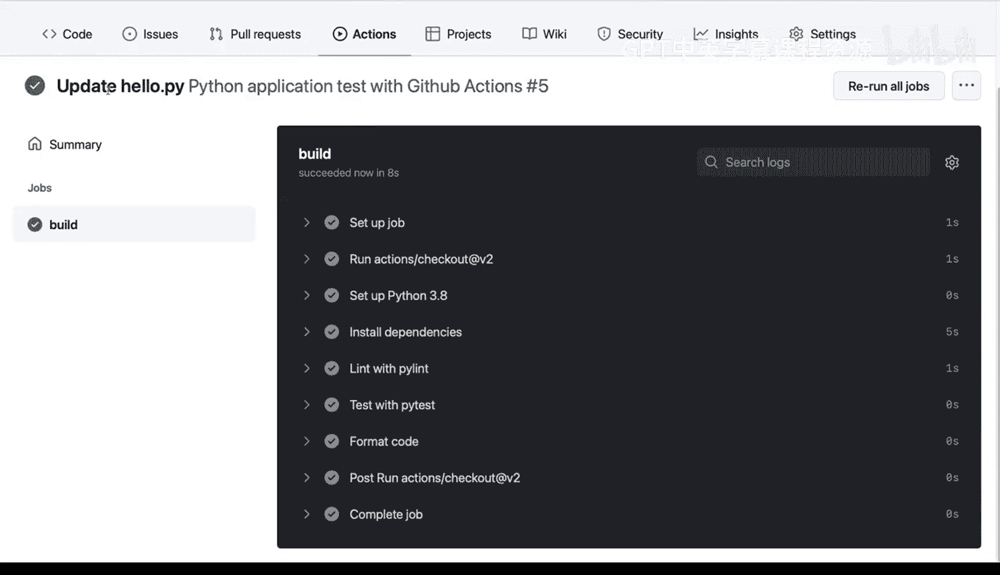
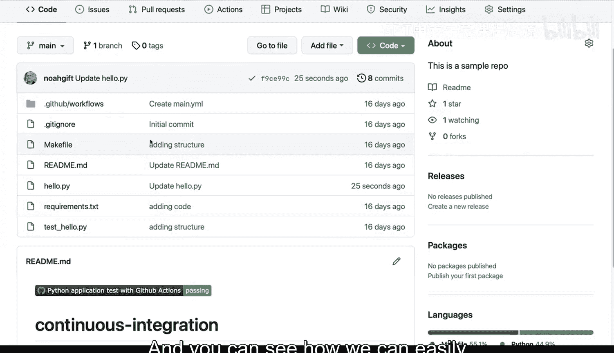

# 杜克大学《应用Python数据工程（3课全）｜Applied Python Data Engineering》中英字幕 p98 43_04_06_微服务持续集成.zh_en -BV1nz421i7KP_p98-

Let's take a look at how you could set up a continuous integration ecosystem for microservices really to start out with your project is the most important first step and this is a project structure that we'll go through in a second。

 but in general， it's the ability to test to Li and to formats or code every time the human。

 the developer that's you pushes the changes into a Gitbased repository。

 So this would be Git in this case I'm going to show you Gitthub but the real key characteristics here are that there is a make file that can do all of these actions right this make file corresponds to the Li it corresponds to the format。

 it corresponds to this test and I do those locally。

 but then I can also replicate that by having this robot up here。

 which is the build server that always is making my project high quality because it's checking for things like the Li of the code。

Foratting the code， the testing of the code and then later when I get into deployment to deploy the code so really this is a key concept。

 set up this local continuous integration environment so that your project is ready to go when you want to push that into production So next let's go ahead and take a look at how that would work in practice with a Github project。

Let's take a look at a project structure that is really set up for you to do everything you need to do to do both continuous integration and then later continuous delivery。

 What are the key components。 First up in this repo Noa giftft continuous integration we have a Github workflows section This is where the built system In this case。

 it will be Github actions but it could be things like Jenkins or Aws code build or some other build system。

 it will go through and test， my code and do exactly what I tell to do。 In this case。

 we can look at the commands by going to this main do yaml file and we can see that on every push or every change a human makes itll go through and it will spin up in a boontu virtual machine It will use Python 38 and it will do these steps。

 make install make Li and make test and then later make format。

 and this is a great structure I would recommend for all continuous integration projects is to have this kind of a structure set up now。

What we can do next here is take a look at the environment for the code itself and that would be the different sub componentsents of this project so we can see here that there is a readme file。

 always a good idea， I have a build system badge， I also have a really basic file here that adds two numbers I also have a test file that was able to go through here and test our code。

And then I also have a requirements file which has versioned packages。

 And this is important so it's reproducible so that I know that the version I tested my Python project with will be reproducible for the build system。

 Finally， if we go ahead and we take a look at our make file itself。

 you can see that this structure is really a set of recipes right and make install I make test I make format I make Lint。

 So that's the structure。 But how would I use this in the real world。 Well。

 we can take a cloud based development of Ormin here， which is Github codespaces。

 and we can spin it up and take a look at it。😊，And from here。

 actually go through and exercise the components of the project and also see what happens if something fails and how it's easy to detect the failure because of the fact that we have this great scaffolding for our project。

Okay， so we're inside of this GitHub codespaces environment here and notice that I have a terminal and I have all of the code here on the left and notice there's a virtual environment that I created you can create your own by using the virtual environment command and then putting it in some location in my situation I actually edited my BshRC file here and I put in the source command directly into that BshRC file we cover that in another lesson in the Bsh section about how to edit your BshRC but for now I'm going to go through here and look at the structure again you see all these files here and I'm going to run make all。

And when I do make all， we can take a look at this。 What does it do It installs， it linkss。

 it tests our code。 And what's great about all this is I get a great kind of feedback loop that says hey。

 everything works。 Now what happens if there's a problem in the code in this case。

 this would be a great little bug is that if I assign a variable to itself。

 it doesn't necessarily break our code， but it does cause a potential problem in the future。

 And so in this case， look we can see that oh there's two different problems We're assigning a variable to itself plus I never actually made this variable do anything。

😊，I never assigned it and now if I change it， we can see that that variable is still got a warning problem so the first one was an exception or an error where it the code would not run。

 the other one is just a warning in either case the Li was able to catch this bug now let's go ahead and push this change。

Okay， great。 now I'll go ahead and do a get push。And we'll push those changes perfect and now if I go back here and I say open repository or go to repository。

 we can watch this build system in action and this is the benefit of a continuous integration system is it's a robot that's watching our code that's one of the best ways to think about it It's sitting there constantly cleaning up things looking for installation problems。

 Linting problems， testing problems， it'll fail right here with this Li because we have a bad message oh the code has actually had alinnting problem。

There's there's an issue what do we do Well fortunately it's very straightforward I don't even need to go into my development environment。

 I can just go to this file right here and I can edit it and I can say oh this was a problem I don't need these two lines of code。

 let's go ahead and fix this and let's have our robot or build server go ahead and take a look at this and see if it can fix it。

Okay， so we're waiting for this build server to run the job。There we go。

 It's going to set up the code， install the dependencies。

 and then finally now we see that the Li itself has actually gone through。

 the format has gone through， everything's gone through。

 So really this is the process is it's something that every project should have if you're doing microservice development command and tool development。

 really anything in software development in Python and you can see how we can easily test those changes even inside of a GitHub project。

