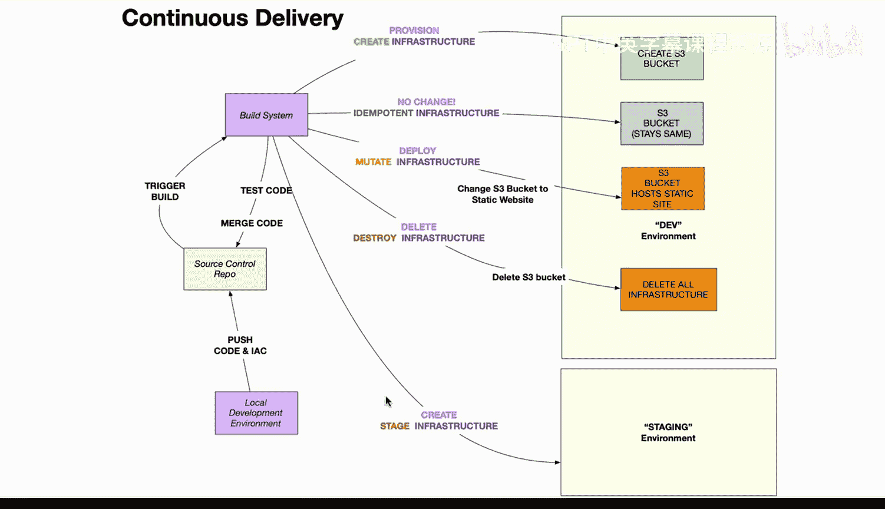

# 杜克大学《应用Python数据工程（3课全）｜Applied Python Data Engineering》中英字幕 p99 44_04_07_什么是持续交付.zh_en -BV1nz421i7KP_p99-

Let's walk through a continuous delivery workflow using the latest cloud native ecosystem tools to start off with you would develop in an environment oftentimes this would be a cloudbased environment like cloud 9 on AWS or Giup codespaces on the Azure platform and the reason for using these cloud native environment is that they give you the ability to use all of the developer tools that will later be in the production environment。

 so you have a very similar one to one environment Now when you're building things you'll push not only the software but the infrastructure as code as well。

 and the infrastructure as code allows you to define every single aspect of what's happening in a cloudbased environment or a Kubernetesbased environment and notice here that when you push the changes that the build system will then go through and test your code。

 merge the code and this build will then automatically go to the provisioning。

StepAnd what's powerful about infrastructure as code is that it's item potent。

 And what this means is that it only makes a change if a change is necessary。

 but it also makes the state always be in the same condition。

 So if you initially create the infrastructure when you do another maybe a second build。

 it won't create the infrastructure again， because it'll notice that let's say this S3 bucket here it's already been created so it won't need to to make that change。

 Now， likewise， if you mutate it if you go to your infrastructure as code。 you make a small change。

 it would then go through here and create a new bucket for you。 Finally。

 if you need to clean up your resources， it's easy to do this with infrastructure as code。

Now finally， another thing you can do that's pretty powerful here is you can do whatever actions you'd like so you can go ahead and say instead of a delete action。

 you could say I want to create a new infrastructure here and I want to build out in this particular environment。

 a stage environment and this staging environment is where I'll do my load testing and then you could likewise make another fork of the code and the infrastructure as code and then create a production environment。

 so this idea of using the infrastructure itself to define the system and to make itempotent changes is a huge part of continuous delivery and this allows you to constantly push the changes into a new environment it doesn't necessarily mean that you will always push that into a production environment without a human being involved but it does actually allow you to make pushes to multiple environments and this is really the key concept in continuous delivery。

