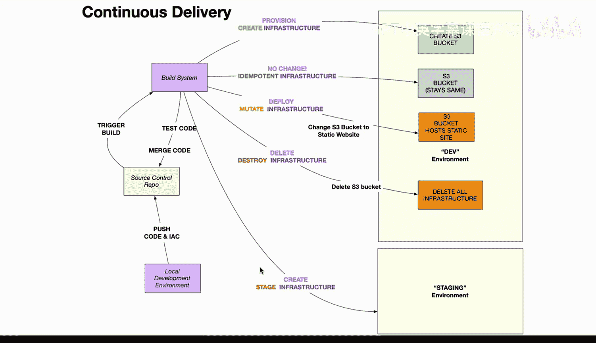

# 应用Python数据工程：3：什么是持续交付 🚀

在本节课中，我们将学习持续交付的核心概念，并了解如何利用现代云原生工具构建一个自动化的软件交付工作流。

---

上一节我们介绍了持续交付的基本理念，本节中我们来看看一个具体的持续交付工作流是如何运作的。我们将使用最新的云原生生态系统工具来构建这个流程。

首先，开发工作通常在云端环境中进行。例如，AWS的Cloud 9或Azure平台的GitHub Codespaces。使用这些云原生环境的原因是，它们能让你使用与未来生产环境一致的开发工具，从而构建出一个与生产环境高度相似的开发环境。

在构建过程中，你不仅会推送软件代码，还会推送“基础设施即代码”。基础设施即代码允许你定义云环境或Kubernetes环境中每一个组件的配置。值得注意的是，当你推送变更时，构建系统会自动测试你的代码、合并代码，然后这个构建版本会自动进入“资源供给”阶段。

基础设施即代码的强大之处在于它是**幂等**的。这意味着，它只在必要时才做出变更，并且始终确保环境状态保持一致。例如，如果你最初创建了基础设施，在进行第二次构建时，它不会重复创建，因为它会检测到（比如）某个S3存储桶已经存在，因此无需再次创建。

同样地，如果你修改了基础设施即代码的配置，比如做一个小改动，系统会识别出差异，并为你创建一个新的存储桶。最后，如果需要清理资源，使用基础设施即代码也能轻松完成。

此外，你还可以执行各种强大的操作。例如，你可以选择不执行删除操作，而是创建一个全新的基础设施。你可以构建一个特定的**预发布环境**，用于进行负载测试。同样地，你可以复制代码和基础设施即代码的配置，再创建一个**生产环境**。

这种利用代码来定义系统、并实现幂等变更的理念，是持续交付的重要组成部分。它使你能够持续地将变更推送到新环境。这并不意味着在没有人工干预的情况下，变更总会直接进入生产环境，但它确实允许你将变更推送到多个不同的环境。这正是持续交付的关键概念。

---

本节课中我们一起学习了持续交付工作流的核心组成部分，包括使用云原生开发环境、基础设施即代码的幂等性，以及如何通过自动化流程将代码变更安全、一致地推送到多个环境（如预发布和生产环境）。