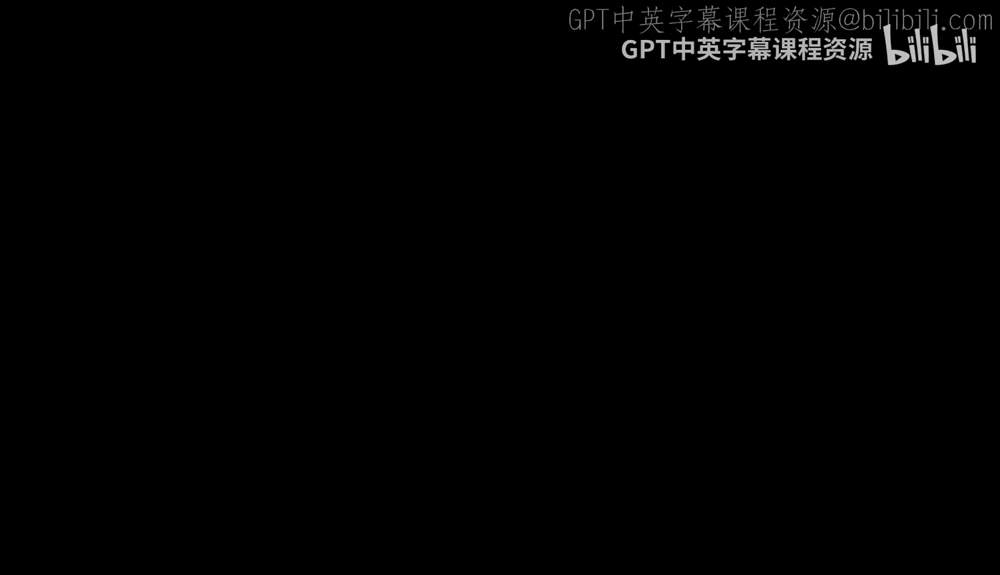

# 1：认识你的课程讲师阿尔弗雷多·德萨 👨‍🏫

在本节课中，我们将认识本课程的讲师阿尔弗雷多·德萨，并了解他的专业背景与课程重点。

大家好，我是阿尔弗雷多·德萨。我很高兴为大家带来这门关于 Azure 上大型语言模型的课程。我的经验和背景主要在自动化编程领域。我是一名资深的 Python 开发者，最近也在大量使用 R 编程语言进行开发。此外，我在云技术领域已有很长时间的工作经验。

多年来，我的工作重点一直是自动化以及构建稳健的基础设施。我认为，我的侧重点在于关注监控，以及在流程（例如流水线）运行过程中捕捉细节。在我们学习本课程的不同类型内容时，大家会清楚地看到如何应用我过去的这些经验。

有趣的是，我们将学习如何将过去行之有效的方法（如自动化、监控、密切关注细节以及构建稳健的基础设施和应用程序）应用到像大型语言模型这样的新技术上。因此，结合我的背景，以及我在微软的经验，希望大家能够对在 Azure 上运行的大型语言模型有一个非常透彻的理解。

本节课中我们一起认识了讲师阿尔弗雷多·德萨，并了解了他将如何结合其在自动化、监控和云基础设施方面的丰富经验，来指导我们学习 Azure 上的大型语言模型。