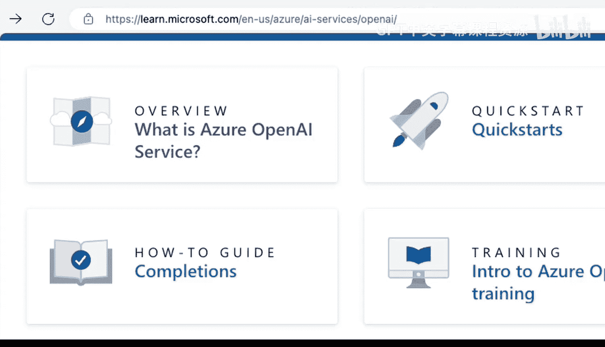

# 3：获取Azure OpenAI服务访问权限 🔑

在本节课中，我们将学习如何获取Azure OpenAI服务的访问权限。目前，该服务的访问权限受到一定限制，未来可能会有所变化。我们将通过一系列步骤来完成申请。

## 访问申请概述

首先，我们需要访问Microsoft Learn平台上的Azure OpenAI服务文档页面。这个页面不仅是申请访问的起点，也是了解服务功能、创建资源、使用嵌入和OpenAI模型等所有信息的绝佳场所。

上一节我们介绍了Azure OpenAI服务的概况，本节中我们来看看如何具体申请访问权限。

## 申请步骤详解

以下是申请Azure OpenAI服务访问权限的具体步骤。

1.  **访问官方文档**：导航至Microsoft Learn上的Azure OpenAI服务文档页面。这是获取最新信息和申请链接的可靠来源。
2.  **查找申请链接**：在文档页面的“附加资源”部分，可以找到申请访问的链接。点击该链接将跳转到申请页面。
3.  **使用快捷链接**：一个更易记忆的快捷方式是访问 `aka.ms/oai/access` 这个短链接。它同样会引导你至申请页面。
4.  **填写申请表单**：在申请页面，请仔细阅读所有说明，并完整填写表单中的所有信息。
5.  **使用企业信息**：请注意，申请时不应使用个人邮箱地址。你需要提供企业相关信息，例如公司名称、地址等。
6.  **提交并等待**：完成所有信息填写后，提交申请。审核和开通访问权限可能需要一些时间。

## 重要注意事项

由于服务注册目前存在一定限制，申请过程可能有所调整。为了确保你遵循的是最新、最准确的流程，建议始终通过Microsoft Learn平台，搜索并进入“Azure OpenAI服务”官方文档页面来获取最新指引。

本节课中我们一起学习了如何通过Microsoft Learn平台申请Azure OpenAI服务的访问权限，包括查找申请链接、填写企业信息以及提交申请的完整流程。