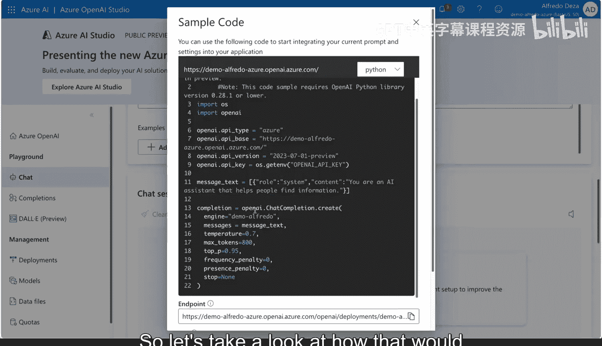
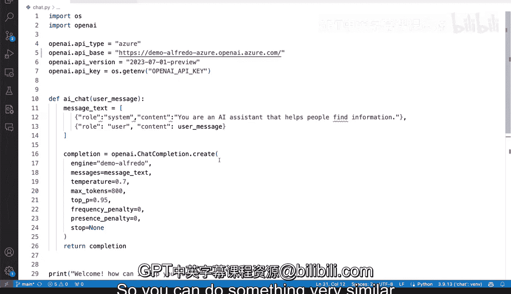

# 4：04_01_04_创建Azure OpenAI服务资源


## 概述
在本节课中，我们将学习如何通过Python代码与Azure OpenAI服务进行交互。我们将从分析官方提供的代码示例开始，了解其结构，并学习如何修改和运行一个简单的聊天脚本。

## 代码示例分析
上一节我们介绍了在Azure门户中创建资源。本节中我们来看看如何通过代码与创建好的服务进行对话。

官方提供的Python代码示例需要特定版本的库才能运行。代码开头明确指出，它需要`openai`库的0.28.1或更低版本。如果你从未使用过Python，建议先尝试使用页面中提供的`curl`命令示例，该命令在大多数系统终端（如macOS、Linux或Windows的WSL）中都可用。

## 修改与运行Python脚本
为了更清晰地展示交互过程，我们对示例代码进行了一些调整。以下是修改后的脚本核心部分：



```python
import os
import openai

openai.api_type = "azure"
openai.api_base = os.getenv("AZURE_OPENAI_ENDPOINT")
openai.api_version = "2023-05-15"
openai.api_key = os.getenv("AZURE_OPENAI_KEY")

def get_completion(user_message):
    messages = [
        {"role": "system", "content": "You are an AI assistant that helps people find information."},
        {"role": "user", "content": user_message}
    ]
    response = openai.ChatCompletion.create(
        engine="gpt-35-turbo",
        messages=messages,
        temperature=0.7,
        max_tokens=800,
        top_p=0.95,
        frequency_penalty=0,
        presence_penalty=0,
        stop=None
    )
    return response.choices[0].message.content

while True:
    user_input = input("User: ")
    if user_input.lower() == 'quit':
        break
    response = get_completion(user_input)
    print("Assistant:", response)
```

主要修改点包括：
1.  将API密钥和终端点设置为环境变量，提升安全性。
2.  将核心逻辑封装在一个函数`get_completion`中，使结构更清晰。
3.  使用`while`循环实现持续对话，直到用户输入“quit”退出。

## 环境与依赖管理
在运行脚本前，需要正确设置Python环境并安装依赖。

以下是设置步骤：
1.  **创建虚拟环境**：使用命令`python3 -m venv venv`创建一个隔离的Python环境。
2.  **激活虚拟环境**：
    *   macOS/Linux: `source venv/bin/activate`
    *   Windows: `venv\Scripts\activate`
3.  **安装依赖**：创建一个`requirements.txt`文件，内容为`openai==0.28.1`，然后运行`pip install -r requirements.txt`进行安装。

“固定版本”（`==0.28.1`）意味着精确安装此版本，以避免因库版本更新导致的兼容性问题。

## 运行演示
完成环境配置后，在终端激活的虚拟环境中运行脚本`python chat.py`。

程序启动后，会提示“User:”。输入问题，例如“I find Python dependency management kind of tricky.”，AI助手会迅速回复，例如“Python dependency management can be challenging...”。

这个循环对话模式允许用户持续提问并获得回答，模拟了真实的聊天交互体验。



## 总结
本节课中我们一起学习了如何通过Python与Azure OpenAI服务进行交互。我们分析了官方代码示例，创建了一个可持续对话的修改版脚本，并介绍了使用虚拟环境和`requirements.txt`文件来管理项目依赖的重要步骤。通过本课实践，你已经掌握了连接并使用Azure OpenAI核心服务的基础方法。