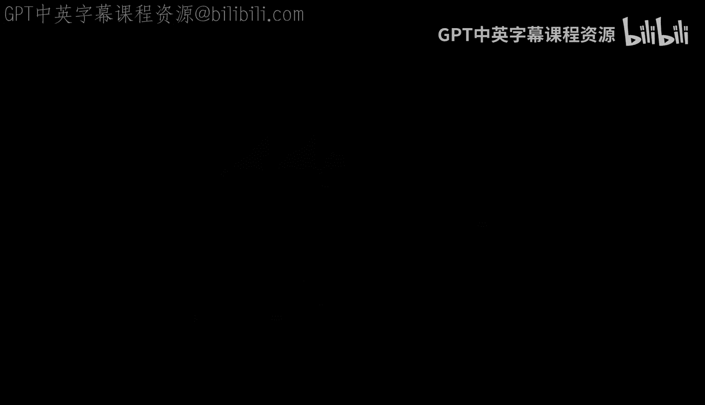
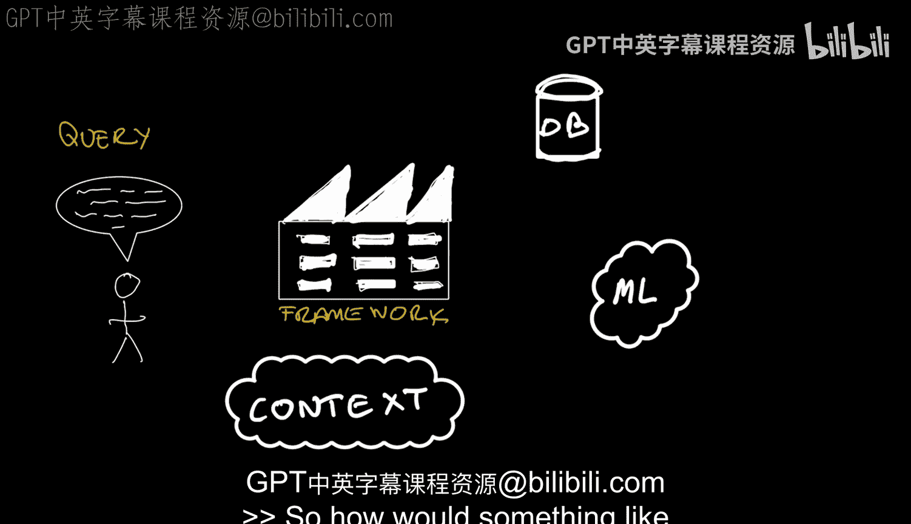
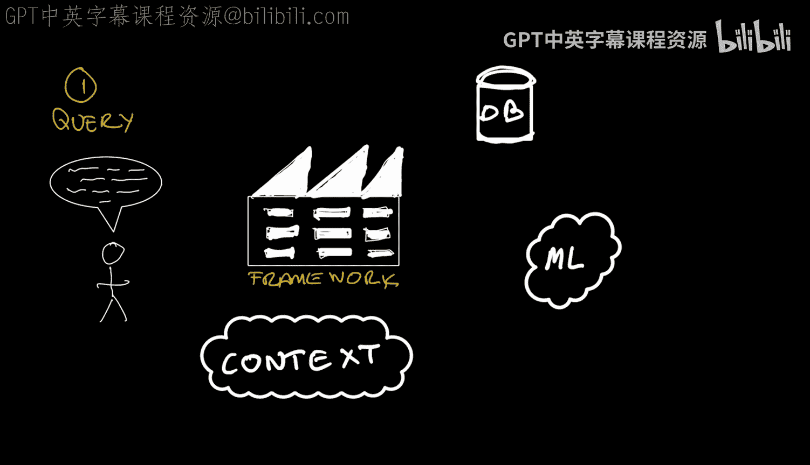
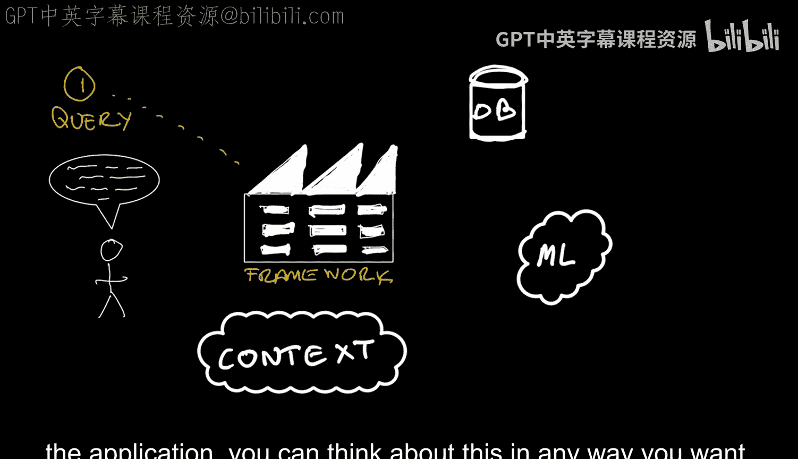
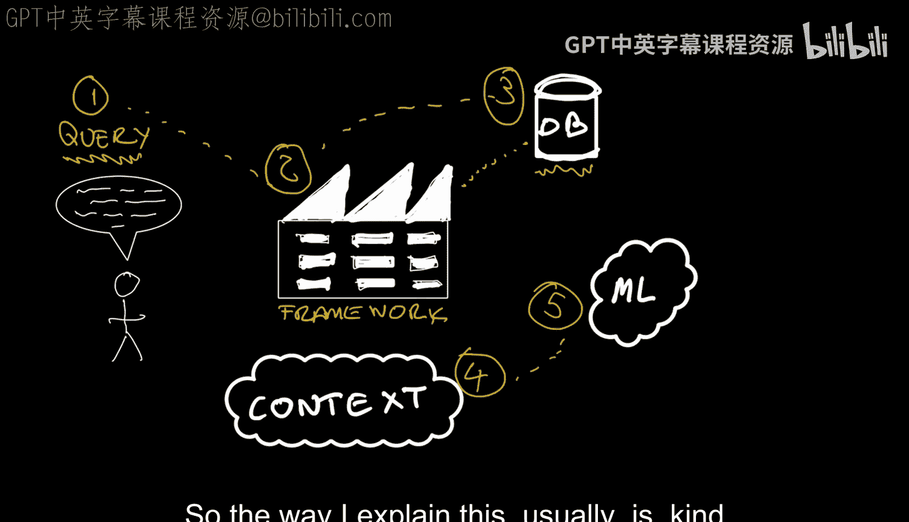
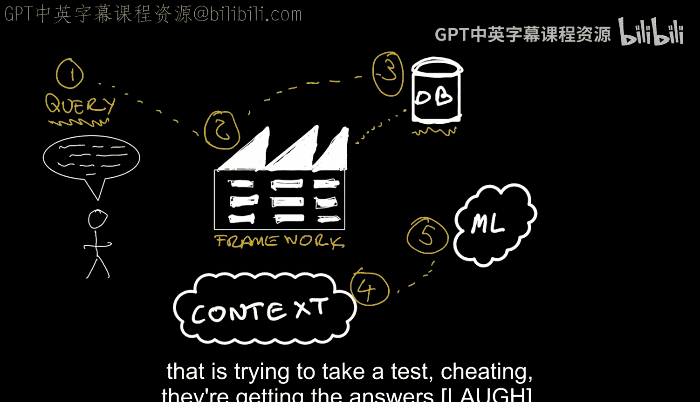
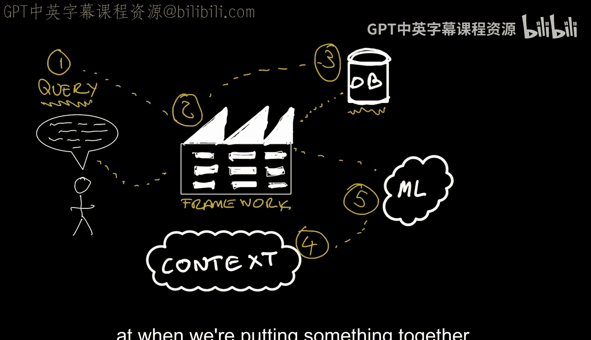
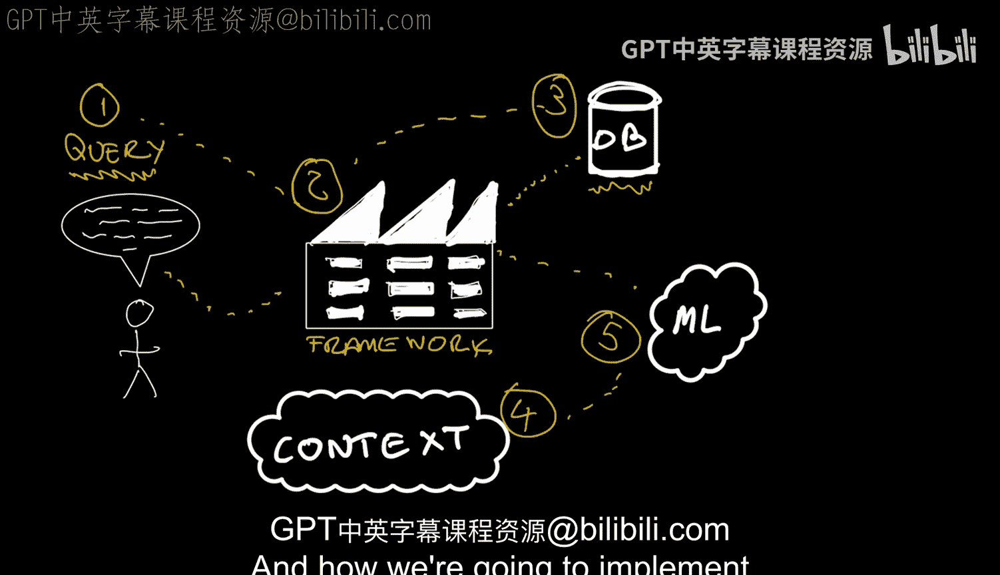

# 9：09_01_01：架构概述 🏗️

在本节课中，我们将要学习检索增强生成（RAG）的基本架构和工作流程。我们将通过一个清晰的步骤分解，了解用户查询如何通过框架、向量数据库和大语言模型的处理，最终返回一个包含额外上下文的答案。

---

## 架构概述

首先，我们从用户的一个查询开始。通常，这个查询会直接发送给应用框架，然后由框架传递给大语言模型处理。但在检索增强生成的架构中，流程会有所不同。

上一节我们介绍了RAG的基本概念，本节中我们来看看它的具体工作路径。

### 查询处理流程

以下是检索增强生成（RAG）的核心处理步骤：

1.  **用户发起查询**：流程始于用户提出一个问题，例如“昨天的天气怎么样？”。
2.  **查询发送至框架**：用户的查询首先被发送到应用框架。这个框架可以是LangChain、Semantic Kernel，或者任何实现了相关API的自定义应用程序。
3.  **框架查询向量数据库**：框架收到查询后，不会直接将其发送给大语言模型。相反，它会先将查询发送到**向量数据库**进行搜索。
4.  **数据库返回相关上下文**：向量数据库执行相似性搜索，找到与用户查询最相关的信息片段（例如，存储的昨日天气记录）。这些信息是大语言模型在训练时未曾见过的。
5.  **组合查询与上下文**：框架将原始用户查询和从向量数据库获取的额外上下文信息组合在一起。
6.  **发送增强提示至LLM**：这个组合后的、包含“答案”的增强提示被发送给大语言模型。可以把这个过程想象成学生在考试时拿到了参考资料。
7.  **LLM整理并返回答案**：大语言模型的核心任务不再是凭空生成答案，而是根据已有的上下文信息，以一种通顺、自然的方式组织语言，形成最终回复。
8.  **答案返回给用户**：框架将大语言模型生成的答案返回给用户。

### 架构优势

这种“前后往返”的流程设计巧妙。它能够为模型提供相关的事实和背景信息，从而提升回答的准确性和可靠性。

训练一个大型机器学习模型成本高昂，但向向量数据库中添加文档的成本却相对很低，操作也更为简单。我们稍后会探讨如何向数据库中添加文档，但以上便是实现检索增强生成时，数据流转路径的快速概览。当我们决定部署时，也会基于此架构进行实施。

---

本节课中我们一起学习了检索增强生成（RAG）的基本架构。我们了解到，RAG通过引入向量数据库作为外部知识源，让大语言模型在回答时能够参考更具体、更实时的信息，从而克服了模型本身知识可能过时或不足的限制。核心流程可以概括为：**用户查询 -> 框架 -> 向量数据库检索 -> 组合上下文 -> 大语言模型生成 -> 返回答案**。