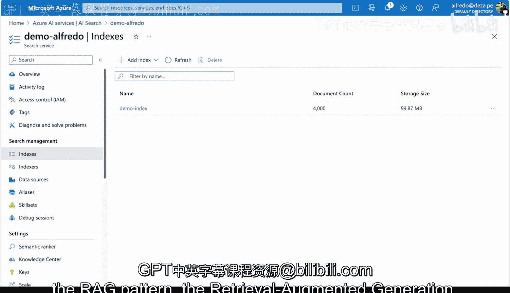

# 10：Azure AI搜索概述 🧠

在本节课中，我们将学习Azure AI搜索服务的基础知识。我们将了解其核心概念、如何创建资源，以及它如何作为增强大型语言模型应用的关键组件。

---

Azure AI搜索，之前被称为Azure认知搜索，是Azure平台提供的一项强大服务。它能够帮助我们在应用中嵌入文档时，增强应用的能力。

上一节我们介绍了课程背景，本节中我们来看看Azure AI搜索的具体操作。首先，让我们快速浏览一下其界面和功能。

我将点击此处。这里有一个我之前创建的实例。我不仅会展示其中的一些功能，还会逐步演示如何创建一个新的资源。

首先，我将创建一个新资源。和往常一样，我会使用“demo”作为资源组名称。我总是尝试使用“demo”作为前缀，因为这是一个便于后续清理资源组的好方法。

以下是创建资源时需要填写的几个关键步骤：

*   **服务名称**：需要输入一个全局唯一的名称。例如，我们可以输入“fredo-search”。
*   **区域**：选择部署区域，例如“US2”。
*   **定价层**：这里非常重要。我们可以选择**免费层**。免费层提供50MB的存储空间，允许进行基本的操作，且无需任何成本。这对于学习和实验非常有用。
*   **副本与分区**：在免费层中，我们只能配置1个副本和1个分区，即1个搜索单元。这对于我们当前的学习目标已经足够。

配置完成后，点击“查看 + 创建”。系统会进行验证，然后开始实际创建资源。

创建成功后，我们可以转到该资源。在这里，事情开始变得有趣。你会看到“导入数据”的选项，这非常实用。还有一个选项是“导入和矢量化数据”，这是我们在使用大型语言模型处理数据时的一个主要步骤。**矢量化**正是我们想要实现的目标。

你可以通过此处的用户界面进行操作。点击后，需要创建一个Blob存储账户（如果还没有的话）。然后，你需要选择存储账户中的容器以及存放数据的文件夹。由于目前没有现成的存储账户，我们暂时不深入这一步。

但我会展示其他实现这些操作的方法。我这里有一个之前创建好的搜索服务实例，我想向你展示其他内容。我已经创建了一个**索引**。索引意味着我已经上传了数据，并用我的矢量化数据完成了索引构建。

你可以使用“搜索浏览器”来测试查询。你可以查看字段，或者执行查询。我之前处理了一些关于葡萄酒的数据，让我们看看查询结果。可以看到返回了许多结果，虽然它们目前不相关，但这没关系。我们将在后续课程中学习如何具体实现。

本质上，这就是快速开始使用Azure AI服务，特别是AI搜索的方法。你可以创建自己的实例和资源。这样一来，当你准备好开始与大型语言模型以及**RAG模式**（检索增强生成）进行交互时，就能够将你的应用程序连接起来。

---

本节课中，我们一起学习了Azure AI搜索的概述。我们了解了其作用、如何创建免费层资源，以及索引和矢量化数据的基本概念。这些是构建能够利用大型语言模型和RAG模式的智能应用的基础。