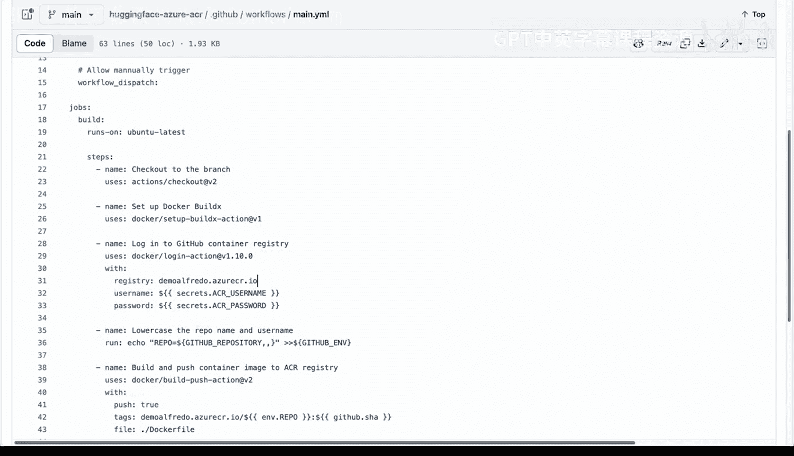

# 11：使用GitHub进行自动化与部署 🚀


在本节课中，我们将学习如何使用GitHub Actions来自动化部署端到端的应用程序。这是一种强大且直接的方法，能够将你的应用部署到Azure等云平台。

## 概述

GitHub Actions提供了一种自动化工作流的方式，特别适合持续集成和持续部署（CI/CD）。通过编写一个YAML配置文件，你可以定义一系列步骤，例如构建Docker镜像、推送到容器注册表，以及部署到云服务。本节将快速概述其基本结构和核心概念。

## GitHub Actions工作流结构

上一节我们介绍了自动化部署的概念，本节中我们来看看如何具体配置一个GitHub Actions工作流。其核心是在代码仓库中创建一个特定目录和YAML文件。

你需要执行以下操作：
1.  在项目根目录下创建一个名为 `.github` 的目录。
2.  在 `.github` 目录内，创建一个名为 `workflows` 的子目录。
3.  在 `workflows` 目录中，放置一个YAML格式的配置文件。

该YAML文件定义了整个自动化流程。GitHub提供了入门模板，帮助你快速开始。

## YAML配置文件详解

以下是YAML配置文件的一个通用结构示例。我们将逐部分解析其含义。

```yaml
name: Deploy to Azure Container Apps # 工作流的名称

on:
  workflow_dispatch: # 允许手动触发此工作流

env:
  # 这里可以定义环境变量，例如注册表名称
  # REGISTRY_NAME: 'myregistry.azurecr.io'

jobs:
  build-and-deploy:
    runs-on: ubuntu-latest
    steps:
      - name: Checkout code
        uses: actions/checkout@v3

      - name: Build Docker image
        run: |
          docker build -t ${{ env.REGISTRY_NAME }}/myapp:${{ github.sha }} .

      - name: Log in to Azure Container Registry
        uses: azure/docker-login@v1
        with:
          login-server: ${{ env.REGISTRY_NAME }}
          username: ${{ secrets.REGISTRY_USERNAME }}
          password: ${{ secrets.REGISTRY_PASSWORD }}

      - name: Push Docker image
        run: |
          docker push ${{ env.REGISTRY_NAME }}/myapp:${{ github.sha }}

      - name: Deploy to Azure Container Apps
        uses: azure/container-apps-deploy-action@v1
        with:
          appSourcePath: ${{ github.workspace }}
          acrName: ${{ env.REGISTRY_NAME }}
          containerAppName: 'my-container-app'
          resourceGroup: 'my-resource-group'
```

**关键部分说明：**
*   **`name`**: 工作流的名称。
*   **`on`**: 定义触发工作流的事件。`workflow_dispatch` 表示可通过GitHub界面手动触发。
*   **`jobs`**: 定义一个或多个任务。每个任务在指定的运行器（如 `ubuntu-latest`）上执行。
*   **`steps`**: 任务内的具体步骤序列。

## 核心步骤解析

工作流通常包含几个核心阶段：检出代码、构建镜像、登录注册表、推送镜像和部署应用。

以下是构建和部署流程中的关键步骤：

1.  **检出代码**：使用 `actions/checkout` 操作将你的仓库代码拉取到工作流运行环境中。
2.  **构建Docker镜像**：执行 `docker build` 命令，根据项目中的 `Dockerfile` 构建容器镜像。镜像标签通常包含Git提交哈希（`${{ github.sha }}`）以确保唯一性。
3.  **登录容器注册表**：使用Azure或Docker的登录操作，通过存储在GitHub Secrets中的凭证认证，以便推送镜像。
4.  **推送镜像**：执行 `docker push` 命令，将构建好的镜像上传到指定的容器注册表（如Azure Container Registry）。
5.  **部署到云服务**：使用特定的部署操作（如 `azure/container-apps-deploy-action`），指示云平台（如Azure Container Apps）拉取新镜像并更新应用。

## GitHub Secrets的使用

GitHub Secrets是GitHub Actions的一项关键安全功能，它允许你在仓库中安全地存储敏感信息，如API密钥、密码或连接字符串。

在YAML配置中，你可以通过 `${{ secrets.SECRET_NAME }}` 的格式引用这些秘密。例如，在登录Azure容器注册表的步骤中，我们使用了 `${{ secrets.REGISTRY_PASSWORD }}`。这样的设计避免了将敏感信息硬编码在配置文件中，既安全又便于团队协作和复用。

## 总结



本节课中我们一起学习了如何使用GitHub Actions实现自动化部署。我们了解了工作流的基本结构，剖析了YAML配置文件的各个部分，并明确了从代码检出到应用部署的核心步骤。此外，我们还认识了GitHub Secrets在安全管理凭证方面的重要作用。通过这套流程，你可以高效、自动地将应用程序部署到Azure等云平台，实现端到端的LLM应用交付。在后续课程中，我们将看到这个工作流的具体运行实例。