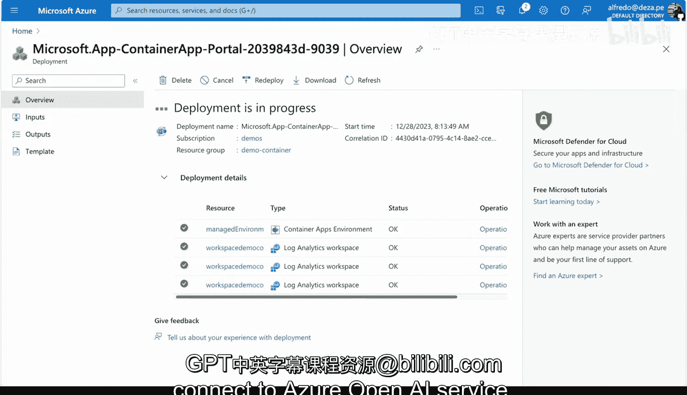

# 12：设置Azure组件 🛠️

在本节课中，我们将学习如何为将应用程序部署到云端而设置必要的Azure服务。我们将重点创建Azure容器应用，并确保其配置与我们的自动化部署流程（例如GitHub Actions）相匹配。

---

## 创建容器应用

上一节我们介绍了项目结构和自动化部署的概念。本节中，我们来看看如何在Azure门户中具体创建容器应用。

首先，我们需要访问Azure门户并导航到“容器应用”服务。在创建新应用之前，有一个关键细节需要注意：我们的自动化脚本（如GitHub Actions工作流）中已经预定义了资源组和容器应用的名称。我们必须确保在Azure门户中创建时使用完全相同的名称，否则自动化部署将无法正确识别资源。

以下是创建容器应用的步骤：

1.  在Azure门户中，选择“创建资源”并搜索“容器应用”。
2.  点击“创建”开始配置。
3.  在“基本信息”选项卡中，选择所需的订阅。
4.  在“资源组”字段，**必须输入**与自动化脚本中完全一致的名称。例如，如果脚本中定义为 `demo-container`，则此处也应创建或选择同名资源组。
5.  为“容器应用名称”设置一个名称，**同样必须**与自动化脚本中定义的 `container-app-name` 保持一致。
6.  选择偏好的区域（例如“美国东部”）。
7.  完成其他必要配置后，点击“查看 + 创建”进行验证。
8.  验证通过后，点击“创建”以部署容器应用。

部署过程需要一些时间。一旦完成，该容器应用资源就可以被我们的自动化部署流程所使用。

---

## 理解自动化与容器注册表

现在我们已经创建了基础的Azure容器应用，接下来需要理解自动化部署流程如何与之协同工作。

我们的自动化脚本（以GitHub Actions为例）通常会构建一个Docker容器镜像，并将其推送到一个容器注册表。在本例的架构中，我们选择使用**GitHub容器注册表**来存储构建的镜像。其地址通常类似于 `ghcr.io/<用户名>/<镜像名>`。

以下是此流程的核心环节：

*   **构建镜像**：自动化脚本在代码仓库中根据 `Dockerfile` 构建应用程序的容器镜像。
*   **推送镜像**：构建好的镜像被标记并推送到指定的容器注册表（此处为GHCR）。
*   **部署到Azure**：自动化脚本接着指示Azure容器应用服务，从该注册表中拉取最新版本的镜像并部署运行。

这意味着，虽然你也可以选择使用Azure容器注册表，但本教程采用了GitHub提供的集成方案，因为它与代码仓库的结合更为紧密和直接。

---

## 监控部署进度

创建资源并触发自动化流程后，我们可以监控部署状态。

你可以回到GitHub仓库的“Actions”选项卡，查看对应工作流的运行情况。当工作流开始执行，你会看到诸如“构建镜像”、“推送镜像”、“部署到Azure”等步骤依次进行。

同时，在Azure门户的容器应用“概述”页面，你最终将看到应用状态变为“正在运行”。至此，你的应用程序就已成功部署到云端，并可以准备连接Azure OpenAI服务等其他资源。

---

## 总结

本节课中我们一起学习了设置Azure组件的关键步骤。我们首先在Azure门户中创建了容器应用，并强调了资源组和应用名称必须与自动化脚本严格匹配。接着，我们解释了自动化部署流程如何利用GitHub容器注册表来管理镜像，并最终将应用部署到Azure。完成这些设置后，我们的基础云环境就已就绪，为后续集成更高级的服务（如Azure OpenAI）打下了基础。