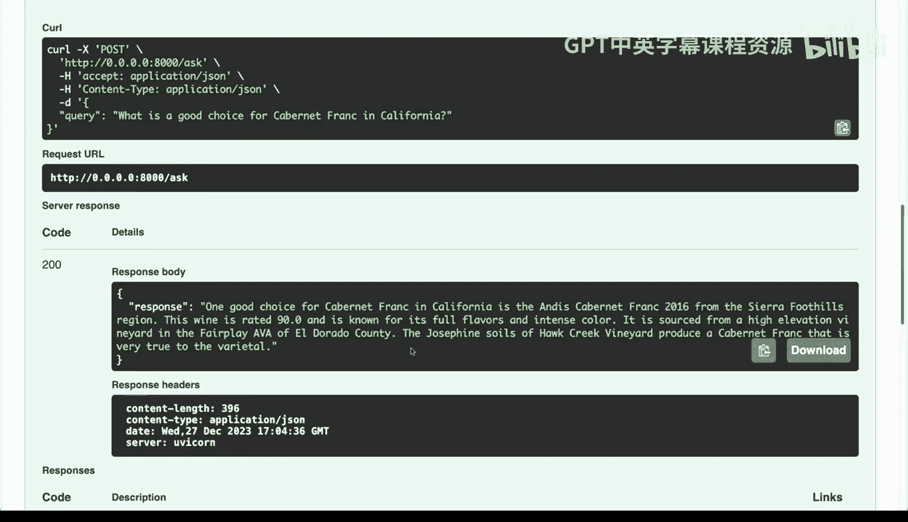
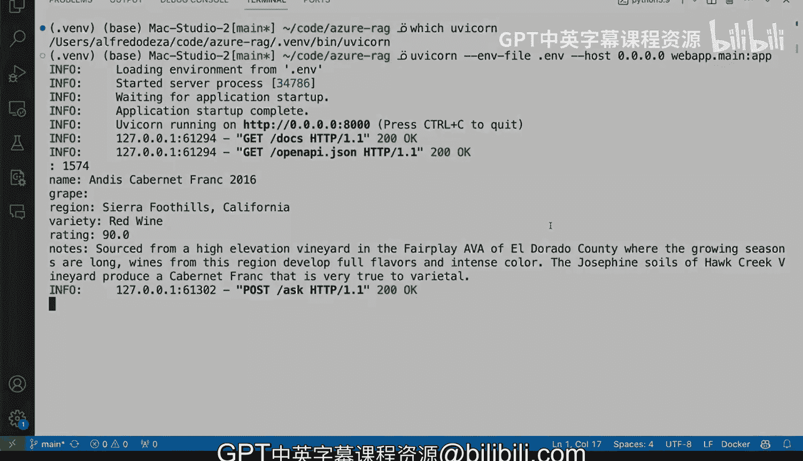

# 14：应用程序概述 🚀


在本节课中，我们将学习如何将之前构建的所有组件整合到一个完整的应用程序中。我们将创建一个基于 FastAPI 的 API 服务，它能够接收用户查询，利用 Azure AI 搜索获取相关信息，并通过 Azure OpenAI 的大型语言模型生成最终答案。我们将首先在本地运行并验证这个应用，为后续将其容器化并部署到 Azure 做好准备。

上一节我们介绍了如何利用 Jupyter Notebook 进行原型开发，本节中我们来看看如何将这些功能封装成一个可部署的 Web 服务。

## 应用程序架构

我们将以非常直接的方式将所有组件整合在一起。与之前在 Jupyter Notebook 中的操作类似，但这次我们将把它作为一个 API 来提供服务。这个 API 最终将运行在 Azure 的容器中，但在此之前我们可以在本地进行验证。

我们将使用 **FastAPI** 这个 Python Web 框架，并像之前一样使用 OpenAI 的嵌入模型和 Azure AI 搜索。

## 核心代码结构

以下是构建应用程序的主要步骤：

首先，我们定义应用程序并收集所有必要的信息。

```python
# 导入必要的库并初始化应用
import os
from fastapi import FastAPI, HTTPException
from openai import OpenAI
from azure.core.credentials import AzureKeyCredential
from azure.search.documents import SearchClient
# ... 其他导入
```

我们需要确保能够连接到 OpenAI 以获取嵌入，并连接到之前部署的 Azure OpenAI 嵌入模型。同时，连接 Azure AI 搜索也是必需的，因为这是我们扩展查询能力的方式。

我们将暴露几个路由，主要是根路由和 `/ask` 路由。

```python
app = FastAPI()

@app.get("/")
async def root():
    return {"message": "Redirecting to /docs"}

@app.post("/ask")
async def ask_question(query: str):
    # 处理查询的逻辑
    pass
```

根路由将重定向到 API 文档。`/ask` 端点将允许 POST 请求，它主要完成三件事：
1.  将查询提交给 Azure AI 搜索。
2.  将查询和搜索结果一起传递给助手函数。
3.  将增强后的响应以 JSON 格式返回。

查询来自请求体，它既被发送到搜索服务，也被发送给大型语言模型。最终的响应格式如下：

```json
{
  "response": "来自 LLM 的聊天机器人回答"
}
```

## 辅助函数

以下是实现核心功能的两个辅助函数。

**搜索函数**：此函数与之前 Jupyter Notebook 中的功能完全相同。我们添加了打印语句，以便在运行应用时查看搜索返回的结果，方便验证。

```python
def search_documents(query, search_client):
    print(f"正在搜索查询: {query}")
    # 执行带相关度分数的相似性搜索
    results = search_client.search(search_text=query, top=5)
    # ... 处理结果
    return context_text
```

**助手函数**：这是与 OpenAI 服务进行 AI 交互的部分。我们使用了与之前 Jupyter Notebook 中相同的模式：设置一个系统消息来定义助手角色，用户查询是原始问题，而内容（`content`）则是来自 Azure AI 搜索的上文信息。

```python
def get_assistant_response(query, context, openai_client):
    messages = [
        {"role": "system", "content": "你是一个乐于助人的助手。"},
        {"role": "user", "content": f"问题：{query}\n上下文：{context}"}
    ]
    response = openai_client.chat.completions.create(
        model="gpt-4",
        messages=messages
    )
    return response.choices[0].message.content
```

最后，我们将所有内容整合到暴露的 `/ask` 路由中。

## 运行与部署准备

为了运行此应用，我们需要满足一些依赖要求。

以下是主要的依赖项：
*   `uvicorn`: 用于运行 FastAPI 应用的 ASGI 服务器。
*   `fastapi`: 构建 API 的 Web 框架。
*   其他与 OpenAI 和 Azure 服务交互所需的库（与之前相同）。

由于此应用最终将被容器化，我们需要一个 Dockerfile。

```dockerfile
# Dockerfile 示例
FROM python:3.9-slim
WORKDIR /app
COPY requirements.txt .
RUN pip install -r requirements.txt
COPY . .
CMD ["uvicorn", "main:app", "--host", "0.0.0.0", "--port", "80"]
```

这个 Dockerfile 非常简单：它基于 Python 镜像，安装依赖项，复制代码，并使用 Uvicorn 服务器运行应用。

现在，让我们在本地运行它进行验证。打开终端，确保处于虚拟环境中，并运行以下命令：

```bash
uvicorn main:app --reload --host 0.0.0.0 --port 8000
```

这个命令启动了 Uvicorn 服务器，加载环境变量中的密钥和秘密，并将应用绑定到本地主机的 8000 端口。`main:app` 指定了主 Python 文件（`main.py`）和其中的 FastAPI 应用实例（`app`）。

应用加载后，我们可以在浏览器中访问 `http://localhost:8000`。这里会显示可用的路由，包括我们定义的 `/ask` 路由（允许 POST 请求）。

这使我们能够立即与 API 进行交互。例如，我们可以发送一个查询：“What is a good choice for Cabernet Franc in California?”

当我们执行这个查询时，应用程序会在后台执行以下操作：
1.  API 接收查询。
2.  将查询发送给 Azure AI 搜索。
3.  将搜索结果和原始查询一起发送给 Azure OpenAI 的 LLM。
4.  将 LLM 生成的答案返回。

查看响应，我们可能会得到：“一个很好的选择是 2016 年的 Andy Cabernet Franc...”，并附上葡萄酒评分和来源信息。这证明应用正在与 Azure AI 搜索通信。



如果我们回到代码的终端输出，可以看到打印的搜索响应，这正是我们最初加载的 CSV 数据，现在正为大型语言模型提供有用的信息。

## 总结



本节课中我们一起学习了如何构建一个端到端的 LLM 应用程序。我们从定义 FastAPI 应用开始，集成了 Azure AI 搜索来获取相关上下文，并通过 Azure OpenAI 服务生成智能回复。我们成功在本地运行并测试了整个流程，验证了从数据采集、处理到最终提供问答服务的完整链路。这个应用概述为我们下一步将其容器化并部署到 Azure 云服务奠定了坚实的基础。