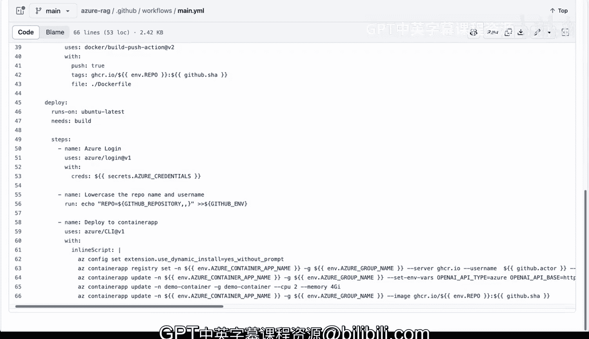

# 16：在Azure中使用GitHub Actions 🚀


在本节课中，我们将学习如何配置和使用GitHub Actions，以实现将应用程序自动构建并部署到Azure容器应用（Azure Container Apps）的完整流程。我们将详细解析工作流文件，并说明如何设置必要的认证信息。

## 概述

上一节我们介绍了Azure容器应用的基本概念。本节中，我们来看看如何利用GitHub Actions实现持续集成与持续部署（CI/CD）。我们将通过一个具体的YAML工作流文件，讲解如何构建Docker镜像、推送到GitHub容器注册表，并最终部署到Azure。

## 工作流文件解析

以下是GitHub Actions工作流的核心组成部分。该文件定义了从代码变更到云上部署的自动化步骤。

### 工作流触发机制

工作流的名称可以自定义。`workflow_dispatch`选项是关键，它允许我们手动触发工作流执行。在本例中，我们没有设置为在代码推送到主分支时自动触发。如果你确信代码变更经过验证，可以后续修改为自动触发。

```yaml
name: Build and Deploy to Azure Container Apps
on:
  workflow_dispatch:
```

### 构建与推送容器镜像

此部分负责构建Docker容器镜像，并认证、推送到GitHub容器注册表（GHCR）。`GITHUB_TOKEN`等认证信息已由GitHub自动预设，无需额外配置。

```yaml
jobs:
  build-and-deploy:
    runs-on: ubuntu-latest
    steps:
      - name: Checkout repository
        uses: actions/checkout@v3

      - name: Log in to GitHub Container Registry
        uses: docker/login-action@v2
        with:
          registry: ghcr.io
          username: ${{ github.actor }}
          password: ${{ secrets.GITHUB_TOKEN }}

      - name: Build and push Docker image
        uses: docker/build-push-action@v4
        with:
          push: true
          tags: ghcr.io/${{ github.repository }}/my-app:latest
```

### 部署到Azure容器应用

这是与Azure交互的核心步骤。首先需要登录Azure，然后执行部署命令。

以下是部署步骤的关键操作列表：

*   **Azure登录**：使用`azure/login` Action并传入之前设置的`AZURE_CREDENTIALS`密钥进行认证。
*   **设置容器注册表**：告知Azure容器应用从哪个注册表拉取镜像。这里使用GitHub容器注册表，并需提供用户名和密码（个人访问令牌）。
*   **配置环境变量**：为容器应用设置运行所需的环境变量，例如OpenAI API类型、终端点、密钥以及Azure AI搜索服务的相关信息。
*   **创建/更新容器应用**：指定容器的计算资源（如2个CPU和4GB内存），并最终触发部署。

```yaml
      - name: Log in to Azure
        uses: azure/login@v1
        with:
          creds: ${{ secrets.AZURE_CREDENTIALS }}

      - name: Deploy to Azure Container App
        uses: azure/CLI@v1
        with:
          azcliversion: latest
          inlineScript: |
            az containerapp registry set \
              --name my-container-app \
              --resource-group my-resource-group \
              --server ghcr.io \
              --username ${{ github.actor }} \
              --password ${{ secrets.PAT }}

            az containerapp update \
              --name my-container-app \
              --resource-group my-resource-group \
              --set-env-vars \
                OPENAI_API_TYPE=azure \
                OPENAI_API_BASE=https://your-resource.openai.azure.com/ \
                OPENAI_API_KEY=${{ secrets.OPENAI_API_KEY }} \
                SEARCH_SERVICE_NAME=your-search-service \
                SEARCH_API_KEY=${{ secrets.SEARCH_API_KEY }} \
                SEARCH_INDEX_NAME=demo-index \
              --cpu 2 \
              --memory 4Gi \
              --image ghcr.io/${{ github.repository }}/my-app:latest
```

## 关键配置详解

要使上述工作流正常运行，必须在GitHub仓库中正确设置几个密钥（Secrets）。

### 1. 创建Azure服务主体（Service Principal）

需要在Azure中创建一个服务主体，用于GitHub Actions对Azure进行身份验证。在Azure Cloud Shell或本地CLI中运行以下命令：

```bash
az ad sp create-for-rbac --name "my-github-actions-sp" --role contributor --scopes /subscriptions/<your-subscription-id> --sdk-auth
```

将输出的JSON对象完整复制。

### 2. 在GitHub仓库中配置密钥

进入GitHub仓库的 **Settings > Secrets and variables > Actions** 页面。

以下是需要添加的密钥列表：

*   **`AZURE_CREDENTIALS`**：将上一步复制的整个JSON输出粘贴在此处。
*   **`PAT`**（个人访问令牌）：需要一个具有`write:packages`权限的GitHub个人访问令牌。可以在 `https://github.com/settings/tokens/new` 创建。
*   **`OPENAI_API_KEY`**：你的Azure OpenAI API密钥。
*   **`SEARCH_API_KEY`**：你的Azure AI搜索服务的管理员API密钥。

## 总结



本节课中我们一起学习了如何配置GitHub Actions工作流，以实现应用在Azure容器应用上的自动化部署。我们分解了YAML文件的各个部分，包括手动触发、镜像构建与推送，以及通过Azure CLI进行部署的核心步骤。最重要的是，我们详细说明了如何创建Azure服务主体和在GitHub中设置必要的认证密钥。掌握这些步骤后，你就能建立起一套高效的CI/CD管道，轻松地将应用部署到Azure云环境。