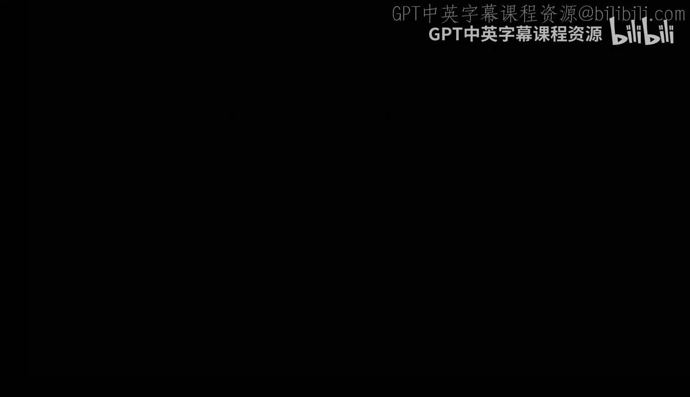
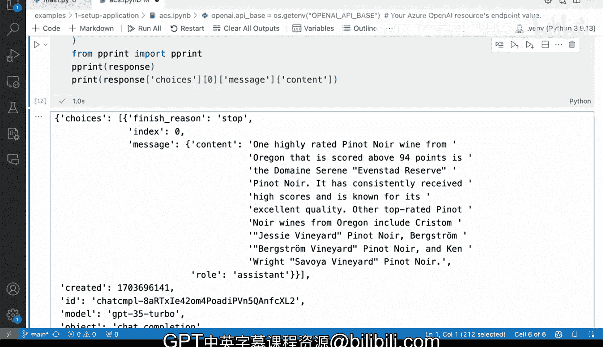

# Azure的端到端 LLMs：P13：在Azure OpenAI中使用RAG 🧠

在本节课中，我们将学习如何在Azure OpenAI服务中实现检索增强生成（RAG）。我们将把之前准备好的文档加载到向量存储中，通过相似性搜索获取相关上下文，并最终利用大型语言模型生成精准的回答。整个过程将展示如何将Azure AI搜索与Azure OpenAI服务无缝集成。

---

上一节我们使用CSB加载器准备好了所有文档。现在，让我们实际运行并测试它。我们将演示几个关键操作。

首先，我们将使用带相关性分数的相似性搜索功能。我们将向Azure AI搜索（即这里的向量存储）提问：“What is the best governance ofonwin in App Valley above 94 points?”。运行此查询后，我们会得到一个结果。在本例中，返回的是“declaration App Valley governanceness whensure”。这个结果看起来符合预期。

接下来，我们需要设置Azure OpenAI服务。我们将使用必要的密钥和配置来启动服务。以下是涉及的几个组件：

*   **OpenAI API基础地址**：从环境变量加载。
*   **API密钥**：同样从环境变量获取。
*   **API版本**：这是关键，因为如果你需要使用更新版本的API，此处必须正确指定。

在消息配置部分，需要特别注意。我们设置了系统消息，内容为“assistant is a chatbot that helps you find the best wine for your taste.”。这为系统设定了上下文，用户不会直接看到此消息。

用户的问题（即查询）将放在这里：“What is the best governance so when you want in A Valley above and 94 points”。而助手的回复将包含额外内容，这些内容正是来自我们之前从Azure AI搜索获取的结果。我们需要将这些搜索结果捕获并整合到消息的“content”字段中。

当所有这些消息组件准备就绪后，我们就能清楚地看到各个部分是如何协同工作的：我们有系统和助手的角色设定、用户的查询，以及来自Azure AI搜索的补充内容。

完成以上步骤后，我们将调用OpenAI的聊天补全接口。我们指定部署名称，并传入之前构建好的消息列表。最后，打印出模型的响应内容。

让我们看看结果。这次调用耗时1.2秒，与后台API交互是值得的。响应内容显示：“Here is a highly rated Caness windum from Napa Valley with a score above 94 points”。这完全是大型语言模型的功劳。它具体提到了“The wine 1849 declaration Caness whenium from 2014”，但指出其评分91分并不理想。你可以看到，模型最终以清晰的方式组织了回答。

我们可以尝试一个略有不同的查询来验证灵活性。将问题改为：“pin wine in Oregon noir wine in Oregon above 94 point”。为确保流程正确，我们需要在将查询和上下文发送给OpenAI端点之前，先运行一次搜索来获取新的相关文档。确认搜索返回正确结果后，再次运行整个流程。

这一次，借助新的上下文，大型语言模型成功给出了回答：“A highly rated pinot noir wine from Oregon that is scored above 94 points is this one right here.”。

至此，我们已验证了所有组件协同工作正常。我们成功地将Azure OpenAI服务与Azure AI搜索（原名Azure Cognitive Search）粘合在一起，整个系统完全按照预期运行。

---

本节课中，我们一起学习了在Azure OpenAI中实施RAG的完整流程。我们从文档加载和向量搜索开始，接着配置了Azure OpenAI服务并构建了包含系统指令、用户查询和检索上下文的提示消息，最后调用模型生成了基于上下文的精准回答。这个过程展示了如何利用外部知识库增强大语言模型的能力，使其能提供更准确、更相关的信息。