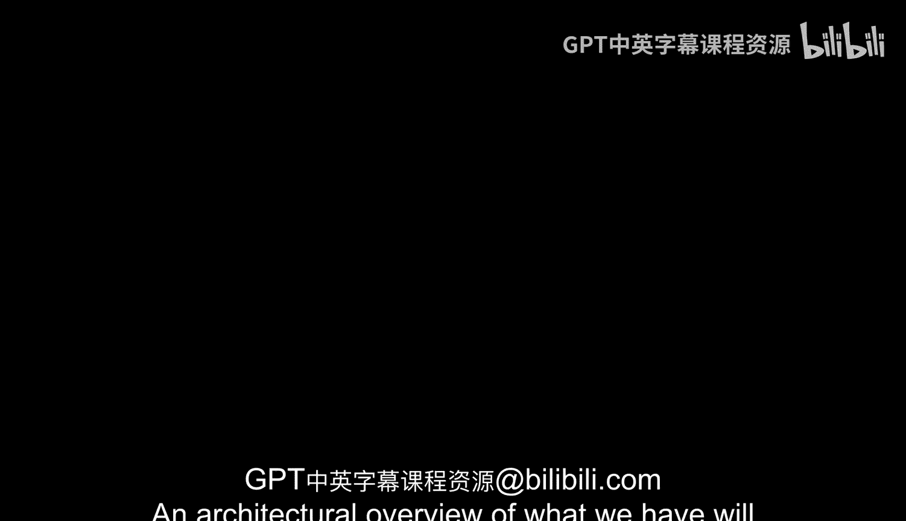
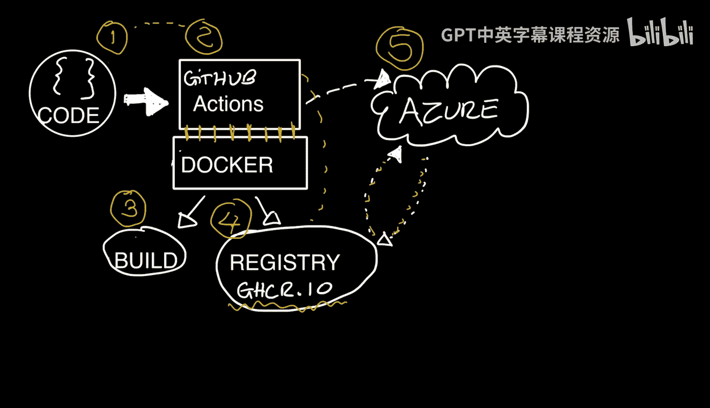
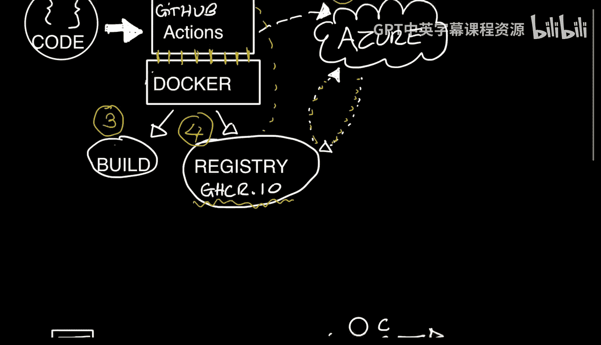
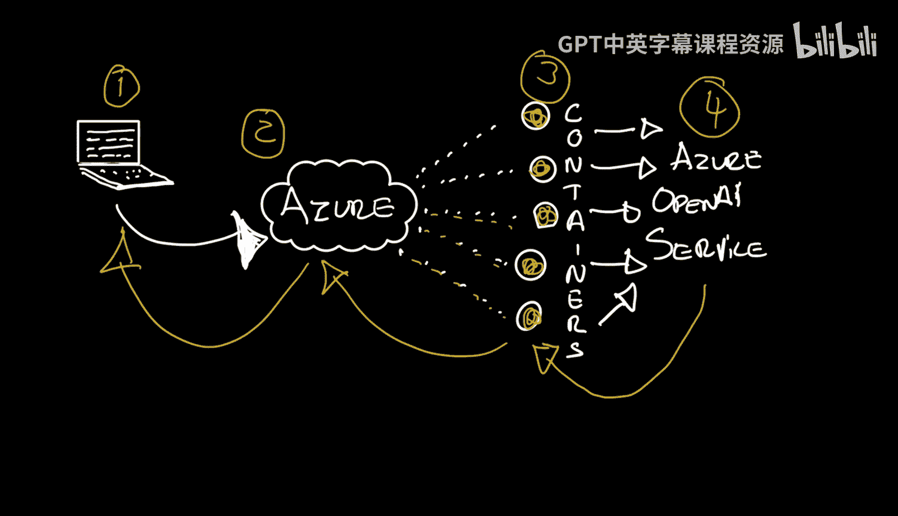

# 端到端 LLMs 与 Azure：P15：部署与自动化概述 🚀

在本节课中，我们将学习如何将我们的应用程序从代码部署到云端。我们将了解整个部署流程的架构，以及各个组件（如代码仓库、自动化工具、容器注册表和云服务）是如何协同工作的。

## 架构概览

理解我们现有系统的架构，将帮助我们掌握所有组件是如何协同工作的。

上一节我们介绍了应用程序的基本构成，本节中我们来看看整个部署流程的宏观视图。

## 部署流程详解

以下是部署流程的详细步骤，我们将从代码开始，一直到应用程序在云端运行。

### 1. 代码与应用程序

我们从代码开始。我们的应用程序托管在 GitHub 上，它是一个 HTTP API，用于接收请求并与模型交互。

### 2. 自动化构建

接下来，我们将使用 **GitHub Actions** 来实现自动化。GitHub Actions 将与 **Docker** 交互，设置 Docker 构建系统并执行命令。通过这一步，我们将能够构建我们的容器化应用程序。

### 3. 构建容器镜像

构建容器化应用程序是至关重要的一步，因为我们的目标是将它部署到 Azure 云上。这个过程将生成一个容器镜像。

### 4. 推送镜像到注册表

构建完成后，我们将把生成的容器镜像推送到注册表。在本例中，我们使用的是 **GitHub 容器注册表**。当然，你也可以使用其他注册表。使用 GitHub 容器注册表可以简化流程，因为用户名和密码等配置已经预先设置好了，我们稍后在查看 GitHub Actions 工作流时会详细看到这些细节。

### 5. 触发云服务部署

当镜像成功推送到注册表后，GitHub Actions 会通知 Azure（具体来说是 Azure 容器服务）去拉取这个新镜像。这是一个触发机制：GitHub Actions 告诉 Azure，新的镜像已准备就绪。

### 6. 在 Azure 上部署与运行

Azure 容器服务会从注册表（GHCR.io）拉取容器镜像，并将其部署到 Azure 云上。至此，应用程序就成功发布了。

## 应用程序的运行与扩展

现在，让我们看看应用程序部署后是如何运行和应对用户请求的。

当用户开始与我们的应用程序交互时（我们称之为第一步），他们会发送提示或查询。

这些请求将被 Azure 云接收。我们的应用程序就运行在 Azure 云中。

Azure 的一个重要能力是扩展我们的应用程序，这被称为**水平扩展**。随着请求量的增加，Azure 可以部署更多这样的“小单元”（即容器）来处理负载。这种根据需求增长容器数量的能力，就是水平扩展系统，它确保我们能够处理所有涌入容器的请求。

一旦请求到达容器，我们的应用程序就能与 **Azure OpenAI 服务**进行通信。

请求在容器中被处理，通过 Azure OpenAI 服务获得响应，最后经由 Azure 云将响应返回给用户。

## 总结

本节课中，我们一起学习了从代码到云端的完整部署流程。我们了解了架构概览，并逐步拆解了如何使用 GitHub Actions 实现自动化构建、如何通过 Docker 创建容器、如何将镜像推送到注册表，以及 Azure 如何拉取镜像并部署运行。我们还看到了 Azure 的水平扩展能力如何确保应用程序能够应对高并发请求。这个流程将代码、自动化工具和云服务紧密连接在一起，构成了一个高效的部署管道。接下来，我们将深入 GitHub Actions，亲眼看看这一切是如何具体运作的。