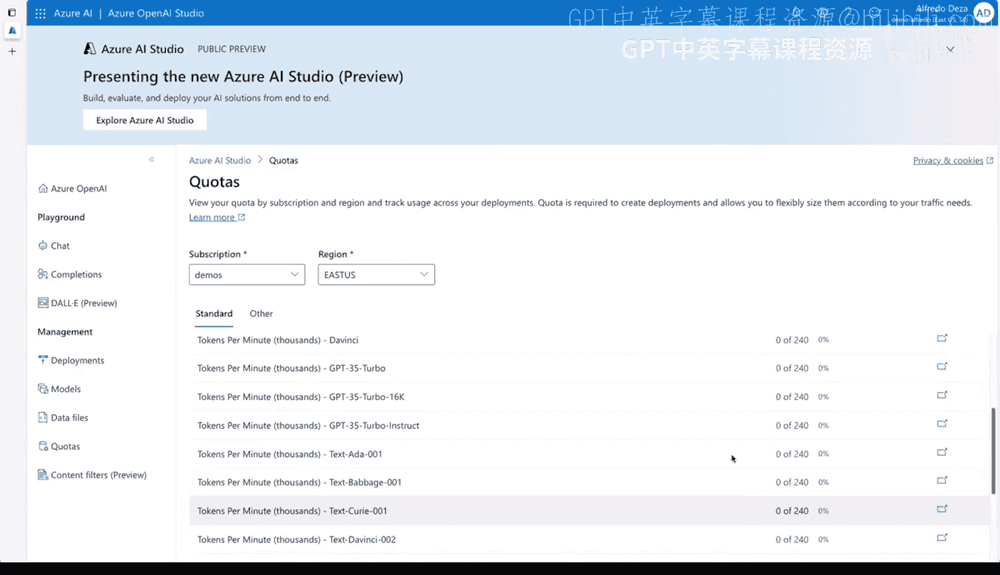
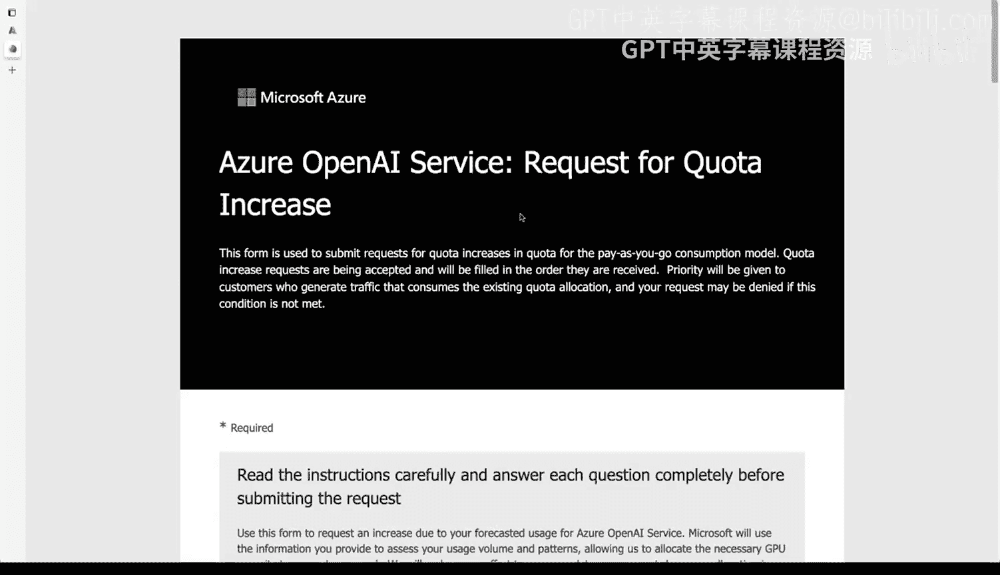
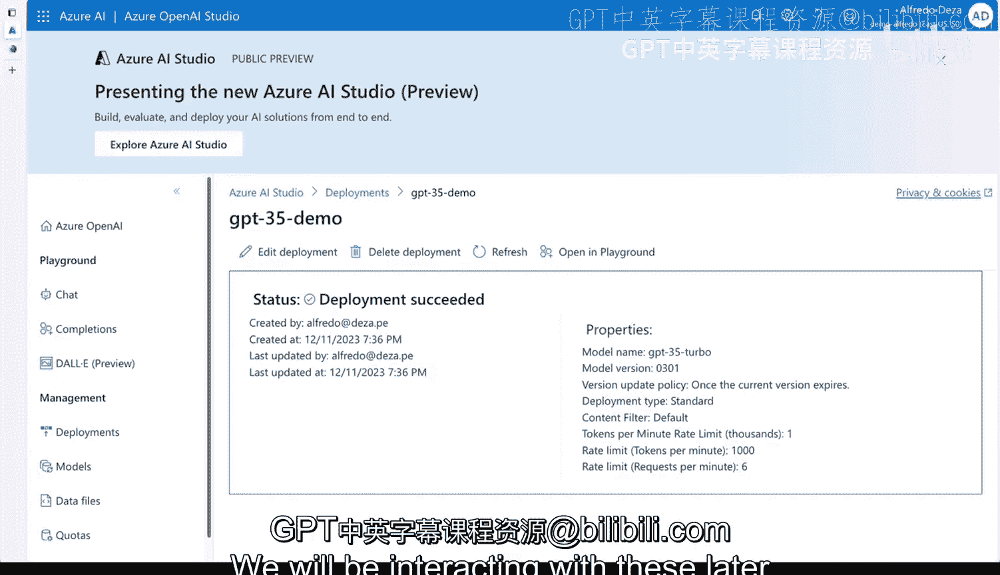

# Azure的端到端 LLMs：P5：部署OpenAI模型 🚀

在本节课中，我们将学习如何在Azure AI Studio中部署OpenAI模型。我们将了解配额设置、模型选择、部署配置以及如何验证部署结果。整个过程旨在让初学者能够轻松上手。

---

## 配额概览与设置

在开始部署模型之前，我们先来了解一下Azure AI Studio中的配额管理。配额决定了您每分钟可以处理的最大令牌数量，这对于控制资源使用和成本非常重要。

以下是配额设置的关键信息：

*   **配额单位**：配额以**每分钟令牌数（TPM）** 为单位进行管理。
*   **默认限制**：系统会提供一个默认配额，例如**240,000 TPM**。
*   **自定义调整**：您可以根据需要，通过请求流程来增加配额上限。
*   **动态配额**：一个重要的特性是，您可以随时将配额从最高值（如240,000）降低到更低的值（如1,000）。这允许您灵活利用可用容量，并且只有在实际使用时才会产生费用。

了解了配额的基本概念后，我们就可以开始选择并部署具体的模型了。

---

## 选择与部署GPT-3.5 Turbo模型

上一节我们介绍了配额管理，本节中我们来看看如何具体部署一个模型。我们将以GPT-3.5 Turbo为例进行演示。

操作步骤如下：

1.  在Azure AI Studio中，导航至“模型”部分。
2.  从模型列表中选择“GPT-3.5 Turbo”。
3.  点击“部署”按钮，开始配置部署。

在部署配置界面，您需要进行以下设置：

*   **模型版本**：从可用版本中选择一个，例如 `gpt-35-turbo-0125`。
*   **部署名称**：为此次部署起一个易于识别的名字，例如 `GPT-35-demo`。
*   **高级选项**：在这里，您可以看到并调整为此部署分配的配额。系统会显示可用配额（如240,000 TPM），您可以根据需求在此范围内进行调整。

配置完成后，点击“创建”。由于这是基于API的部署，过程通常非常迅速。部署成功后，您会收到“已成功创建部署”的确认信息。

---

## 验证部署与使用模型

模型部署成功后，我们需要知道在哪里找到它以及如何开始使用。接下来，我们将进入“部署”管理页面进行验证。

请按照以下步骤操作：

*   在Azure AI Studio中，点击进入“部署”页面。
*   在部署列表中，找到您刚刚创建的部署（例如 `GPT-35-demo`）。其状态应显示为“成功”。
*   点击该部署，可以查看详细信息，包括速率限制、令牌使用情况等。

查看部署详情后，您可以通过以下方式立即开始使用模型：

*   **在Playground中打开**：点击“在Playground中打开”，您将进入一个交互式界面，可以直接与部署的模型进行对话和测试。
*   **通过API调用**：部署信息中会提供终结点（Endpoint）和密钥（Key），您可以在自己的应用程序代码中使用这些信息来调用模型API。

此外，您也可以从Azure AI Studio的主页，通过“试用Azure OpenAI”入口访问模型目录和Playground。

---

## 课程总结

本节课中，我们一起学习了在Azure AI Studio中部署OpenAI模型的完整流程。我们首先了解了配额（TPM）的概念和设置方法，然后逐步完成了选择GPT-3.5 Turbo模型、配置部署参数并成功创建部署的过程。最后，我们学会了如何在部署管理页面验证结果，并通过Playground或API开始使用已部署的模型。掌握这些步骤，您就具备了在Azure平台上部署和使用大型语言模型的基础能力。