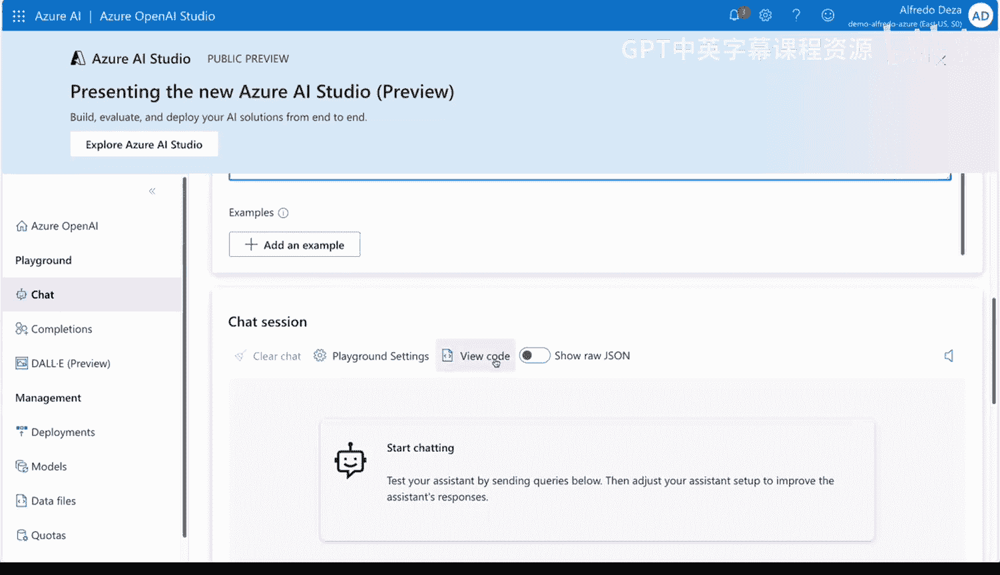
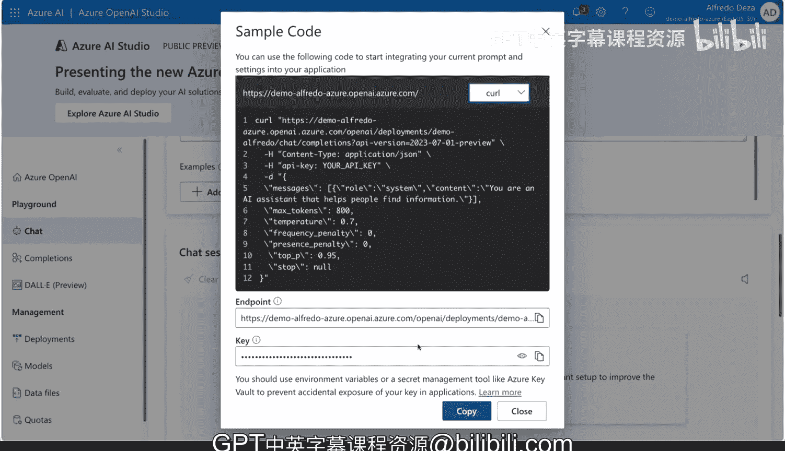

# Azure的端到端 LLMs：P6：使用密钥和终结点 🔑


在本节课中，我们将学习如何在Azure OpenAI服务中使用密钥和终结点。我们将了解如何查找和管理这些关键信息，以及如何根据不同的使用场景（例如使用Python库或直接调用API）来正确配置它们。

## 资源管理中的密钥与终结点

上一节我们介绍了Azure OpenAI服务的基础。本节中，我们来看看如何访问和管理服务的访问凭证。

在Azure门户中查看已创建的OpenAI服务资源时，可以在资源管理部分找到密钥和终结点。


你将在此处获得终结点。同时，你还会获得位置、区域以及两个密钥。密钥管理功能允许你执行例如重新生成密钥或复制密钥等操作。重新生成密钥的功能在此处可用。例如，如果你不小心泄露了密钥，或者像我一样在演示中担心密钥被展示，你可以在此处重新生成它们。

你也可以查看模型部署，不过我们暂时不在此处管理它们。重点是密钥和终结点。

## 通用终结点与特定终结点

这里有一个需要注意的地方：此处显示的终结点是通用的，并不特定于我实际部署的模型。在我的例子中，我已经部署了模型，但它们没有显示在这里。这会在某些情况下显示。

让我们看看这些情况是什么。我将转到Azure AI Studio，查看“模型”部分。这里列出了我已部署的几个模型，以及更多可用的模型。

关于我的部署，我转到“部署”部分，可以看到我已经部署的几个模型。

让我们查看名为 `demo-alfredo` 的部署。这个部署很好，它使用的是 `gpt-35-turbo` 模型，这符合我们当前的需求。

## 从Playground获取代码示例

现在，让我转到Playground。我点击“打开Playground”，可以选择聊天Playground，然后选择刚才的部署并立即打开。

我想向你展示的是，在聊天会话中，点击“查看代码”。




当你想要使用像Python这样的语言时，你将能够使用 `openai` 库（非Azure专用版）。你会得到需要定义的变量。这个代码示例需要一个特定的版本，这没问题。

但我希望你注意我们在这里的 `openai.api_base`。在这个例子中是：
```
https://demoalfredo.openai.azure.com
```
这就是我们之前看到的通用终结点，它并不具体。那么，OpenAI（或Azure）如何知道我们指的是哪个具体模型呢？

对于像Python这样的使用场景，你需要 `api_base` 是这个通用终结点，这没问题。但对于其他情况，你将需要特定的终结点。我知道这可能会让人困惑。

关键在于，你在这里看到的 `engine` 参数，它写着 `demo-alfredo`。这指的是我们实际部署并命名为 `demo-alfredo` 的模型。如果我给它起了别的名字，这里就会不同。

令人困惑的是，你既获得了一个终结点，也获得了一个密钥，但你只获得一个密钥。如果你想使用另一个密钥，可以回到OpenAI服务之前的仪表板获取。

但你是否注意到，这里的终结点实际上是特定的？这是因为当你在不使用OpenAI库的情况下直接与API通信时，你可以使用这个特定终结点。

## 直接API调用与CURL示例

如果我们切换到“Curl”和“命令行”视图，你会看到它实际上使用了完整的、特定的API终结点。



这就是使用HTTPS的实际终结点。对于Python的OpenAI库，它会为你构建这个URL。你可以在这里看到 `/openai/deployments/demo-alfredo/...` 这样的路径。

以下是需要记住的要点：
*   **密钥**：用于身份验证，可以在Azure门户中管理（如重新生成）。
*   **通用终结点**：格式如 `https://[your-resource-name].openai.azure.com`，在使用OpenAI客户端库时使用。
*   **特定终结点**：包含部署名称的完整路径，格式如 `https://[your-resource-name].openai.azure.com/openai/deployments/[deployment-name]/...`，在直接调用REST API（如使用Curl）时使用。
*   **引擎/部署名称**：在代码中通过 `engine` 或 `deployment_name` 参数指定，以告诉Azure使用哪个具体的模型部署。


本节课中我们一起学习了如何在Azure OpenAI服务中查找和使用密钥与终结点。我们区分了通用终结点和特定于部署的终结点的不同用途，并了解了如何从Playground获取不同编程语言和工具的代码示例。理解这些概念对于安全、有效地集成Azure OpenAI服务到你的应用程序中至关重要。