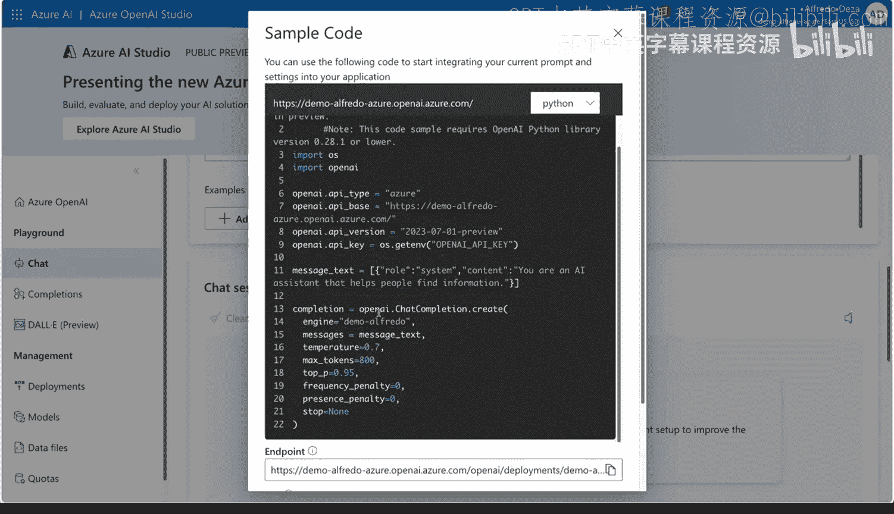
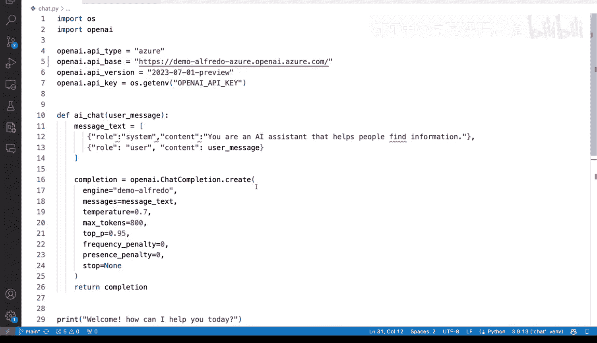

# 端到端 LLMs 与 Azure：P7：07_01_07：创建一个简单的 Python 示例 🐍

在本节课中，我们将学习如何使用 Python 与 Azure OpenAI 服务进行交互，创建一个简单的聊天示例。我们将从分析官方示例代码开始，逐步构建一个可运行的脚本，并了解如何管理 Python 依赖环境。

---

我们已将示例代码在此处打开，现在我们将开始与之交互，并使用 Python 来实现。

关于 Python 有几点需要注意。如果你直接复制这里的代码，它将无法工作。代码示例明确指出，它需要 `openai` Python 库的版本为 **0.28.1 或更低**。因此，你首先会在 Python 包管理上遇到挑战。

如果你从未使用过 Python，建议你使用此处提供的 `curl` 示例。`curl` 命令在大多数 Unix 系统（如苹果电脑、Linux 电脑）的终端中可用。如果你使用的是 Windows 的 Linux 子系统（WSL），也需要使用类似的方法。

不过，让我们还是来看看如何使用 Python 进行操作。我将快速切换到我的文本编辑器，向你展示如何实现。官方示例代码是自上而下顺序执行的，没有使用函数。让我们看看我整合好的脚本是什么样子。

好的，这是基本相同的代码，但有一些区别。你可以看到，`openai.api_key` 是从环境变量中获取的。这意味着在运行脚本之前，我需要确保已经导出了这个环境变量，稍后我会展示具体做法。

与自上而下的写法不同，我在这里创建了一个非常小的函数，并做了一些细微的改动。我将添加一个 `user_message` 参数，当我传递它时，它会被附加到消息列表中。这就是模型与我交互的方式：系统消息设定助手角色（例如“你是一个帮助人们查找信息的AI助手”），用户角色则传递我输入的消息。

然后，我将调用 `completion` 方法，其参数与我们在 Azure 门户上看到的代码示例以及之前的内容完全相同。接下来，我将创建一个无限循环，持续要求用户输入，并将输入的消息传递给函数进行处理。

最后，我将通过以下代码提取响应：`completion.choices[0].message.content`。这是因为在 Python 中，返回的数据结构是一个字典，我们通过这种方式层层访问所需的内容。我们无需深入 Python 的细节，只需知道它是这样工作的即可。

现在，我还想向你展示 `requirements.txt` 文件。关闭其他文件后，你可以看到我已经按照要求安装了指定版本的库：`openai==0.28.1`。这里的双等号意味着“锁定版本”，即精确选择 **0.28.1** 这个版本。

我将切换到我的终端。在终端中，我已经激活了一个虚拟环境。如果你从未在 Python 中使用过虚拟环境，你可以使用类似 `python3 -m venv venv` 的命令来创建一个，然后使用 `source venv/bin/activate`（在 Linux/Mac 上）来激活它。激活后，你就可以在其中安装依赖了。在本例中，我们将使用 `pip install -r requirements.txt` 来安装。

本视频不会详细讲解 Python 的所有细节，我们会快速进行。我已经预先安装好了所有依赖。现在，我将运行 `python chat.py`。

程序启动：“欢迎。我今天能为您做些什么？” 例如，我可以输入：“我觉得 Python 依赖管理有点棘手。”

消息被发送出去，然后我们很快就能收到回复：“Python 依赖管理可能具有挑战性，尤其是在处理复杂项目时。一个流行的 Python 工具是我们一直在使用的 Pip。”

回到聊天界面，这就是我们修改后的版本。我们使用了 `while True` 循环，这允许我们保持对话持续进行，不断添加消息并获取回复。你可以参照此例进行类似操作，或添加你自己的变体。

---

本节课中，我们一起学习了如何设置 Python 环境、安装特定版本的 OpenAI 库，并编写了一个简单的交互式聊天脚本。我们了解了如何从环境变量读取 API 密钥、构建请求消息以及处理模型的响应。通过这个基础示例，你可以开始探索和构建更复杂的 AI 应用。