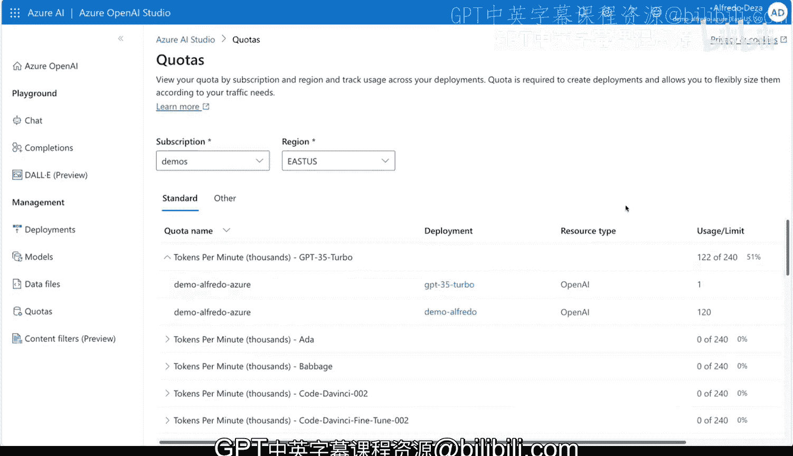

# Azure的端到端 LLMs：P8：审查使用情况和配额 📊

在本节课中，我们将学习如何在Azure OpenAI服务中审查资源的使用情况和配额。上一节我们介绍了如何部署和调用模型，本节中我们来看看如何监控和管理这些资源的使用量。

## 概述

在Azure门户中，我们可以查看已部署模型的使用情况，包括令牌消耗量和配额限制。这有助于我们了解资源消耗，并据此进行成本管理和规划。

## 查看配额与使用情况

现在我们已经与Azure OpenAI服务进行了一些交互，部署了一个模型并调用了该模型。接下来，我将查看配额信息。配额选项位于“管理”部分，点击即可加载。

加载完成后，页面将显示我的部署具体使用情况。

加载完毕。这里显示的是GPT-3.5 Turbo模型每分钟的令牌使用量（以千为单位）。请记住，这是我实际部署的模型。

## 解读使用数据

目前，我的使用量是122，总配额是240。这意味着在刚才简短的交互中，我已经使用了51%的配额。这就是查看配额的方式。

以下是页面显示的其他关键信息：

*   我可以看到多个不同的条目，因为我确实可以部署很多模型。
*   使用情况按部署进行区分。
*   我有多个使用限制，例如这里有一个120的限制。
*   这些限制会累加到该模型的总使用量中。

对于同一个模型（本例中是GPT-3.5 Turbo），可以创建多个部署。目前，我为该模型创建了两个部署。

## 计费模式与灵活性

请记住，计费是基于使用量，而非计算资源本身。这一点非常巧妙，因为它允许你专注于API的消耗，而不必过多担心底层计算资源。

这提供了很大的灵活性，并且能让你密切关注使用情况并设置一些限制。

## 总结

本节课中我们一起学习了如何在Azure OpenAI服务中审查使用情况和配额。我们了解了如何查看令牌消耗、解读配额限制，以及Azure基于使用量计费的模式所带来的管理灵活性。掌握这些信息对于有效管理和优化云上AI资源成本至关重要。