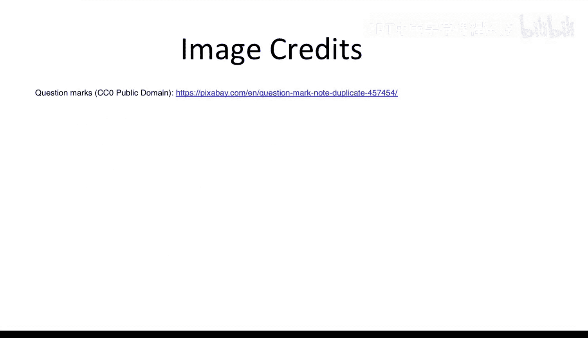

# 杜克大学《Excel 到 MySQL：商业分析（5课全）｜Excel to MySQL： Analytic Techniques for Business》中英 p03 03_02_01_指标如何帮助我们提出正确问题.zh_en -BV1mS421X7yw_p3-

What is the highest and best use of a business analyst or a business data analyst。Answer。

To find out the right question to ask。Then find the best answer you possibly can in the time and with the resources available。

Ensuring that your answer has practical impact。By translating it into a specific call to action。

 a specific recommended action communicated to the relevant decision makers using visual metaphors and non technical language。

What is always the right question？Answer。What change in our business processes？

Can and should we make right now to increase revenues， maximize profitability or reduce our risk。

What do we mean by right now？Well， there's several answers。

The ideal answer is something like our company has engineered real time computerized systems。

That optimize for certain dynamic metrics by adjusting our response to customer and market input。

With a delay for processing or latency of no more than a fraction of a second。The next best answer。

Is what we call just in time。A computerized response is not possible。

So we respond to individual customers with a human being where that human being has access to the full historical record of that customer's interactions with the company。

Whether through buying things， customer support calls， actions on our website， etc。

The third best answer。Which is still good。Is that the change that we are recommending can't happen overnight。

But it can happen as soon as it has been empirically tested and shown to work。

We do testing by making one small change at a time to our website。Creating two different versions。

 A and B， and comparing which performs better。This is called AB testing。In any case。

 an AB test can begin within 30 days of a recommendation。

 and the recommended change can be made as soon as enough data is gathered to determine that one choice is clearly better than the other。

So metrics are special numbers。That help us to ask and answer the right business question。

WhatWhat decision should we make？What process should we change right now？

Metrics are numbers that we can impact when we change our business processes。So， for example。

 for a local bricks and mortar retail clothing store rooted in the state of North Carolina。

 where we have a 4。75% sales tax。 The sales tax is not a metric。

 There's nothing that we can do to change it。 It's basically a fact of nature for us。

 like the weather。On the other hand， the percentage of people who viewed our ad on a particular website then used it as a link to click through to our homepage。

Can change every time the ad contents and appearance change or when the time of day changes where we run the ad on websites。

 it appears， etc， etc。

