# 杜克大学《Excel 到 MySQL：商业分析（5课全）｜Excel to MySQL： Analytic Techniques for Business》中英 p06 06_02_02_埃格斯烘焙咖啡案例研究第一部分：定义.zh_en -BV1mS421X7yw_p6-

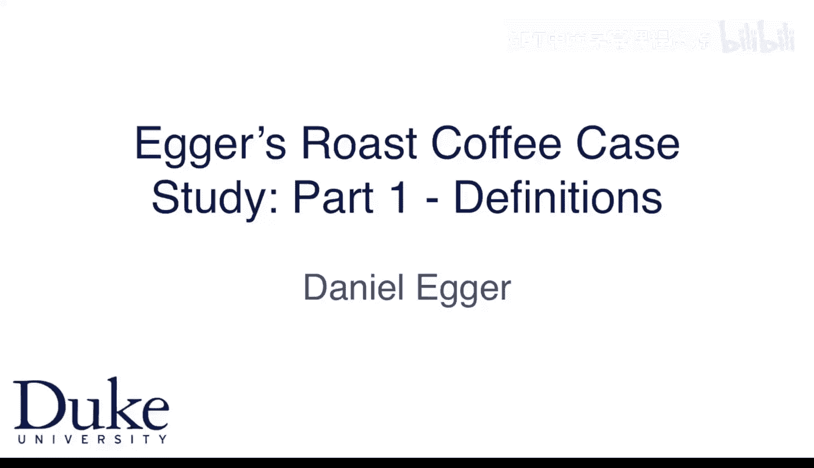

Next， we will be going through a case study to illustrate the critical difference between profitability metrics and cash flow metrics。

Part one of this case study we'll talk about some financial definitions。

Business analytics is not financial accounting。But it does draw upon some accounting concepts for its metrics。

We will keep this brief， so in about the next 10 minutes。

 I'm going to orient you to all the financial accounting terms and concepts you will need to grasp essential business metrics。

I will explain these very few most important terms。

Through the example of a startup venture that I'm organizing。Egggars roast coffee。

 Egar's roast coffee plans to buy raw coffee beans in bulk。

 roast and package them and sell them wholesale at higher prices， obviously to a grocery store chain。

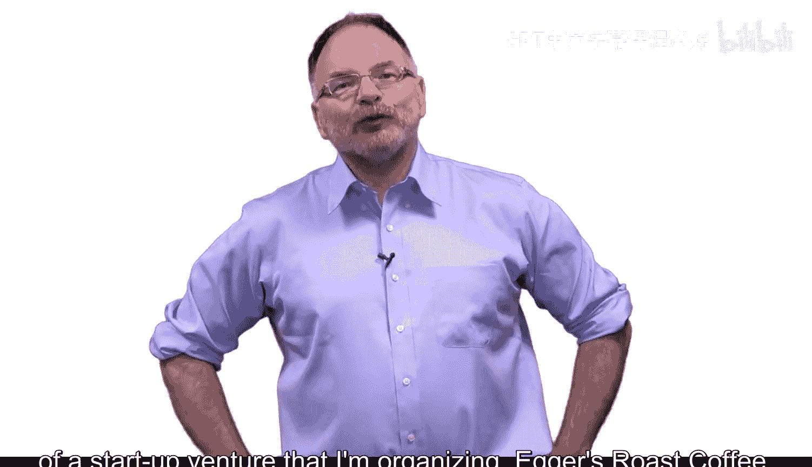

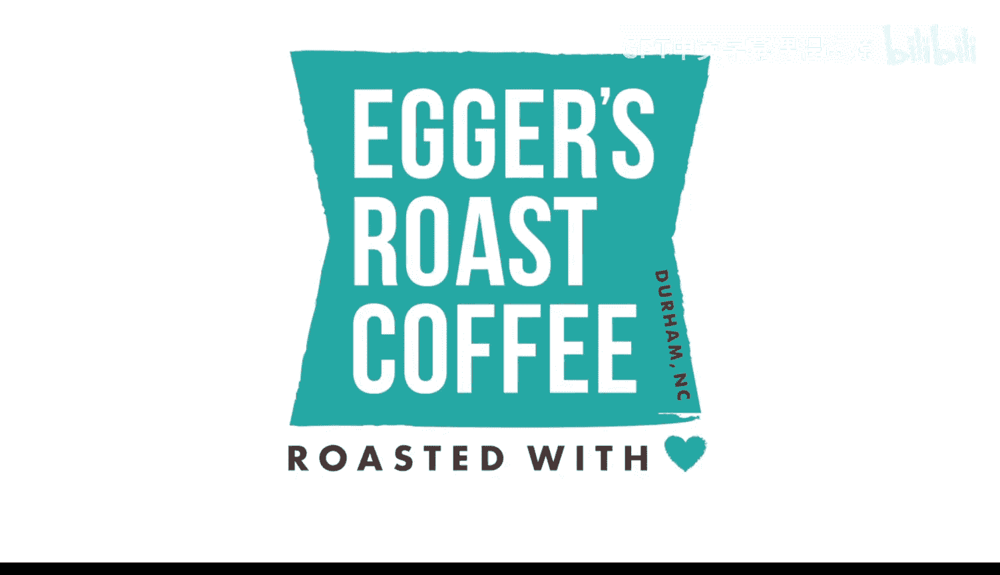

In the next video。We will explore what happens with Egar's roast coffee when you have different types of growth scenarios。

 and we will show how a rapid growth scenario can actually be very dangerous in terms of cash flow。

 even if it's fine in terms of profits， cash flow and profits are concepts that are so distinct that corporate financial reports discuss them separately。

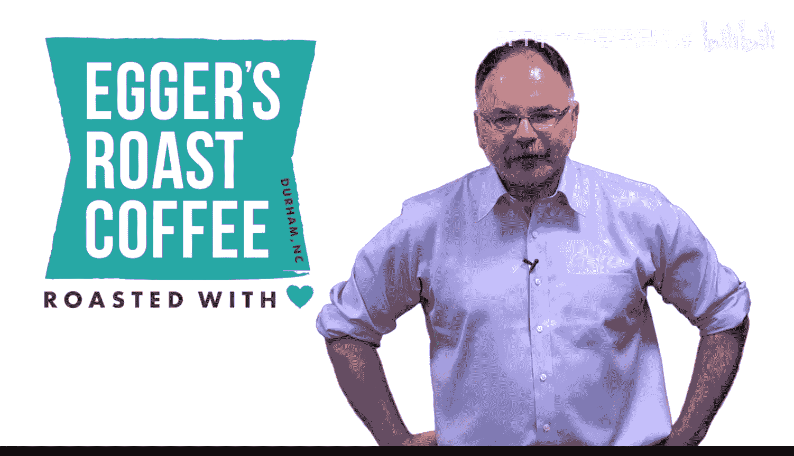

Profits are presented in a profit and loss。Or a P&L statement。

And cash flows in a statement of cash flows。Unprofitable companies can survive and thrive for years or decades。

Take Amazon， for example。But unprofitable companies that run out of cash。

Disappear without a trace like E Toys or pets。com or webvan。

Even companies that are massively profitable。Can collapse if they can't meet their short term cash obligations quickly enough。

As happened to the world's largest。And most profitable insurance company， AIG。

 over a few days in the fall of 2008。Profitable companies actually run out of cash and go out of business quite often。

One of the most common triggers for this kind of disaster is uncontrolled or unplanned sales growth。

Too much success too quickly can kill you。I am illustrating this danger through two different revenue scenarios for Eger's roast coffee。

Scenario 1， which involves safe， steady revenues。And scenario2。Rapidly increasing， excitingly great。

But ultimately fatal sales growth。If I， as your teacher。

 did not make sure before we do anything else that your company will never run out of cash due to your inability to track the right business metrics。

 I would not be doing my job。

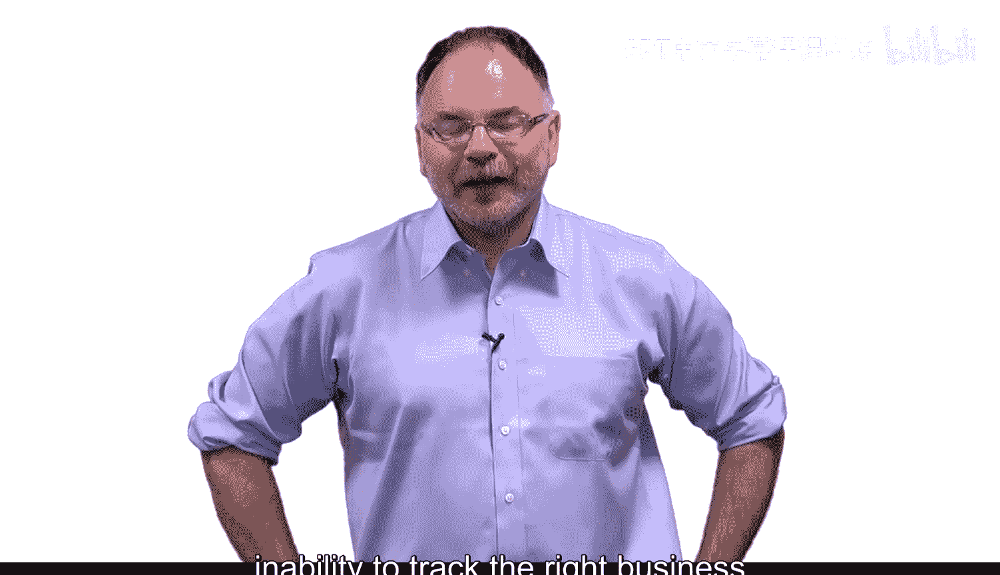

All of the egggars roast coffee business model assumptions。

 the financial terms and concepts discussed in this video and the next。

 and the two scenarios in the case study are spelled out in a detailed Excel spreadsheet that you can download。

 I recommend reviewing carefully after you watch the video And before you take the quiz or this lesson。

 the materials in the spreadsheet。So。

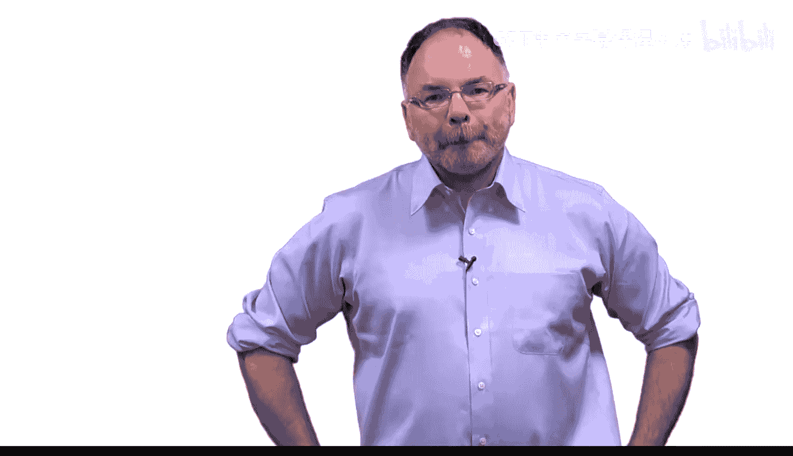

As I said， I am starting a coffee roasting business。

My business model is simple and I think it is guaranteed to work。I have a friend。

Who works as a buyer for a giant retail grocery chain。And he has promised to buy from me。

For $6 per pound。That's the wholesale price， as much egggers roast coffee as I can produce。

I will sign a supply contract with the grocery store chain agreeing to deliver as much coffee as they need。

With financial penalties， if I fail to deliver the full amount on time。

But at a price that guarantees me a profit for every pound。

My friend thinks that his giant grocery store chain can sell an unlimited amount。

We're going to market this coffee as artisanal and authentic。

 roasted with love and care by me personally in Durham， North Carolina。

The grocery chain。Pays all of its suppliers， including me。On average。

 60 days after it receives the merchandise。This gives it time to sell the merchandise itself。

 These are common terms known as net 60。I expect that the average time it will take me to roast。

 package， and deliver beans from the time I receive the raw green beans is 30 days。

I have located a source of high quality raw green coffee beans in bulk。For $2 per pound。

Their terms are cash on delivery or CO D。 I pay for the beans when they arrive at my door。Now。

 variable costs。Are things that cost me more the more beans I roast。

The obvious example that I've just mentioned are the raw green beans themselves。

 I buy each pound for $2。 And if I buy  one more pound， I pay another $2。 That is a variable cost。

Other variable costs of production for me are fuel used in the roasting process。 The paper packaging。

 the beans are wrapped in。 hourly wages for workers who help load the raw beans into the roaster and roasted package beans onto the delivery trucks。

 transportation costs to deliver the beans to my customer stores。

I expect all of these additional variable costs to be about $2 per pound。

So I expect the total variable cost to be about $4 per pound。

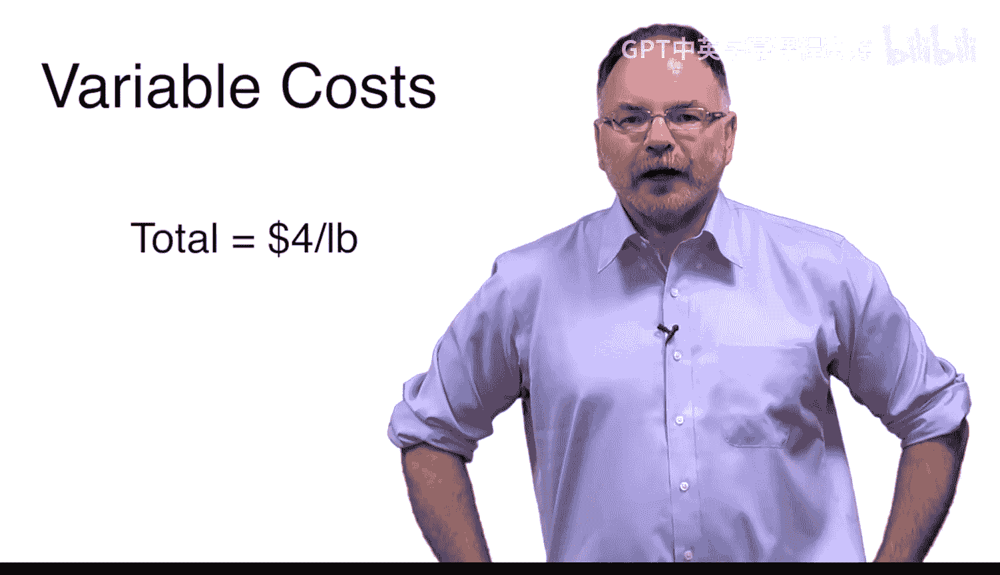

Next， I need to consider my capital investment。I will need to make one major capital investment。

I need to buy a machine。That can roast and package a large number of beans quickly and consistently。

I've looked into it and a roaster that can handle the volume of beans I'm expecting。Costs540000。

It should last three years before it will need to be replaced。I plan to pay cash for it。

I'm planning on putting $800，000 total cash into this business as we get organized。

 and that will leave me with a nice cash cushion of $260，000 in the bank when we begin operations。

I also can borrow up to an additional $800，000 from friends and family if I need to in an emergency。

From the point of view of financial accounting， in order to determine if I'm selling coffee at a profitable price or not。

I need to find a way to include in the cost of roasting beans， the $540。

000 that I already spent on the machine。I could say that the first pound of coffee cost me $540004。

 but that would not be fair。 The later pounds would get to use the roaster for free。

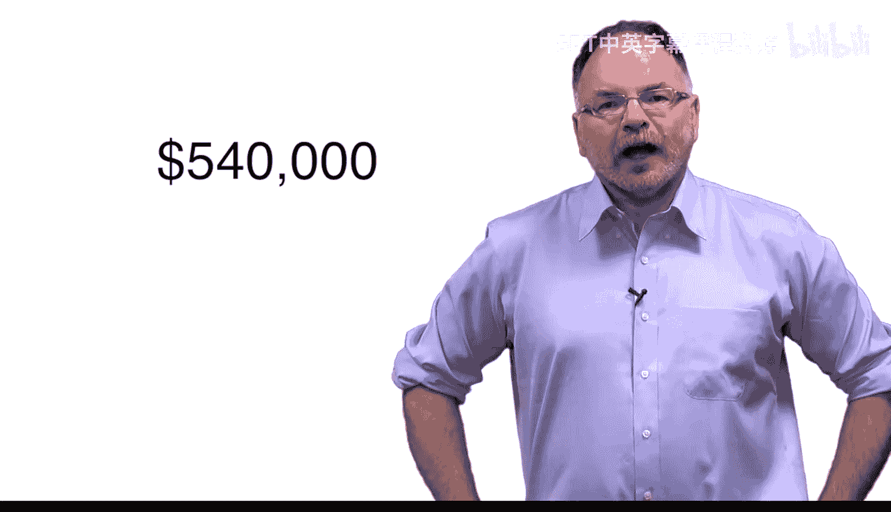

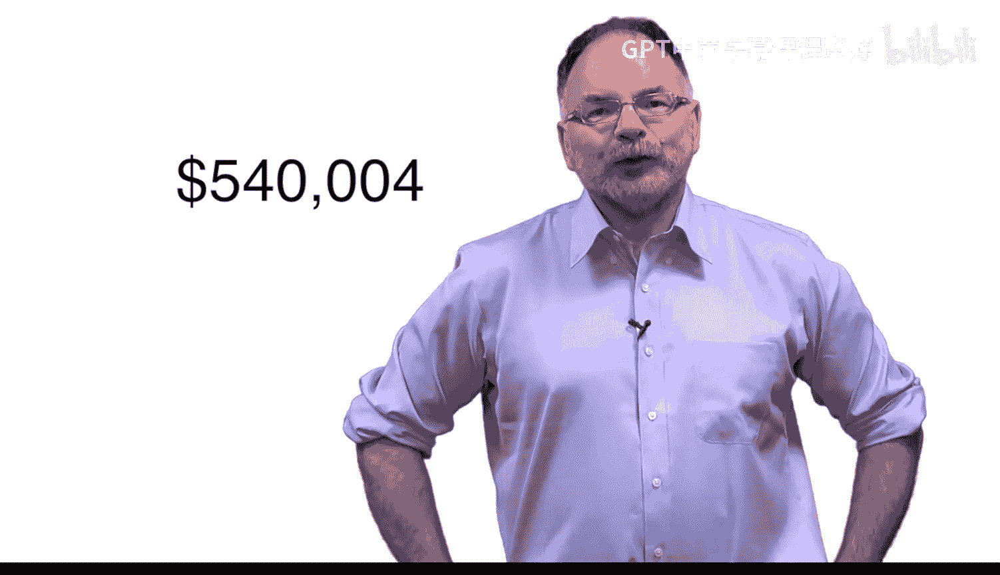

The traditional solution。Which I use here is to take the $540。

000 amount and allocate it or parcel it out over time so that some fraction of that money is assigned to each bag of coffee that is roasted by the machine。

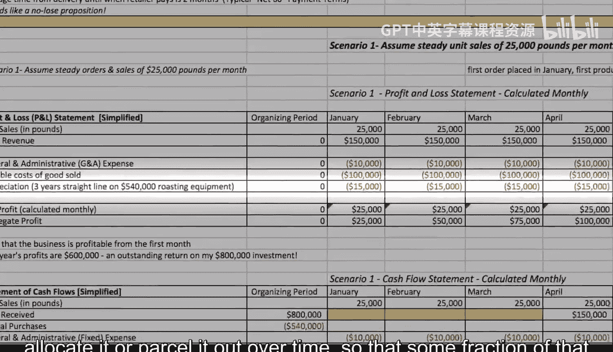

Based on the idea。That the coffee roasting machine's useful life is three years。

I'm going to allocate the $540，000 purchase price。Over three years or 36 months。$136 or $15。

000 each month。If I produce 25，000 pounds of beans each month。

Allocating that cost to each pound equally results in reducing my profits on each pound of being sold by 15。

000 divided by $25，000 or 60 cents per pound。Allocation of capital expenditure is over time because stuff wears out is called depreciation。

I know that machines don't really wear out exactly steadily。

 but we make this type of assumption in accounting all the time。

You can picture a straight line that slopes down to the right。

 so the machine is assumed to be worth exactly $15，000 less each month。

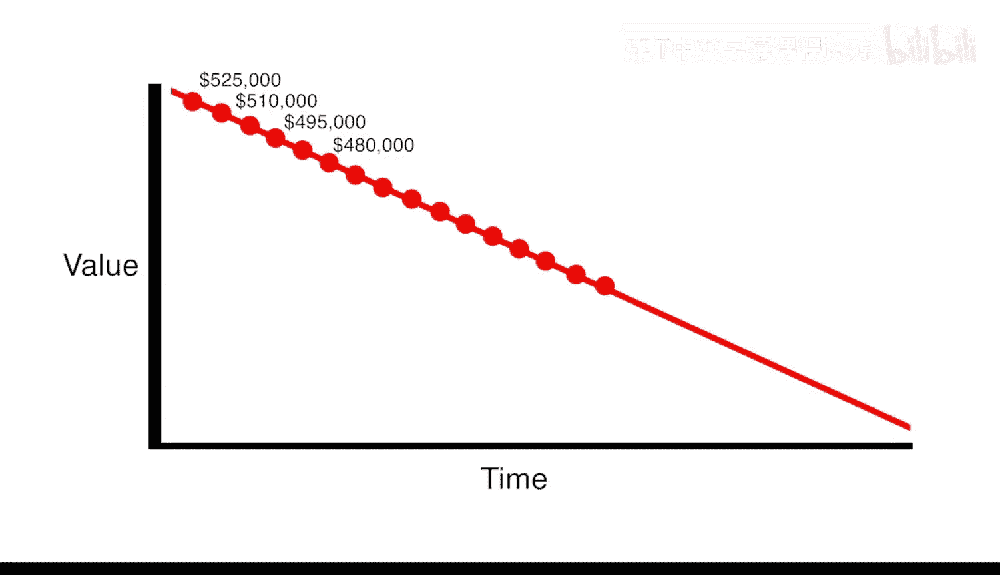

This approach。Which is， again， the most common type of depreciation is called straight line depreciation。

For simplicity here， we will consider depreciation to be a fixed cost fixed。

 because making one more pound of coffee or one less does not impact it。

The machine is not considered to wear out faster or slower if we run more or fewer beans through it。

Certain other of my costs are also the same each month。Whether I roast 1 pound of coffee or 10。

000 pounds。Rent for the building， utilities， insurance， required business licenses。

 salaries for an office manager and bookkeeper， these are all the so called general and administrative or G expenses。

I also will assign a fraction of these G&A expenses to each pound of coffee。

 just as I did with the capital expenditure depreciation。G andA expenses of $10。

000 per month allocateocd across 25，000 pounds of production should be 10，000 divided by 25。

000 or 40 cents per pound that first year。My cost per pound will drop if my production increases。

So in the model that I have presented。At a selling price of $6 per pound。

And a one year volume of 300000 pounds。It looks like my variable costs of $4 per pound。

 plus fixed costs of $1 per pound should result in a profit or net earnings of $1 per pound or $300。

000 the first year。

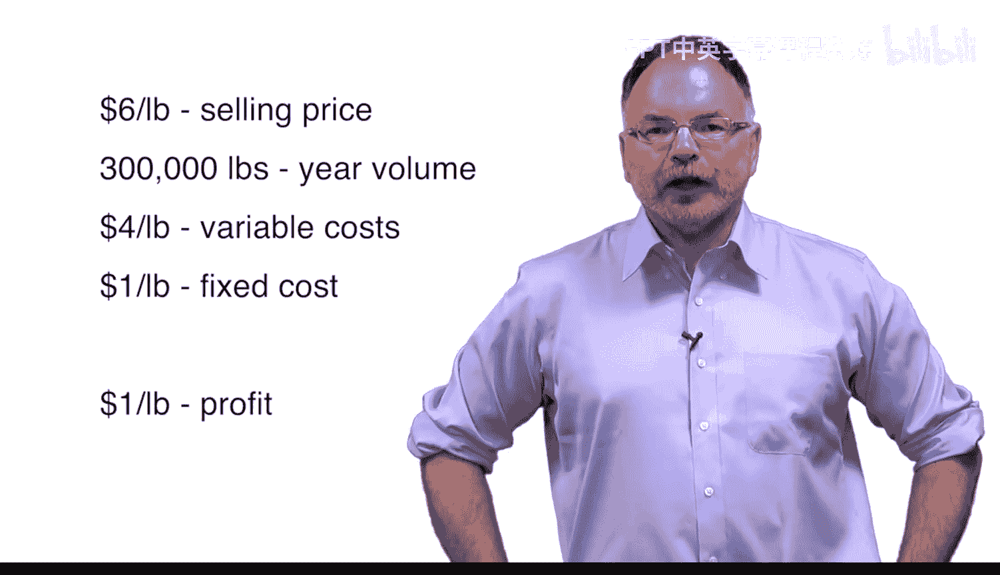

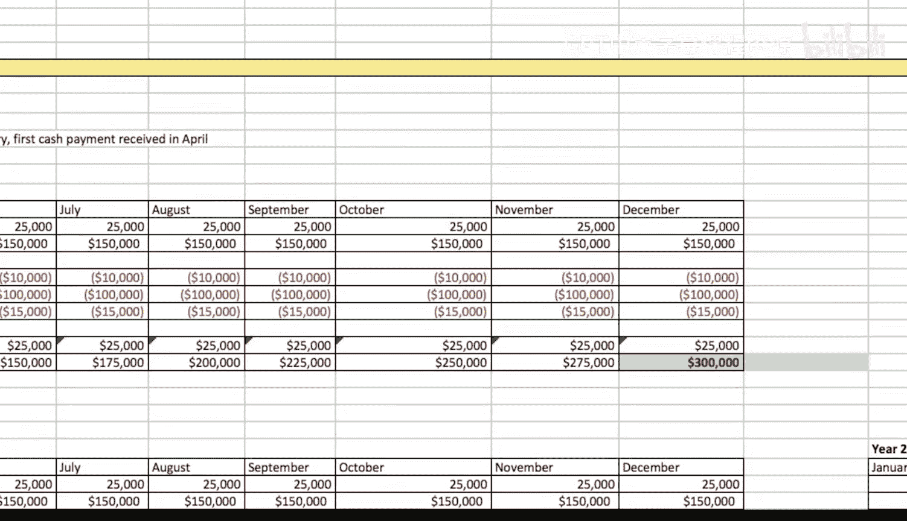

I will record or book this revenue。When I I receive an order。

 and so I am already showing a profit of $25，000， my very first month of operations。

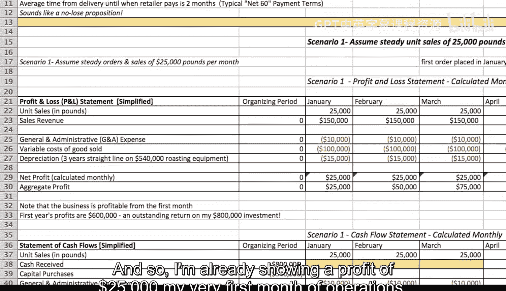

So what could possibly go wrong？Well。If examined from the point of view of profitability。

 the business looks great。But if examined from the point of view of how cash moves into and out of the company's bank account。

 the picture is a little less reassuring。Cash flow analysis is all about timing。

You may recall that we pay for new beans， C O D， cash on delivery。

 And then we need 30 more days to process the beans before they can arrive at the customer' site。

 The customer then pays us net 60。 This means that on average， when we receive an order。

We spend cash on that same day， but we get paid cash by the customer 90 days later。This situation。

 known as negative float。Is extremely common in all different kinds of businesses。

I will point out that certain businesses like insurance and banking。

Get paid cash now to deliver a service later。 This is a delightful situation known as positive float。

😊，However。Moneyies our customers owe us for products already delivered。

 but have not yet which we have not yet received payment on， are called accounts receivable。

So we deliver something and then we have an account receivable on that amount of money that we' owed until it's paid。

The money has been booked for purposes of calculating our profits and losses。

 but it does not show up on our cash flow statement。Because we haven't actually gotten it yet。

We track how long it has been that money we have not yet received is owed us。

Through a metric known as aged account receivables or aged receivables for short。Okay。

 that's all the financial accounting that you will need。

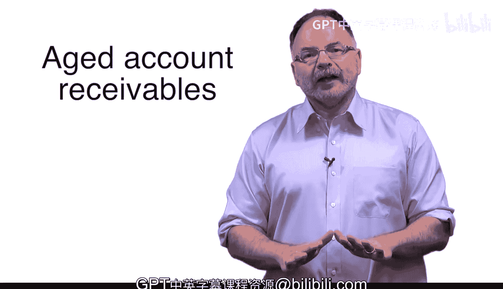

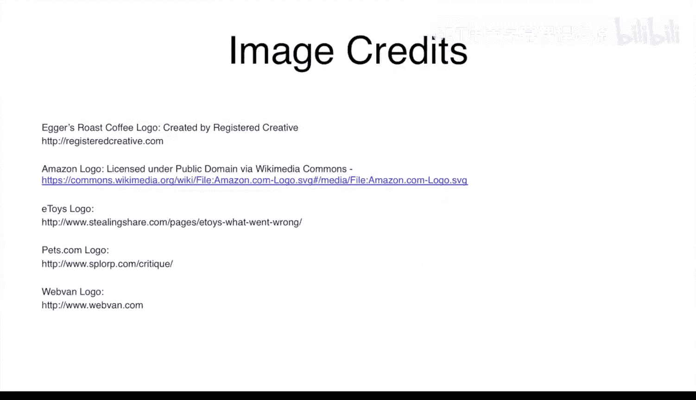