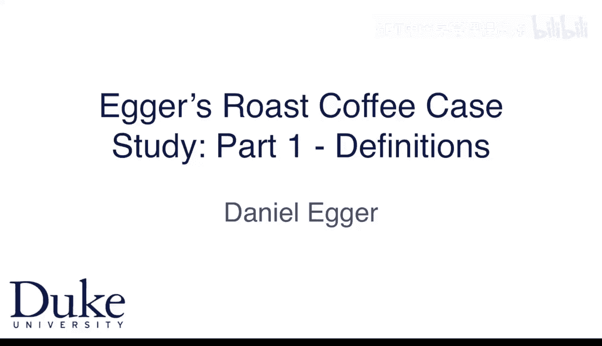
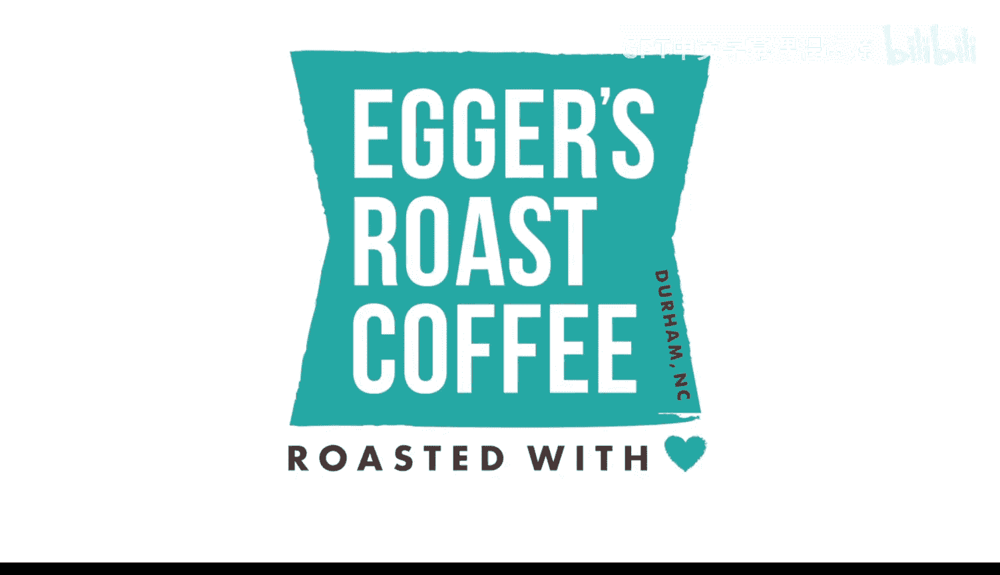
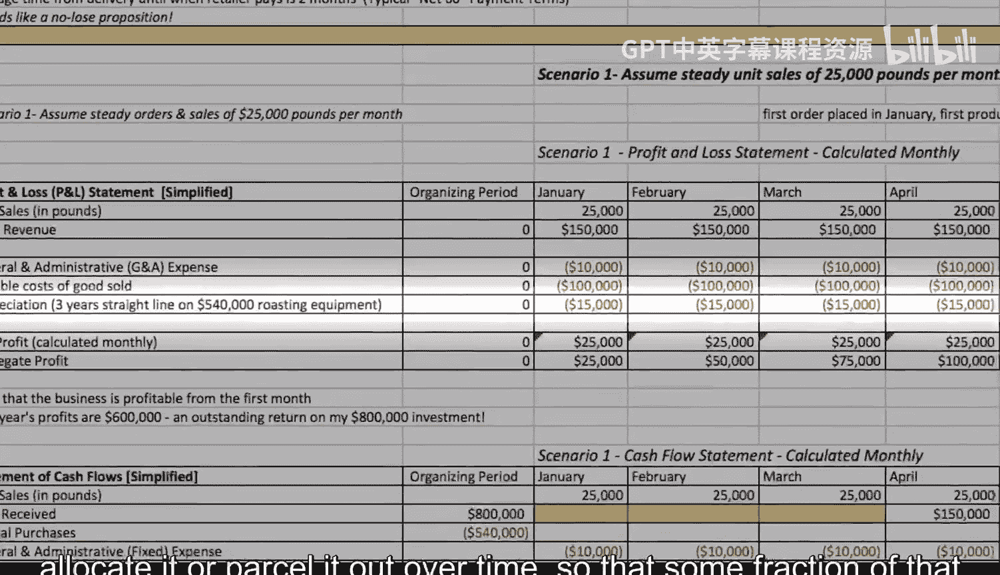
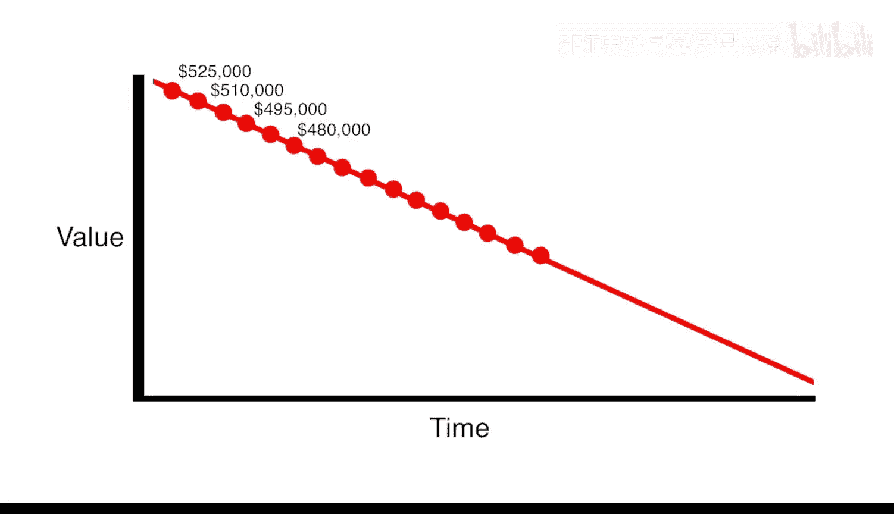
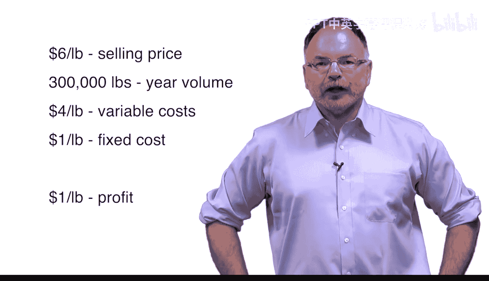
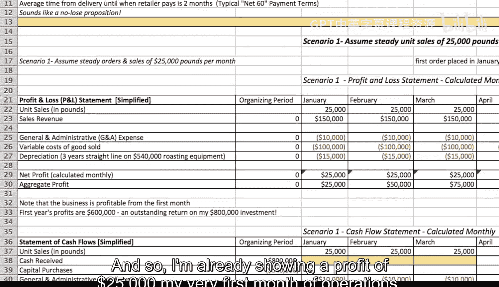
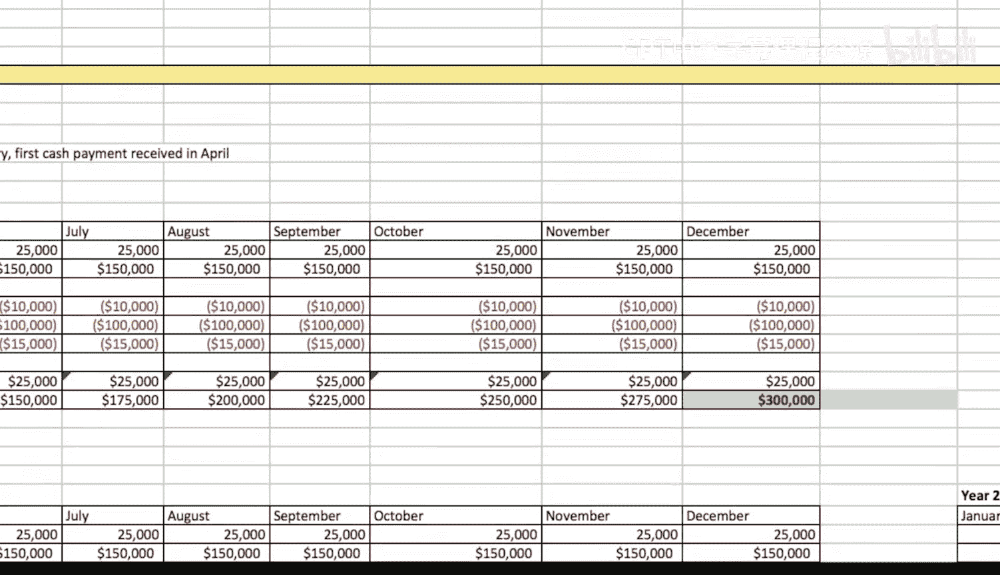
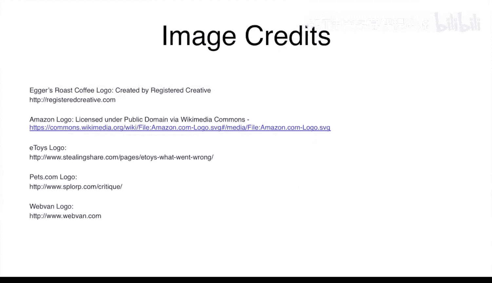

# 商业分析：P06：埃格斯烘焙咖啡案例研究第一部分：定义 ☕

在本节课中，我们将通过一个案例研究，来阐明盈利能力指标与现金流指标之间的关键区别。案例研究的第一部分，我们将讨论一些财务定义。

商业分析并非财务会计，但它确实会借鉴一些会计概念来构建其指标。我们将简要介绍，在接下来的约10分钟里，我会引导你了解所有需要掌握的、理解核心商业指标所必需的财务会计术语和概念。

我将通过一个我正在筹划的初创企业——埃格斯烘焙咖啡——的例子来解释这些最重要的术语。

## 商业模式概述

埃格斯烘焙咖啡计划批量购买生咖啡豆，进行烘焙和包装，然后以更高的价格批发销售给一家连锁超市。

在下一个视频中，我们将探讨当埃格斯烘焙咖啡面临不同类型的增长情景时会发生什么。我们将展示，即使从利润角度看情况良好，快速增长情景在现金流方面实际上可能非常危险。现金流和利润是两个截然不同的概念，因此公司的财务报告会分别讨论它们。

利润体现在**损益表**中，而现金流则体现在**现金流量表**中。不盈利的公司可以生存并蓬勃发展数年甚至数十年，例如亚马逊。但那些耗尽现金的不盈利公司，则会像E Toys、pets.com或Webvan一样消失得无影无踪。

即使是利润丰厚的公司，如果无法足够快地满足其短期现金义务，也可能倒闭，就像2008年秋天世界上最大、最盈利的保险公司AIG在几天内发生的情况一样。盈利的公司实际上也经常因为耗尽现金而倒闭。引发此类灾难最常见的原因之一就是不受控制或计划外的销售增长。成功来得太快、太多，可能会毁掉你。

我将通过埃格斯烘焙咖啡的两种不同收入情景来说明这种危险：情景1，涉及安全、稳定的收入；情景2，快速增长、令人兴奋但最终致命的销售增长。作为你的老师，如果我不在开始做任何其他事情之前，确保你的公司永远不会因为无法追踪正确的商业指标而耗尽现金，那我就没有尽到我的职责。

所有关于埃格斯烘焙咖啡商业模式的假设、本视频及下一个视频中讨论的财务术语和概念，以及案例研究中的两种情景，都在一个详细的Excel电子表格中列出，你可以下载。我建议你在观看视频后、参加本课测验前，仔细复习电子表格中的材料。

## 埃格斯烘焙咖啡的商业模式

如前所述，我正在创办一家咖啡烘焙企业。我的商业模式很简单，我认为它肯定会成功。我有个朋友在一家大型零售连锁超市担任采购员，他承诺以每磅6美元的价格（批发价）从我这里购买我能生产的所有埃格斯烘焙咖啡。

我将与这家连锁超市签订一份供应合同，同意按需交付咖啡，但如果我未能按时足额交付，将面临财务处罚。不过，这个价格保证我每磅都能获得利润。我的朋友认为他的大型连锁超市可以销售无限量的咖啡。我们将把这种咖啡作为手工制作、正宗的产品进行营销，由我个人在北卡罗来纳州达勒姆市精心烘焙。

### 收入与付款条件

连锁超市平均在收到商品**60天**后向其所有供应商（包括我）付款。这给了他们时间自己销售商品。这些是常见的条款，称为**净60天**。我预计从我收到生豆到完成烘焙、包装和交付的平均时间为**30天**。

### 成本结构

我已经找到了一个批量采购高品质生咖啡豆的来源，价格为每磅**2美元**。他们的条款是**货到付款**。也就是说，豆子送到我家门口时我就付款。

#### 可变成本

**可变成本**是指我烘焙的豆子越多，成本就越高的项目。最明显的例子就是我刚才提到的生豆本身。我每磅支付2美元，如果多买一磅，就再付2美元。这就是可变成本。

对我来说，其他生产可变成本包括烘焙过程中使用的燃料、包装豆子的纸质包装、帮助将生豆装入烘焙机和将烘焙好的包装豆装上送货卡车的工人的小时工资，以及将豆子交付给我的客户商店的运输成本。我预计所有这些额外的可变成本约为每磅**2美元**。

因此，我预计总可变成本约为每磅 **$4**。

#### 资本投资与折旧

接下来，我需要考虑我的资本投资。我需要做一项重大的资本投资：购买一台能够快速、稳定地烘焙和包装大量豆子的机器。我调查过，一台能处理我预期豆子量的烘焙机成本为 **$540,000**。它应该能用三年才需要更换。我计划用现金支付。

我计划总共向这家企业投入 **$800,000** 现金作为启动资金，这样在开始运营时，我银行里还会有 **$260,000** 的充裕现金缓冲。在紧急情况下，我还可以向朋友和家人额外借入最多 **$800,000**。

从财务会计的角度来看，为了确定我是否以盈利的价格销售咖啡，我需要找到一种方法，将我已经花在机器上的 **$540,000** 计入烘焙豆子的成本中。我可以说第一磅咖啡花了我 **$540,004**，但这不公平。后面的磅数就可以免费使用烘焙机了。

传统的解决方案（我在这里使用）是取 **$540,000** 这个金额，在一段时间内进行**分配**或分摊，使得这笔钱的一部分被分配到机器烘焙的每一袋咖啡上。

基于咖啡烘焙机的使用寿命为三年的想法，我将把 **$540,000** 的购买价格分摊到三年或36个月中。每月 **$15,000**。如果我每月生产 **25,000** 磅豆子，将这笔成本平均分配到每磅上，会导致我每磅销售的利润减少 **$15,000 / 25,000 = $0.60**。

这种因为设备随时间损耗而分配资本支出的方法称为**折旧**。我知道机器实际上并不是完全均匀地损耗，但我们在会计中经常做这种假设。你可以想象一条向右下方倾斜的直线，所以假设机器每月价值正好减少 **$15,000**。

这种方法（再次强调，是最常见的折旧类型）称为**直线折旧法**。为简化起见，这里我们将折旧视为一项**固定成本**。固定是因为多生产或少生产一磅咖啡不会影响它。如果我们通过机器运行的豆子更多或更少，机器不被认为会损耗得更快或更慢。

#### 固定成本

我每月的某些其他成本也是相同的，无论我烘焙1磅还是10,000磅咖啡。建筑物的租金、水电费、保险费、必要的营业执照、办公室经理和簿记员的工资，这些都是所谓的**一般及行政费用**。

我也会像处理资本支出折旧一样，将这些G&A费用的一部分分配到每磅咖啡上。每月 **$10,000** 的G&A费用分摊到25,000磅产量上，第一年应该是 **$10,000 / 25,000 = $0.40** 每磅。如果我的产量增加，我的每磅成本将会下降。

### 初步盈利预测

因此，在我提出的模型中，以每磅 **$6** 的售价和第一年 **300,000** 磅的销量来看，我的可变成本为每磅 **$4**，加上固定成本每磅 **$1**，第一年应该能带来每磅 **$1** 或总计 **$300,000** 的利润或净收益。

当我收到订单时，我将**记录**或**确认**这笔收入。因此，在我运营的第一个月，我已经显示出 **$25,000** 的利润。

## 潜在风险：现金流视角

那么，可能会出什么问题呢？从盈利能力的角度来看，这个生意看起来很棒。但如果从现金如何流入和流出公司银行账户的角度来看，情况就不那么令人放心了。**现金流分析的核心是关于时机**。

你可能还记得，我们为新的豆子支付**货到付款**。然后我们需要另外30天来处理豆子，才能将它们送到客户那里。客户然后按**净60天**的条款支付给我们。这意味着平均而言，当我们收到订单时，我们在同一天支出现金，但客户在**90天**后才支付现金给我们。

这种情况被称为**负浮存金**，在各种类型的商业中都非常普遍。我要指出，某些企业如保险和银行业，是现在收到现金，以后提供服务。这是一种令人愉快的情况，称为**正浮存金**。

然而，客户因已交付产品而欠我们、但我们尚未收到付款的钱，被称为**应收账款**。所以我们交付了东西，然后我们就有一笔应收账款，直到这笔钱被支付。为了计算我们的损益，这笔钱已经被**确认**了，但它不会出现在我们的现金流量表上，因为我们实际上还没有拿到它。

我们通过一个称为**账龄应收账款**的指标来追踪这些我们尚未收到的钱被欠了多久。

好了，以上就是你需要了解的所有财务会计知识。

## 总结

在本节课中，我们一起学习了埃格斯烘焙咖啡案例研究的第一部分，重点在于定义关键的财务概念。我们介绍了：
*   **商业模式**：批发烘焙咖啡的基本运作方式。
*   **成本分类**：区分了**可变成本**（如生豆、燃料）和**固定成本**（如折旧、租金）。
*   **重要会计概念**：包括**折旧**（特别是直线折旧法）、**损益确认**以及**应收账款**。
*   **核心风险点**：揭示了即使账面盈利，由于付款周期（**货到付款** vs **净60天**）导致的**负浮存金**可能带来严重的现金流风险。

我们明确了**利润**（体现在损益表中）和**现金流**（体现在现金流量表中）是截然不同的两个分析维度。在下一部分，我们将运用这些概念，具体分析在不同销售增长情景下，埃格斯烘焙咖啡将面临的现金流挑战。