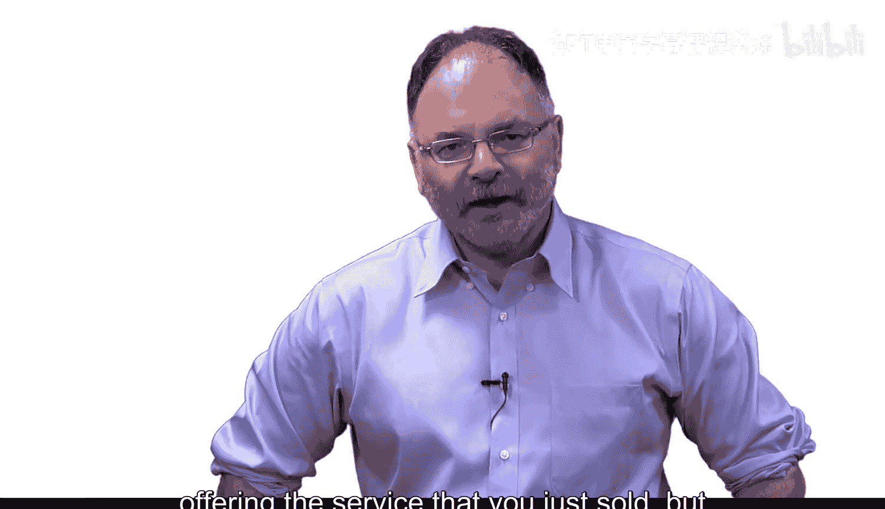
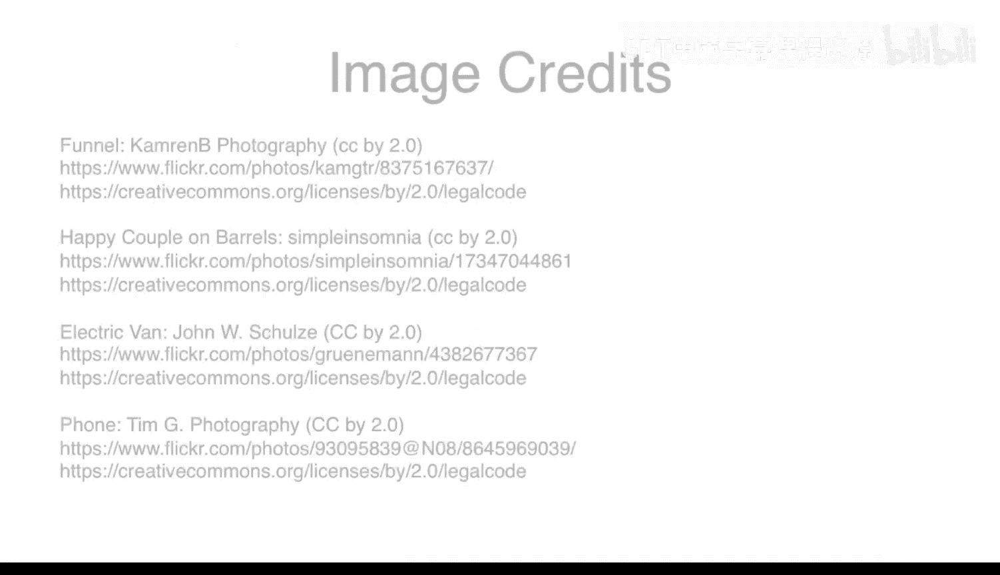

# 杜克大学《Excel 到 MySQL：商业分析（5课全）｜Excel to MySQL： Analytic Techniques for Business》中英 p08 08_02_01_收入指标：传统企业销售漏斗.zh_en -BV1mS421X7yw_p8-

We'll talk now about the traditional Enprise sales funnel。As you recall。

 revenue metrics are outward facing。They have to do with a company's outreach to customers。

 they measure how well or badly a company is identifying potential customers。

 communicating to them about its offerings and value proposition to them。

 and ultimately selling to them。After watching this video。

 you'll be able to identify and track the most important business metrics that define success in traditional enterprise sales。

In this course， we use the term enterprisese sales a bit loosely to refer to any sale that requires involvement by full time salespeople in your company Enterprise sales historically refer to big sales of complex products or services。

 an elaborate piece of capital equipment like a wind turbine。

Or something like a bidding process to win the right to act as a general contractor on construction of an office building。

Enterprise sales at a minimum require talking to potential customers on the phone。

 getting to know them， and more importantly， giving them a chance to get to know you。

 So they almost always involve sending your people or yourself to travel out to the customer site and hold in person meetings。

Sometimes many meetings before a sale is made。Enterprise sales are expensive to do。And therefore。

 the payoff for each enterprise sale must be large。

Companies that attempt enterprise sales for low priced to medium priced items typically lose money on average。

 on every sale and either change their sales model or go out of business。

Different companies in different industries have different numbers for what would qualify as a minimum size enterprise sale。

But I'll give you a general rule based on the cost of operating in the United States。

 I would say you would want to have a minimum of $250，000 for a onetime sale or $100。

000 per year on a recurring sale to justify an enterprise sales effort。

Imagine your product is an electric delivery van that's non polluting and has low operating costs。

But needs to be operated within a 75 mile radius of its charger station。

One of your vans costs $50000。It would make no sense to target a small business that might buy one van。

With your enterprise sales campaign， even if they buy it。

 you would end up spending more money than the marginal profit。 Instead。

 you need to target companies that replace a minimum of 2 to three delivery trucks every year as the old ones wear out and ideally。

 far more。The sales funnel metrics are as follows。You start with a lead。

A lead is a person whose name and contact information you have。

Who you know works at a company that owns delivery trucks， so they might be buying more sometime。

The first step is to qualify the lead。While definitions differ。

 I would say that to be a qualified lead， your sales team needs to establish two things。First。

That the target company your lead works for wants to buy at least two or three delivery vans from someone in the next year。

And second， that they could afford to buy your vans if they wanted to。In other words。

 they have a plan to buy and a budget to buy vans in your price range。Hey， as an aside。

 I can't tell you how many people are happy to talk to you on the phone for hours about how their company wants very much to buy the thing you're making。

 or if you're still doing prelaunch market research or considering making。

And you only find out months or years later that they have no money in their budget to buy any such thing。

Such people also often like to invite you to travel out and demonstrate your product in person at your own expense without informing you that no one with any buying authority will be at the demo。

Apparently， many people are quite bored sitting at their desks and are happy to talk at length with and hold follow up meetings with anyone friendly。

 even if they will never buy anything from them。Note that you have established that the lead is qualified by reference to the targetet company's plans and budget now you need to identify the person within the targetrget company organization who has the budget and authority to decide on the purchase。

They need to be able to sign a purchase order。 They are the correct decision maker。

The person you originally contacted may be able to tell you who the correct decision maker in the organization is。

 but they may not choose to identify them。Because doing so may mean you'll stop calling them。Really。

Not kidding。Not surprisingly， often， your original contract won't tell you that they have no power to decide anything and that their opinions don't even matter and certainly don't matter to the actual decision maker。

When the correct decision maker tells you that they want to engage with you about the possibility of buying your product。

 Yes， we might buy vans from you。 That is an expression of interest。

 The next big step will be to meet directly with the correct decision maker。 This may require。

 particularly in large， complex organizations， many meetings with other people First。

 various gatekeepers and lower level functionaries and lots of requests for documentation。

You can literally spend forever holding seemingly necessary and productive meetings in the intermediate levels of any large company。

The work product of many people is meetings apparently， so the more meetings they hold。

 the better in their view。Great salespeople seem to have a knack for getting directly to the top guy or gal and short circuiting the potentially limitless meeting process。

 If you have such a salesperson， cherish them， keep them happy。😊。

Once the decision maker is persuaded， you've overcome all their objections and addressed all their concerns。

 and you've negotiated terms and a price， and they tell you directly that their company will buy X amount of vans from you for Y dollars。

You have what I call a soft circle sail。Why do we call it a soft circle。

The number of things that can still go wrong before you actually close the deal with a legal contract。

 never mind getting paid， is incredible。Here are a few examples that I've come across in my business career。

After getting a definite and unambiguous yes from the correct decision maker。

 heres some things that can happen， the decision maker never takes another call from you。

 stops answering your email and pretends you don't exist。Or。

You eventually learn from someone else that the decision maker has quit or been fired or is transferred to a different office。

 and you will need to start the sales process all over again with a new person who has never heard of you or your product。

Or the target company is suddenly acquired， or it is in acquisition talks and all pending contracts are suspended indefinitely。

Or the target company goes bankrupt。Or your own company decides to stop making the product or offering the service that you just sold。

 but only tells you about that decision after you get a yes from the customer。😡。

So to review。The key sales， enterprise sales metrics are。New leads。New qualified leads。

Expressions of interest。Meetings with the correct decision maker。

Getting the decision maker to say yes， that's a soft circle sale。

 and then the number of actual official binding contract sales。

 and that's when you book the revenue for financial accounting purposes。

