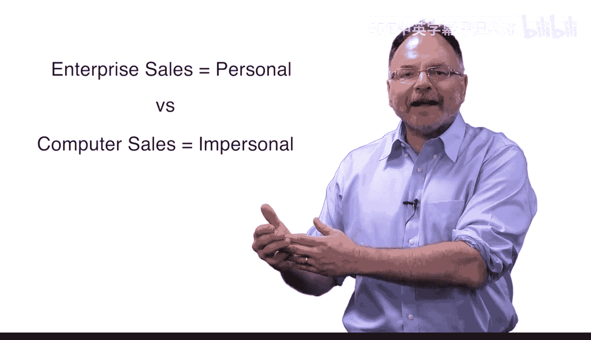
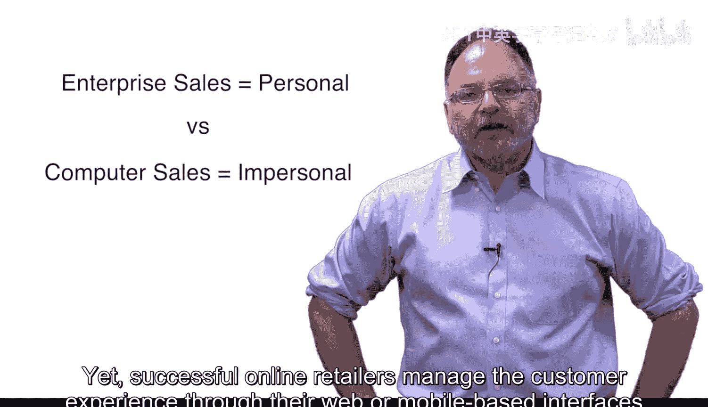
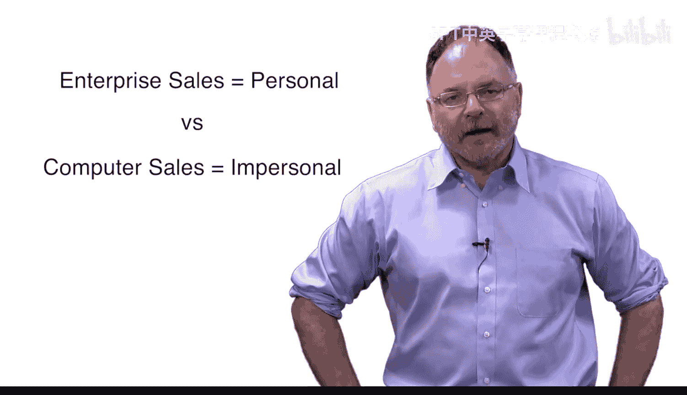
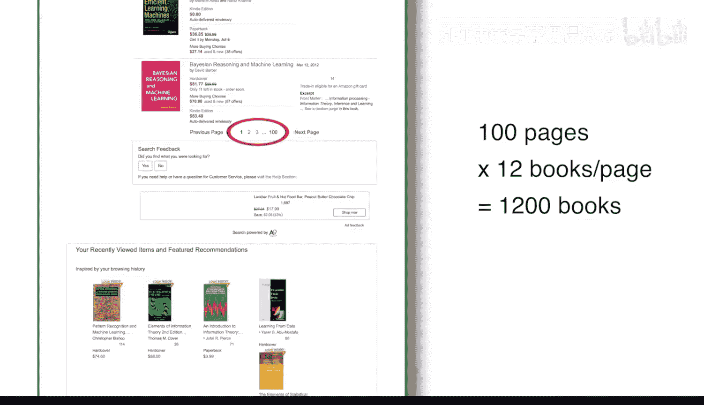

# 杜克大学《Excel 到 MySQL：商业分析（5课全）｜Excel to MySQL： Analytic Techniques for Business》中英 p09 09_02_02_收入指标：亚马逊作为动态指标应用的领先范例第一部分.zh_en -BV1mS421X7yw_p9-

Enterprise sales。That are dependent on personal one on one meetings between salespeople and potential customers。

 They represent one extreme on a sales continuum。

A place where traditional revenue metrics predominate at the other extreme。

 online retailers entice potential customers to make purchases without interacting with a human being at all。

Yet， successful online retailers manage the customer experience through their web or mobile based interfaces so that the sales process does not feel impersonal or robotic。

And they manage it empirically to optimize revenue from each customer visit。

We will study in detail the customer experience and related metrics for one company that does a brilliant job of defining and exploiting dynamic revenue metrics。

 and that is Amazon com。😊。

If your current company is in retail， there is certainly some aspect of the Amazon approach that you can apply as current best practice。

 even if you are not in retail， the methods Amazon uses to study its visitors' clickstream data。

The pattern of clicks， cursor movements， movements from page to page。

Are very important data analytic methods that will apply to any business with a website。

The beauty of Amazon's underlying computer system design is evident in how seamlessly what the user sees combines a large amount of pre processed data from various databases and indexes。

 with real time responses to the user's query。They're clicking activity。

 they're all important clickstream。Real time customization means that a company can customize each individual's user experience while that user session is going on in real time。

 based on that user's historical and current clickstream data。

Informed by detailed records of what that visitor and similar visitors did in the past。

This is our highest expression of the overall goal of making a business process change right now。😊。

I'd like to show you an example and take you behind the scenes of one of my own Amazon book searches to explain what work Amazon had to do in the past and what it is engineered to do in real time to support this current user experience。

 I'll start with a text search in books， typing in the three words， information， theory， learning。

In under three seconds， Amazon presents me with a web page with 12 books visible。

Let me walk you through how this web page with this particular display list of 12 books that Amazon chose to show me is generated。

Amazon maintains a very large database。 We'll call it the book I D database。

Where every book itself sell is assigned a separate record number and location specified by a unique book ID。

Amazon also maintains an up to date text index so that each word in a text search can be used to retrieve exactly the book records in the database whose title contains that word。

Sometimes also text within a book might be indexed。

For my search， Amazon identifies more than 1200 books in its database that have at least one of my three search words in its title or in other index text。

 now is when it gets interesting。

Amazon could pick 12 out of。1200 at random， in which case the books would almost certainly not be books that I want。

 I would probably click down， look at another page of 12 or so。

 maybe two pages and then give up without buying anything after some browsing through largely irrelevant junk。

Welcome to Internet Search Circuitirca 1995。Instead。

 Amazon begins to apply its own dynamic revenue metrics。Amazon ranks the 1。

200 possibly relevant items by their predicted relevance to me。Or put another way。

 They're ranked by the probability that someone who typed in my search terms will buy the item on this visit。

They show me just the top 12 of 1200 that Amazon's prior data analysis predicts I am most likely to buy。

 How cool is that。I infer， although I do not have direct inside knowledge of Amazon system。

 that Amazon is ranking the books they choose to show me using a two step process。 First。

 they study my text string of three words， information， theory and learning。

And match it to a predefined list of categories， high level subject areas。

 This list of categories is what old fashioned library card catalogs called a subject index。

Because a subject index contains a much smaller or more controlled number of words than all the words that people could run queries on。

 this type of index is called a controlled vocabulary index。

Amazon does matching between my text string， the text I typed in on the one hand。

 and their controlled vocabulary index on the other hand。

They do this by using a giant thesaurus that finds the best synonym or synonyms for the words that I've typed in in their subject area index。

 This is a very effective method to find for people what they actually wanted but didn't know how to ask for Instead of giving them what they thought they wanted。

 but will be disappointed by。Maybe they should invent a system that does the same thing for dating。

Oh yeah。 that exists also。My clue that this synonym matching is what Amazon is doing behind the scenes comes from the names of the subject areas that Amazon has decided to show me as most relevant。

 They appear in the upper left hand corner of the first page with the number of books in the Amazon catalog that are cross listeded in each subject area。

Note that although all10 subject areas are in fact relevant to me。

 only three of the 10 subject areas contain even one of the words I typed into my original query。😡。

Very cool。The high level subject index also expands to include subtopics。

 If I click on AI and machine learning， for example， I get AI and machine learning， computer vision。

 pattern recognition， intelligence and semantics， neural networks， machine theory and so on。

If we have a tree of categories and subcategories， Amazon defines best sellers by how well they are selling relative only to those other books that fall into the same subject area subcategories。

I told you that I suspect Amazon has a two step process for choosing what 12 books to display to me first。

Their first step is using the thesaurus of synonyms to retrieve the most relevant categories in Amazon's own subject index。

 The second step I involves identifying the best selling books within the subject Subcategories。

 My search terms fit best。 It is these best sellers。

Waied by their topical relevance that Amazon displays to me。

The reason why the intermediate step of identifying subject categories is necessary for Amazon is that if they just ranked all 1。

200 books by their rate of sales without regard to the subcategory。

 that would bury any specialized books that I and maybe only a few thousand other people are interested in beneath the weight of the most general interest bests sellers。

So we can infer that the dynamic top line metrics Amazon is using are。First。

 what are the subject area categories in the controlled vocabulary index most relevant to this user's exact typed query terms。

Within the subject subcategories that most closely fit his query。

What books are we selling the most of right now？