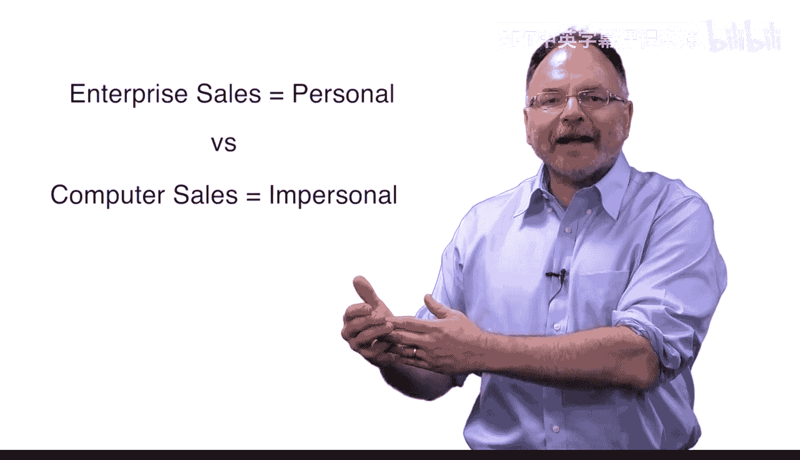
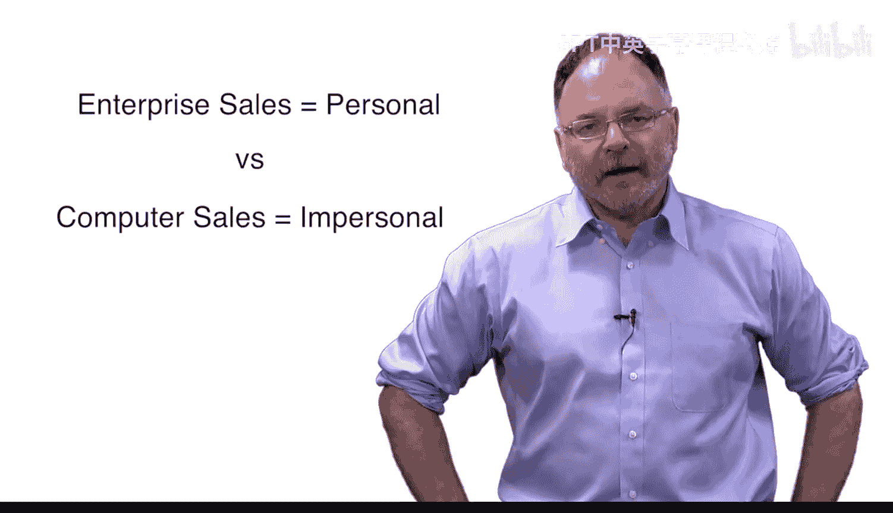
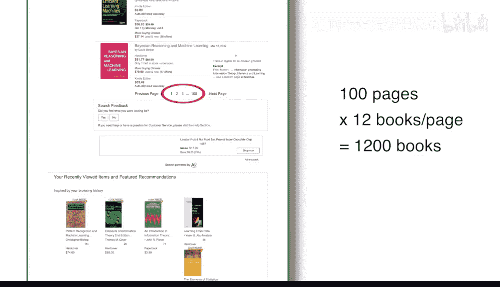

# 杜克大学《Excel 到 MySQL：商业分析》：P09：收入指标：亚马逊作为动态指标应用的领先范例（第一部分）📊

在本节课中，我们将学习动态收入指标的概念，并以亚马逊公司作为核心案例，深入探讨其如何通过数据分析和实时定制来优化客户体验与销售收入。

---

销售活动存在于一个连续光谱之上。光谱的一端是**企业销售**，其依赖于销售人员与潜在客户之间一对一的个人会议。这类销售代表了销售连续体中的一个极端。

在这个极端，传统的收入指标占据主导地位。而在光谱的另一端，**在线零售商**则完全无需人工互动，就能吸引潜在客户完成购买。

然而，成功的在线零售商通过其网站或移动端界面管理客户体验，使得销售过程不会显得非人性化或机械化。并且，它们基于实证数据来管理这一过程，以优化每位客户访问带来的收入。

接下来，我们将详细研究一家在定义和利用动态收入指标方面做得非常出色的公司——亚马逊（Amazon.com）——的客户体验及相关指标。

如果你的公司从事零售业，亚马逊方法中的某些方面无疑可以作为当前的最佳实践来应用。即使你不在零售业，亚马逊用于研究访客**点击流数据**（即点击、光标移动、页面间跳转的模式）的方法，也是适用于任何拥有网站的企业的重要数据分析方法。

亚马逊底层计算机系统设计的精妙之处在于，它能够无缝地将用户看到的、来自各种数据库和索引的大量预处理数据，与对用户查询和点击活动的实时响应结合起来。**实时定制**意味着公司可以在用户会话进行时，基于该用户的历史和当前点击流数据，以及该访客和类似访客过去的详细行为记录，为每个个体定制用户体验。这是我们实现“**立即改变业务流程**”这一总体目标的最高体现。

我想通过一个例子，带你深入了解我本人在亚马逊上进行的一次图书搜索，解释亚马逊过去必须做哪些工作，以及它被设计成如何在实时中支持当前的用户体验。

我将从图书的文本搜索开始，输入三个词：`information`， `theory`， `learning`。

在三秒内，亚马逊向我展示了一个包含12本可见图书的网页。让我带你了解这个网页，以及亚马逊选择展示给我的这12本特定图书的列表是如何生成的。

亚马逊维护着一个非常庞大的数据库，我们称之为**图书ID数据库**。

其中，每一本销售的图书都被分配一个独立的记录号和由唯一图书ID指定的位置。

亚马逊还维护着一个最新的文本索引，以便文本搜索中的每个词都能用来精确检索数据库中标题包含该词的图书记录。

有时，书内的文本也可能被索引。

对于我的搜索，亚马逊在其数据库中识别出超过1200本图书，这些书的标题或其他索引文本中至少包含我的三个搜索词中的一个。现在，有趣的部分开始了。

亚马逊本可以从1200本书中随机挑选12本，那样的话，这些书几乎肯定不是我想要的。我可能会向下滚动，再看一两页，浏览大量无关的内容后，最终放弃购买。这就像是1995年左右的互联网搜索。

相反，亚马逊开始应用其自身的动态收入指标。亚马逊根据这1200个可能相关的项目对我的**预测相关性**进行排名。换句话说，它们按照输入我的搜索词的人**本次访问会购买该商品的概率**进行排序。它们只向我展示1200本书中排名前12的，即亚马逊先前数据分析预测我最有可能购买的。这非常酷。

我推断，尽管我没有亚马逊系统的直接内部知识，但亚马逊在选择展示给我的图书时，使用了一个两步流程。

**第一步**，它们分析我的三个词文本字符串“information, theory, learning”，并将其与一个预定义的高级主题领域类别列表进行匹配。这种类别列表就是老式图书馆卡片目录中的**主题索引**。由于主题索引包含的词汇量比人们可能查询的所有词汇要少得多或更受控，因此这类索引被称为**受控词汇索引**。

亚马逊在我输入的文本字符串与其受控词汇索引之间进行匹配。它们通过使用一个庞大的**同义词库**来实现，该词库为我输入的词汇在其主题领域索引中找到最佳的同义词。这是一种非常有效的方法，可以为人们找到他们实际想要但不知如何询问的东西，而不是给他们自认为想要但会失望的东西。

我之所以推断亚马逊在幕后进行了这种同义词匹配，是因为亚马逊决定向我展示为最相关的主题领域名称。它们出现在第一页的左上角，并附有亚马逊目录中交叉列在每个主题领域下的图书数量。

值得注意的是，虽然所有10个主题领域都与我相关，但其中只有3个主题领域包含了我原始查询中键入的任何一个词。

高级主题索引还可以扩展以包含子主题。例如，如果我点击“AI and machine learning”，我会得到AI and machine learning, computer vision, pattern recognition, intelligence and semantics, neural networks, machine theory等子类。

如果我们有一个类别和子类别的树状结构，亚马逊通过一本书相对于**同一主题领域子类别下其他图书**的销售情况来定义畅销书。

我提到过，我怀疑亚马逊在选择向我展示哪12本书时采用了两步流程。**第一步**是使用同义词库来检索亚马逊自身主题索引中最相关的类别。**第二步**则涉及识别我的搜索词最匹配的主题子类别内的**畅销书**。正是这些根据主题相关性加权的畅销书，被亚马逊展示给我。

对于亚马逊来说，识别主题类别这个中间步骤是必要的，因为如果它们只是不考虑子类别，按销售率对所有1200本书进行排名，那么任何我（可能只有几千其他人）感兴趣的专门书籍，都会被最畅销的大众读物所淹没。

因此，我们可以推断亚马逊正在使用的动态核心指标是：
1.  在受控词汇索引中，哪些主题领域类别与用户键入的精确查询词最相关？
2.  在最符合其查询的主题子类别中，哪些书籍是我们当前销售最多的？

---

本节课中，我们一起学习了销售连续体的概念，并以亚马逊为例，深入探讨了其如何通过构建图书ID数据库、文本索引和受控词汇主题索引，并应用两步流程（同义词匹配与子类别内畅销书排名）来实现实时定制和动态收入优化。这种基于点击流数据和历史行为分析的方法，是提升在线业务收入能力的强大范例。