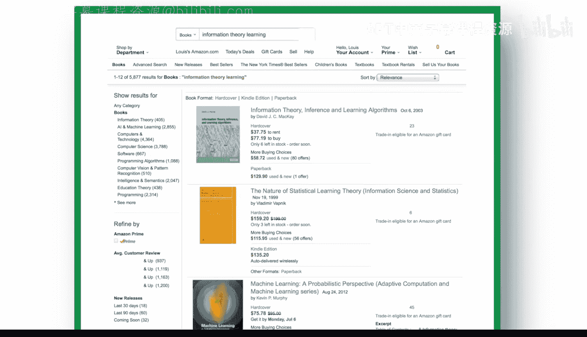
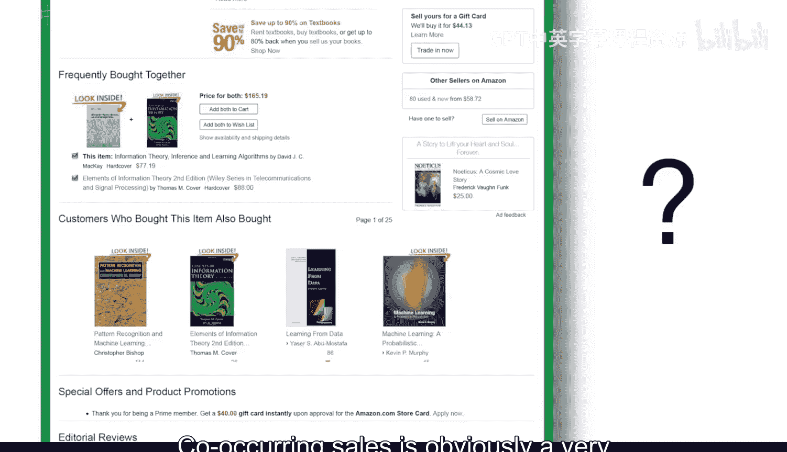

# 杜克大学《Excel 到 MySQL：商业分析（5课全）｜Excel to MySQL： Analytic Techniques for Business》中英 p10 10_02_03_收入指标：亚马逊作为动态指标应用的领先范例第二部分.zh_en -BV1mS421X7yw_p10-

。What have we discovered about the Amazon database behind this individualized magic。

We already know that for every unique book ID， Amazon must store a tree of subject area categories and subtopic subcategories that the book is located in and a record of how each book ranks in terms of Amazon's own recent sales。

Within each of the subject area categories and subcategories in which it is cross listed。

We are about to see what other dynamic revenue metrics Amazon tracks for each book and how it stores and uses that information。

The top book。On the list of 12， remember out of 1200 possible that Amazon has retrieved and is showing me is information theory。

 inference and learning algorithms by David McKay。Which happens to be one of my favorite books。

 which I first read when my brother gave it to me many years ago。

And which we now use as a textbook in my Duke Master of Engineering Management data mining course。

I can click on the book to get more information about it。

Look carefully at the new page layout。 First， we get frequently bought together with a suggestion that we buy the cover and Thomas elements of information theory。

Note the subtle selling suggestion that learning information theory in relation to machine learning requires buying more than one book。

Because people frequently。Frequently bought the cover and Thomas Element of Information Theory textbook。

 which is also excellent， together with the McKay book。To my surprise。

 Amazon is not offering a discount for purchasing both together。Obviously。

 because they have found that doing so does not increase sales enough to justify it。

We don't actually know what percentage of buyers of McKay also bought coververant Thomas or vice versa。

But Amazon is clearly tracking every purchase of more than one book at a time and maintaining an up to date database for every book it sells of the other books sold during the same user session to the same customer ID。

Amazon offers viewers the top 100 books in terms of frequency that people bought at the same time that they bought the Mckaay textbook。

This kind of data is called coocnce data。It can be represented in a co occurrence matrix。

 much more on this later。Co occurring sales is obviously a very important dynamic metric to Amazon。

A question now arises to which I do not know the answer。 If you do know， please send me a note。

 Does Amazon list the top 100 co occurring sales books in simple order from the highest co occurrence to the lowest。

If yes， then coverver and Thomas is not actually the book bought most frequently with McKay。

That would be pattern recognition and machine learning by Christopher Bishop。Of course。

 Amazon did not say。That it was bought together with Mckaay most frequently， only frequently。

 It is likely that the frequently bought together book offered is chosen through A B testing experiments by Amazon that suggests that showing cover together with Mckay increased sales or profits by more than showing Bishop。

Or maybe any of the other 98 co occurringring books on the list。In this case。

 Amazon has created best upsell revenue potential in the frequently bought together marketing slot。

On the other hand。If they are presenting the 100 books out of ranked order。

Maybe Covering Thomas really is the book most frequently bought with McKay。

 but Amazon knows we've already been given information about it。

 and we didn't bite on their offer to buy both together。

So Amazon makes a small change in the true ordering in the list of 100 to put the second most popular book to buy together with McKay first。

 because it is a better use of the top slot to display a new title to us。It is a mystery to me。

 but in either case， the combined placement。In the frequently bought together display and the top 100 frequently bought together display is certainly optimized through A B testing to maximize sales。

In addition to tracking what books people buy together at the same time。

Amazon maintains a co occurrence database of every book that a web user clicked on while browsing。

Wow， that is a lot of detail。Click stream data about everything I ever looked at， but did not buy。

How do I know that Amazon does this。Because at the bottom of the same page is a separate co occurrence list of the books people most commonly bought during the same session when they viewed the Mckaay textbook without buying it。

So we know that Amazon is maintaining a cooccurnce matrix that lists for every visit that results in the sale of at least one book。

Two other possibilities First， when Book1 is bought， it has list of all other books bought。

 and second， when Book 1 is bought， it has a list of all other books viewed by using this second set of records。

 Amazon can identify what books were ultimately purchased by people who viewed but did not buy any given book。

So to summarize。Amazon's first line of promotion is the profit maximizing frequently bought together metric。

Their second metric is a kind of recommendation engine。

What's likely to be also be bought based on the assumption that we do ultimately purchase the first book。

 The third metric is a recommendation based on the purchases people made who looked at but did not buy the first book。

