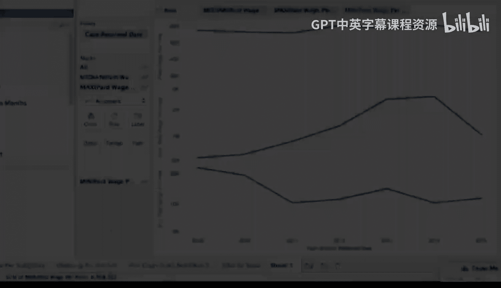
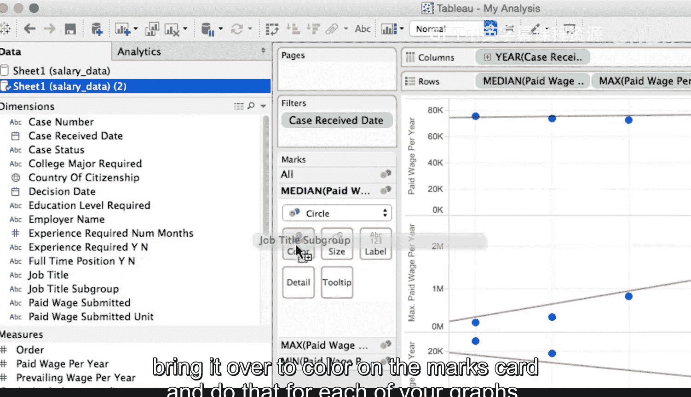
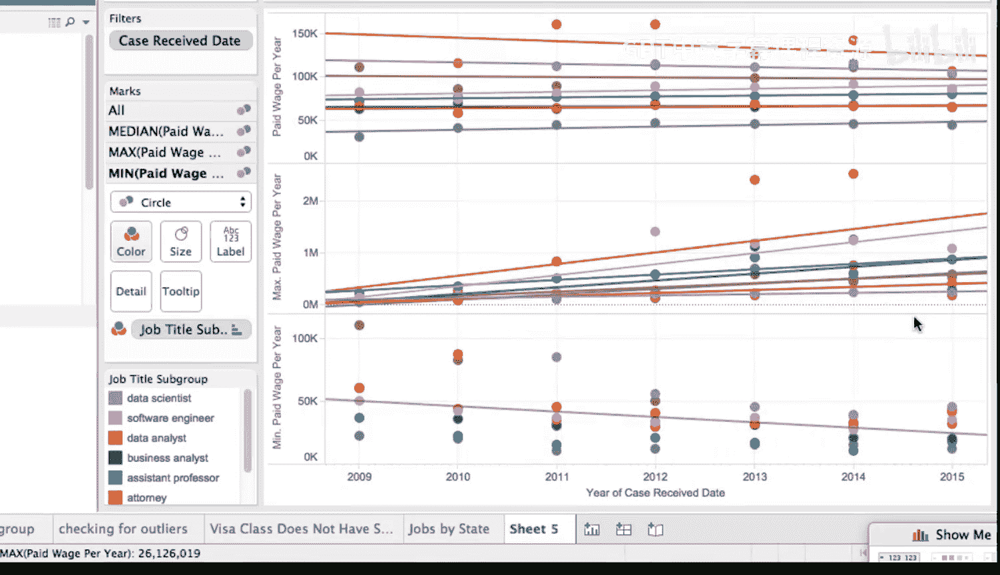

# 杜克大学《Excel 到 MySQL：商业分析（5课全）｜Excel to MySQL： Analytic Techniques for Business》中英 p100 25_03_04_使用趋势线分析数据相关薪资随时间变化.zh_en -BV1mS421X7yw_p100-

All the work we've done in the past few videos has provided a great example of how visualizations can help you narrow them down on what statistical models are worth your time。

😊，This is not a course in statistics， so I don't want to get bogged down in the details。

 but I did want to show you how some of the simple statistical capabilities of Tableau can help you move through your data analysis faster。

If you can get a statistic to help you decide whether you should take an effect into account。

 for example， it could be very useful。

This exercise is a good example of how you can use visualizations to help you narrow down what statistical models are worth your time。

Now this is not a course on statistics， so I don't want to get bogged down in details。

 but I do want to give you an example of how some of the simple statistics capabilities of Tableau can also help you move through your data analysis faster。

 so if you can get a statistic that helps you decide very quickly whether or not you should take an effect into account that can be very useful。

 for example。So the statistic that I'm going to show you how to do in Tableau is called regression。

And to show you what that is， we're going to change this graph。

 I don't want the different points to be connected by a line anymore。

 I'd like you to change it so that you are looking at just individual marks。And do that for each one。

 please。Okay。So a regression is a process that tries to take a line and put to the best of its ability makes a line that goes through these different dots。

 so it's trying to minimize the amount of error between the line and each one of these dots okay。

And the line is called a best fit line or a trend line。

 So Tableau can do this regression very quickly， actually， So if you right click。

 you'll see trend lines and you can say show trend lines。Now， what this is showing you here。

 this dark black line is that best fit line I was telling you， So it's。

The best job that a regression can do to make a line that connects all of these dots。

These outside curvy things， curvy lines are the confidence intervals。 In this case。

 it's a 95% confidence interval。 and those are basically ways of letting you know how reliable this line is。

The way to interpret 95% confidence intervals is that everything within these lines here has a 95% chance of containing the mean。

Now， of course， so this is a visual way of getting an idea of how confident you should be in this line。

 but the whole point of using statistics is to get an actual number so that it can make the decision for you about whether or not this line is something that you want to pay attention to So tableableau gives you those numbers as well。

 So the fastest way to do this is if you hover over the line。

 you'll see it actually gives you the equation for the best fit line。

 I don't want to go through the details of what the equation means。

 I have included some resources with this video in case you're interested in learning more。

 there's certainly a lot more to learn and regression is very interesting。 but for right now。

 the main thing I want you to pay attention to is that part underneath it that's called the P value。

 the P value indicates how likely it is that the observed trend happen by chance or is indeed reliable the smaller the P value。

 the more likely it is that the inclusions that you would draw from looking at this line are indeed reliable in something that you should trust。

Now， the convention is that you should only trust trend lines with P values that are less than either 0。

05 or 。01。 Now， when you're using a P value of 0。05。

 that means that there is a false positive rate of 5% or less。If you are using a P value of 0。

01 that means there's a false positive rate of 1% or less so that gives you an idea of the things that you should consider important for your analysis Now this particular line it has a P value of 。

07 so one way to decide whether or not this effect is important for your analysis would be to say well it's not under 0。

05 so I'm not going to worry about it too much， maybe I'll put it in the back of my head but I'm not going to worry about it too much。

So now that you know how to do this， I want to do this for each one of our job subcategories and before we do that。

 I want to go ahead and get rid of these confidence intervals because it will make the graphs look pretty busy so if you right click on the line you can go to edit trend lines。

And you see here that show confidence band is is clicked。 I want you to unclick that and press O。

 And now you see that there's no confidence interval。 So let's go ahead and let's add trend lines。

Do these other graphs。And now we're going to look at these lines for each individual sub。

Job title subgroup。 So now take job title subgroup and bring it over to color on the marks card。

And do that for each of your graphs。

And once you've done that for all three graphs， we can start looking at the data for each subgroup independently。

 Now， as before， this is very busy， but we can use that highlighting trick to look at each one more simply。

 So let's look at just the data for data scientist。Now when you first look at this。

 you might be thinking， okay， this line is pretty flat， this one doesn't seem to be changing。

 and this one definitely seems to be going down。But you should always remember to look at the axes。

 This axis goes from  zero to a little over 100，000。 This one goes to over 2 million。

 This one goes to about 150。 so this line going up is actually goes up way more than it looks like here。

 So the best way you can either change this axis so that it's the same as it is for this or you can hover over the line to be able to see whether or not it is a significant trend and what you're seeing here is for the data scientist indeed it does look like the maximum paid wage is going up over time。

And even though this line looks like it's steeper than the one above it。

 it actually is not significant， so that's because again the access or the axis is not the same in those two different graphs。

 so it looks like for data scientist， the maximum a paid wage is going up but the median is not for software engineer。

The maximum paid wage is going up over time。And the minimum paid wage is going down over time。

 Overall， again， the median paid wage is not changing。Data analyst。

Can see that the minimum paid wage is going down over time。

 whereas the maximum is staying basically the same。 Again， the median is not changing。

 and for business analyst again。The minimum is going down。The maximum is trending up。

 but it's not significant， and the median paid wage is not changing at all。

 So according to this analysis， it does look like the minimum salaries for software engineers。

 data analysts and business analysts are decreasing over time。

 even though the median paid wages are remaining exactly the same for all of these different categories。

 The maximum paid wage for data scientists and software engineers the other hand are increasing。

 So overall， that suggests that there might be increasing amount of opportunity to be awarded with very high salaries in data scientists jobs and software engineering jobs。

 But overall， the typical salaries for data related jobs seem to be staying quite constant。

 and for every category other than data scientists as time goes on。

 there might actually be increased risk that you will make less than you expected。

So that was it's an interesting result to get from our data now there's one more thing I want to show you about trend lines。

Even though it's not related to our data questions because I think it might help you later and right now you'll see you saw that it makes a trend line for each subgroup independently now you can do this so that it makes a trend line for the entire group as a whole but still shows the data for each group independently and to do that go to edit trend lines and you'll see that it says here allow a trend line per color。

If you unclick that。This is the trend line， this black line is the trend line for all of the data aggregated together。

 even though it's showing you all the different groups。

 so this can be something that's useful in the future for our purposes。

 though these individual trend lines are more useful for actually analyzing our data and figuring out what they mean。

Nice job in this lesson。 We actually did quite a lot in this video。 At first。

 you learned about how to make line graphs。 You learned about hierarchies。

 You learned that dates can be considered either continuous or discrete variables in Tableau。

 You learned about the effect of treating dates as either continuous or discrete in Tableau。

 You learned how to make regression or best fit lines and how to interpret them。

 And you learned some interesting insights about salaries of data related jobs。😊。

Did a lot of work today。