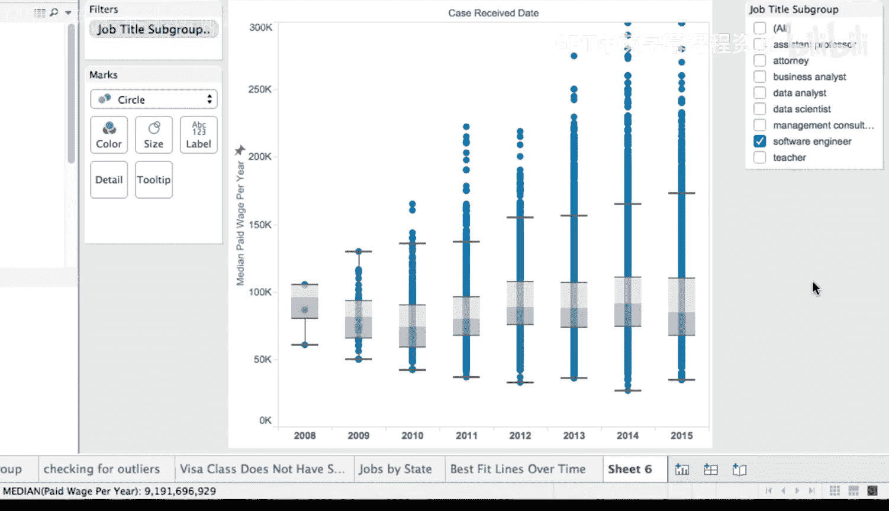

# 杜克大学《Excel 到 MySQL：商业分析（5课全）｜Excel to MySQL： Analytic Techniques for Business》中英 p101 26_03_05_使用箱线图分析数据相关薪资随时间变化.zh_en -BV1mS421X7yw_p101-

Hey， guys。In the last video， we went over how to make line graphs using dates as continuous variables or measures。

Treating dates as continuous variables or measures allowed us to run regression analyses and get best fit lines that had P values associated with them。

 These P values gave us an idea statistically of how reliable those best fit lines were。

 and therefore， how much we should trust the trends we saw。😊，In this video。

 I'd like to show you an advantage of treating dates as discrete variables or dimensions。

 When you treat dates as discrete variables or dimensions。

 you can now make a statistical type of visualization called a box plot or a box and whisker plot。

These box and whisker plots allow you to see many more details about your data Then best fit lines can show you even best fit lines that have confidence intervals。

So what are these box and whisker plots。In a box plot， you will see a box， a line inside the box。

 some whiskers， and sometimes some dots outside the box are the whiskers。

 The line in the box represents the median value of the group。

The box shows the values halfway between the median and either the minimum or the maximum value in the dataset set。

If you were to take all the values in your dataset set and rank them so that the minimum value goes first and the maximum value goes last。

 you could break the rank data into four equal groups。

 The three points that divide the data set into four equal groups are called quartiles。

 The smallest value of those three is called the first quartile。

 and the largest value of those three is called the third quartile。 The inter quartile range。

 then is the distance between the first and the third quartiles。

The whiskers on a box plot usually extend to 1。5 times the intercorrtile range。

 Any data points outside of these whiskers are generally considered outliers。

 Some people change the whiskers so that they represent the maximum and minimum values of the entire data set。

 But that tends to make the plots even more dense and crowded than they already are。

 So any box plots we use in this course will have whiskers that represent 1。

5 times the intercorrtile range。As you can see， box plots do not make pret or simple pictures to show other people。

 but they are very useful for summarizing the raw data values within a group for yourself as an analyst so that you or your group can have a feeling for the raw data。

In the last video， we made one line graph at the top for median paid wage for a given time point。

 underneath that， we made a graph that showed us the maximum salary offered for that same time point。

 and then we made a third graph underneath that that showed us the minimum salary offered for that time point。

An alternative way to look at that data and get similar types of information would have been to treat date as a dimension。

 rather than a measure and to make a box plot for every single one of those time points and then look at different box plots for each subgroup category。

 But try it。Okay go to your Tau workbook and make a new worksheet。Now， this time。

 I want you to put paid wage per year in roses again。

 and we're going to put case receive date in columns。Now， go to the show me card。

And click on this icon here。 That's for Bo box and whisker plot。Now， when you click it。

 you'll see that the year went down to the marks card。 Now， the reason why is because right now。

 the only variables that Tableau has in its workspace is meeting paid wage per year broken up by year。

 So Tableau is taking its best guess about what you're trying to do with those data points in order to make a box plot。

 you have to have a set of data。 You can't just have one data point。

 So we assumed that you just wanted to put all of the years together。

 And that was actually incorrect In our case。 So we're going move year back up to columns。

I want you to make sure that the pill is blue and that it's a dimension。Now。

 this doesn't look like a box plot yet。 just looks like a single data point with a line。

 Any idea why that would be。The reason why is because， as I alluded to before， Tableau。

Sees this as just one data point now。 in order to make the box plot， it needs lots of data points。

 It needs to not be aggregating over each year。 So we're going to go up to analysis。

 and we're going to disaggregate our measures。So this is what the box plot will look like。 Now。

 we want to look at these box plots broken up according to the different job title subgroups to do this and want you to put it the job title subgroup on filter。

And for right now， let's go ahead include all of them。

And let's make a quick filter that we can look at。Let's get rid of the show me card。

 Here is our filter。So you can see that if you click on one of our jump title subgroups。

 If you look at the actual values that are here。 If you look at the minimum value here。

 you see that the lower whisker says 45，1，50。So if I change this and now go to data analyst。

 we'll see the whiskers are different， so this is showing you that it is indeed calculating the box chart differently each time for the different job title subgroups you have on the filter。

Now， I just want to point out to you you would not get this result if we did the highlighting trick we did before。

 So if we put job title subgroup on color。You have our entire filter。If you click on。

The different the different job title subgroups over here in the highlighting bar。

 you'll see that although it's showing you different points that are going into the calculations。

 the actual calculations in these boxes aren't changing。

So this is different than the trend lines that we were showing before。

 The trend lines can actually use the color。Property in the marks card to make different trend lines。

 That's not the case when you're looking at box plots。

 box plots actually need the raw data and have to aggregate over the raw data。

So let's actually get rid of this on color because it's not。That helpful。

And let's go back to actually looking at our data in different job title set groups。 So first。

 let's look at data scientist。Now， when you look at the data this way。

 you can see very clearly that there are quite a lot of job salaries that are below the first quartiles。

 remember， this box shows you where 50% of your data is 25% of your data is above this line and 25% of your data is below this line。

 And so it's clear here that over time， there are more and more salaries that have lower and lower values。

 there are also more and more salaries that have higher values。

 So this is showing us in an even stronger way than before。

 that although the median doesn't seem to be changing all that much。 Again。

 remember the median is this line here。It seems to be increasingly possible to get both a higher wage and a lower wage than the median。

Let's look at another subcategory， like software engineer。Now， at first glance you think， well。

 this isn't very different or this is very different than data scientist。

 but remember that trick I told you before about looking at the axis before the top salary that we had for data scientists only went up to something like 250K。

Here， the top salary is over a million。 So if we actually want to compare these by I。

 we want to make sure that the axes are the same。 So let's change this axis。

Go to click on the axis and click on edit access and let's make it a fixed value from one。To 300000。

And we know， by the way， when we do this， we're going to be cutting out some data。

 We'll be cutting out some of the outliers， but it will let us compare most of the data more carefully。

So now when you look at this， you see that there are indeed more and more salaries that are below the median or below that 50 that first quartile。

 but doesn't seem quite as bad as for the data scientist。On the other hand。

 there seem to be more and more very high paid software engineers。

 So this's go back and look at data scientists using the same axis。

You'll see that indeed there seems to be seems this trend of lower and lower minimum wages seems to be stronger and you definitely don't see as many outliers for the data scientist What about for our business analyst。

This doesn't seem to be going down quite as much， but you see more and more going up。

 more and more maximum values。And now let's look at our data analyst。

Data analyst looks pretty similar to business analyst。Now， overall。

 because these plots show more data， even though they don't have a statistical model associated with them。

 like our best fit line did， they show even more convincingly than the line graphs we saw in the last video that there might be an increasing amount of opportunity to be awarded with very high salaries in data related jobs as time goes on。

 but there also might be increased risk that you will make less than you expected。

 especially if the data analyst and business analyst jobs and the new trend from 2015 continues。😊。

Overall， in this lesson， you've now gained experience with the effects of treating a variable as continuous or discrete。

😊，Treating a variable as continuous or discrete will affect the types of statistics you have access to and will also affect the type of information you can get。

The results of these statistics and the information you get can actually impact your analysis and your interpretation。

 The very least， it will impact your confidence in the interpretation。Now。

 if you try to convert a variable from discrete to continuous in Excel。

 it would take quite a long time。 But one of the beautiful things about a program like Tableau is that it lets you do that almost instantaneously。

 so quick and so easy。 So this is a good example of why visualization and visualization programs can really expedite the speed at which you can make it through your data analysis。

😊。