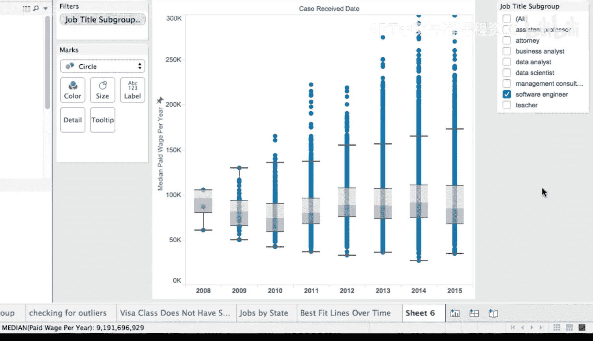

# 商业分析：第26课：使用箱线图分析数据相关薪资随时间变化 📊

## 概述
在本节课中，我们将学习如何使用箱线图（Box and Whisker Plot）来分析数据相关职位的薪资随时间变化的趋势。我们将重点理解将日期变量视为离散维度而非连续度量时，如何通过箱线图获取比趋势线更丰富的数据分布信息。

## 从趋势线到箱线图
上一节我们介绍了如何使用日期作为连续变量或度量来创建折线图，并进行回归分析以获得带有P值的最佳拟合线。这些P值从统计上告诉我们拟合线的可靠性，从而影响我们对所观察趋势的信任程度。

本节中，我们来看看将日期视为离散变量或维度的一个优势。当你将日期视为离散维度时，你可以创建一种称为箱线图（或盒须图）的统计可视化图表。这些箱线图可以展示比最佳拟合线（即使带有置信区间）更多的数据细节。

## 理解箱线图
那么，什么是箱线图呢？在一个箱线图中，你会看到一个箱子、箱内的一条线、一些“须线”，有时在须线外还有一些点。

*   **箱内的线**代表该组数据的中位数。
*   **箱子本身**显示了数据集中介于中位数与最小值或最大值之间一半位置的值。
*   **须线**通常延伸到1.5倍的四分位距。
*   **须线外的点**通常被视为异常值。

为了更好地理解，以下是箱线图各部分的计算逻辑：

1.  **排序与四分位点**：将数据集中的所有值按从小到大排序。将排序后的数据分成四个相等的部分，分割这三个点称为四分位数。
    *   最小的那个点称为**第一四分位数**。
    *   最大的那个点称为**第三四分位数**。
2.  **四分位距**：第一四分位数和第三四分位数之间的距离称为**四分位距**。
3.  **须线范围**：箱线图的须线通常延伸到 **1.5倍的四分位距**。任何超出此范围的单个数据点通常被视为异常值。

虽然箱线图产生的图像并不总是最简洁美观，但对于分析师自己总结组内原始数据值非常有用，能让你或你的团队对原始数据有一个直观的感受。

## 在Tableau中创建箱线图
上一节，我们为每个时间点创建了三个折线图：中位数薪资、最高薪资和最低薪资。另一种查看数据并获得类似信息的方法是，将日期视为维度而非度量，并为每个时间点创建一个箱线图，然后查看不同子类别组的箱线图。

现在，让我们在Tableau中实际操作。

以下是创建基础箱线图的步骤：

1.  打开你的Tableau工作簿并新建一个工作表。
2.  将“paid wage per year”字段拖到**行**功能区。
3.  将“case receive date”字段拖到**列**功能区。**确保该胶囊是蓝色的，表示它是一个维度**。
4.  转到“显示”卡，点击箱线图图标。
5.  此时，图表可能看起来不像箱线图，而像一个带线的单点。这是因为Tableau默认对每年的数据进行了聚合。要创建箱线图，它需要多个数据点。
6.  转到顶部菜单栏的“分析”，取消勾选“聚合度量”。现在，箱线图就会正确显示。

## 按职位子类别分解箱线图
为了按不同的职位子组查看这些箱线图，我们需要添加筛选器。

以下是操作步骤：
1.  将“job title subgroup”字段拖到“筛选器”功能区。
2.  暂时选择包含所有子类别，并创建一个快速筛选器以供查看。
3.  现在，当你点击筛选器中的不同职位子类别时，箱线图会相应变化。这表明Tableau确实为筛选器上不同的职位子组分别计算了箱线图。

**重要提示**：这与我们之前使用的突出显示技巧不同。如果你将“job title subgroup”放在“颜色”标记卡上，然后使用突出显示，虽然它显示参与计算的数据点不同，但箱线图本身的计算结果并不会改变。箱线图需要原始数据并基于原始数据进行聚合计算。

## 分析与解读
让我们使用相同的坐标轴来比较不同职位子类别的趋势，以便进行公平比较。我们将Y轴固定为从1到300,000。

以下是不同职位子类别的观察结果：

*   **数据科学家**：可以清楚地看到，随着时间的推移，有越来越多的薪资低于第一四分位数。同时，也有越来越多的薪资具有更高的值。这表明，虽然中位数变化不大，但获得高于或低于中位数薪资的可能性都在增加，且低薪资趋势似乎更强。
*   **软件工程师**：使用相同坐标轴后，可以看到确实有越来越多的薪资低于中位数，但情况似乎不如数据科学家严重。另一方面，似乎有越来越多的高薪软件工程师。
*   **业务分析师与数据分析师**：对于业务分析师，最低薪资下降趋势不那么明显，但最高薪资似乎在增加。数据分析师的情况与业务分析师相似。

总体而言，这些箱线图虽然不像最佳拟合线那样有相关的统计模型，但由于展示了更多数据，它们比上一节的折线图更有力地表明：随着时间的推移，在数据相关工作中获得高薪的机会可能增加，但同时，薪资低于预期的风险也可能增加，特别是如果数据分析师和业务分析师职位自2015年以来的新趋势持续下去的话。

## 总结
本节课中，我们一起学习了将变量视为连续或离散的不同效果。将变量视为连续或离散会影响你可用的统计方法类型，也会影响你能获取的信息类型。这些统计结果和你获得的信息实际上会影响你的分析和解读，至少会影响你对解读结果的信心。

在Excel中尝试将变量从离散转换为连续可能需要很长时间。但像Tableau这样的程序的一个美妙之处在于，它几乎可以让你即时完成这种转换，既快速又简单。这是一个很好的例子，说明了可视化和可视化程序如何能够真正加快你完成数据分析的速度。