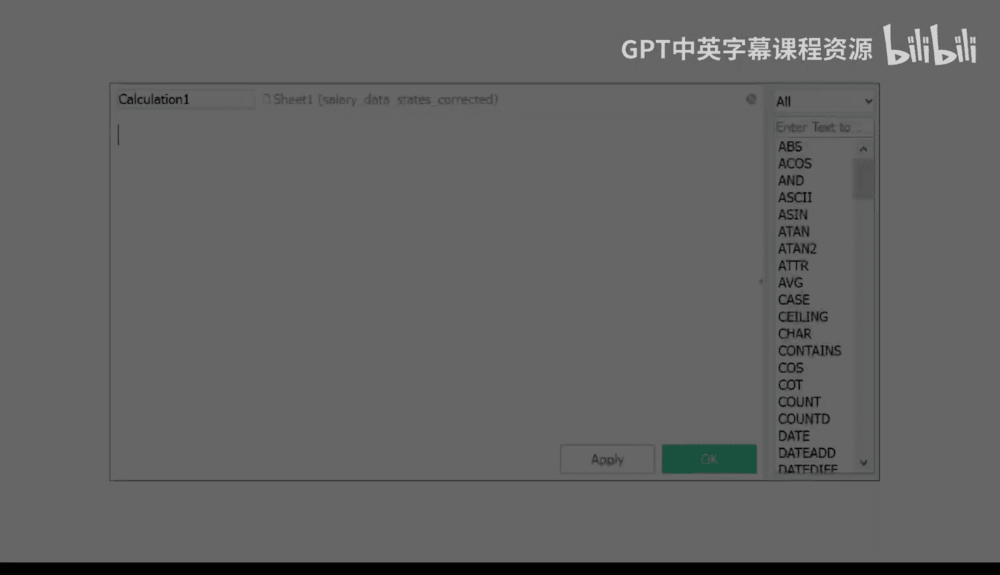
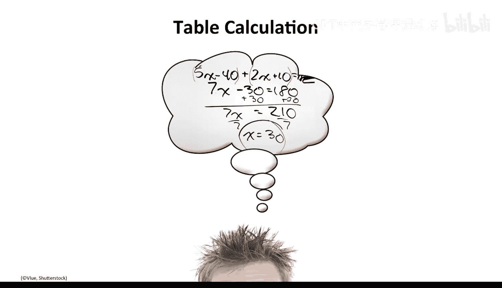

# 杜克大学《Excel 到 MySQL：商业分析（5课全）｜Excel to MySQL： Analytic Techniques for Business》中英 p103 28_04_02_Tableau计算类型.zh_en -BV1mS421X7yw_p103-

Welcome back。This lesson is going to be all about calculations in Tableau。

 Cals are kind of tableableau's workhorse。 They make Tableau flexible and dynamic。

 They allow tableableau to do things like add columns of data。 Clean your data。

 change variable types， All kinds of stuff。 But with the added capability comes at of complexity。

 So while some calculations are going to be really easy to use right out of the box。

 other ones will take a little bit more time to master。 Even the tableableau Jeeddi。

 as they call them， who are the most the best tableau experts out there。

 are still learning every day， how to use calculations to their full potential。

 So don't worry if some of the calculations we do together are a little bit complex at first。

 and a little bit challenging。 You'll get them。 and it takes time to figure out how to make calculations work for you。

😊，So I want you to think of calculations as one of the areas that you can grow and learn the most as you go down your data analysis path in the meantime。

 our class together will help you get started and make you comfortable troubleshooting your own calculations in your own data analysis scenarios。

Let's talk a little bit more about what calculations are。

Calculations are implemented in calculated fields。 Cal fields are pretty much the same as a name cell in Excel。

 and actually， the syntax is very similar to Excel's formulas。

The fields can contain both fixed values or formulas that refer to other cells。

 Each field itself can also serve as the input to other calculations or just be there to display a result in a certain way。

There are many different types of calculations。 Some of these are number calculations。

 which are used to do things like arithmetic string calculations。

 which are used to change the actual text or words in a cell。Date calculations。

 which are specifically designed to make working with dates easy typey conversion calculations。

 which are used to change the type of variable you are working with。

 Like if you wanted to turn numbers into text， logical calculations。

 which include things like if then statements or true and false statements， aggregate calculations。

 which define ways to put multiple rows together， like some median minimum， etc cetera。

 things we've used in the past。 and use your calculations。

 which are unique because they give you ways to manage the people signing on to look at your data。

One of the trickiest aspects of calculations is that they can be implemented at different levels of aggregation。

 And if a calculation is designed for one level of aggregation， it won't work at a different level。

The way to think about how calculations interact with levels of aggregation is to ask yourself。

If I were doing this calculation in Excel， would I have a new number on every row in a new column or would I have a single number at the bottom of all the columns。

if you would have a new column with a new number on every row in excel you will need a row level calculation in tableau😊。

These will make a new column with an entry for every single row of your data set。

 They should be used when you are sure the numbers would be useful at any level of detail。

If you would end up with a single number at the bottom of your columns when you implement a similar calculation in Excel。

 you will need to use an aggregation level calculation in Tableau。

 These are the types of calculations you do with multiple rows at a time or with variables that are already aggregated。

A third type of calculation that is very different from row level and aggregate level calculations is table level calculations。

 These are calculations you do only on the data you have in your visualization and only as it is organized in your visualization。

 you can think of these calculations as tableau doing math in its head。 These are extremely powerful。

 but they can also be some of the toughest parts of tableableau to master。😊。

Once you make a calculated field， you can use it the same way use measures and dimensions from your data source。

 You'll also see the calculated field in every worksheet you make as long as the worksheets all come from the same data source。

We won't be able to go over examples of all the different types of calculations Tableau can make because there really are a lot of them。

 but we will go through a wide variety of them。I encourage you to explore and try the other calculations on your own。

 And if you run into problems as you try them out， you can always ask for advice or post questions on the Tableau community website。

 It really is a terrific resource， and some of the best Tableau users in the world often post there。

 so I highly recommend you check it out。😊，With that， let's make some calculations。

