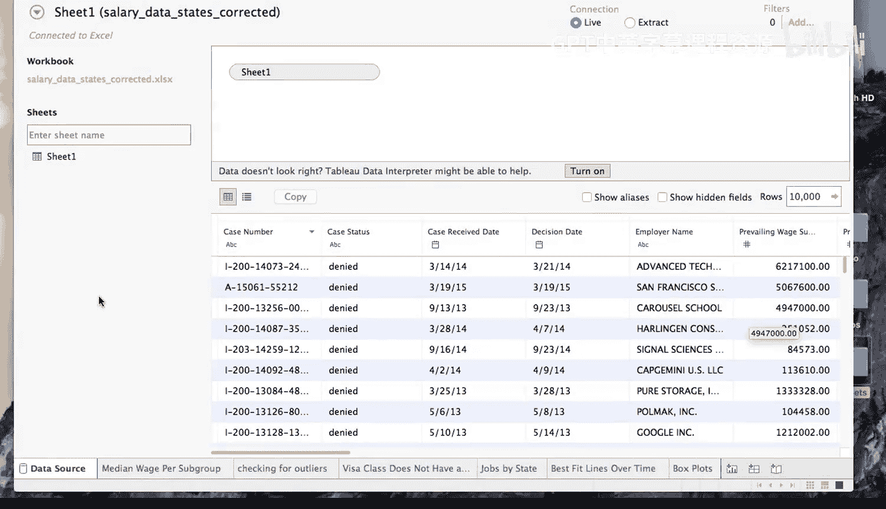
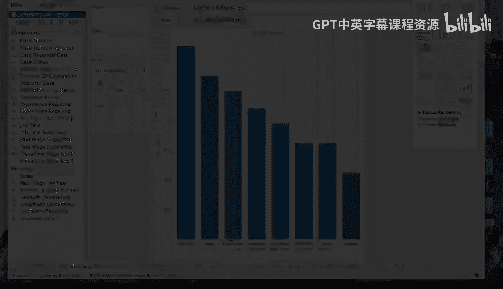
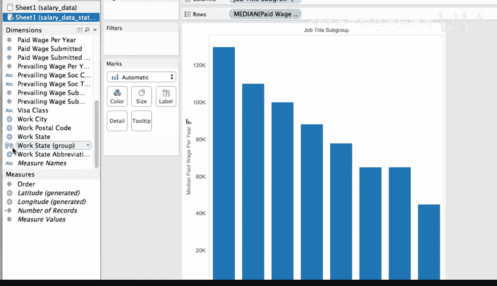
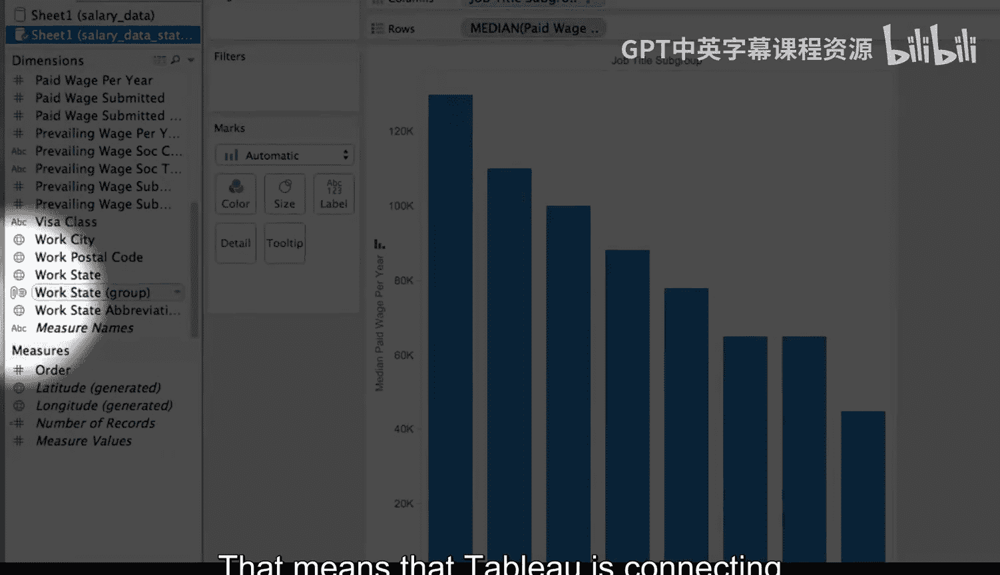
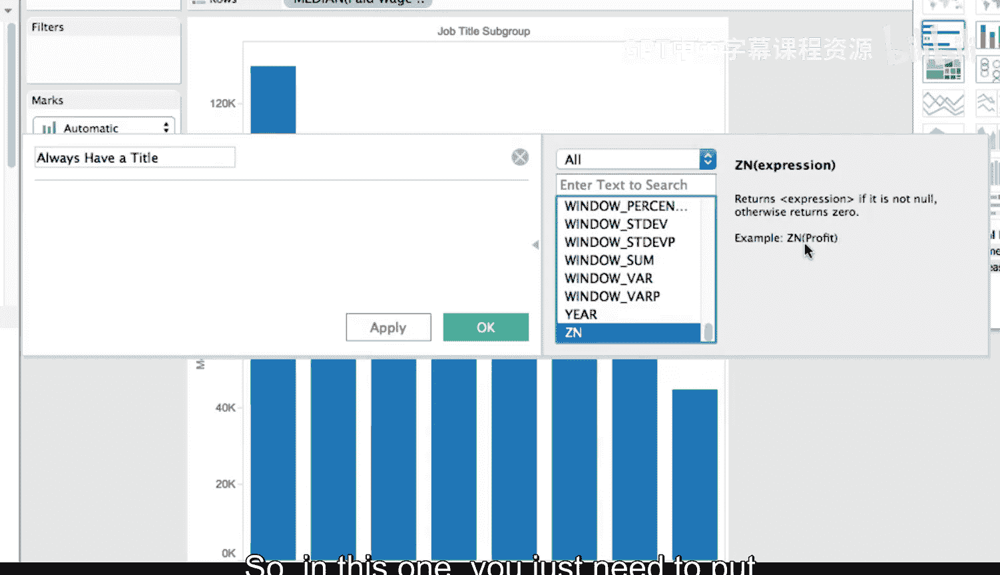
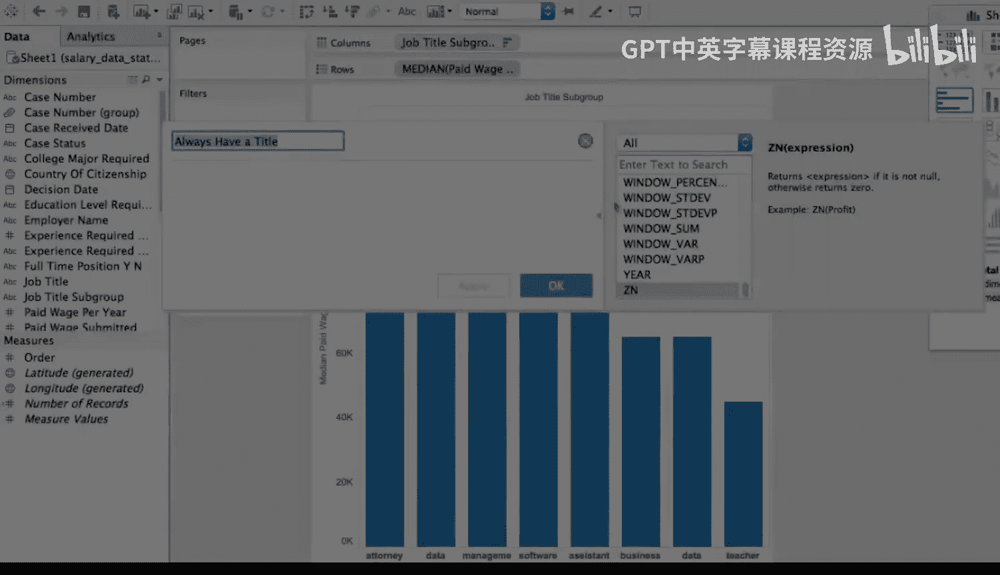
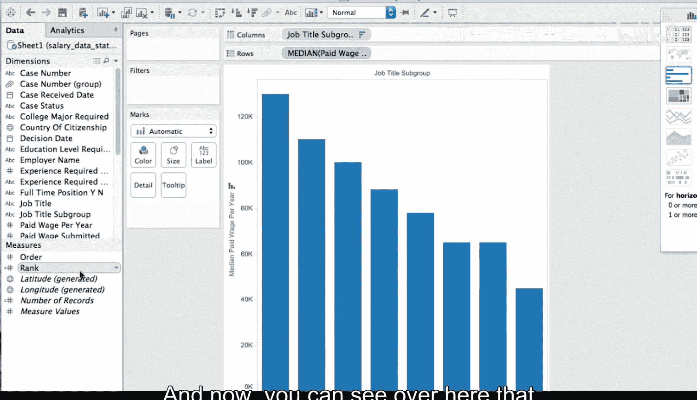
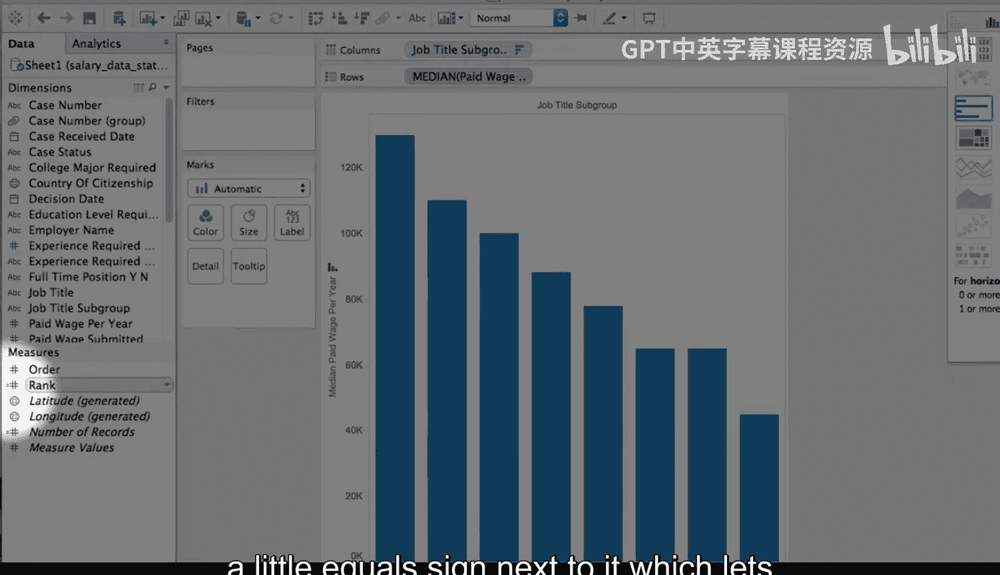
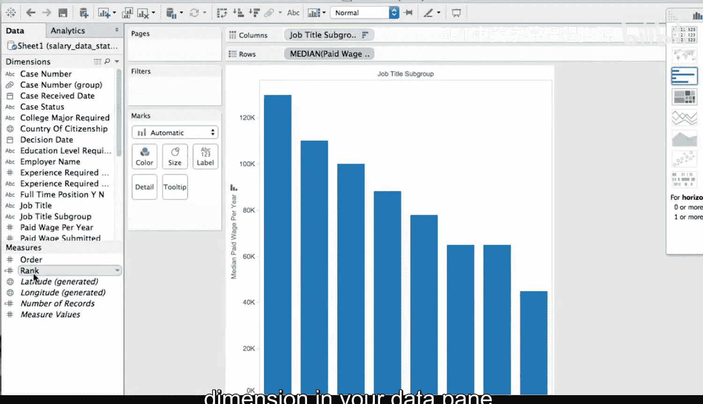

# 杜克大学《Excel 到 MySQL：商业分析（5课全）｜Excel to MySQL： Analytic Techniques for Business》中英 p104 29_04_03_如何编写计算字段.zh_en -BV1mS421X7yw_p104-

Yeah there。In this video， we are going to get oriented to the calculation pane。

 So I want you to go ahead and open up tableableau where we left it off before。

And this week we're going to use a slightly different version of the data set。

 we've cleaned up the state names for you， and that will make it easier when we do some things later on。

 So before we get look at the calculations first， I want you to open up the new data set。

 which is going to be called salary data states corrected。So I want you to open up。

Download that file from the website， and open it up。

And just like last time it could take a little bit of time。 So it is a large file。

When you open it just like last time you'll have to change some of the the variable types。

 so for example， case receive date here is a string and you want it to be a date。

Decision date should also be a date。So go ahead and fix those for all of the fields in the data set。

Okay， once you've fixed all of your your headings， go ahead and press update now if you haven't already。

And let's go to our worksheets。

Okay， once you're in a worksheet， want you to go up to your data pane。

And right click and say replace data source so right click on the salary data， not the new one。

 and say replace data source， and then I want you to replace the salary data with the salary data states corrected。

Once you replace the data you'll see that there's a checkmark next to the new dataset and in some cases you might not want to get rid of the old dataset because you you may have made new variables that you don't have in your new dataset that you'd like to use again so for example。

 if you go down to workday group remember we made that to try to correct the old state names this variable doesn't exist in the new dataset So if you wanted to keep it。

 you would need to keep both datas around and Tableau actually knows how to link those two together you can know it's linked when you see this little paperclip here so or this little link that means that Tableau is connecting the old dataset set to the new dataset and it's allowing you to use this even though it's only in the old dataset it's linking it by the way by case number which is here but we don't need either of these groups and to make our lives easier we're actually going to get rid of this dataset。

Okay， and now we should be ready to go， so let's take a look at what the calculation pane looks like。

 You can， as usual get a calculation pane in many different ways。

 you can first way we'll do it is you can right click here it can say it says create calculated field。

This is the calculation and pain。 So there are a couple different parts。 This is the title。

 You should always have a title。And try to make it more descriptive than I just made this one because you will usually have a lot of calculations and they can be easy to confuse。

 so the more descriptive your title， the easier it'll be to work with later。

This area right here is where you will actually write your calculation and over here is where Tableau tells you all the different possible calculations you can use。

And if you click on this drop down here， you'll see there are the different categories I told you before。

 numbers during date and so on。 and if you don't remember what these are about you can go back to one of the last videos to remind yourself but you can see how many different types of calculations there are and a neat thing about Tableau is that it will tell you what you need to do for each one of them so even though there's so many of them。

 if you click on them over here in this area of the pain。

 it will tell you exactly what you need to do to to actually use the calculation。

 so in this one you just need to put a variable name in the parentheses。

So let's go ahead and use this one as an example to see what that would look like so you can either double click or actually type in the calculation yourself over here and now you can see it's prompting us to put in a variable name and let's put how about we put education level required so you can actually go over to the variable pane of your workbook and drag it directly into your calculation and you'll see here。

A couple things I want you to notice。 First thing is that it put it automatically put the variable name in brackets。

 And that's because whenever your variable name has spaces like right here。

Table will get confused unless you tell it that this is all one variable name。

 and the way you do that is in brackets。 So if you just have a variable name that has no spaces。

 you don't have to use the brackets， but I do recommend that you get in the habit of just always using them because then you won't have mistakes。

Now the next thing I want to show you is that you see variable name is in orange here and the calculation is in blue when you have really long calculations that can be help you orient。

 so the variable names are always going to be in orange and the light blue indicates that you have an aggregated calculation。

I also use this particular variable name on purpose because I want to show you what happened when your calculation is incorrect Tableau is very helpful in this regard。

 and they show you right here in this red this red message that there's error in the message so if you click on it it will tell you what's wrong and you can see it says that this calculation Zen is supposed to be using an integer and we're using a string so education level required is a string and it needs a number。

So to make it correct。You would have to use。A different type of variable， say， experience required。

And now you can see it says the calculation is valid。 Now。

 I want to go back and show you what would happen if we do have an incorrect calculation。

 Let's go back to education level required。So you says it contains errors and will' actually let you say okay and it will go ahead and make a calculated variable and you can see as soon as you make a calculated variable。

 it automatically puts it on the dimensions or measures pane and it looks like any other variable in this case though it has an exclamation red exclamation point next to it and that means that it is an incorrect calculation so if I actually if I tried to drag this onto any other part of the workspace。

 it wouldn't let me。Because it's incorrect， so if that's the case。

 you can always edit your calculations by right clicking and going to edit。

And you have your pain back and now you can do whatever you want。

 So there's another thing you need to know about formatting in calculations。

 and that's that whenever you refer to a string or that's a sequence of letters。

 those that string needs to be in quotes。 So if we go to string calculation， let's do something like。

Find。And you can see over here the description of Find， you put an open parentheses。

 then you put the word， the full word or string that you're interested in then comma。

 then you put the letters you want to find in that first string and it will tell you then where that subset of letters is in the greater string。

 so this tells you this gives you an index for where a substring is in a greater string。So。

 let's go ahead and。See what that would look like。So let's say we wanted to。Look at。啊。Analysis。

 and we want to know where the y is。This calculation would let us do that and you can see it says it's valid Another thing that's curious but seems to be true is that Tableau can recognize either single quotations or double quotations in its string。

 so this would also work。So you can see that it now says the calculation is valid so you can either use single quotations or double quotations when you're referring to strings。

 but you do have to use a quotation of some kind Let's look at another type of calculation let's look at ATTR This one returns the value of the given expression if it only has a single value for all the rows in the group。

 otherwise it displays an asterisk。So what I want to show you with this。

Is that let's say put in decision date。Is that especially when you have long long calculations。

 sometimes you want to leave notes for yourself and you can do that actually。

 you can do that by leaving a comment and you indicate to tableau that you have a comment by putting these two slashes you can see that when I put one slash it's a dark font。

 but if I put two， it automatically puts it into a light font which lets you know that it's a comment so you can write whatever you want here。

And it still will be a valid calculation because Tableau will not incorporate this into the calculation。

 so this can be something that's very useful。The other thing that's useful to look at with this particular calculation is that you can see the ATR is in bold。

Bold represents any type of calculation that's done locally in tableableau on an aggregate function of some kind or aggregate results。

 if it's normal weight， like the decision date， that means it's going to be done at the database level or the row level so that can be useful or remembering that formatting structure can be useful when you very long calculations and you're trying to troubleshoot them or if you have nested calculations。

 which you'll see later on， it's a good reminder to know when your calculation is on an aggregated。

Function or an aggregated set of results as opposed to row level results。

Let's make one type of calculation。 we will actually use later。

And that'll be index and index is an interesting one we actually don't need to put anything inside the parentheses。

 we'll show you later what this means you can say the calculation is valid and go ahead and click OK and now you can see over here that rank is here in measures and it has a little equal sign next to it which lets you know that it's a calculated parameter and now you can actually use rank just like any other measure or dimension in your data pan now that you have a good feel of how the calculation pane is laid out in the next video let's make some row calculations。

