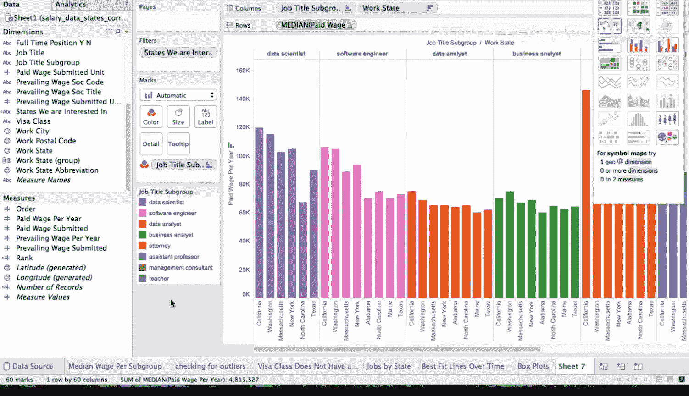

# 杜克大学《Excel 到 MySQL：商业分析（5课全）｜Excel to MySQL： Analytic Techniques for Business》中英 p105 30_04_04_提升筛选效率的计算方法.zh_en -BV1mS421X7yw_p105-

Now that you know how to use the calculation pane in this video we'll go over a couple of different examples of row calculations。

 remember row calculations are calculations that make a different number for every single row of your data。

 so if you're implementing them in Excel you would get an entire new column of data。

So when you go ahead back to your Tableau workbook and start off with let's make a calculation that would be an alternative to something we did last week。

 remember last week when we wanted to only look at data from states we were interested in living in。

 we put the state variable on the filter card and then we clicked for each of the states we were open to living in。

One way to do that that might be a little faster is to make a calculation that would create a variable that said true or some type of logical output every time a estate was in the group we're interested in and false or something like that every time the estate was not in the group we're interested in So let's see what that would look like remember I told you that you can right click on the measure pane to create a calculated field that way。

 but you can also go up to analysis on the drop down and say create calculated field there。

There are a couple different ways to make the logical calculation I just described。

 let's start with doing it with if。So we can do a bunch of if then statements so you can look at the format over here。

 Basically， you're going to say if。My variable that I'm interested in， which is work state。

 So you can drag that into the workspace equals， say California。

Because we know that's one of the states that we were interested in。Then。

I've tried to put that in caps so that it helps me helps it stay the whole calculation state organized。

 then let's sit put it in the view group。Else。It's not in California。Put it in the don't view group。

 And I want to show you something that's going to happen here。And then remember， you have to put end。

 Now， this is going to be incorrect because。Tableau is going to be confused because it's going to think that this this apostrophe with this quotation mark is the end of this string。

 So if you need to have quotation mark within a string， you need to make this double。

So you see now that the calculation is correct， so it won't actually look like don't view when it prints。

 but this is so that Tableau knows that this is the string that you want， not this is the string。

So if you want to do this for all 10 states we were interested in before。

 you could put a whole bunch more of else ifs in here， so you could say。Elsif。Work state equals。

Washington。Weenbu。Another way we could adapt the same calculation is instead of using else if statements we could put。

Or statements in here。And so this way， you could。L all of the work states。A little more quickly。

So here's what that calculation would look like if we fill it all out with the 10 states。

 So you can see there are a bunch of or' statements。

 it starts with an if goes through a bunch of or's。

 ends with a this one then statement caps for everything above it。 else don't view and an end。

There's one more way that we can do the same type of logic。

 or there's another type of calculation that you can use to do this， and it's called case。

So in to use case， you need to put case， then the variable， which will be work state。

 then you can say when。When the thing you're interested in。

 then So let's see what that would look like。So I went ahead and fill this out for us。

 Let's look at how the format's a little bit different than for the if then statements。

 There are no equal signs and case statements。 instead， you say。

In this in this case type of calculation， we're going to look at this variable work state。

 when within this variable， it equals California， then make an output that says view。

 when within the work state variable， it says Washington， then make the output save view。

 and you can do this all the way through for all of our 1 states。Each one in quotations。

And you can see that none of them are in bold and always remember that you have to put an end at the end of if then statements or logical statements。

And you can see too here that case is not in bold， so it's not an aggregate function。

 It's a logical function。Let's save this calculation。 Let's call it。States， we are。Interested。

And now you can see this variable here in the dimensions pane。

And it has a little equal sign next to it。 So you know that it's a calculated field。

 And now we can use that to make the same type of bar graph we made before， which let's make a new。

A new worksheet and let's put median paid wage。Since we opened up the new worksheet。

 these our paid wage variables are now in dimensions again， so we need to make them measures。

 so paid wage submitted should be a measure。Paid wage per year should be a measure。

 prevailing wage per year should be a measure， there are a couple more of those there that should be measures。

Let's put paid wage per year is going to be the default aggregation is going to be sum again。

 so let's change that。To。Mian。Prevailing wage per year while we're at it， let's remember to do that。

Default properties， aggregation， median。And so let's put paid wage per year。On rose。

Let's put jobb title subgroup on columns。And work state。Before I do that， let's put。

 I was going to put work state here on columns， but that's going to look at all of the states for us。

 which will take a little bit of time。 So instead， let's put states we are interested in our calculated field on filters。

First， and let's only click on view。 So instead of having to click 10 different states like we did last time。

 now， we can just click view。Say okay。And now we can put work state。

Here in columns and we can put job title subgroup。On color。Just like we did last time。

 And if we order it， this will give us the exact same chart that we did last time。

 except that these were in a different order。So now this should be similar to the chart we saw last time。

Hopefully， these exercises have helped you get the hang of how to use calculations In the next video。

 we're going to use calculations to help us address our next batch of questions about salaries and data related jobs。

