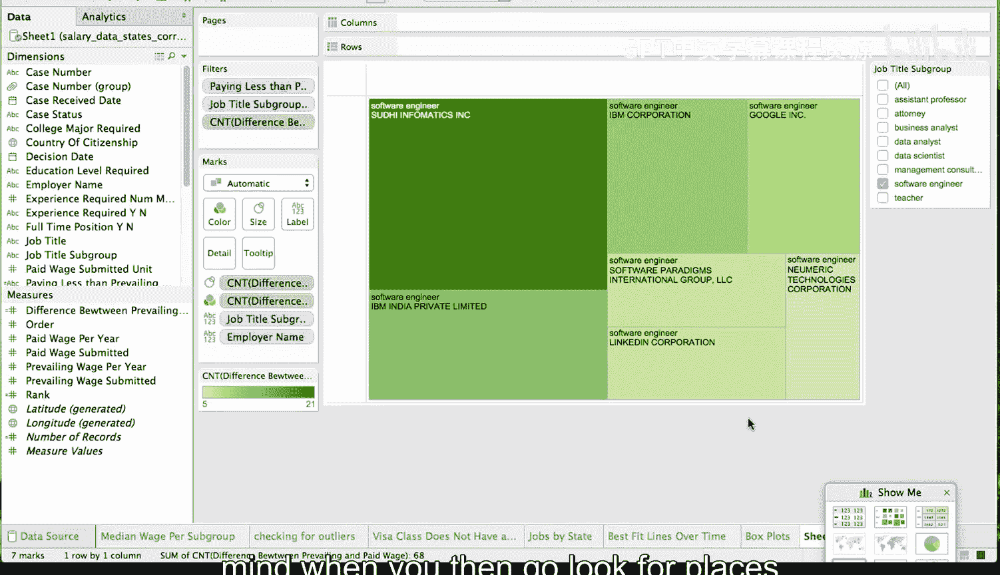

# 杜克大学《Excel 到 MySQL：商业分析（5课全）｜Excel to MySQL： Analytic Techniques for Business》中英 p106 31_04_05_识别支付低于市场薪资的公司.zh_en -BV1mS421X7yw_p106-

In this video， we are going to use calculations to address our next set of data analysis questions。

 One of those questions is within data related jobs。

 are there any specific subtypes of data related jobs that tend to get paid much more or much less than the prevailing wage。

 We would also like to know if there are any companies that systematically pay their employees or at least their non US employees。

 much less or much more than the prevailing wage So to answer that。

 I want you to go back to the Tau workbook we used last time and pick up exactly where we left off。

If you recall， there aren't yet any variables here that can compare prevailing wage and paid wage。

 But now， thanks to our lastable videos， you know how to calculate that。

 So let's make a calculated field。And let's call this。Difference。Between。

And so now we're just going to do a simple arithmetic calculation。

 we want to know whether the paid wage is more or less than the prevailing wage so we can take paid wage per year。

Simply subtract from it， the prevailing wage per year。

And this will give us the difference that we're interested in。

So you can see here our calculated field is in the Me column and you can see the equal sign next to it。

 which means that it is a calculated field。I I've cleared our workspace here now let's take a look at that calculating field we just made。

I change this to。To median right now。And now let's move job title subgroup into columns。

And now as usual。Let's look at a scatter plot so we can see all of our data and get an idea of how many different times companies actually paid less or more than the prevailing wage。

 so let's go to analysis， aggregate measures， and disaggregate the measures。

And this will give us the scatter plot that we are used to looking at。 We can format that。

To look a little bit better to our eye。Okay， so what you can see is that there clearly are a bunch of companies that are paying less than prevailing wage more are paying equals either at median wage or at prevailing wage or higher。

 but there are a bunch that are paying less。So let let's look at just the ones that are paying less。

 And instead of doing this with a filter， let's make another calculated field again。

 So create calculated field。And let's call this。Paying。Less。单。Which。

And I want to do it this way because I want to show you that you can make calculations with calculations。

 so let's use an logical if。That's the syntax。So let's do if。Difference between。 and actually。

 one way to do this。 I'll just show you this is that。

Sometimes it can be easier to make your calculations if you put all of the operators and caps first and then go fill in afterwards。

 So this would be if then。Else if。Or else。Ben。Well， we're just gonna use else， so。So we can do。If。

Difference between prevailing wage is less than 0。Then， we're gonna call them。Heid was。Vaiiling。W。

Else。And there actually， shouldn't be it then here。Else。Paid。Pveiling。Wage for higher。

You can see that says the calculation is valid， so this shows you that we can make calculations with calculations。

So here's our the field we just made， let's use that and put it on filters。

And look at just paid less than prevailing wage。Companies so looks like assistant professor poor guys。

arere often getting paid quite a lot less than the prevailing wage。

 attorneys not so much teachers that happens quite often。

 and it looks like just to our eye that this is happening bunch to business analysts and software engineers but not quite so much to data scientists or data analysts。

Now one question we might have at this point is whether all of these points are coming from the same company。

 are there some companies that are consistently and systematically paying less than the prevailing wage。

 are these all just kind of flukes and every company does it once or twice？

One way we can do that is to go back to some of the charts that we made last week。

 so first let's go ahead and although I'd feel very badly for these assistant professors。

Let's focus on just our data related job， so let's put job title subgroup in our filter。

And lets look at only our data related jobs。Okay， so now let's reaggregate our measures。

And look at instead of the median， let's do account。And now let's put。Employer name。On size。

And let's make a tree chart。This is one of the rare cases when a teacher it might be useful。

Let's go ahead and look at our filters， let's make a。A quick filter so that we can look at just one。

One data related job at a time。So it looks like there are some companies that are。Systematicically。

 perhaps paying quite a lot less than they should be prevailing wage。

 let's look at just at those all of these， if you look at， but if we hover over these。

 you can see it says one。 so all of these it's just happening one。

 So it looks like this these might beef lukes， but so let's。Go ahead and put。

ADifferent per different prevailing wage on filters。Let's do account。And let's say， it has to be。

 at least。So this means that they would have to over the past five years or a couple of years since 2009 or 2008。

They would have to have at least five instances where they paid less than the prevailing wage。

 and when we look at this， you can see that this particular company has done that 21 times。

 so that seems like quite a lot。 This company， IBM India has done it 12 times Even Google's done it eight times Na over the past couple of years。

 LinkedIn as well， six times。 What about the other data related jobs。 Let's do business and analyst。

There's nothing there， so that means in business analysts。

 none of the companies were systematically paying less than prevailing wage， but about data analyst。

Same thing。Data scientist， Sam thing。Just for control same thing for consultants。

 so it looks like out of our data related jobs only software engineers seem to be systematically paid less in certain companies if you are interested in that type of data related job。

 you might want to keep this in mind when you then go look for。

Places you might want to apply for in the future。Great job today。

 You now know how to do a bunch of different types of row calculations and in doing so。

 you've learned that in general， it does seem like companies are paying their data analyst。

 business analysts and data scientists the prevailing wage or higher。

 which is good news that is usually the case for software engineers。

 but they also have a very different story and that there are a couple companies who seem to be systematically paying some of their software engineers less than prevailing wage and that is not good。

 but now you know that you aren't that knowledge when you go to apply for jobs in those companies or consider applying for jobs in those companies。

Now that you're an expert at making row calculations in the next lesson。

 we'll learn how to do aggregate calculations。