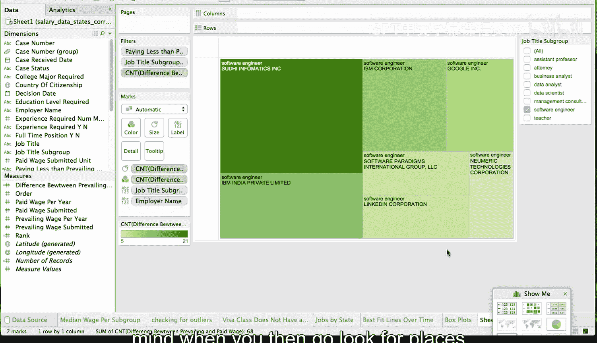

# Excel 到 MySQL：商业分析：5：识别支付低于市场薪资的公司 💰


在本节课中，我们将学习如何使用计算字段来识别那些支付给员工（特别是非美国籍员工）的薪资低于市场普遍薪资的公司。我们将通过创建计算字段、应用逻辑判断以及可视化分析来达成这一目标。

## 概述与目标

上一节我们学习了如何创建基本的计算字段。本节中，我们将利用这些技能来回答一个具体的商业分析问题：在数据相关职位中，是否有公司系统性地支付低于市场普遍水平的薪资？我们将通过比较“实际支付年薪”和“市场普遍年薪”来找出这些公司。

## 创建薪资差异计算字段

首先，我们需要一个能够比较实际支付薪资与市场普遍薪资的变量。由于原始数据中没有这个字段，我们将创建一个计算字段。

以下是创建名为“薪资差异”的计算字段的步骤：
1.  在数据表中，选择“创建计算字段”。
2.  将字段命名为 `Difference_Between`。
3.  在公式区域输入：`[Paid Wage per Year] - [Prevailing Wage per Year]`。

这个简单的算术计算会告诉我们，实际支付的年薪是高于还是低于市场普遍年薪。正数表示支付更高，负数则表示支付更低。创建成功后，该字段会出现在度量列中，旁边带有等号标识。

## 可视化薪资差异情况

现在，让我们来看看刚刚创建的计算字段。我将视图切换为显示中位数。

为了直观地查看所有数据点，了解有多少公司支付低于或高于市场薪资，我们创建一个散点图。
1.  将 `Job Title Subgroup` 拖入“列”功能区。
2.  将 `Difference_Between` 拖入“行”功能区。
3.  在“分析”菜单中，取消选中“聚合度量”，以显示所有数据点。

调整图表格式使其更清晰后，我们可以清楚地看到，确实有一批公司支付低于市场普遍水平的薪资（数据点位于零线以下），当然也有许多公司支付等于或高于市场水平的薪资。

## 筛选支付低于市场薪资的记录

为了专注于分析支付较低薪资的情况，我们不使用简单的筛选器，而是再创建一个计算字段。这样做的好处是，我们可以基于已有的计算字段进行更复杂的逻辑判断。

以下是创建名为“支付低于市场薪资”的计算字段的步骤：
1.  再次选择“创建计算字段”。
2.  将字段命名为 `Paying_Less`。
3.  输入以下 **IF** 逻辑公式：
    ```
    IF [Difference_Between] < 0
    THEN “Paid Below Prevailing Wage”
    ELSE “Paid Prevailing Wage or Higher”
    END
    ```
这个公式检查“薪资差异”是否为负数。如果是，则标记为“支付低于市场薪资”；否则标记为“支付市场薪资或更高”。这演示了如何基于另一个计算字段进行运算。

创建完成后，将这个新字段 `Paying_Less` 拖到“筛选器”功能区，并只选择“Paid Below Prevailing Wage”。现在视图只显示那些支付低于市场薪资的记录。初步观察发现，“助理教授”职位经常薪资偏低，教师职位也时有发生。在数据相关职位中，商业分析师和软件工程师似乎也有不少此类情况，而数据科学家或数据分析师则相对较少。

## 识别系统性低薪支付的公司

接下来，我们需要回答一个关键问题：这些低薪支付是零星发生的，还是某些公司有系统性的行为？即，是否有公司 consistently 支付低于市场水平的薪资？

我们可以通过树状图来按公司分析低薪支付的频率。
1.  首先，在筛选器中只选择我们关心的“数据相关职位”。
2.  然后，重新聚合度量（在“分析”菜单中勾选“聚合度量”）。
3.  将“标记”卡中的图形改为“树状图”。
4.  将 `Employer Name`（雇主名称）拖到“大小”上。
5.  将 `Paying_Less` 字段拖到“颜色”上（确保只显示“Paid Below Prevailing Wage”）。

这个树状图的大小代表了公司出现低薪支付的案例数量。将鼠标悬停在方块上可以看到具体数字。我们发现很多公司只出现了一次，这可能是偶然情况。

为了找出那些系统性低薪支付的公司，我们需要进一步筛选。让我们对 `Employer Name` 应用一个计数筛选。
1.  将 `Employer Name` 拖到“筛选器”上。
2.  在筛选器对话框中，选择“条件”选项卡。
3.  选择“按字段”筛选，字段选择 `Paying_Less`。
4.  设置条件为“计数”至少为 5。

这意味着，我们只查看那些在过去几年（数据覆盖期内）至少有5次支付低于市场薪资记录的公司。应用此筛选后，我们发现像“IBM India”这样的公司有12次记录，甚至“Google”也有8次，“LinkedIn”有6次。这表明对于“软件工程师”这个职位，确实存在公司系统性地支付较低薪资。

为了对比，我们可以通过筛选器快速查看其他数据相关职位（如商业分析师、数据分析师、数据科学家）的情况。结果显示，在这些职位上，没有公司达到“至少5次”低薪支付的门槛。这说明系统性低薪问题主要集中在“软件工程师”这个职位类别。



## 总结与应用

本节课中，我们一起学习了如何通过创建计算字段来识别支付低于市场薪资的公司。我们首先计算了薪资差异，然后通过逻辑判断筛选出低薪记录，最后利用聚合和可视化工具发现了在“软件工程师”职位上存在系统性低薪支付模式的公司。

总结来说，数据分析显示，对于数据分析师、商业分析师和数据科学家，公司通常支付市场普遍薪资或更高，这是个好消息。然而，软件工程师的情况则不同，有几家公司似乎系统性地支付低于市场水平的薪资。掌握了这个知识后，当你未来申请或考虑申请这些公司的职位时，就可以将此作为一个重要的考量因素。

现在你已经成为了行计算方面的专家，在下一课中，我们将学习如何进行聚合计算。