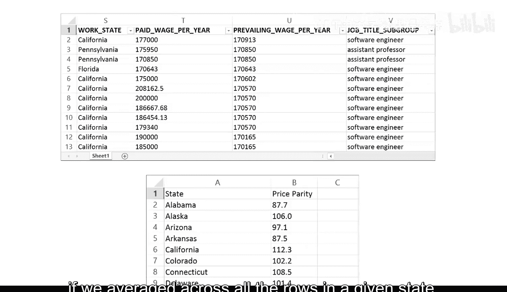
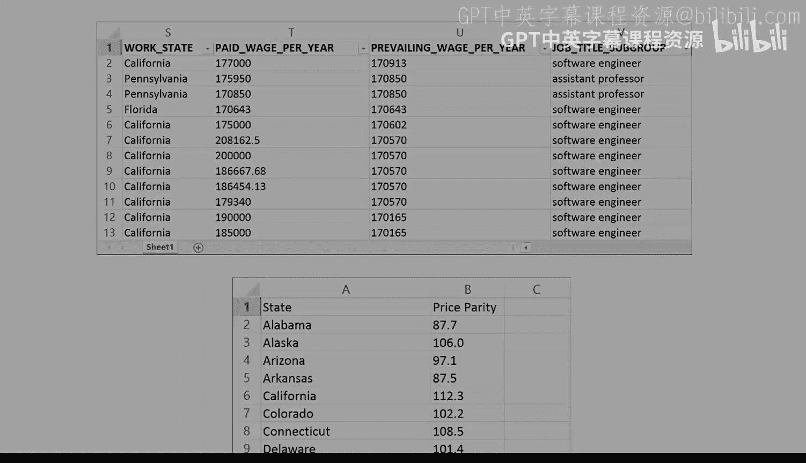
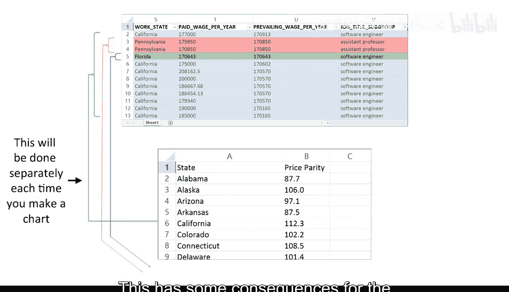

# 杜克大学《Excel 到 MySQL：商业分析（5课全）｜Excel to MySQL： Analytic Techniques for Business》中英 p107 32_04_01_将价格平价数据与薪资数据混合.zh_en -BV1mS421X7yw_p107-

We've been trying to understand the salary we would make in different data related jobs so far we've been doing that by looking at the raw salaries offered to visa applicants in those data related jobs。

 and that's given us a lot of useful information。There is one hitch to that strategy though。

 and that's that the purchasing power of a given raw salary will change in different parts of the country depending on the cost of living in that part of the country。

 so $75，000 in New Hampshire would give you a very different standard of living than $75。

000 in Texas or New York City or San Francisco。So if part of your decisions about where you're going to apply for jobs is going to be based on the salaries you would make in those jobs。

 you really want to be looking at the raw salaries adjusted for the cost of living in the location of those jobs。

 not the raw salaries themselves。We were able to locate a data set that provided us with the regional price parity of each US state plus Washington。

 D。 C。 So there are 51 locations in all 50 states plus Washington， D。 C。😊。

The regional price parity is an index that sets the national average cost of goods and services at 100。

 with a particular region's regional price parity showing how the cost of living in that region compares to the national average。

 For example， if a state had a regional price parodity of 1 20。4， that state would be about 20。

4% more expensive to live in than the national average。

If another state had a regional price parity of 91。5， that city would cost 8。

5% less than the national average。We can therefore use this regional price parity data set to adjust our paid wage values to account for the cost of living。

There's a practical problem with that， though。Our paid wage data looks like this with each row representing a single paid wage。

 We aggregate over all these rows in different ways to compute the median paid wage of certain types of jobs like we've been doing for the past bunch of lessons。

On the other hand， our regional price parity data set looks like this。 It has one row per state。

It looks like our salary data set would look if we averaged across all the rows in a given state。

 but in its raw form， we haven't averaged over each state。

 so how are we going to put these data sets together？

Tableau is going to save the day by offering a function called data blending。

 Data blending is a way to put two different sources of data together when those two different sources have different levels of aggregation。

The only thing Tableau needs to do this is one field that is common to both data sets。 In our case。

 that field is going to be state name now that we've cleaned it up for you。

Let's take a look at how this data blending would work conceptually anyway。

The most computationally efficient way to blend data from two sources with different granularities is to aggregate the larger data source first at the level defined by the field that is common to both tables。

 which is in our case， state， and then link up the tables after the data has been aggregated。

The reason why is that in order to blend these two sources。

 Tableau has to make a temporary table and store in its memory。

 This temporary table it has to store will be much smaller if we aggregate the larger table first and then link the tables。

 rather than filling in every single row of the larger table with a repeated copy of the value in the smaller table and then aggregating at the end。

In Tableau speak， this means that when you blend， the smaller data set with the more coarse level of granularity should be the primary data source。

 and the larger data set with the more detailed level of granularity should be the secondary data source。

This also has some consequences。 You will never be able to use a blended field at a level of granularity that is smaller than that of the smallest table of data you are combining。

It also means that values that are found in the larger table。

 but not the smaller table will not get incorporated into the results On the flip side。

 valuesue that are found in the smaller table， but not the larger table will be included as null values。

Another consequence is that the fields from the larger table you aggregate in order to blend them with a smaller table will always be measures。

 and you won't be able to change that because you had to use a dimension to define the level of detail that made them。

Further， in order for a tableableau to keep the visualization experience flexible so that the larger table can be analyzed at more granular levels when blending isn't required。

 the blending will be done individually for every single chart you make。

 This has some consequences for the formulas of the calculations you run。

Now that we know this， let's look at how we can blend our salary data with our price parity data and then run some aggregate level calculations to determine which states will have the highest salaries for different data related jobs after those salaries have been adjusted for the cost of living。

