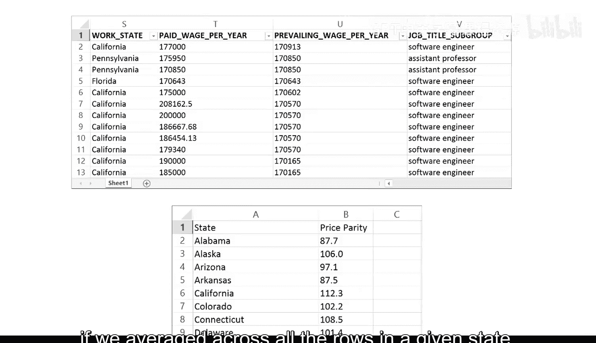
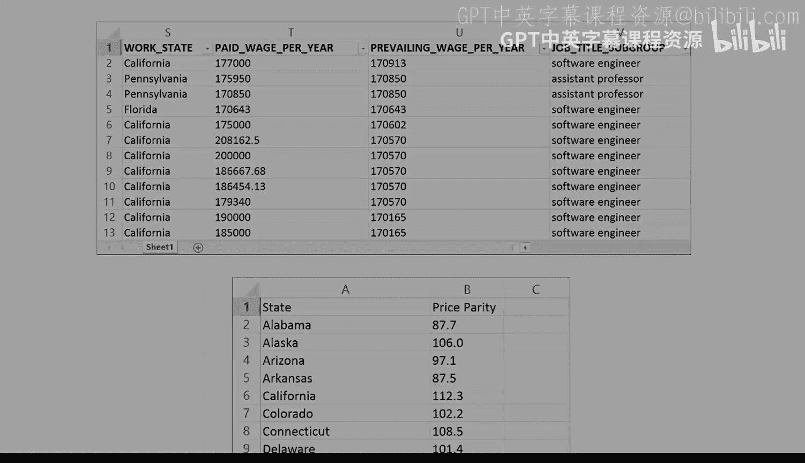
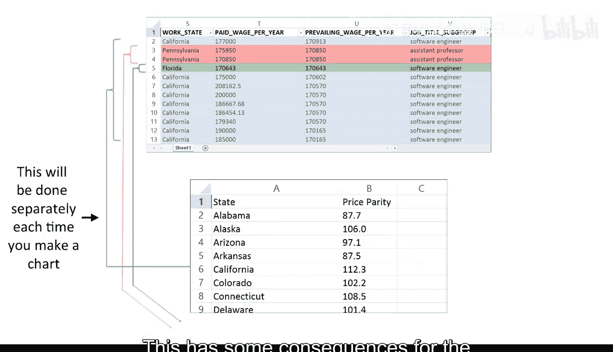

# Excel 到 MySQL：商业分析：5.4：混合价格平价与薪资数据

在本节课中，我们将学习如何将两个不同粒度的数据集——薪资数据和地区价格平价数据——结合起来，以计算经生活成本调整后的实际薪资。我们将重点介绍 Tableau 中的“数据混合”功能。

## 调整薪资数据的必要性

上一节我们分析了不同数据相关职位的原始薪资。这些信息很有用，但存在一个问题：相同数额的薪资在不同地区，由于生活成本差异，其实际购买力是不同的。例如，在新罕布什尔州的75，000美元与在纽约市或旧金山的75，000美元，能提供的生活标准截然不同。

因此，如果你在决定求职地点时会考虑薪资水平，那么你需要关注的是**经当地生活成本调整后的薪资**，而非原始薪资本身。

## 引入地区价格平价数据

我们找到了一个数据集，提供了美国50个州及华盛顿特区共51个地区的“地区价格平价”。这是一个指数，将全美商品与服务的平均成本设为100。特定地区的价格平价显示了该地区生活成本与全国平均水平的比较关系。

*   **公式**：`地区实际成本比例 = 地区价格平价 / 100`
*   **示例**：如果一个州的地区价格平价是120.4，意味着该州生活成本比全国平均水平高约20.4%。如果另一个州的指数是91.5，则意味着生活成本比全国平均水平低约8.5%。

我们可以利用这个数据集来调整薪资数据，以反映生活成本的影响。

## 数据混合的挑战

然而，这里存在一个实际操作问题。我们的两个数据集结构不同：

1.  **薪资数据**：每一行代表一份具体的签证申请薪资记录。我们通过聚合这些行来计算特定职位的薪资中位数。
2.  **价格平价数据**：每个州只有一行数据，粒度更粗。

如何将这两个不同聚合级别的数据集结合起来呢？

## Tableau 的数据混合功能

Tableau 的“数据混合”功能可以解决这个问题。它允许我们将两个具有不同聚合级别的数据源结合在一起。Tableau 实现此功能只需要一个**两个数据集共有的字段**。在我们的案例中，这个共有字段就是“州名”。

从概念上理解数据混合的工作原理很重要。计算效率最高的方式，是先将较大的数据源（薪资数据）按照共有字段（州）定义的级别进行聚合，然后再与较小的数据源（价格平价数据）链接。

这样做是因为 Tableau 混合数据时需要在内存中创建临时表。先聚合再链接，生成的临时表会小得多，性能更优。

## 数据混合的规则与影响

以下是使用数据混合时需要了解的关键规则和影响：

*   **主次数据源**：粒度较粗的较小数据集应设为主数据源，粒度较细的较大数据集设为次数据源。
*   **粒度限制**：混合后的字段无法在比最小数据表更细的粒度上使用。例如，你无法看到混合后每个城市级别的价格平价（因为价格平价数据只到州级别）。
*   **数据包含性**：
    *   存在于次数据源（大表）但不在主数据源（小表）中的值，不会被纳入结果。
    *   存在于主数据源但不在次数据源中的值，会以空值形式包含进来。
*   **字段类型**：为了与较小表混合而对较大表进行的聚合字段，将始终是**度量**，无法更改为维度，因为正是维度（州）定义了聚合的详细级别。
*   **按图表混合**：为了保持可视化分析的灵活性（以便在不需要混合时能在更细粒度上分析较大表），混合是针对你创建的**每一个图表单独进行**的。这也会影响计算字段的公式编写。

## 开始混合与计算

了解了这些原理后，接下来我们就可以实际操作，将薪资数据与价格平价数据进行混合。然后，我们将运行一些聚合级别的计算，以确定在考虑生活成本调整后，哪些州能为不同的数据相关职位提供最高的实际薪资。

本节课中，我们一起学习了为何需要根据生活成本调整薪资，并深入探讨了 Tableau 中数据混合功能的概念、规则和应用场景。下一节，我们将进行实际操作，完成数据混合并计算调整后的薪资。