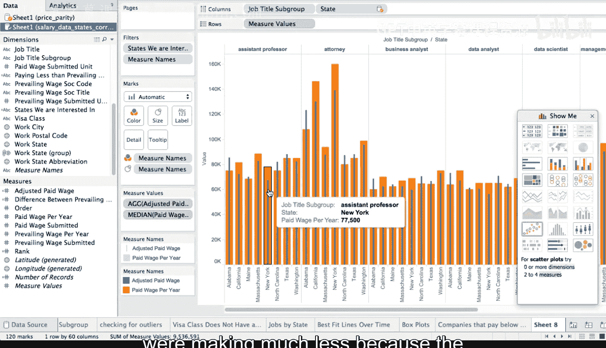

# 杜克大学《Excel 到 MySQL：商业分析（5课全）｜Excel to MySQL： Analytic Techniques for Business》中英 p108 33_04_02_根据生活成本调整数据相关薪资.zh_en -BV1mS421X7yw_p108-

In this video， we're going to blend our salary data with our price parity data and then compute a calculation that allows us to determine which states of the highest salaries in different data related jobs after those salaries have been adjusted for the cost of living。

To do this， I need you to go to the course website and download the price parity data set。

Make sure you save it into a place you can find it。Then， go to Tau。Click on your data pane。

Go up to the menu and add new data source。Click on Excel。

And then navigate to where you save the price parity data and say open。And as usual。

 some this might take a little time， but this is not a big data set which didn't take very long。

As you can see， it only has two columns， state and price parity。

 and there are only 51 different rows。Once it's loaded。

 you can go to our worksheets and you'll see that price parity worksheet is there and that salary data set has a blue check mark connects to it。

To put these two data sets together， go to data and go to edit relationships。

Now that we can see this window， I'm going to tell you some important details about Tableau blending that it can be hard to miss in the documentation。

Tableau usually makes the first data set you load the default primary data source in this window。

 Perhaps more importantly， though， when we actually start blending in the workspace。

 the primary and secondary data source labels can change。

Since Tableau will blend a new table for every visualization or worksheet you make。

 it will automatically make the primary data set the data that houses the first variable you put in the workspace。

So what you enter here in this window is not likely to be critical in most cases。Nonetheless。

 we'll change this so that you can see how to do it if you need to。

So go ahead and put the smallest data set as the primary data source and the largest data set as the secondary data source。

 so primary data set will be price parity and the secondary data source will be salary data sets corrected。

And for illustration purposes， we'll leave this in automatic for right now。When you do that。

 you'll see that state doesn't have a link next to it。 and if you go to the salary data set。

 work state doesn't have a link next to it either， so that means something didn't work。

Let's go back to data and edit relationships。 And you'll see that the reason why is because I told you to leave this option on automatic。

 The column names of the state variable is slightly different in the two different data sources。

 So we'll actually have to manually tell Tableau to connect those two variables。So to do that。

 clickCustom。And click add。And now the fields we're going to combine are。Work state here。

With state here。So click OK。And， okay。And now you'll see that the state variable on our price parity worksheet has this link with a line through it。

The reason Tableau sets its default as not blending the data is because it can be very computationally intensive to blend the data。

 so most of the time anyway， Tableau will make you tell it to blend the data rather than doing it automatically so that it doesn't take more resources than it needs。

So when you click on it， you'll see that price parity now has an orange check mark next to it。

 which means it's getting treated as the secondary data source because other variables from the data set are already in the workspace。

 and this link is now working。So if we go back to our salary data set and we try to do some calculations。

 we should now have access to。To price parity as well。So let's go ahead and make another worksheet。

And we're going to make a calculation that adjusts the median paid wage for price parity。

 So do that again， make a create calculated field。And let's call this adjusted。Paid which。

And this is going to be arithmetic。 So we're going to take the paid wage per year。

Going to divide it by。The price， parodity value。And we're going to put a open parentheses at the beginning。

And end parentheses at the end。 And then we're going to multiply by 100。Now， it has errors。

 And this is an example of what I mentioned before that calculations can be difficult if you don't pay attention to the different levels of aggregation。

 So we know that the price parity is on the level of state。 There's nothing。

 There's no granularity smaller than that。 That means that paid wage per year will also need to be on the level of state。

 So it will have to be some type of aggregation。 First of all。

 we want to change the aggregation here for price parity to A T T R。 rather than sum。 And here。

 we're going to choose median。Now that we've aggregated both。

Our paid wage per year and our price parity， the calculation is valid。And we'll be able to use it。

 so go ahead and press OK。And if we go back to salary date corrected。

 now you can see adjusted paid wage here。Now we're ready to look at the adjusted paid wage per year in our different data led jobs in different states。

To make the blending go a little faster rather than looking at all the states， let's use our。

Are states that the only states that we're interested in。

 So let's take this calculation that we made before and go ahead and put that on the filter。

And just look at those 10 states。Now I want you to take the paid wage per year and put on let's put it on text this time before we make our visualization to make it a little easier to look at the numbers。

So put median paid wage there and then adjusted paid wage。Also untext。 Now， take work state。

Let's actually go to price parodity， whoops。And put state in columns。And let's put price parity。

In text as well。And let's take the。Take our calculated field and put it in the bottom。Okay。

 so now we have our table of data。 Let's bring up a calculator。

So that we can check these numbers so we know that the median paid wages in this row， then the。嗯。

Price parity， which we should change。To attribute。Although the sum is fine because it only has one number。

 let's go back to our calculator。So we know that price parity is on the next。

 and then we know that our calculation is on the bottom row。 so if we were to take。70000。

And divide it by 87。70。And then， multiply that。By 100。We would get 79818。

 which is what you see on this row， so that shows you that the calculation worked and that it's correct。

Now that we are sure the calculation worked， let's go ahead and visualize our data so that we can see which states we might want to move to if we wanted a certain type of data related job。

Let's start by putting the median paid wage and rows。And we will put job title subgroup。

In front of state。So this is pretty similar to。To what we。

Looked at before in some of the lessons previously。

Let's go ahead and take the adjusted or the the price parity off。Of our workspace。

 And let's now put adjusted paid wage。Here， next to the median。So just by I。

 you can tell that these values are quite different from one another。

 If we want to compare them directly， we can do a trick。Where we are going to drag the。

Adjusted paid wage on to the axis of the paid wage per year。And now I want you to put measure names。

 right now measure names is breaking up each of the measure values into two different columns that's put measure names on to size。

And now I also want measure names， so press down your shift or your Apple button and move it onto color as well。

So now this lets us see the adjusted paid wage overlaid on the paid wage per year。

And what you can see is that sometimes like in Alabama。

 looks like you actually will get more for the cost of living or that you can expect that the quality of your life will actually be higher with that salary than you might expect。

 but in most places like in California or in Massachusetts or in New York。

 you can see that it as if you were' making much less because the cost of living in those states is so high。

Now that you've seen with your eyes how much the buying power of a given salary can change。

 given the cost of living in a certain area， it might be useful to take a second and forget about the states you wanted to move to for a second and instead look at which states across the entire country end up having the highest salaries when you take cost of living into account for a given data-related job that's what we'll learn how to do next by using table calculations。

