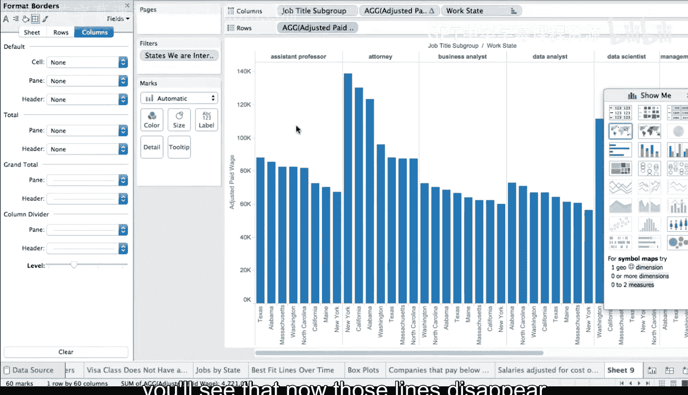

# 杜克大学《Excel 到 MySQL：商业分析（5课全）｜Excel to MySQL： Analytic Techniques for Business》中英 p109 34_04_01_计算各职业子类别中调整后薪资最高的州.zh_en -BV1mS421X7yw_p109-

In this lesson， we are going to learn how to use table calculations to figure out which states across the country have the highest salaries for different data related jobs once you take cost of living into account。

This is going to be a little bit of a complex topic， but we're going take it piece by piece。

 So stick with me。 I know you're going get it。 And once you do。

 you'll see how powerful Tableau can be。 and will' set you up well for making dashboards later on down the line。

So why don't you open up Tau again and open up a brand new worksheet that's clear。

And before we get started， I just want to make sure that we are on the same page and really understand how these blended fields work。

 so to do that， let me just show you if I put paid wage per year in rows。

 you see I get a column of data here， so this is the median page per paid wage per year of the entire data set。

If I do that same thing with our adjusted paid wage calculation。I don't get any data。

Do you have any idea why that is。The reason why is because this calculation requires a state level aggregation。

 and right now there's nothing in the workspace to be able to aggregate the data that way。

 the raw data that way， so there's no data here for the calculation to work with if we put work state in the columns。

nNow we see our data。However， there is another thing we can point out here。

 and thus that there seem to be some empty。data points。Any idea why that's the case。

The reason why is that when we bnted our data sources。

 Tableau treated the salary dataset set as the primary data source。

 So anything that is in the salary dataset set， but not in the price parity dataset set will end up in this calculated field as no values。

All of these US territories were in the salary data set。

 but were not one of the 51 rows in the price parity data set。

 So that's why they don't have any data in them。And to be clear。

 we would not be able to look at the results of this calculated field in any of those parts of the country that are not in the price parity dataset set。

 Our strategy for addressing our question is going to be to try to order。

All of the states within a job title subgroup， according to their adjusted paid wage。

 so let's get our visualization set up so that we can start to do that。

 Let's take job title subgroup and actually before we do that to make our lives a little easier to make this computationally less intensive。

 Let's start by filtering our data based on just the states that we were interested in。Eventually。

 we'll open this up again， but this will make it easier for us to understand the calculations we're doing。

ok。So now let's look at， let's put our job title subgroup in front of。Work state。

 And this is similar to a visualization we saw a bunch of lessons ago。 Now， if you remember。

What when we try to sort these。It didn't seem TL didn't seem to sort the data within each subcategory。

 instead it seemed to be sorting in some way across the entire table。

And the way I said that should give you an idea of why table calculations might be useful here。

 Basically， tableableau doesn't have any way to sort based on the stuff that's inside the visualization。

 We have to make a calculation to tell it what's inside the visualization。

 or what's inside the workspace and then tell it what to do with those fields that are in the workspace。

 So our goal is going to be to make a calculated field that's going to have a rank of the work state。

As it relates to job title subgroup and the only way we can do that again。

 is by having job title subgroup and workt in our workspace already to do this every time you make a calculation within the workspace。

 it will actually take the variable you're working with and just turn it into the calculation。

 So if you want to keep the data in the workspace， you actually have to copy the copy the pill and then make the calculation on that duplicated pill。

 So to do that， you can press the Apple key or control and bring the pill over to the detail。

 And you can see it just duplicated the adjusted paid wage pill that we had here。 So now on this one。

 I want you to right click and go to add table calculation。

And you'll see that it gives you a bunch of different calculation types and you can play around with all of these and you can look them up。

 we're going to use rank。Now we have a bunch of things we have to define here。

 the most important is going to be running along。You see through the drop down that it gives you lots of different options。

I'm going to give you some controversial advice here， but I'm going to stand by it。

 These different options in bold table across， pan across， pan across then down all the way to sell。

These are going to cause the calculation to hard code what it's aggregating over according to exactly what the visualization looks like right now this very second。

That is not a good thing you almost always change your visualizations and so you want it to be a little bit more flexible in that you want the calculation to be based on the variable rather than exactly what the variable looks like and exactly one orientation right now so I'm going to suggest that you never I actually think maybe someone will prove me wrong。

 but I actually may never use these options instead I would suggest that you always go to the advanced option and make sure that you choose exactly which categories you are going to order over。

Now in this field you have to define what you are going to partition over and what you're going to address the partition field tells you what you're going to use to group the calculation the addressing fields are the ones you're going to apply the calculation to so in our case we want to apply the ranking calculation to work state so we're going to keep put work state over here and job title subgroup here in partitioning。

Right now you can leave sort as automatic。And you have a choice between descending and sing。

 we're going to use descending because we want the highest paid wage。First。Okay。

 and just so you know， there are different ways to rank duplicate values。

 so if you had the exact same medium paid wage， you'd have to tell Tableau how to handle that。

You can use any of these you want， I'll go ahead and use the competition version。

 so that means that if second and third were tied， it would go1， two，2，4 rather than1，2，3，3。Okay。

 and press， okay。Now let's talk through again what this calculation is supposed to do。

 It's supposed to rank work state within the greater umbrella of job title subgroup。

So if you think about that visually， what you'd like to do is you'd like to put the ranking calculation right before the work state。

 which is what it's going to act upon so that it's under the greater umbrella of job title subgroup。

So I want you to go ahead and try to do that， go ahead and drag。The variable onto the shelf。

And this is a little bit of a trick because you'll see you can't do that actually。

 it'll let you put it at the end， but it won't let you put it in the middle or the top and that's because right now our calculated field table calculation specifically is treated as a measure because it's green。

And Tau needs it to be a dimension， and the reason why is kind of similar to the way dates worked when we treated them as measures or dimensions。

The rank needs to be able to start and stop all over again every time it goes to a different job title subgroup。

So it needs to be able to go one2，3，45，67，8910 and then jump again to  one2，3，45，67，8910。

It has a hard time doing that if it's supposed to be one continuous long string。

 so it needs to be able to jump around and that's what the treating as a dimension allows it to do。

 so if you change this calculation to a discrete variable now it will let you put it in the middle of your two other variables and you saw immediately that it ordered。

All of the states within a job title subgroup， according to their adjusted paid wage。

Now there are a couple things what I do to clean this up a little right now。

 these numbers represent the rank and so you can see that they are going in order and that the ranking is working。

If we you don't actually want to see that in most your visualization， so if you right click。You can。

It's always hard for me to get this thing。Right click and you see that show header has a check mark。

 uncheck that。So now those numbers disappear Another thing that you'll notice is because Tableau is partitioning the data and aggregating it for every state within each job title subgroup。

 Now they're all of these lines here and these lines are pretty ugly and they're pretty distracting so we can。

Format these lines by clicking right on the right clicking。

 going to format and then go to the border option。And I know this is a little bit weird。

 but what's the variable that's defining where those lines are right now are column divider。

 So if you bring level down one notch。You'll see that now those lines disappear。

 so this is a much cleaner visualization。

Nice job。 We're halfway there。 Now you have all the calculations you need to answer our data analysis question。

 The next video will actually answer the question。