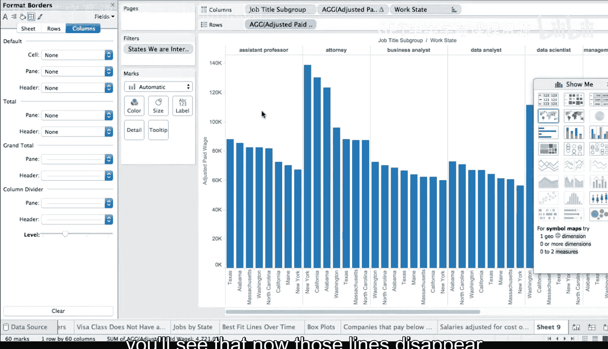

# Excel 到 MySQL：商业分析：5.4：计算各职业子类别中调整后薪资最高的州 📊

在本节课中，我们将学习如何使用 Tableau 的表格计算功能，在考虑生活成本后，找出全美范围内不同数据相关职业薪资最高的州。这是一个稍显复杂的主题，但我们会逐步分解，确保你能掌握。一旦理解，你将看到 Tableau 的强大之处，并为后续创建仪表板打下良好基础。

## 理解混合数据源与计算字段

在开始之前，我们需要确保理解混合字段的工作原理。

*   **原始年薪数据**：将 `paid wage per year` 放入行中，会得到整个数据集的年薪中位数。
*   **调整后年薪数据**：将我们创建的 `adjusted paid wage` 计算字段放入行中，则不会显示任何数据。

**原因**：`adjusted paid wage` 计算需要基于州级别进行聚合。当前工作区中没有提供州级别的维度，因此计算无法进行。

**解决方法**：将 `work state` 放入列中。现在，我们看到了按州划分的调整后年薪数据。

**注意**：数据中存在一些空值点。

**原因**：当我们混合数据源时，Tableau 将薪资数据集视为主数据源。任何存在于薪资数据集但不存在于价格平价数据集中的记录（例如美国的一些海外领土），在计算字段中都会显示为空值。因此，我们无法在价格平价数据集未覆盖的地区查看此计算字段的结果。

## 设定分析目标与可视化

我们的分析策略是：在每个 `job title subgroup`（职业子类别）内部，根据 `adjusted paid wage`（调整后年薪）对所有州进行排序。

为了简化计算并便于理解，我们先对数据进行筛选，仅关注我们感兴趣的州（后续可以再放开筛选）。

1.  将 `job title subgroup` 拖放到 `work state` 之前。这类似于我们之前课程中见过的可视化。
2.  回忆一下，如果我们尝试直接排序，Tableau 似乎无法在每个子类别内部进行排序，而是对整个表格进行某种全局排序。这正是表格计算可以发挥作用的地方。

## 创建排名计算字段

Tableau 无法直接基于可视化内部的内容进行排序。我们需要创建一个计算字段，告诉 Tableau 如何对工作区内的字段进行处理。

**目标**：创建一个计算字段，用于对 `work state` 在 `job title subgroup` 的范围内进行排名。

**关键步骤**：要在工作区内进行计算，同时保留原始数据，需要复制数据字段。

1.  按住 `Ctrl`（Windows）或 `Cmd`（Mac）键，将 `adjusted paid wage` 药丸拖拽到“标记”卡片的“详细信息”上。这会复制该字段。
2.  在复制出的新 `adjusted paid wage` 药丸上右键单击，选择“添加表计算”。
3.  在计算类型中选择“排名”。
4.  接下来进行关键配置：
    *   **计算依据**：不要选择加粗的选项（如表、穿过、穿过然后向下等），因为这些选项会根据当前可视化的具体布局进行硬编码，缺乏灵活性。建议点击“高级...”进行设置。
    *   **分区依据**：定义计算的分组。这里我们选择 `job title subgroup`。计算将在每个分组内独立进行。
    *   **寻址依据**：定义计算应用的对象。这里我们选择 `work state`。排名将应用于每个分组内的州。
    *   **排序顺序**：选择“降序”，因为我们希望薪资最高的排第一。
    *   **并列值处理**：可以选择如何处理并列排名。例如，选择“竞争”模式，则并列后的下一个名次会跳过并列数量（如：1, 2, 2, 4）。

点击“确定”完成设置。

## 调整可视化与格式

现在，这个排名计算字段（显示为绿色，被视为度量）需要被放置在正确的位置并调整为维度。

1.  **调整字段类型**：我们希望排名在每个 `job title subgroup` 内重新开始（1,2,3...），因此它需要是一个离散的维度，而不是连续的度量。将该计算字段从“度量”区域拖到“维度”区域，或右键单击选择“转换为离散”。
2.  **调整视图结构**：将排名字段拖放到列架上，置于 `job title subgroup` 和 `work state` 之间。你会立即看到，各州已在其职业子类别内按调整后年薪进行了排名。
3.  **隐藏排名标题**：排名数字本身可能不需要在最终视图中显示。右键单击列架上的排名字段，取消勾选“显示标题”。
4.  **美化视图**：由于 Tableau 在每个职业子类别内对州进行了分区和聚合，视图上会出现许多分隔线。为了视图更清晰：
    *   在视图空白处右键单击，选择“格式”。
    *   在格式边栏中，选择“边框”选项卡。
    *   将“列分隔符”的级别调低一档，这些分隔线就会消失。

## 总结

做得好！我们已经完成了一半的工作。本节课中，我们一起学习了：

1.  **理解了混合数据源中计算字段的依赖关系**，特别是聚合级别对计算结果的影响。
2.  **创建并配置了表格计算字段**，使用“排名”函数，并通过高级选项精确设置了分区依据（`job title subgroup`）和寻址依据（`work state`）。
3.  **掌握了调整字段类型（度量转维度）** 以符合计算逻辑的需求。
4.  **进行了视图格式优化**，包括隐藏计算字段标题和调整网格线，使可视化结果更加清晰美观。

现在，我们已经拥有了回答“各职业子类别中调整后薪资最高的州”这一问题所需的所有计算数据。下一节课，我们将利用这些结果来最终解答这个数据分析问题。