# 杜克大学《Excel 到 MySQL：商业分析（5课全）｜Excel to MySQL： Analytic Techniques for Business》中英 p11 11_02_04_盈利能力与效率指标：库存管理.zh_en -BV1mS421X7yw_p11-

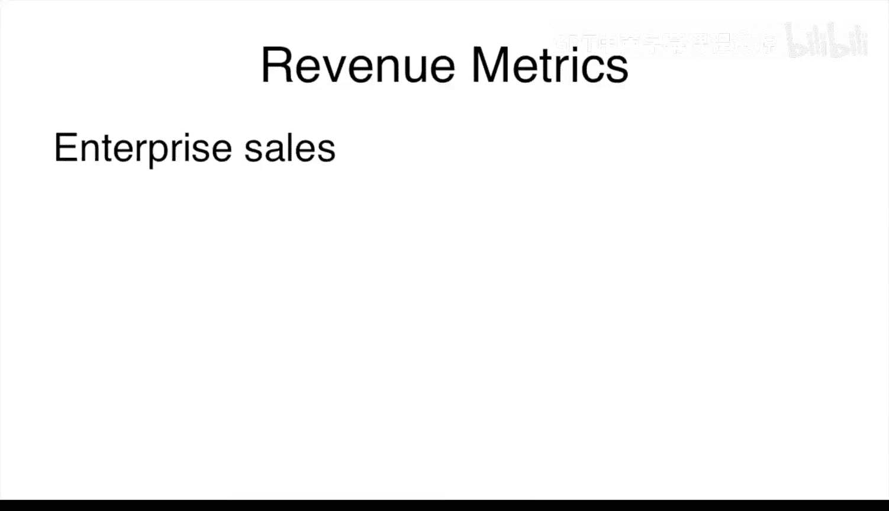

We've already identified some of the most important revenue business metrics。

 focusing on enterprise sales。Now we'll look at examples of profitability or efficiency metrics。

 focusing for now on metrics that are widely used to evaluate the efficiency of a company's inventory management。

And will let you in on the secret of how to pay the lowest possible price for a hotel room。

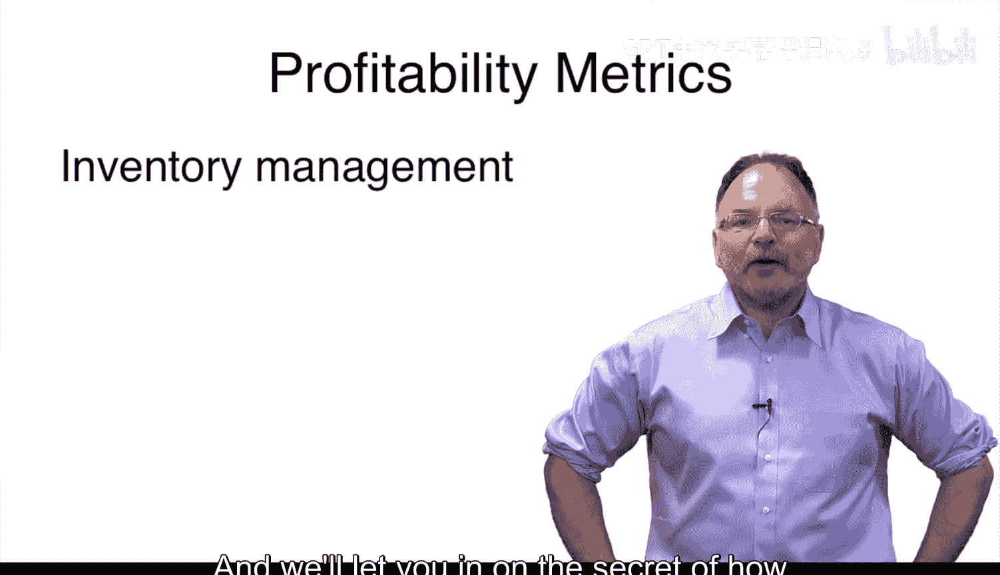

Why the focus on inventory management？Inventory management is one of the primary ways that operating companies can reduce their costs and maximize profitability without lowering the quality of what they sell in any way。

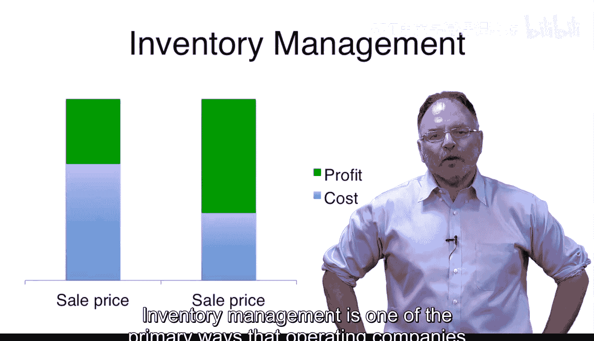

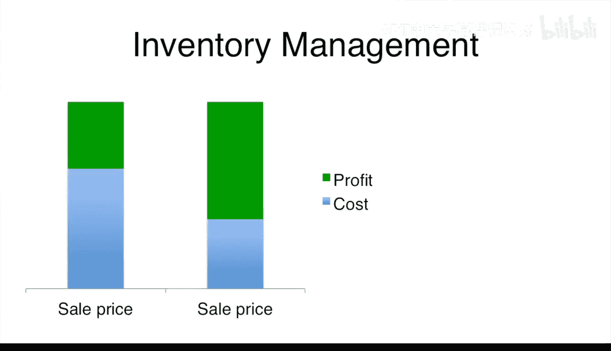

Let's define inventory。Inventory is typically a finished product waiting to be bought。

 typicallyy sitting on a shelf in a retail store or somewhere between the factory and the customer in a logistics warehouse。

The more time a product just lies around between being made and being sold。

 the less efficient for the manufacturer time spent in inventory erodes profits。

Here are the four main reason。That inventory time should be minimized。 First， negative float。

You should be familiar with this problem from the Eggs roast coffeeoffee case study。

 A manufacturer supplying a retailer typically will not get paid until the item is sold at retail。

 But the money its spent to make that product is already gone。

This negative float requires working capital， which also entails an interest expense。

 The longer the negative float in terms of time， the more interest you pay。

 If a company's credit is not good and the negative float increases unexpectedly。

 it could run out of cash waiting for its inventory to sell。

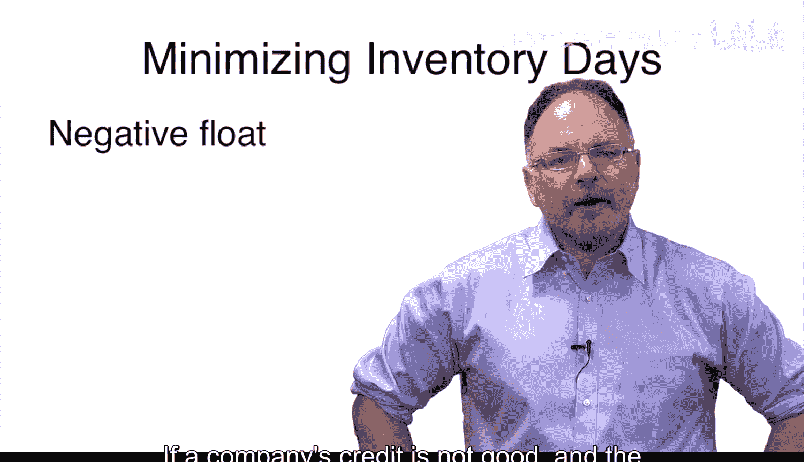

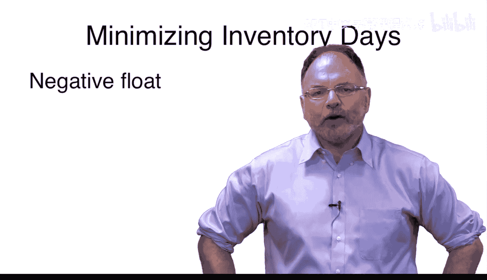

For example， retail clothing stores are especially vulnerable to being forced into bankruptcy due to cash flow problems caused by unsold inventory in their stores。

In the US。 three large retail chains， wet seal， cash。

 and simply fashion all declared bankruptcy just in the first six months of 2015。Second reason。

 fixed costs of storage。 It costs money every day to heat， light， air condition， pay renton， guard。

 and other ways maintain a warehouse or retail store。 The longer a product sits on a shelf。

 the more the cost of storage that need to be allocated to it。

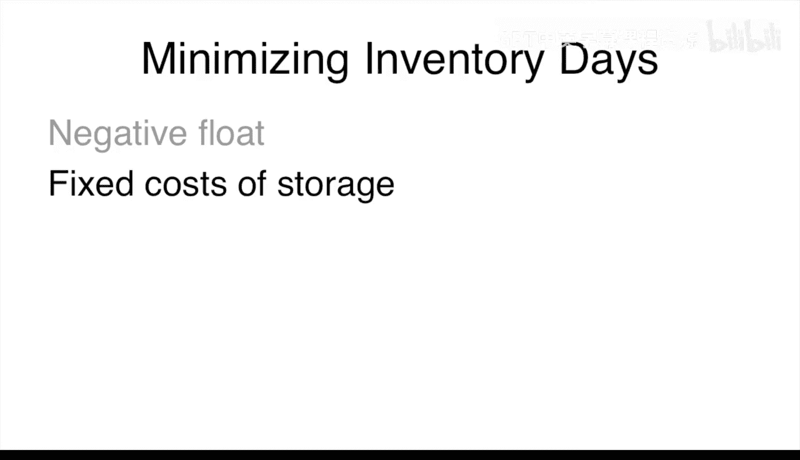

For example， assume that a furniture warehouse and showroom has fixed costs of $100，000 per year。

 and it has room to display 200 fully set up luxury dining room tables。

And these tables sell for an average price of $1200。

If the average inventory turnover were one time per year。

 that would mean that we would be selling 200 tables per year。

 and we would need to allocate the $100，000 across those $200 units or $500 in storage costs to every table。

 if the average inventory turnover were  five times per year。

 then we would only need to allocate $100 per table， which seems more reasonable。third is wastage。

 On average， inventory items lose value the longer that they are in inventory。

 Some inventory items are subject to complete wastage。

 Their value goes to 0 if they are not sold immediately。

 Consider fresh baked bread or restaurant food that must be sold on the day it is made。

Those are extreme examples where every unit of extra inventory not sold is a total loss。

Other examples of inventory wastage include any product with an expiration date in the US and other countries。

 many grocery items have a regulated sell by date after which they cannot legally be sold。

A special case of complete wastage that we will consider separately in a few minutes are hotel rooms and airline seats。

 if they are not sold by their quote unquote expiration date， their value as inventory goes to zero。

The fourth reason is obsolescence。Items that stay in inventory for six months or more may in reality。

 be items that no one wants to buy anymore ever。Maybe production of that item exceeded worldwide demand。

 or the product has become obsolete and been replaced by something better。

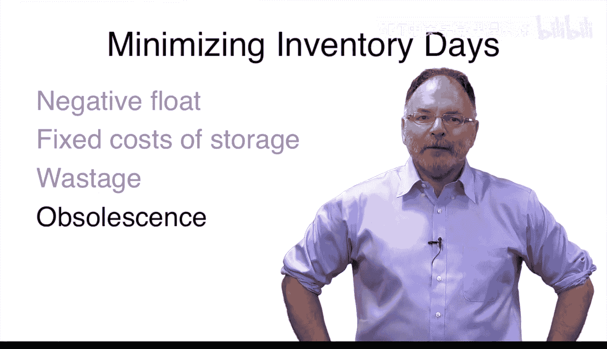

Or fashions have changed。 The longer an item is in inventory。

 The greater the risk it will ultimately need to be disposed of without a sale for a complete loss。

For these reasons， average number of days inventory is held abbreviated as。

Day's inventory is a very useful business metric to track。Now。

 not many companies are willing to make their day's inventory data public， however。

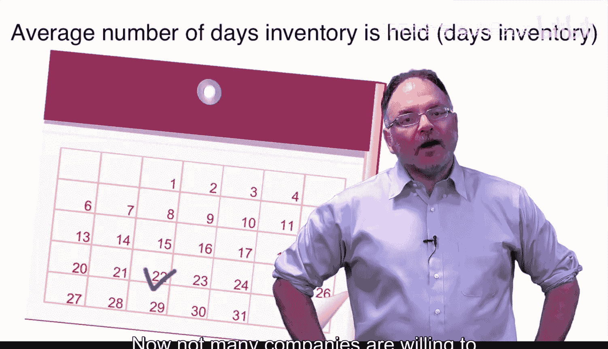

I will share with you a handy trick for estimating day's inventory for publicly traded companies based on numbers that they are required to include in their annual reports。

Public company annual reports will include the value of inventory on hand at the end of the year。

As well as the total annual cost of goods sold。Inventory on hand is valued using the same accounting method that is used to value cost of goods sold。

 so this is an apples to apples comparison。The company's inventory on hand at the end of the year。

Divided by the total annual cost of goods sold and then multiplied by 365 for days under the year is a very good estimate of average day's inventory。

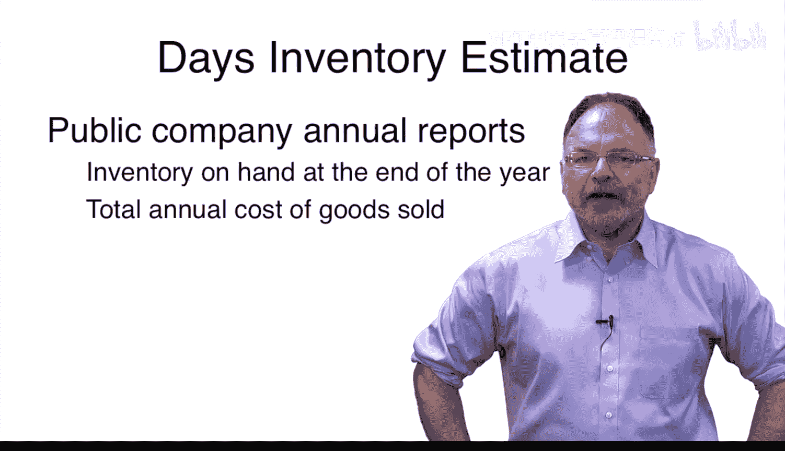

So we'll work an example for Walmart， courtesyofinveipedia。com。

 which is a great website with excellent glossary of business metrics。

For the fiscal year ended January 2014， the Walmart annual report gave year end inventory of 44。

9 billion。 an annual cost of goods sold of 358。1 billion。

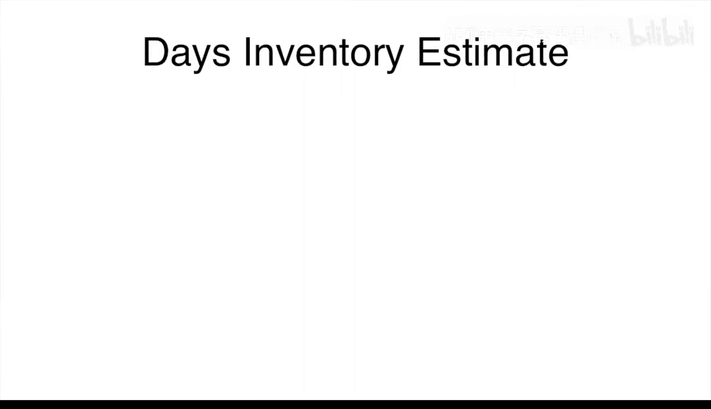

Walmart's estimated days inventory turnover for the year is simply 44。9 divided by 358。

1 or 18th times 365 or approximately 46 days。Walmart sells all its inventory on average within a 46 day period。

 which is quite impressive when you consider the number of slow selling items every Walmart needs to keep on hand。

A Walmart store typically has over 100，000 distinct product SkuUs on hand。

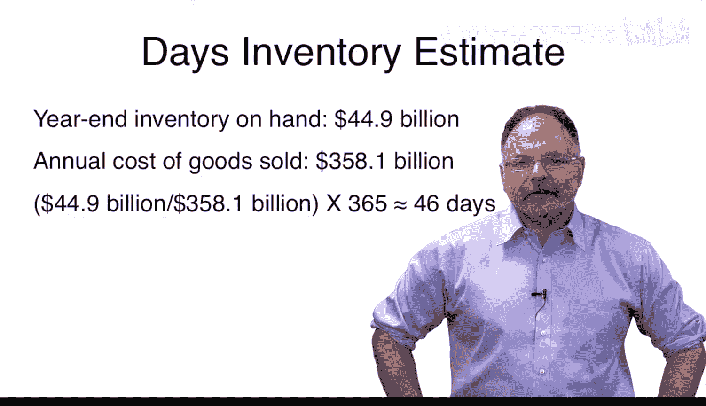

Soap。The day's inventory metric is great。But it does not tell us anything about which of our thousands or tens of thousands of items are not selling as quickly as expected and why。

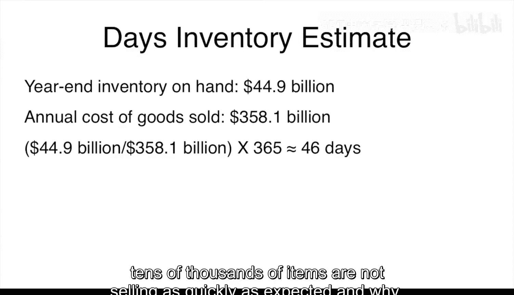

It could be that particular products are seasonal， are no longer in fashion are getting returned by customers as defective。

 these are all dynamic metrics that we want to know immediately。

All companies that have embraced big data culture， and this includes the major US retail grocery chain。

 such as Walmart， 711， Costco， et ceter， all track inventory turnaround and days inventory at the individual product SKU level。

And they further subdivide that analysis by geographic region of the country and even by individual store。

This is done by tracking the date and quantity when any item is reordered by local management and often also when the item is delivered and stocked on the shelf。

And that's compared against cash register sales data that identifies the exact time and SkuU for all sales。

So for example， if a store in North Carolina sells 50 snow shovels per year and all those sales are between December and March。

 it does not make sense for them to hold snow shovel inventory between April and November。

In a best practices system， each product SkuU has its own expected day's inventory。

 adjusted for region and a seasonal factors using a mathematical model that helps determine how much shelf space should be allocated to it Any time the actual day's inventory can be found to be different than what is expected。

That is a warning sign that needs to be looked at。Another issue is when you have too few of an item on the shelf。

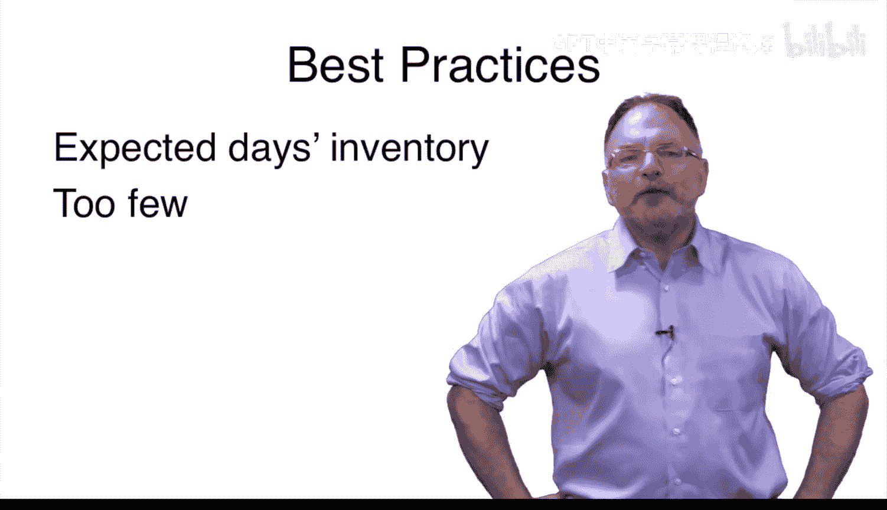

We can't measure directly how many times a potential customer went away unhappy and without buying anything because what they wanted was out of stock。

 but a good proxy for the empty handed lost customer metric。

Is the number of times inventory of any particular SKU reached to zero？

Having at least one of everything that you might be expected to sell on hand is highly desirable in terms of brand reputation。

As Bloomberg reporter Mehan McCarll stated in a 2013 article。

  Walmart has tried to cut the number of SkuUs it carries。

 but ended up having to put them back because it cost them in complaints and sales。

The higher the volume of unit sales of a product， the larger the potential lost revenue every time we see a zero level inventory。

It would be an excellent practice any time a potential customer is observed to walk out of a big box retailer empty handed to send a friendly marketing researcher after them with a $5 gift certificate in their hand。

 And the question， was there a particular product you were looking for that we didn't have on the shelf。

In fact， I noticed yesterday that in my local grocery store。

 which is part of a very large national chain， the staff are now trained to ask at checkout。

 was there anything you couldn't find today？I'm tempted to answer yes。

 emu eggs every single time in hopes that some data analyst will decide that they should stock Iu eggs。

 try it yourself。

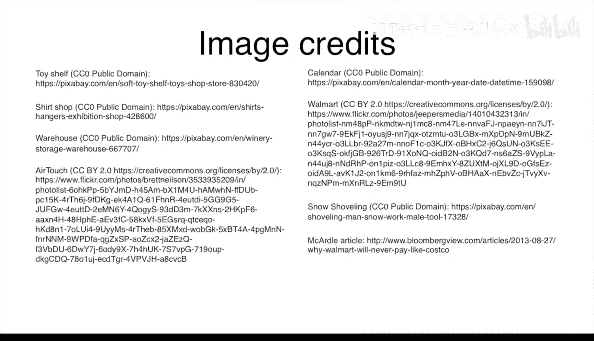